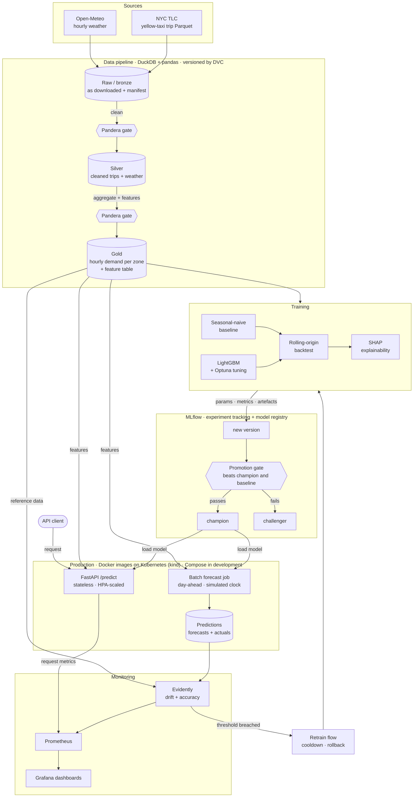
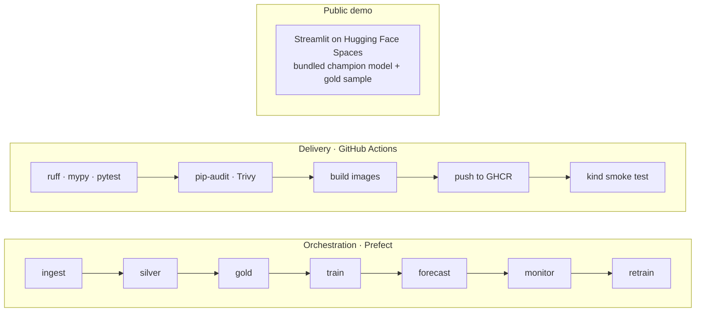

# Architecture

The system produces a **day-ahead forecast of hourly taxi pickups per NYC zone**. This page shows every tool in the stack and how data moves from ingestion to production.

## High-level flow

## Cross-cutting layers

## Stack by concern

| Concern | Tool | Where it appears |
|---|---|---|
| Data source | NYC TLC trip records, Open-Meteo | Sources |
| Processing | DuckDB, pandas | Data pipeline |
| Data validation | Pandera | Gates after silver and gold |
| Data versioning | DVC | Raw, silver and gold layers |
| Modelling | LightGBM, Optuna, SHAP | Training |
| Tracking and registry | MLflow | Registry, promotion gate |
| Orchestration | Prefect | Schedules every stage |
| Serving | FastAPI, Pydantic | Production |
| Monitoring | Evidently, Prometheus, Grafana | Monitoring |
| Packaging | Docker, Docker Compose | Production (development) |
| Deployment | Kubernetes (kind), Kustomize | Production |
| CI/CD | GitHub Actions, GHCR | Delivery |
| Demo | Streamlit, Hugging Face Spaces | Public demo |

## Design decisions

| Decision | Reason |
|---|---|
| **Day-ahead forecast, 48-hour horizon.** Every pickup feature is at least 48 h old. | The forecast for the whole of tomorrow is issued at 00:00 today. Its last hour, 23:00, is then 47 hours away, so nothing newer than 48 hours before each target hour may be used. |
| **Simulated clock.** Train on January to April 2025, replay May and June day by day as "production". | TLC publishes each month about two months late, so there is no live feed to monitor. |
| **Weather forecasts as features**, not observed weather. | Observed weather for a future hour is information the model would not have. |
| **One feature function** shared by training, batch forecasting and the API. | Removes training/serving skew. |
| **Zones chosen from the training period only**, then frozen in the config. | Picking them from the full dataset would leak the test period. |
| **Stateless API.** Forecasts and actuals are written by the batch job. | The API can scale to several replicas without file-write conflicts. |
| **Two monitors:** drift at once, accuracy when actuals arrive. | Ground truth is always late. |
| **Gated retraining** with cooldown and rollback. | An automatically retrained model must not replace a better one. |
| **DVC for the pipeline definition, Prefect for scheduling**, both calling the same functions. | Reproducibility in development, automation in production, no duplicated logic. |

## Contracts

- **Configuration:** `configs/config.yaml`, loaded by `src/demand/config.py`. Environment variables prefixed `DEMAND_` override any value.
- **Data:** column names and Pandera schemas for every layer live in `src/demand/schemas.py`.
- **Entry points:** `python -m demand <command>`, defined in `src/demand/cli.py`.
