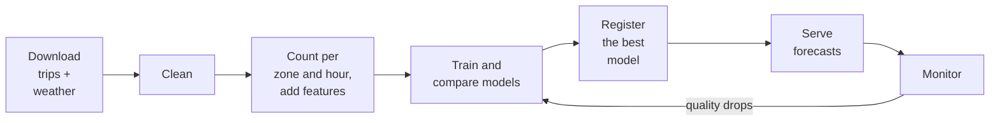

# Chapter 1 – What we are building

A taxi company has 500 drivers and must decide today where they should start work tomorrow. Send too few to the airport and passengers wait. Send too many and drivers sit idle. To decide well, the company needs a number: how many people will want a taxi in each area, in each hour of tomorrow. This project produces that number.

## What you will learn

- What the system predicts, and for whom.
- Why "the whole of tomorrow, one day early" is the most important fact about the project.
- The steps between a raw data file and a forecast that someone can use.
- What is in the repository today and what is still to come.

## The forecast

New York City is divided into taxi zones, each with a number. Zone 132, for example, is one of them. The system predicts, for each of 20 busy zones, how many yellow-taxi pickups will happen in each hour of the next day. One prediction answers one question of this form: "How many pickups in zone 132 between 18:00 and 19:00 tomorrow?"

Three words describe this kind of prediction, and you will see them through the whole book.

It is a **forecast**: a prediction about a future time, made from past data.

It is **hourly**: the unit of time is one hour, so one day needs 24 numbers per zone.

It is **day-ahead**: the 24 numbers of a day are produced together, on the day before. In this project they can be produced at 00:00, the first moment of the day before, so the user has a full day to act on them.

How far ahead a forecast must reach is called the **forecast horizon**. Here it is 48 hours, not 24. The reason is a small calculation. At 00:00 today, the newest pickups that exist are those of the hour that has just ended, 23:00 to 24:00 yesterday. The last hour of tomorrow starts at 23:00 tomorrow, which is 48 hours after 23:00 yesterday. So the forecast for the last hour of tomorrow must be made from pickups that are 48 hours older than that hour. Chapter 2 does this calculation slowly, with a table.

## Why the horizon comes first

The horizon is not a detail of the model. It comes from the user.

Think again about the taxi company. Drivers get their shifts the day before. A forecast that arrives one hour before the rush is correct and useless, because nobody can move 50 drivers across the city in an hour. The company needs the numbers for the whole of tomorrow during today. That need gives the horizon of 48 hours.

This one decision controls much of what follows. It decides which past data the model may use (Chapter 2). It decides how the model must be tested (Chapter 3). It is even written into the configuration file as a number that the program checks (Chapter 7). When you read any forecasting project, the first question to ask is: when is the prediction made, and what is known at that moment?

> [!IMPORTANT]
> A model is always built for a decision. Find out when the decision is made before you choose features. In this project the decision about a whole day is made on the day before, so no pickups newer than 48 hours before the forecast hour may be used.

## From a raw file to a served forecast

A trained model is a small part of a working system. Most of the work is around it: getting data, checking it, keeping the model up to date, and delivering its answers. The figure shows the path in this project.



*Figure 1.1 – The life of a forecast. The detailed diagram, with every tool, is in [architecture.md](../architecture.md).*

Each box is one step.

**Download.** The trip data comes from the NYC Taxi and Limousine Commission (TLC), which publishes one file per month. Each row is one taxi trip. The weather comes from Open-Meteo, a free weather service. The files are saved exactly as they arrive.

**Clean.** Real data contains errors. Some trips end before they start. Some have a distance of zero, or a date in the year 2090. These rows are removed, and each removal is counted.

**Count and add features.** The model does not predict single trips. It predicts counts. So the trips are counted per zone and per hour. Then the inputs of the model are added: for example, the count in the same zone at the same hour one week earlier. An input column of a model is called a **feature**.

**Train and compare.** Two models are trained. The first is a **baseline**, a very simple method that sets the minimum to beat: "the same as the same hour last week". The second is LightGBM, a model built from many decision trees. If LightGBM cannot beat the baseline, it has no value.

**Register.** The trained model is stored in a **model registry**, a place that keeps every version of a model with a label. The model in use is labelled the **champion**. A new model is a **challenger**. It replaces the champion only if it is measurably better.

**Serve.** There are two ways to deliver forecasts. A web service answers single requests. A scheduled job writes the complete forecast for the next day.

**Monitor.** The world changes: a new airport terminal opens, a strike happens, the weather is unusual. The system compares new data with the data the model was trained on, and compares forecasts with what really happened. If the model gets worse, it is trained again.

## What exists today

The foundation exists, and the first three steps of the path: the download, the cleaning, and the counting per zone and hour with its features. Between the steps stand two quality gates that check the files, and one command, `dvc repro`, runs the steps and the gates in order (Chapters 20 and 21). The fourth step exists too: the baseline and a LightGBM model are scored on four past weeks, the parameters of the model were tuned, the model is fitted, explained and recorded, and it is registered as a numbered version (Chapters 22 to 28). A promotion gate decides which version gets the label champion, and a person can set it by hand for a rollback (Chapter 29). Nothing is served yet.

The foundation was built before any step of the pipeline. This order is deliberate. Every later step needs the same basic things: one place for settings, one definition of the column names, one way to start a command, one way to write a log line, and a way to test all of it. If these are built first, every later step uses them. If each step invents its own, they will not fit together.

So the repository contains the project packaging, the settings, the data contracts (rules that tables must satisfy), a command-line program, logging and tests. Part II of this book explains each of them. Part I, where you are now, explains the forecasting ideas that the foundation was designed around. Part III follows the pipeline step by step, starting with the download. Part IV follows the modelling, and Part V the prediction service.

## Try it yourself

Ask the program which commands it has.

```powershell
.venv\Scripts\python.exe -m demand --help
```

You should see a short description and a list of fifteen commands: `config`, `ingest`, `select-zones`, `silver`, `gold`, `validate`, `backtest`, `train`, `tune`, `promote`, `set-champion`, `forecast`, `monitor`, `retrain`, `serve`. Compare the list with Figure 1.1: almost every box has a command. This shows that the shape of the whole system was fixed before the steps were written. Twelve of them do real work today: `config`, `ingest`, `select-zones`, `silver`, `gold`, `validate`, `backtest`, `train`, `tune`, `promote`, `set-champion` and `serve`. The other three, `forecast`, `monitor` and `retrain`, answer with "Not implemented yet".

Now ask for the three dates that define the project.

```powershell
.venv\Scripts\python.exe -c "from demand.config import get_settings; d = get_settings().data; print(d.start_date, d.train_end_date, d.replay_start_date, d.end_date)"
```

You should see:

```text
2025-01-01 2025-04-30 2025-05-01 2025-06-30
```

The data covers January to June 2025. The model may learn from data up to 30 April. Chapter 3 explains what happens with May and June.

## Key takeaways

- The system forecasts hourly taxi pickups per zone. The numbers of a whole day are issued together, at 00:00 on the day before.
- The 48-hour horizon comes from the user's decision, and it limits which data the model may use.
- A model is one step in a longer path: download, clean, build features, train, register, serve, monitor.
- The foundation (settings, contracts, commands, tests) is built before the pipeline, so that all later steps share it.

## Exercises

**1.** A second customer wants to send extra taxis to a zone when it suddenly becomes busy. They can react within one hour. Is the day-ahead system in this project the right tool for them? What would be different in a system built for them?

<details>
<summary>Answer</summary>

No. Their decision is made one hour before, so their horizon is one hour. A system for them could use much newer data, such as the pickups of the last hour, and would be more accurate for that reason. It would also need a live data feed, which this project does not have. The same data and the same model type can give two very different systems when the horizon is different.

</details>

**2.** Why does the project train a "same hour last week" baseline when a much stronger model is planned?

<details>
<summary>Answer</summary>

Because an error number has no meaning alone. "An average error of 12 pickups" could be very good or very bad. The baseline gives a reference: if the simple rule has an error of 30, then 12 is a large improvement; if it has an error of 11, the complex model is not worth its cost. The baseline also protects against mistakes: a complex model that cannot beat it usually has a bug in its data.

</details>

**3.** Look at Figure 1.1. The arrow from "Monitor" goes back to "Train", not to "Download". What does that tell you about when the system retrains?

<details>
<summary>Answer</summary>

Retraining is a reaction to measured quality, not a routine that runs after every download. New data arrives regularly anyway. The model is trained again only when monitoring shows that it has become worse, and even then the new model must beat the current champion before it is used.

</details>

---

[Contents](README.md) | [Next: Chapter 2 – Forecasting without cheating](02-forecasting-without-cheating.md)
