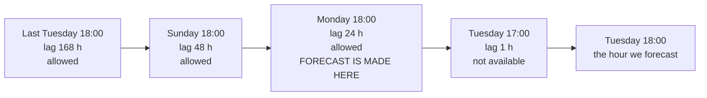

# Chapter 2 – Forecasting without cheating

Your model scores very well in the notebook. You deploy it on Monday, and by Tuesday the forecasts are clearly worse than the notebook promised. Nothing crashed and the code is the same. What happened? In most cases the model was using, during training, information that does not exist at the moment a real forecast is made. This chapter shows how that happens and how this project prevents it.

## What you will learn

- What a lag feature is and why it is the most useful input in demand forecasting.
- Why a lag of one hour is impossible for a day-ahead forecast.
- What data leakage is, and why it gives no error message.
- Three leaks that the plan for this project found, and the decision made for each.

## The most useful feature: the past

Taxi demand repeats. Monday at 18:00 looks like last Monday at 18:00. Tuesday at 18:00 looks a lot like Monday at 18:00. So the best predictor of demand is earlier demand.

A **lag feature** is a past value of the thing you predict, used as an input. The thing you predict is called the **target**; here it is the number of pickups. "Lag 24 hours" for Tuesday 18:00 is the number of pickups in the same zone on Monday 18:00. "Lag 168 hours" is the same hour one week earlier, because a week has 168 hours.

In pandas a lag is one line: `df["pickups"].shift(24)` on an hourly table moves every value 24 rows down. This is so easy that it is dangerous, as the next section shows.

## Why "one hour ago" is impossible

Suppose you want the best possible model. You try `shift(1)`: the pickups one hour earlier. The error drops a lot. Demand at 18:00 is very close to demand at 17:00, so the model learns to copy it.

Now use the model for real. The forecast for Tuesday 18:00 must be ready on Monday at 18:00 at the latest, because the horizon is 24 hours. The feature needs the pickups of Tuesday 17:00. On Monday, Tuesday 17:00 has not happened.

In the notebook the value existed, because the historical table contains every hour. In real use it does not exist. The figure shows which values are available.



*Figure 2.1 – Time runs from left to right. Everything up to the moment the forecast is made can be used. Everything after it is the future.*

This gives the rule that the whole project follows:

> [!IMPORTANT]
> Every feature for hour *t* may use only information from *t* − 24 hours or earlier.

The configured lags are 24, 48 and 168 hours. You can read them in [`configs/config.yaml`](../../configs/config.yaml):

```yaml
features:
  horizon_hours: 24
  lags: [24, 48, 168]
  rolling_windows: [24, 168]
  outlier_zscore: 4.0
```

The line `rolling_windows` describes **rolling statistics**: a summary, such as the mean, over a moving window of hours. "The mean of the last 24 hours" has the same problem as a short lag, because its newest hours are too recent. The plan is to compute these windows so that they end 24 hours before the target hour.

## Data leakage

The general name for this problem is **data leakage**: the model is trained or tested with information that will not be available when it is really used.

Leakage has one property that makes it worse than a normal bug: it produces no error. The program runs. The score is good, in fact better than it should be. A model with a leak always looks better in testing than it performs in use. So a surprisingly good result is a reason to search for a leak, not a reason to celebrate.

> [!WARNING]
> If a simple change makes the error drop by a large amount, first ask: "Would I have this information at prediction time?" Most large and easy improvements in forecasting are leaks.

The lag case is the best-known leak. The plan for this project found two more, and both are easy to miss.

## A second leak: weather

Rain increases taxi demand, so weather is a useful feature. A weather service gives two kinds of data for any past hour. **Observed weather** is what really happened. A **weather forecast** is what was predicted before it happened.

For training, observed weather looks like the natural choice: it is the truth. But think about real use. On Monday you forecast Tuesday 18:00. You do not know the real rain of Tuesday 18:00. You only have the weather forecast for it, and weather forecasts are sometimes wrong.

A model trained on observed weather learns that the weather column is always correct, so it trusts it strongly. In real use it receives forecasts with errors, trusts them just as strongly, and makes mistakes that it never made in testing.

The decision: train on archived weather *forecasts*, which is what the model will receive in real use. The config file has two addresses for this reason.

```yaml
  weather:
    latitude: 40.7128
    longitude: -74.0060
    forecast_url: "https://historical-forecast-api.open-meteo.com/v1/forecast"
    archive_url: "https://archive-api.open-meteo.com/v1/archive"
```

The first address returns past forecasts. The second returns observed weather and is only a fallback. If the forecast service fails or its answer is incomplete, the download uses observed weather and records that fact next to the file. A limitation that is written down is acceptable. One that is hidden is a leak. Chapter 15 shows the code.

## A third leak: choosing the zones

The project forecasts only the 20 busiest zones. Which are they? The obvious method is to count the pickups per zone over all six months and take the top 20.

This also leaks, and no feature is involved. The six months include May and June, which are kept for testing. If a zone became busy only in June, it enters the list because of data the model is not allowed to see. The choice itself carries information from the future into the project.

The decision: the zones are chosen from the training months only, then written into the config file as a fixed list that is never calculated again. At the moment the list is empty, because the selection needs cleaned data and that step of the pipeline is not built yet:

```yaml
  n_zones: 20
  # Frozen list of pickup zone IDs, chosen from the training period only.
  # Empty until `python -m demand select-zones` has been run and its output pasted here.
  zones: []
```

The lesson is wider than zones. Any decision made by looking at data can leak: which rows count as outliers, how to fill gaps, which columns to keep. If the decision looked at the test period, the test is no longer clean.

## Rules that the program enforces

Knowing these rules is not enough. Six months from now someone will try a lag of one hour, see a better score, and keep it. That person may be you.

So this project puts the most important rule into code. When the program starts, it compares every lag with the horizon and refuses to run if a lag is too short. Chapter 7 walks through that code. You can already see it work.

## Try it yourself

Read the lags that the program uses.

```powershell
(.venv\Scripts\python.exe -m demand config | ConvertFrom-Json).features.lags
```

You should see `24`, `48` and `168` on three lines. This proves the values come from the config file, not from a number written inside the code.

Now try to add a lag of one hour. The line below sets an **environment variable**, a named value that the shell gives to the program. Chapter 7 explains how this replaces the value from the file.

```powershell
$env:DEMAND_FEATURES__LAGS = "[1, 24]"
.venv\Scripts\python.exe -m demand config
Remove-Item Env:DEMAND_FEATURES__LAGS
```

You should see a long error report. Near the end it says:

```text
Value error, features.lags [1] are shorter than the 24 h forecast horizon and
would leak information unavailable at prediction time
```

No configuration is printed. This proves that a leaking lag cannot be configured: the program stops before any work starts. The last line removes the variable so that later commands behave normally.

## Key takeaways

- A lag feature is a past value of the target. It is powerful and easy to compute wrongly.
- For a 24-hour horizon, no feature may use anything newer than 24 hours before the target hour.
- Leakage gives no error. Its only sign is a result that is too good.
- Observed weather is a leak when the real system will only have a weather forecast.
- Decisions made from data, such as which zones to keep, must use the training period only.
- A rule that the program checks is safer than a rule that people must remember.

## Exercises

**1.** A colleague suggests the feature "average pickups in this zone over the whole dataset". It uses no lag. Does it leak?

<details>
<summary>Answer</summary>

Yes. "The whole dataset" includes the test months, so the average contains future information for every training row. The clean version is the average over the training period only, computed once and then reused. This is the same problem as the zone selection.

</details>

**2.** The horizon is 24 hours. Is a lag of 25 hours allowed? Would it be useful?

<details>
<summary>Answer</summary>

It is allowed: 25 hours before the target hour is known when the forecast is made. It is probably less useful than 24, because it is a different hour of the day, and demand depends strongly on the hour. The check only refuses lags that are impossible. It does not decide which legal lags are good; that is a modelling question, answered by testing.

</details>

**3.** Imagine that weather forecasts were always perfect. Would using observed weather for training still be a leak?

<details>
<summary>Answer</summary>

No. Leakage means a difference between what the model sees in training and what it will have in use. If forecasts were perfect, the two would be the same numbers. The leak exists because forecasts contain errors and observations do not. This shows that leakage is not about the type of data but about its availability at prediction time.

</details>

**4. Interview question.** "How do you prevent data leakage in a forecasting project?"

<details>
<summary>Points of a good answer</summary>

- Start from the horizon: say when the forecast is made and what is known then.
- Give concrete cases: lags shorter than the horizon; observed weather used where only a forecast would exist; selections such as "top zones" calculated on all the data.
- Say that you enforce the rule and do not only know it: a check at start-up that rejects short lags, a split by time, and a test that no feature for hour *t* uses data newer than *t* − 24 hours.
- Name the warning sign: a model that is much better offline than in real use.

</details>

---

[Previous: Chapter 1 – What we are building](01-what-we-are-building.md) | [Contents](README.md) | [Next: Chapter 3 – Testing a forecast honestly](03-testing-a-forecast-honestly.md)
