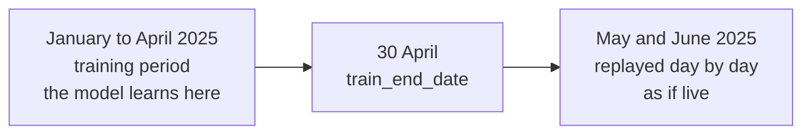

# Chapter 3 – Testing a forecast honestly

In most courses you test a model with one line: `train_test_split(X, y, test_size=0.2)`. It puts a random 20% of the rows aside, and you measure the error on them. For a table of house prices this is correct. For taxi demand per hour it gives a number that is too good, and this chapter explains why and what to do in its place.

## What you will learn

- Why a random split is wrong for data that is ordered in time.
- How a time-based split works and where this project puts the dividing date.
- What a rolling-origin backtest is and why one test period is not enough.
- What the simulated clock is, and why it is an honest answer to a real limitation.
- Why accuracy can never be measured immediately.

## What a test is for

A test must answer one question: how good will the model be when it is really used? So the test must look like real use. In real use, the model is trained on the past and asked about the future. A good test repeats that situation.

## Why a random split is wrong here

A **random split** puts each row into the training set or the test set by chance. With hourly data the result looks like the first row of the figure.

```text
Hour of Tuesday    14  15  16  17  18  19  20  21  22  23
Random split        T   T   ?   T   ?   T   T   ?   T   T
Time-based split    T   T   T   T   T   T   ?   ?   ?   ?

T = used for training      ? = used for testing
```

*Figure 3.1 – The same ten hours, split in two ways.*

Look at 18:00 in the random split. The model must predict it, and it was trained on 17:00 and 19:00 of the same day. Demand changes smoothly, so the answer is roughly the middle of its two neighbours. The model does not need to understand demand. It only needs to fill a small hole between two known values.

In real use there is no 19:00 to help. Everything after the present moment is unknown. The random split tests an easier task than the real one, so its score is too good. This is another form of the leakage from Chapter 2: the future is in the training set.

> [!WARNING]
> Never use a random split, or ordinary shuffled cross-validation, on data where the order in time matters. The score will be better than the truth.

## The time-based split

A **time-based split** chooses one date. Everything before it is for training, everything after it is for testing. This is the second row of Figure 3.1. The test now has the same shape as real use: learn from the past, predict what comes after.

In this project the date is in [`configs/config.yaml`](../../configs/config.yaml):

```yaml
  start_month: "2025-01"
  end_month: "2025-06"
  # Last day the model is allowed to learn from. Everything after it is replayed
  # as "production" by the simulated clock.
  train_end_date: 2025-04-30
```

January to April are the training period. May and June are never used for learning. The comment mentions a "simulated clock", which this chapter explains below.

## One split is one opinion: the backtest

Suppose you test on one week and the error is low. Was the model good, or was it an easy week? One test period gives one number, and one number can be lucky.

A **backtest** tests a forecasting model on the past as if you had used it then. A **rolling-origin backtest** does this several times. You train up to a date, test on the days after it, then move the date forward and repeat. Each repetition is called a **fold**.

```text
                    January      February      March         April
Fold 1   train  ##########################  test ====
Fold 2   train  ################################  test ====
Fold 3   train  ######################################  test ====
Fold 4   train  ############################################  test ====
```

*Figure 3.2 – A rolling-origin backtest with four folds. The exact dates are set by the modelling code in Phase 2; the picture shows the idea.*

The config sets the numbers:

```yaml
backtest:
  n_folds: 4
  fold_days: 7
```

Four folds of seven days give four errors. Their average is a more reliable estimate than any single one. Their spread is also useful: if the model is good in three folds and bad in one, you want to know what was special about that week.

Every fold stays inside the training period. May and June are still not touched.

## The problem of no live data

A production system should be monitored: is the incoming data still normal, and are the forecasts still accurate? To show this, the project needs data that "arrives" over time.

It does not have any. TLC publishes each month about two months late. There is no live feed of taxi trips. A dashboard labelled "real-time" would be fake.

## The simulated clock

The solution is a **simulated clock**: historical data that the model has never seen is replayed one day at a time, as if it were happening now.



*Figure 3.3 – The two periods of the project.*

Each simulated day works like this. The clock says "today is 9 May". The forecast job writes the forecast for 10 May, using only data up to 9 May. Then the clock moves to 10 May. Later, the real pickups of 10 May "arrive", and the forecast can be compared with them.

The first replayed day is calculated in the code, not written a second time. This is a property of the data settings in [`src/demand/config.py`](../../src/demand/config.py):

```python
    @property
    def replay_start_date(self) -> date:
        """First day replayed as "production" by the simulated clock."""
        return self.train_end_date + timedelta(days=1)
```

Line by line: `@property` makes this a value you read like a field, without brackets. The function takes the last training day and adds one day. So if someone changes `train_end_date`, the replay start moves with it. The two dates cannot disagree, because only one of them is stored.

## Why this is honest

A simulation can be used to mislead. This one is honest for three reasons.

First, the model never learns from May and June. The errors measured during the replay are real results on unseen data.

Second, the delay of the truth is simulated too, and the next section explains why that matters.

Third, the project says openly that the clock is simulated. The alternative was to present the dashboards as live monitoring and hope nobody asks. An interviewer who knows the TLC data will ask.

## The truth arrives late

The **ground truth** is the real value that a prediction tried to match. The real values are also called **actuals**. In forecasting the ground truth is always late: the forecast for tomorrow can only be checked after tomorrow.

So accuracy cannot be the only thing a system watches. If the data changes on Monday, the errors appear days later. The plan uses two kinds of monitoring.

**Drift** is a change in the data compared with the training period. For example, the temperatures this week are far outside anything in the training data. Drift can be measured immediately, because it needs only the inputs.

**Accuracy** is the comparison between forecast and actual. It is the real measure, but it is available only after the actuals arrive.

Drift is an early warning and accuracy is the proof. The table for stored forecasts already has a place for the late value: its `actual` column is allowed to be empty. Chapter 8 shows that line.

## Try it yourself

Print the dates that define the two periods.

```powershell
.venv\Scripts\python.exe -c "from demand.config import get_settings; d = get_settings().data; print(d.start_date, d.train_end_date, d.replay_start_date, d.end_date)"
```

You should see:

```text
2025-01-01 2025-04-30 2025-05-01 2025-06-30
```

The third date, 1 May, is not written in any file. It was calculated from the second. This proves the replay start follows the training end automatically.

Now run the test that checks these values.

```powershell
.venv\Scripts\python.exe -m pytest tests/unit/test_config.py -q -k "months_cover"
```

You should see `1 passed, 15 deselected`. The option `-k` selects tests by a part of their name. Open `tests/unit/test_config.py` and read `test_months_cover_the_configured_period`: it states the four dates as facts that must stay true.

## Key takeaways

- A test must look like real use: train on the past, predict what comes after.
- A random split lets the model fill holes between known hours, so its score is too good.
- A time-based split uses one date. Here it is 30 April 2025.
- A rolling-origin backtest repeats the test over several periods and gives a more reliable average.
- The simulated clock replays unseen months day by day, because no live data exists. It is stated openly.
- Ground truth is late, so drift is watched as an early warning and accuracy as the proof.

## Exercises

**1.** A model has an error of 8 pickups with a random split and 13 with a time-based split on the same data. Which number do you report, and what explains the difference?

<details>
<summary>Answer</summary>

Report 13. It comes from a test that looks like real use. The 8 is too good because, in the random split, the model was trained on hours directly before and after each test hour and could estimate the value between them. The difference of 5 is not a measure of model quality. It is the size of the leak.

</details>

**2.** In Figure 3.2 every fold trains from January. Another design always trains on the last 60 days only. Give one reason for each design.

<details>
<summary>Answer</summary>

Training from the start uses the most data, which helps when patterns are stable and data is limited, as with four months. A fixed window of recent days forgets old data, which helps when the world changes and old patterns would mislead the model. Neither is always right. The backtest is the tool that tells you which works better for your data.

</details>

**3.** During the replay, the drift monitor reports nothing unusual for a week, but the accuracy monitor shows the error getting worse. What could explain this?

<details>
<summary>Answer</summary>

The inputs look the same as in training, but the relation between inputs and demand has changed. For example, a competing service starts in a zone: the weather, the calendar and last week's demand all look normal, and fewer people take taxis. Drift monitoring watches the inputs only, so it cannot see this. That is why accuracy must be monitored too, although it arrives late.

</details>

**4. Interview question.** "Your taxi data is two months old. How can you claim to monitor the model?"

<details>
<summary>Points of a good answer</summary>

- Say directly that there is no live feed and that monitoring is shown with a simulated clock.
- Explain the design: train on January to April, replay May and June one day at a time, forecast each next day with data up to the current simulated day only.
- Explain why the numbers are still real: the replay months were never used for training.
- Mention that the delay of the actual values is also simulated, which is why drift and accuracy are monitored separately.

</details>

---

[Previous: Chapter 2 – Forecasting without cheating](02-forecasting-without-cheating.md) | [Contents](README.md) | [Next: Chapter 4 – Data in layers, features in one place](04-data-in-layers.md)
