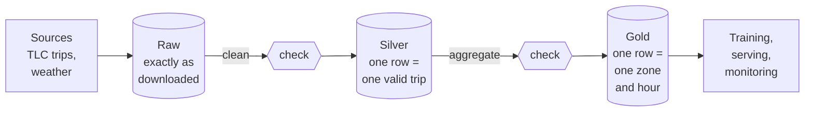

# Chapter 4 – Data in layers, features in one place

You open a project from last year. There is one script, `prepare_data.py`, 600 lines long. It downloads, filters, joins, fills gaps and builds features, and writes one file at the end. A number in that file looks wrong. Where do you start looking? This chapter describes a way to organise data so that this question has a short answer, and a way to organise features so that the model receives the same inputs in training and in use.

## What you will learn

- What the raw, silver and gold layers contain.
- Why each layer is built only from the layer before it.
- Where a quality check belongs.
- What training/serving skew is, and how one shared definition prevents it.

## Three layers

The **medallion architecture** is a way to store data in layers, where each layer is cleaner and closer to its use than the one before. The usual names are bronze, silver and gold. This project calls the first layer **raw**.



*Figure 4.1 – The three layers. Data moves only from left to right, and passes a check before it enters silver and before it enters gold.*

The **raw layer** holds the files exactly as they were downloaded. Nothing is corrected and nothing is removed. Next to the files is a **manifest**, a small record of where each file came from, when it was downloaded, how many rows it has, and its **checksum**. A checksum is a short code calculated from the content of a file; if one byte changes, the code changes. Raw data is **immutable**: once written, it is never modified.

The **silver layer** holds cleaned data. Each row is one valid trip, or one hour of weather. Duplicates are gone, impossible trips are gone, and every column has a fixed type and a fixed timezone. Silver still has the detail of the source: one row per trip.

The **gold layer** holds data in the form its users need. Here that is one row per zone and hour, with the number of pickups, and then the complete table of model inputs. Training, serving and monitoring all read gold.

The folder of each layer is defined once, in [`src/demand/config.py`](../../src/demand/config.py):

```python
    @property
    def raw(self) -> Path:
        """Raw (bronze) layer: files exactly as downloaded."""
        return self.data_dir / "raw"

    @property
    def silver(self) -> Path:
        """Silver layer: cleaned, typed, de-duplicated tables."""
        return self.data_dir / "silver"
```

There are two more properties of the same form, `gold` and `predictions`. Each takes the base folder `data_dir` and adds a name with the `/` operator of `pathlib`, which joins paths correctly on Windows and Linux. Code that needs the silver folder asks for `settings.paths.silver`. It never writes the text `"data/silver"`. If the data must move to another disk, one value changes.

## The rule: only from the layer before

Each layer is built only from the layer directly before it. Gold is built from silver. Gold never reads a raw file.

This is a restriction, and it has a cost: sometimes going straight to the raw file would be quicker to write. There are three reasons to accept the cost.

**Every table has one origin.** Go back to the wrong number at the start of the chapter. With layers, the search is short. Is the number already wrong in silver? If not, the fault is in the step from silver to gold. If yes, look at raw: if raw is right, the fault is in cleaning. Each step is small and can be checked alone. This only works if gold has one source. If gold also read raw files, some rows would arrive without passing the cleaning rules, and you could not tell which.

**Rebuilding is safe.** Suppose you decide that trips longer than four hours are errors, where the limit was six. Because raw is never modified, you delete silver and gold and build them again. Nothing is downloaded again and nothing is lost. If a step had corrected the raw files in place, the original values would be gone.

**Checks have a fixed place.** In Figure 4.1 a check stands at the entrance of silver and of gold. If every table can only be reached through its entrance, nothing can go around the check. Chapter 8 explains what the checks are.

> [!NOTE]
> The layers cost disk space, because the data is stored three times in three forms. For this project that is six months of trips. In exchange, every question of the form "where did this value come from?" has a short answer.

## One long script, compared

The alternative is the 600-line script. It is faster to write on the first day. It loses on each point above: a wrong number can come from any of its lines, a change in one rule means running everything from the download again, and a check can only be placed at the very end, when the cause of a problem is far away.

## The same features, twice

Now a different problem, with the same solution: define a thing once.

The model is trained on features from the gold table. Later, to make a forecast, the same features must be built again for new hours. Often this is done by different code. The training features come from a notebook or an SQL query. The serving features are written weeks later, perhaps by another person, in the web service.

**Training/serving skew** is a difference between how features are calculated for training and how they are calculated for prediction.

Here is how it happens. The training code marks weekends with `dayofweek >= 5`, where Monday is 0, so Saturday and Sunday are marked. The service uses another library where Sunday is 0, and its author writes the same condition. Now Friday and Saturday are marked. The model receives a weekend signal on Friday and none on Sunday. Nothing crashes. No test of the model fails, because the model was tested with the training features. The forecasts for Fridays and Sundays are worse, and somebody may notice in a month.

> [!WARNING]
> Skew produces no error message. Like leakage, it shows only as forecasts that are worse than the tests promised.

The decision in this project: one feature function, used by training, by the batch forecast job and by the web service, and a test that checks that all three get identical output. The function itself arrives with the data pipeline. One part already exists: the list of model inputs has a single definition.

## Worked example: the list of model inputs

[`src/demand/schemas.py`](../../src/demand/schemas.py)

```python
def feature_columns(settings: Settings) -> list[str]:
    """Model input columns, in the exact order used for training and serving."""
    lags = [lag_column(lag) for lag in settings.features.lags]
    rolling = [
        column
        for window in settings.features.rolling_windows
        for column in (rolling_mean_column(window), rolling_std_column(window))
    ]
    return [ZONE_ID, *lags, *rolling, *CALENDAR_FEATURES, *settings.data.weather.variables]
```

The function takes the settings and returns a list of column names.

The line starting with `lags` builds one name for each configured lag. `lag_column(24)` returns the text `"lag_24h"`. With lags 24, 48 and 168 there are three names.

The lines starting with `rolling` build two names for each window: a mean and a standard deviation. With windows of 24 and 168 hours there are four names.

The last line puts everything in a fixed order: the zone, the lags, the rolling columns, five calendar columns, and the weather variables from the config.

Two things matter here. First, the order is part of the definition. Many models identify inputs by position. If training puts the temperature in column 14 and serving puts it in column 15, the model reads the wrong numbers and does not complain. Second, the list is calculated from the settings. If you add a lag of 336 hours to the config, the name `lag_336h` appears in this list everywhere at once: in training, in serving and in the data checks.

## Try it yourself

Print the model inputs.

```powershell
.venv\Scripts\python.exe -c "from demand.config import get_settings; from demand.schemas import feature_columns; print(feature_columns(get_settings()))"
```

You should see one list with 17 names:

```text
['zone_id', 'lag_24h', 'lag_48h', 'lag_168h', 'roll_mean_24h', 'roll_std_24h', 'roll_mean_168h', 'roll_std_168h', 'hour', 'day_of_week', 'month', 'is_weekend', 'is_holiday', 'temperature_2m', 'precipitation', 'snowfall', 'wind_speed_10m']
```

This proves the list is built from the config: three lags, two windows and four weather variables are all visible in it.

Print the layer folders.

```powershell
.venv\Scripts\python.exe -c "from demand.config import get_settings; p = get_settings().paths; print(p.raw, p.silver, p.gold, p.predictions)"
```

You should see `data\raw data\silver data\gold data\predictions`. Their locations were fixed before any of them existed, so every step agrees on them. The first folder, `data\raw`, is created and filled by the ingest stage (Chapters 14 and 15). The other three do not exist yet.

## Key takeaways

- Raw is the data as downloaded and is never changed. Silver is cleaned. Gold is in the form the model needs.
- A layer is built only from the layer before it, so every table has one origin and every check has a fixed place.
- Because raw is immutable, any later layer can be deleted and built again.
- Training/serving skew is a silent difference between the features used in training and in prediction.
- The defence against skew is a single definition. The list and the order of model inputs already have one.

## Exercises

**1.** A teammate wants the gold step to read one extra column directly from the raw files, because adding it to silver "is more work". What do you answer?

<details>
<summary>Answer</summary>

Add it to silver. If gold reads raw, that column arrives in gold without passing the cleaning rules or the silver check, and gold now has two origins. The next person who investigates a wrong value in gold will check silver, find nothing, and lose time. The extra work in silver is small and is done once.

</details>

**2.** Why must raw files never be corrected, even when a value is clearly wrong, such as a trip dated in the year 2090?

<details>
<summary>Answer</summary>

Because a correction is a decision, and decisions change. If you fix the raw file, the original value and the fact that you changed it are both lost. If you later learn that your rule was wrong, you cannot undo it without downloading again, and the source may have changed. Keeping raw untouched and putting every rule in the cleaning step means all decisions are visible in code and can be repeated.

</details>

**3.** The function `feature_columns` returns names in a fixed order, and a test checks the exact order. Why test the order and not only the set of names?

<details>
<summary>Answer</summary>

A model that reads inputs by position gives wrong results without an error if two columns change places. The set of names would be the same, so a test of the set would pass. Only a test of the exact order catches it. A change in order must be a deliberate change, made together with a new model.

</details>

---

[Previous: Chapter 3 – Testing a forecast honestly](03-testing-a-forecast-honestly.md) | [Contents](README.md) | [Next: Chapter 5 – Project layout and packaging](05-project-layout-and-packaging.md)
