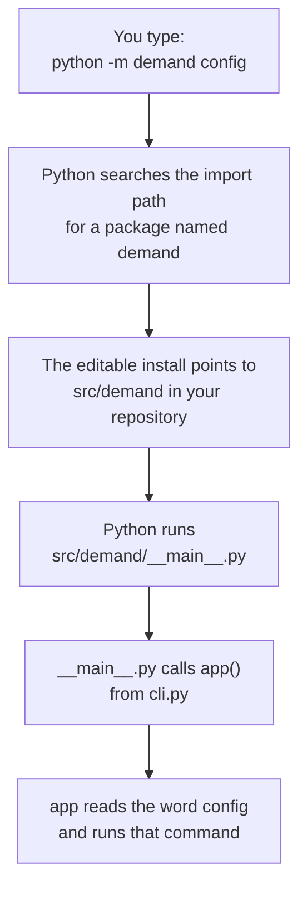

# Chapter 5 – Project layout and packaging

You write `from utils import clean` in a notebook and it works. You move the notebook into a subfolder and get `ModuleNotFoundError: No module named 'utils'`. You add `sys.path.append("..")` at the top and it works again, until a colleague runs it from another folder. This chapter explains why imports break like this and how a production project makes them work from everywhere.

## What you will learn

- How Python decides where to look when you write `import something`.
- What a package is and what it means to install your own code.
- Why the code of this project lives in a folder named `src/`.
- What an editable install is.
- Exactly why the command `python -m demand` works.

## How Python finds code

When Python sees `import demand`, it searches a list of folders, in order, for something named `demand`. The list is called the **import path**. It contains the folder of the script you started (or the current folder), and a folder named `site-packages`, where installed libraries such as pandas live.

This explains the problem at the start. `utils.py` was found because it happened to be in the same folder as the notebook. After the move, it was not on the list any more. The line `sys.path.append("..")` adds a folder to the list by hand, relative to wherever the program was started. It works from one place only.

The reliable fix is to stop depending on the current folder. pandas can be imported from any folder, because it is installed. Your own code can be installed too.

## Packages and installing

A **package** is a folder of Python files that can be imported by its name. The folder contains a file named `__init__.py`, which marks it as a package. The package of this project is named `demand`.

To **install** a package means to register it in an environment so that Python finds it from any folder. For this, the project needs a description: its name, its version and where its code is. That description is the file [`pyproject.toml`](../../pyproject.toml), the standard configuration file of a Python project. Chapter 6 covers the rest of that file. Here we need three small parts of it.

```toml
[build-system]
requires = ["hatchling>=1.24"]
build-backend = "hatchling.build"

[project]
name = "demand"
version = "0.1.0"
```

The first block names the **build backend**, the tool that turns a source folder into something that can be installed. This project uses one called hatchling. You do not call it yourself; `pip` calls it. The second block gives the package its name and version.

```toml
[tool.hatch.build.targets.wheel]
packages = ["src/demand"]
```

This block tells hatchling where the code is: in the folder `src/demand`.

## The layout of this repository

```text
nyc-taxi-demand-mlops/
├── pyproject.toml          project description and tool settings
├── requirements.lock       exact versions of all dependencies
├── dvc.yaml                the stages of the pipeline (Chapter 21)
├── dvc.lock                checksums of what the pipeline read and wrote
├── docker-compose.yml      the whole stack on one machine (Chapter 33)
├── .dockerignore           what an image build may see (Chapter 32)
├── configs/
│   └── config.yaml         all settings
├── docker/                 the Dockerfiles and one lock file per image (Chapter 32)
├── monitoring/             the settings of Prometheus and Grafana (Chapter 33)
├── src/
│   └── demand/             the package
│       ├── __init__.py
│       ├── __main__.py     runs when you type: python -m demand
│       ├── cli.py          the commands
│       ├── config.py       the settings object
│       ├── schemas.py      the data contracts
│       ├── logs.py         logging
│       ├── errors.py       failures that are reported in one line (Chapter 20)
│       ├── data/           the data pipeline (Part III)
│       ├── models/         the baseline, the backtest, the model and its training (Part IV)
│       ├── serving/        the prediction service (Part V)
│       ├── monitoring/     this and the next: empty until their part is built
│       └── flows/
├── tests/
│   ├── conftest.py
│   └── unit/
└── docs/
```

*Figure 5.1 – The main folders and files.*

Each file inside `demand` has one responsibility. Settings are in one file, contracts in another, commands in a third. The sub-folder `data` holds the pipeline of Part III, `models` holds the modelling code of Part IV, and `serving` the web service of Part V. The other two are empty packages that reserve a place for the later parts of the system. The folders `docker/` and `monitoring/` hold no Python: they describe how the code is packed into images and how the running service is watched.

## Why the code is inside `src/`

The package could be at the top: `nyc-taxi-demand-mlops/demand/`. That is called a flat layout. This project uses the **src layout**, where the package is one level down, inside `src/`.

The reason is a trap in the flat layout. Remember that Python searches the current folder first. With a flat layout, if you start Python in the repository root, `import demand` finds the folder directly, whether or not the package is installed correctly. Your tests pass. Then you build a Docker image, where the code is not in the current folder, and the import fails. The test said "works" for a reason that was true only on your machine.

With the src layout, the repository root has no folder named `demand`. The only way to import it is through a real installation. If the packaging is broken, you find out on your own machine at once.

> [!NOTE]
> The src layout makes one thing harder on purpose: importing the code without installing it. This is a common pattern in engineering. Remove the path that works by accident, so that only the correct path is left.

## The editable install

A normal install copies the code into `site-packages`. During development that would be annoying: after every edit you would have to install again.

An **editable install** does not copy. It leaves a small note in `site-packages` that says "the package `demand` is in this source folder". Python follows the note. Your edits take effect immediately. The command is `pip install -e .`, where `-e` means editable and `.` means "the project in this folder". The setup steps in the [project README](../../README.md) run it once.

## Worked example: what `python -m demand` does

The option `-m` tells Python: "find the package with this name and run it." To run a package, Python looks inside it for a file named `__main__.py` and executes that file. Here is the whole file.

[`src/demand/__main__.py`](../../src/demand/__main__.py)

```python
"""Allow ``python -m demand``."""

from demand.cli import app

if __name__ == "__main__":
    app()
```

The first line is a **docstring**, a text that documents the file.

The import line takes the object `app` from the file `cli.py`. This object is the command-line program with all its commands. Chapter 9 explains it.

The condition `if __name__ == "__main__":` is true when the file is executed directly and false when it is only imported. So the last line, `app()`, starts the program when you run the package and does nothing if another file imports this one.

The complete sequence is in the figure.



*Figure 5.2 – From the command you type to the code that runs.*

Without the editable install, step two fails with `No module named demand`. This is the first thing to check when that message appears.

There is also a second way to start the program. One more block in `pyproject.toml` asks for it:

```toml
[project.scripts]
demand = "demand.cli:app"
```

When the package is installed, this creates a small program named `demand` (on Windows the file is `.venv\Scripts\demand.exe`) that calls the same `app` object. This book uses `python -m demand` everywhere, because it shows clearly which Python is running.

## Try it yourself

Ask Python where it finds the package.

```powershell
.venv\Scripts\python.exe -c "import demand; print(demand.__file__)"
```

You should see a path that ends in `src\demand\__init__.py` inside your copy of the repository, for example `C:\nyc-taxi-demand-mlops\src\demand\__init__.py`. This proves that the import leads to your source files and not to a copy in `site-packages`.

Ask pip how the package is installed.

```powershell
.venv\Scripts\python.exe -m pip show demand
```

You should see `Name: demand`, `Version: 0.1.0`, and a line starting with `Editable project location:` followed by the path of your repository. That line is the "note" described above.

Start the program through the second entry point.

```powershell
.venv\Scripts\demand.exe config
```

You should see the same output as `python -m demand config`: the settings as text, beginning with `"project"`. This proves both ways lead to the same `app` object.

## Key takeaways

- Python finds code by searching a list of folders. Code that depends on the current folder works in one place only.
- Installing your own project as a package makes it importable from everywhere, in the same way as pandas.
- The src layout removes the accidental import from the repository root, so a broken installation is found early.
- An editable install points to your source folder, so edits are active without installing again.
- `python -m demand` finds the installed package and runs its `__main__.py`, which starts the command-line program.

## Exercises

**1.** A new colleague clones the repository, creates a virtual environment, installs the dependencies, and runs `python -m demand --help`. The answer is `No module named demand`. Which step did they miss?

<details>
<summary>Answer</summary>

They did not install the project itself. Installing the dependencies puts pandas and the other libraries into the environment, but not the `demand` package. The missing command is `python -m pip install -e . --no-deps`. With a flat layout the command might have worked from the repository root by accident, and the missing step would have stayed hidden until it failed somewhere else.

</details>

**2.** You edit a function in `src/demand/config.py`. Do you need to run `pip install -e .` again before your change is active? When would you need to?

<details>
<summary>Answer</summary>

No. The editable install points to the source folder, so Python reads your edited file the next time it starts. You need to install again when the project description changes in a way that affects installation, for example when you add a new entry under `[project.scripts]`.

</details>

**3.** Why does `__main__.py` contain almost no code?

<details>
<summary>Answer</summary>

Its only job is to be the place that Python runs for `python -m demand`. The real program is the `app` object in `cli.py`. Keeping it there means the same object can be used by the `demand` command created through `[project.scripts]` and by the tests, which import `app` directly. If the logic were inside `__main__.py`, it could be reached in one way only.

</details>

---

[Previous: Chapter 4 – Data in layers, features in one place](04-data-in-layers.md) | [Contents](README.md) | [Next: Chapter 6 – Environments, dependencies and the lock file](06-environments-and-dependencies.md)
