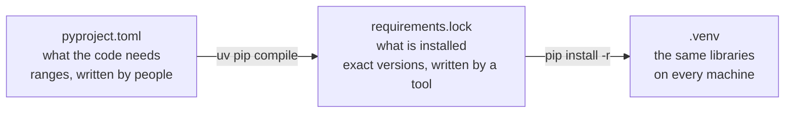

# Chapter 6 – Environments, dependencies and the lock file

In March your training script gives an error of 12.4. In September you run the same script on the same data and get 12.9. You changed nothing. But in between, you ran `pip install --upgrade` for another project, and several libraries are now newer. Which one changed the result? Without the tools in this chapter you cannot know.

## What you will learn

- What a virtual environment is and what problem it solves.
- The difference between saying what your code needs and recording exactly what is installed.
- How optional dependency groups keep each part of the system small.
- What a lock file is, how it is created, and how to install from it.

## One machine, many projects

A **dependency** is a library that your code needs in order to run. This project needs pandas, for example.

By default, `pip install` puts libraries into one shared place for the whole Python installation. This becomes a problem with the second project. Project A needs one version of pandas and project B needs another. A shared place can hold only one. Installing for B breaks A.

A **virtual environment** is a folder that contains its own Python and its own installed libraries, separate from all others. Each project gets its own. This project's environment is the folder `.venv` in the repository root, created with the command `python -m venv .venv`.

Think of it as a separate toolbox for each job. The tools for this job are in this box, in the sizes this job needs, and taking a tool out of another box changes nothing here.

"Activating" an environment means changing your shell so that the word `python` means the Python inside `.venv`. This book avoids the question by always writing the full path, `.venv\Scripts\python.exe`. Both ways run the same program.

> [!NOTE]
> The `.venv` folder is not stored in git. It is large, it is different on Windows and Linux, and it can be rebuilt at any time from the two files described in this chapter.

## Saying what the code needs

The dependencies are declared in [`pyproject.toml`](../../pyproject.toml).

```toml
requires-python = ">=3.12,<3.13"
dependencies = [
    "duckdb>=1.0",
    "holidays>=0.50",
    "httpx>=0.27",
    "pandas>=2.2",
    "pandera[pandas]>=0.24",
```

The first line fixes the Python version to 3.12. The list continues with a few more libraries. Each entry is a name and a **range** of versions. `"pandas>=2.2"` means "version 2.2 or any newer one".

A range is the right thing to write here, because it states a fact about the code: it uses features of pandas that exist from version 2.2. It would be wrong to say that the code works only with one exact version.

But a range is not enough to repeat a result, and this is the problem from the start of the chapter. `pandas>=2.2` installs whatever is newest on the day you install. Two people who install on different days get different libraries.

## Groups for different jobs

Not every part of the system needs every library. The web service that answers requests does not tune models. The training job does not need a web framework. Installing everything everywhere makes each part larger and slower to build, and gives more places for security problems.

`pyproject.toml` solves this with **optional dependency groups**, also called **extras**: named sets of additional libraries that are installed only where needed.

```toml
[project.optional-dependencies]
ml = [
    "lightgbm>=4.3",
    "matplotlib>=3.9",
    "mlflow>=2.14",
    "optuna>=3.6",
    "scikit-learn>=1.5",
    "shap>=0.45",
]
serving = [
    "fastapi>=0.111",
    "prometheus-client>=0.20",
    "uvicorn[standard]>=0.30",
]
```

The group `ml` holds the libraries for training. The group `serving` holds the libraries for the web service. The service of Chapter 30 needs `ml` as well, because it loads the model with MLflow and the model is a LightGBM forecaster; the group `serving` alone is not enough to run it. The full set of groups is in the table.

| Group | Used for |
|---|---|
| (no group) | Needed everywhere: pandas, pydantic, pandera, typer and others |
| `ml` | Training, tuning and explaining models |
| `serving` | The prediction web service |
| `monitoring` | Drift and accuracy reports |
| `orchestration` | Scheduling the steps |
| `versioning` | Versioning the data |
| `dev` | Tools for developers: tests, linter, type checker |
| `all` | Everything above, for a complete local setup |

*Table 6.1 – The dependency groups of this project.*

The groups matter most in Part VI, when each part of the system gets its own container image with only its own group.

## Recording exactly what is installed

Your dependencies have dependencies of their own. pandas needs numpy. MLflow needs dozens of libraries. These are called **transitive dependencies**: libraries you did not ask for, which arrive because something you asked for needs them. This project declares about 30 libraries. Installing them brings 281 in total.

A **lock file** is a list of the exact version of every one of them. To fix a library to one exact version is to **pin** it. The lock file of this project is [`requirements.lock`](../../requirements.lock). Its first lines are:

```text
# This file was autogenerated by uv via the following command:
#    uv pip compile pyproject.toml --all-extras --universal --python-version 3.12 -o requirements.lock
aiohappyeyeballs==2.7.1
    # via aiohttp
aiohttp==3.14.5
    # via
    #   aiohttp-retry
    #   fsspec
    #   mlflow
```

Read it from the top. The first two lines say that nobody wrote this file by hand. A tool named uv created it with the command shown. The command reads `pyproject.toml`, includes every group (`--all-extras`), and finds one set of exact versions that satisfies all the ranges together. The option `--universal` produces one file that is valid on Windows and on Linux, which matters because the code is written on Windows and will run in Linux containers.

Then come the entries. `aiohappyeyeballs==2.7.1` uses `==`, so it is one exact version. The line below it, `# via aiohttp`, explains why it is here: the library aiohttp needs it. The entry for aiohttp shows three libraries that need it. With these comments you can trace every one of the 281 lines back to something you declared.

So the two files have different jobs, and the project needs both.



*Figure 6.1 – From declared ranges to an identical environment.*

> [!WARNING]
> Do not edit the lock file by hand. If you need a new library, add it to `pyproject.toml` and create the lock file again with the command from its first lines. A hand-edited lock file may contain versions that do not work together.

## Worked example: installing in the right order

The setup steps in the [project README](../../README.md) contain these two lines, with the virtual environment active:

```powershell
python -m pip install -r requirements.lock
python -m pip install -e . --no-deps
```

The first line installs the 281 pinned libraries. `-r` means "read the list from this file".

The second line installs the project itself in editable mode, as explained in Chapter 5. The option `--no-deps` is important. Without it, pip would read the ranges in `pyproject.toml` and decide for itself which versions satisfy them. Usually it would agree with what is installed, but the decision would no longer belong to the lock file. `--no-deps` says: "install only this project and do not touch its dependencies."

The wrong way is the single command `pip install -e .`. It works, and it installs the newest version of everything. That is the September situation from the start of this chapter.

## Try it yourself

Check which Python the environment uses and where it lives.

```powershell
.venv\Scripts\python.exe --version
.venv\Scripts\python.exe -c "import sys; print(sys.prefix)"
```

You should see `Python 3.12.7` (the last number may differ) and the path of the `.venv` folder in your repository. This proves that this Python belongs to the project and not to the whole machine.

Compare a declared range with the pinned version.

```powershell
Select-String -Path requirements.lock -Pattern '^pandas=='
.venv\Scripts\python.exe -c "import pandas; print(pandas.__version__)"
```

You should see a line ending in `pandas==3.0.6` and then `3.0.6`. The declaration says `pandas>=2.2`. The lock file chose 3.0.6, and that is exactly what is installed. This proves the environment follows the lock file. It also shows how wide a range is: version 3 satisfies ">= 2.2".

Count the pinned libraries.

```powershell
(Select-String -Path requirements.lock -Pattern '^[a-zA-Z0-9_.\-]+==').Count
```

You should see `281`.

## Key takeaways

- A virtual environment gives each project its own Python and its own libraries.
- `pyproject.toml` declares ranges: what the code is compatible with.
- The lock file records exact versions of all libraries, including transitive ones: what is installed.
- Optional groups let each part of the system install only what it uses.
- Install from the lock file first, then install the project with `--no-deps`.

## Exercises

**1.** Why not write exact versions such as `pandas==3.0.6` directly in `pyproject.toml` and have no lock file?

<details>
<summary>Answer</summary>

Two reasons. First, it would pin only the libraries you list. The transitive dependencies, which are most of the 281, would still float. Second, an exact version in `pyproject.toml` claims that the code works with that version only, which is false and makes every upgrade a manual edit of many lines. Ranges describe compatibility, and the lock file describes one tested installation. They are different facts and belong in different files.

</details>

**2.** A security problem is announced in one library in your lock file. You have never heard of this library. How do you find out why it is installed?

<details>
<summary>Answer</summary>

Find its line in `requirements.lock` and read the `# via` comment below it. It names the library that needs it. If that one is also unknown, read its `# via` comment, and continue until you reach a library that is declared in `pyproject.toml`.

</details>

**3.** The results of a training run changed between March and September, although the code and the data are the same. With this project's setup, how would you investigate?

<details>
<summary>Answer</summary>

The lock file is stored in git, so its history shows every change of every version. Compare the lock file of March with the one of September. If it did not change, the libraries are the same and the cause is elsewhere, for example a random seed that is not fixed. If it changed, the difference is a short list of candidates, and you can install the old lock file in a fresh environment to confirm.

</details>

---

[Previous: Chapter 5 – Project layout and packaging](05-project-layout-and-packaging.md) | [Contents](README.md) | [Next: Chapter 7 – Configuration](07-configuration.md)
