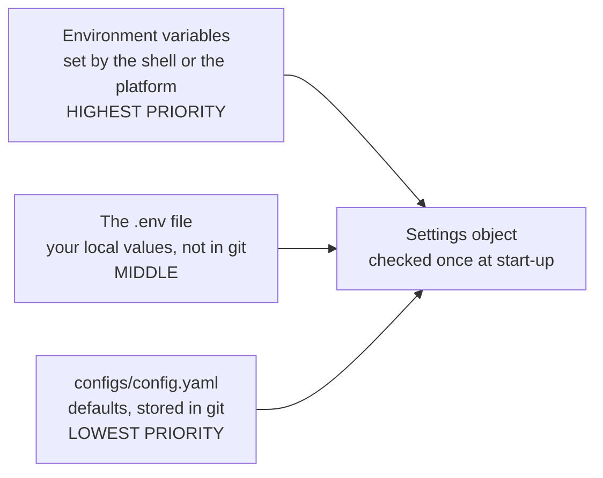

# Chapter 7 – Configuration

Your training script starts with `TRAIN_END = "2025-04-30"`. The evaluation script, written a week later, has its own line: `TRAIN_END = "2025-03-31"`. Both run without error. The model is trained on April and "tested" on April too, and nobody notices for a month. This chapter is about keeping every such value in one place, and about checking those values before any work starts.

## What you will learn

- Why values such as dates, paths and limits should not be written inside the code.
- How one typed settings object replaces scattered constants.
- How a YAML file, a `.env` file and environment variables are combined, and which one wins.
- What "frozen" and "forbid extra" mean, and which mistakes they prevent.
- How a validator turns a project rule into something the program enforces.

## Values that do not belong in code

**Configuration** is the set of values that can change without the logic changing: dates, folder names, limits, addresses of other services, model parameters. A value written directly in the code is called **hard-coded**.

Hard-coded values cause two problems. The first is the one above: the same value is written in several places and the copies disagree. The second appears when the code runs somewhere else. On your laptop the experiment records are in a local file. Inside a container they are on a server with another address. If the address is in the code, you need different code for each place.

The rule of this project is that no path, date or limit is written in the code. All of them are in one file, [`configs/config.yaml`](../../configs/config.yaml). **YAML** is a text format for configuration that is easy for people to read: names, colons and indentation.

```yaml
cleaning:
  min_duration_minutes: 1.0
  max_duration_hours: 6.0
  max_distance_miles: 100.0
```

## From a dictionary to a typed object

The simplest way to use this file is to read it into a Python dictionary and write `config["cleaning"]["max_distance_miles"]` where needed. This removes the copies, but a dictionary accepts anything. Three mistakes pass without notice.

A wrong type: someone writes `max_distance_miles: "100"` with quotes. It is now text, and the comparison `distance > limit` fails somewhere in the middle of a long job.

A wrong name in the code: `config["cleaning"]["max_distance"]` gives a `KeyError`, again only when that line is reached.

A wrong name in the file: someone writes `max_distanse_miles: 50`. The code asks for the correct name, does not find it, and perhaps uses a default of 100. The person believes the limit is 50.

This project uses a **typed settings object** instead: a Python object in which every value has a declared name and type, built once when the program starts. If anything is wrong, the program stops immediately and names the bad value. The library that does the checking is pydantic, together with its extension pydantic-settings.

Each section of the YAML file has a matching class in [`src/demand/config.py`](../../src/demand/config.py). Here is the one for the cleaning section.

```python
class CleaningConfig(_Section):
    """Thresholds for the trip-level cleaning rules that build the silver layer."""

    min_duration_minutes: float = Field(ge=0)
    max_duration_hours: float = Field(gt=0)
    max_distance_miles: float = Field(gt=0)
```

Each line declares one value: its name, its type after the colon, and a condition. `Field(gt=0)` means "greater than zero", and `ge=0` means "greater than or equal to zero". A distance limit of `-5` is rejected at start-up, with a message that names `max_distance_miles`. The class has four more lines of the same form.

The code that uses a value writes `settings.cleaning.max_distance_miles`. An editor can complete that name, and a type checker (Chapter 11) reports a wrong one before the program runs.

## Worked example: frozen and strict

All section classes are built on one small base class.

[`src/demand/config.py`](../../src/demand/config.py)

```python
class _Section(BaseModel):
    """Base class for config sections: immutable and strict about unknown keys."""

    model_config = ConfigDict(frozen=True, extra="forbid", protected_namespaces=())
```

The line `model_config` sets rules for every section. Two of them matter here.

`frozen=True` makes the object **immutable**: after it is created, no value can be changed. Without this, any function could write `settings.cleaning.max_distance_miles = 50`, and every function that runs later would see 50. The result of the program would depend on the order of the calls. With a frozen object, the settings are the same for everyone, from start to end.

`extra="forbid"` makes an unknown name an error. This catches the third mistake above. The misspelled `max_distanse_miles` is not ignored. The program refuses to start and says that this name is not allowed.

> [!TIP]
> A test sometimes needs different settings. It does not change the object. It makes a changed copy with `model_copy(update={...})`. You will see this in Chapter 10. Be aware that `model_copy` does not run the checks again, so it is suitable for tests and not for loading real settings.

## Three sources, one winner

A committed YAML file is good for defaults. It is not good for values that differ between places, or for secrets. An **environment variable** is a named value that lives outside the program, set by the shell, by a container or by a server. The program reads it at start-up. Environment variables are the standard way to give a program its place-specific values.

This project reads three sources.



*Figure 7.1 – Where settings come from. If the same value is in several sources, the one with the higher priority is used.*

The name of a variable follows a fixed pattern: the prefix `DEMAND_`, then the section, then two underscores, then the name. So `DEMAND_MLFLOW__TRACKING_URI` replaces the value `tracking_uri` in the section `mlflow`.

A **`.env` file** is a text file with lines of the form `NAME=value`, in the folder where you start the program. It is a convenient place for your personal values, so that you do not have to set them in every new shell. It is never stored in git, because it may contain passwords. The file [`.env.example`](../../.env.example) is stored in git. It shows which variables exist, with no real values.

Why does the real environment win over `.env`? Because the platform that runs the program in production sets real variables, and they must not be overridden by a file that someone left in the folder.

Here is the function that combines the sources.

[`src/demand/config.py`](../../src/demand/config.py)

```python
    load_dotenv(DOTENV_FILE, override=False)
    path = config_file or Path(os.environ.get(CONFIG_FILE_ENV, DEFAULT_CONFIG_FILE))
    if not path.is_file():
        raise FileNotFoundError(f"Config file not found: {path.resolve()}")
    content = yaml.safe_load(path.read_text(encoding="utf-8"))
    if not isinstance(content, dict):
        raise ValueError(f"Config file must contain a YAML mapping: {path.resolve()}")
    return Settings(**content)
```

Line 1 reads the `.env` file and copies each of its lines into the environment of the running program. `override=False` means: skip a variable that is already set. This one option creates the rule "environment wins over `.env`".

Line 2 decides which YAML file to read: the one given to the function, or the one named in the variable `DEMAND_CONFIG_FILE`, or the default `configs/config.yaml`.

Lines 3 to 7 read the file and stop with a clear message if it is missing or is not a set of named sections. A clear message at this point saves a confusing one later.

The last line builds the `Settings` object from the YAML content. At this moment pydantic also looks at the environment variables, and one more piece of code decides the priority:

```python
        """Let environment variables override the YAML values passed to ``__init__``."""
        return env_settings, init_settings
```

The method returns two sources in order. The first has priority. `env_settings` is the environment. `init_settings` is what was passed in when the object was built, which is the YAML content. So the environment wins over YAML.

## Worked example: a config that refuses to leak

Types catch technical mistakes. A project also has rules of its own. Chapter 2 gave the most important one: no lag may be shorter than the horizon. A **validator** is a function that checks a rule when the object is created and raises an error if the rule is broken.

[`src/demand/config.py`](../../src/demand/config.py)

```python
    @model_validator(mode="after")
    def _check_no_leakage(self) -> FeatureConfig:
        too_recent = [lag for lag in self.lags if lag < self.horizon_hours]
        if too_recent:
            raise ValueError(
                f"features.lags {too_recent} are shorter than the {self.horizon_hours} h "
                "forecast horizon and would leak information unavailable at prediction time"
            )
        return self
```

The first line tells pydantic to run this function after the single values have been checked, so `self.lags` and `self.horizon_hours` are already valid numbers.

The line starting with `too_recent` collects every lag that is smaller than the horizon. With lags `[1, 24]` and a horizon of 24, the result is `[1]`.

If the list is not empty, the function raises an error. Read the message: it names the bad lags, gives the horizon, and says why this is a problem. A person who has never heard of leakage can understand what to fix.

If the list is empty, the function returns the object unchanged, and loading continues.

The effect is that a leaking lag is not a bad result that someone must notice. It is a program that does not start.

> [!NOTE]
> This check covers the `lags` list only. The rolling windows from Chapter 2 need their 24-hour shift inside the feature code, and a test of that code. A validator can only check what is visible in the settings.

## Loaded once

The last piece is a small function at the end of the file.

```python
@lru_cache(maxsize=1)
def get_settings() -> Settings:
    """Return the process-wide settings, loaded once."""
    return load_settings()
```

`@lru_cache(maxsize=1)` remembers the result of the first call. Every later call returns the same object without reading the files again. So every part of the program that calls `get_settings()` works with identical values.

## Try it yourself

Print all settings as the program sees them.

```powershell
.venv\Scripts\python.exe -m demand config
```

You should see the whole configuration, beginning with the `project` section: name `nyc-taxi-demand`, seed `42`, timezone `America/New_York`. This is the combined result of all three sources.

Replace one value through the environment.

```powershell
$env:DEMAND_MLFLOW__TRACKING_URI = "http://localhost:5000"
.venv\Scripts\python.exe -m demand config | Select-String tracking_uri
Remove-Item Env:DEMAND_MLFLOW__TRACKING_URI
```

You should see `"tracking_uri": "http://localhost:5000",`. The YAML file says `sqlite:///mlflow.db`. This proves the environment wins. The last line removes the variable again.

Try to change a setting after loading.

```powershell
.venv\Scripts\python.exe -c "from demand.config import get_settings; s = get_settings(); s.features.horizon_hours = 1"
```

You should see an error that ends with `Instance is frozen`. This proves that no code can change the settings while the program runs.

Run the tests for the two protections.

```powershell
.venv\Scripts\python.exe -m pytest tests/unit/test_config.py -q -k "lag_shorter or unknown_key"
```

You should see `2 passed, 13 deselected`. One test gives the program a lag of 1 hour, the other gives it the misspelled name `sead` for `seed`. Both expect a refusal.

## Key takeaways

- Values that can change live in one config file, not in the code.
- A typed settings object checks names, types and conditions once, at start-up, and stops with a clear message.
- `frozen=True` prevents changes while the program runs. `extra="forbid"` turns a misspelled name into an error.
- Three sources are combined. The environment wins over the `.env` file, and both win over YAML.
- A validator can enforce a rule of the project, such as "no lag shorter than the horizon".

## Exercises

**1.** The file `.env` contains `DEMAND_PROJECT__SEED=7`. Your shell has `DEMAND_PROJECT__SEED=9`. The YAML file says `seed: 42`. Which value does the program use, and which piece of code decides each step?

<details>
<summary>Answer</summary>

It uses 9. `load_dotenv(..., override=False)` does not replace a variable that is already set, so the 9 from the shell stays and the 7 is skipped. Then `settings_customise_sources` puts the environment before the YAML content, so 9 wins over 42.

</details>

**2.** Why is a program that stops at start-up better than one that stops two hours into a job, if the cause is the same wrong value?

<details>
<summary>Answer</summary>

It is cheaper and clearer. At start-up nothing has been done, so nothing is half-finished, and the message points at the config value directly. After two hours, time and computing are lost, some files may be half-written, and the error appears in a place far from its cause, such as a comparison between a number and a text. This idea is called failing fast.

</details>

**3.** Someone wants to make the horizon flexible and sets `horizon_hours: 12` while keeping `lags: [24, 48, 168]`. Does the validator accept this? Is the config still correct for this project?

<details>
<summary>Answer</summary>

The validator accepts it: all lags are at least 12. Whether it is correct depends on the decision the forecast serves. If forecasts are now needed 12 hours ahead, it is a valid and slightly cautious config. If the user still needs them a day ahead, the number 12 would be a false statement about the system. The validator checks that the settings agree with each other. It cannot check that they agree with reality.

</details>

**4. Interview question.** "How do you manage configuration between your laptop and production?"

<details>
<summary>Points of a good answer</summary>

- One typed settings object, checked at start-up, so that mistakes fail fast with a clear message.
- Defaults in a config file stored in git. Differences between places come from environment variables with a fixed naming pattern.
- Secrets are never in git. A `.env` file is for local use and is ignored by git. An example file documents the names.
- The object is immutable and rejects unknown names, and you can say what each protects against.
- Validators can hold rules of the project, not only types. The lag and horizon check is a good example.

</details>

---

[Previous: Chapter 6 – Environments, dependencies and the lock file](06-environments-and-dependencies.md) | [Contents](README.md) | [Next: Chapter 8 – Data contracts](08-data-contracts.md)
