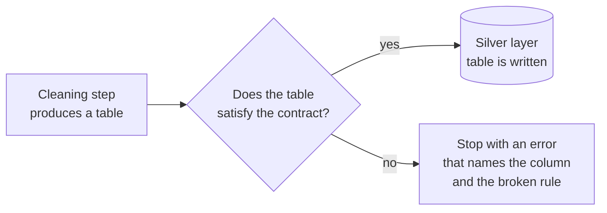

# Chapter 8 – Data contracts

One month, the source of your data changes a column from miles to kilometres. Nothing in your pipeline fails. Every distance is now about 1.6 times larger, more trips are removed as "too long", the counts per hour drop a little, and the model trains on them. Your code has no bug. The data is wrong, and wrong data does not raise exceptions. This chapter shows how to make it raise one.

## What you will learn

- Why data problems are silent, and why that makes them expensive.
- What a data contract is and where it is checked.
- How a Pandera schema expresses a contract.
- Three design choices in this project: schemas built from settings, column names as constants, and strict schemas.
- Why a check that cannot do its job must stop the program.

## Code fails loudly, data fails silently

When code is wrong, Python usually tells you: a `TypeError`, a `KeyError`, a failing test. When data is wrong, the program continues. A negative fare is a valid number. A duplicated hour is a valid row. A table with these problems goes through aggregation and training without complaint, and the only effect is a model that is slightly worse for a reason nobody can see.

The longer a problem travels, the harder it is to find. A wrong value found at the moment the table is written points directly to its cause. The same value found a month later, as a small loss of accuracy, points nowhere.

## A contract between two steps

A **data contract** is a precise description of a table that can be checked automatically: which columns it has, their types, the allowed values, and which combination of columns must be unique.

The word "contract" fits because two parties rely on it. The step that writes a table is the **producer**. The step that reads it is the **consumer**. The producer promises that the table satisfies the contract and checks this before writing. The consumer can then trust the table and does not need to check everything again.

In Chapter 4, Figure 4.1 showed a check at the entrance of the silver layer and of the gold layer. These checks are contracts. A check that can stop a pipeline is called a **quality gate**. If the table does not satisfy the contract, the gate stays closed: the table is not written, and the pipeline stops with an error.



*Figure 8.1 – A quality gate.*

## Schemas with Pandera

A **schema** is the formal definition of a table: its columns, types and rules. Pandera is a library that lets you write a schema for a pandas table and check a table against it. All schemas of this project are in one file, [`src/demand/schemas.py`](../../src/demand/schemas.py).

## Worked example: the contract for cleaned trips

[`src/demand/schemas.py`](../../src/demand/schemas.py)

```python
            TRIP_DISTANCE: pa.Column(
                "float64",
                pa.Check.in_range(0, cleaning.max_distance_miles, include_min=False),
            ),
            DURATION_MINUTES: pa.Column(
                "float64",
                pa.Check.in_range(cleaning.min_duration_minutes, cleaning.max_duration_hours * 60),
            ),
```

This is part of the function `silver_trips_schema`. It describes two of the seven columns.

`TRIP_DISTANCE` is the name of the column. It is written in capitals because it is a constant, explained below.

`pa.Column("float64", ...)` says that the column holds decimal numbers.

`pa.Check.in_range(0, cleaning.max_distance_miles, include_min=False)` is the rule for the values: greater than 0 and not above the maximum. `include_min=False` excludes zero itself, because a trip of zero miles is not a trip.

The second column is the duration, with a lower and an upper limit. The upper limit is given in hours in the settings and multiplied by 60 here, because the column is in minutes.

In words, this part of the contract says: every trip in the silver layer has a distance above zero and at most the maximum, and a duration between the minimum and the maximum. If one row breaks one rule, the check fails.

## Design choice 1: schemas are built from settings

Look at where the limits come from. The number 100 is not written in the schema. The schema reads `cleaning.max_distance_miles`, the value from the config file of Chapter 7.

The cleaning step, when it is written, will remove trips above the same value. So two pieces of code use one number: the code that applies the rule and the gate that checks the result.

Consider the wrong way. The cleaning code has `if distance > 100` and the schema has `in_range(0, 100)`. Later someone lowers the limit to 80 in the cleaning code and forgets the schema. The gate now accepts trips up to 100 and no longer checks the rule that the cleaning step applies. With one shared value this cannot happen. This is why every schema is a function that takes the settings as its argument.

## Design choice 2: column names are constants

The first lines of the file look like this.

```python
# Keys
ZONE_ID = "zone_id"
HOUR_START = "hour_start"
```

Later in the file there is `TARGET = "pickups"`, and one such line for every column. A **constant** is a name for a value that never changes. All other code must use these names: `df[schemas.TARGET]`, never `df["pickups"]`.

The reason is what happens after a typing mistake. If you write `df["pikups"] = ...`, pandas creates a new column with that name and gives no warning. If you write `df[schemas.TARGTE]`, the name does not exist. The type checker (Chapter 11) reports it before the program runs, and Python itself stops at that line with an `AttributeError`. The same mistake is silent in one form and loud in the other.

There is a second benefit. Training, serving and monitoring all import the same names. A column cannot be called `pickups` in one place and `pickup_count` in another. This is one more protection against the skew from Chapter 4.

## Design choice 3: strict schemas

Every schema in the file sets the same option.

```python
        strict=True,
```

`strict=True` means that the table must have exactly the columns of the schema. A column that is not in the schema is an error.

This may look too hard. An extra column seems harmless. It is not, for two reasons. An extra column may carry information the model must not have, such as a value that is known only after the trip has ended. And later code might start to use the column, so that the system depends on something no contract describes. With a strict schema, the table is exactly what the contract says.

> [!NOTE]
> The schemas contain other rules worth reading. The gold tables have `unique=[ZONE_ID, HOUR_START]`: one row per zone and hour, which catches a join that creates duplicate rows. Timestamps must carry the timezone `America/New_York`. In the table of stored forecasts, the `ACTUAL` column has `nullable=True`, because the real value arrives after the forecast, as Chapter 3 explained.

## A gate must never be open by accident

The gold tables may contain only the 20 chosen zones. That list is in the settings, and Chapter 2 explained that it is still empty. What should the gold schema do with an empty list?

One possible answer is "accept any valid zone number for now". That sounds practical. But then the gate is open while it appears to be closed. A gold table with all 263 zones would pass the check, the result would be reported as success, and a rule of the project would be broken without a sign.

There are two ways for a check to behave when it cannot do its job. To **fail open** is to let everything pass. To **fail closed** is to stop. A gate that fails open gives a "passed" result that can mean "the data is good" or "nothing was checked", and you cannot tell which. So a quality gate must fail closed.

[`src/demand/schemas.py`](../../src/demand/schemas.py)

```python
    if not frozen_only:
        check = pa.Check.in_range(1, settings.cleaning.max_zone_id)
    elif settings.data.zones:
        check = pa.Check.isin(settings.data.zones)
    else:
        raise ValueError(
            "data.zones is empty: run `python -m demand select-zones` and paste the "
            "result into the config before building or validating the gold layer"
        )
```

This is the body of the helper `_zone_column`. It has three cases.

In the first case, the caller does not ask for the frozen list (`frozen_only` is false). This is the silver layer, which contains trips from all zones. The rule is a range from 1 to the largest valid zone number.

In the second case, the caller asks for the frozen list and the list has entries. The rule is `isin`: the zone must be one of them.

In the third case, the caller asks for the frozen list and it is empty. The function does not guess. It raises an error whose message says what is missing and which command produces it.

> [!IMPORTANT]
> When a check lacks what it needs to do its job, stop with an error. A safety check that is silently skipped is worse than no check, because people believe it ran.

## Try it yourself

Ask for the gold schema with the current settings.

```powershell
.venv\Scripts\python.exe -c "from demand.config import get_settings; from demand.schemas import gold_demand_schema; gold_demand_schema(get_settings())"
```

You should see an error report that ends with:

```text
ValueError: data.zones is empty: run `python -m demand select-zones` and paste the result into the config before building or validating the gold layer
```

This proves the gate fails closed. The error will disappear when the zones are chosen in Part III.

Ask for the silver schema, which does not need the list.

```powershell
.venv\Scripts\python.exe -c "from demand.config import get_settings; from demand.schemas import silver_trips_schema; print(list(silver_trips_schema(get_settings()).columns))"
```

You should see the seven columns of a cleaned trip:

```text
['pickup_datetime', 'dropoff_datetime', 'pickup_zone_id', 'trip_distance', 'duration_minutes', 'passenger_count', 'fare_amount']
```

Run the tests that give the silver schema bad values.

```powershell
.venv\Scripts\python.exe -m pytest tests/unit/test_schemas.py -q -k "bad_values"
```

You should see `8 passed, 19 deselected`. Open `tests/unit/test_schemas.py` and find `test_silver_trips_reject_bad_values`. It builds one correct table, replaces one value with a bad one (a zone of 264, a distance of 0, a fare of −3, and five more), and expects the schema to refuse. Each of the eight bad values is one test.

Run the test for an unexpected column.

```powershell
.venv\Scripts\python.exe -m pytest tests/unit/test_schemas.py -q -k "unexpected_columns"
```

You should see `1 passed, 26 deselected`. The test adds a column named `tip_amount` to a correct table. This proves `strict=True` works.

## Key takeaways

- Wrong data does not raise errors. A contract turns a silent data problem into a visible failure at the moment the table is written.
- The producer checks the table before writing. If the check fails, the pipeline stops.
- Schemas read their limits from the settings, so the rule and its check cannot disagree.
- Column names are constants, so a typing mistake is found before the program runs.
- `strict=True` makes the table exactly the contract.
- A gate that cannot do its job must fail closed.

## Exercises

**1.** The cleaning step writes a table where one trip has a fare of −3. Describe what happens next with a contract, and what would happen without one.

<details>
<summary>Answer</summary>

With the contract, the silver gate checks the table before it is written. The rule for the fare column is "at least 0", so the check fails, the table is not written, and the error names the column and the rule. Someone then fixes the cleaning step. Without a contract, the row enters silver. The gold step only counts trips, so the count is one too high for that hour. Nobody sees it. The single row is a small problem. The larger one is what it means: the cleaning rule for fares does not work, so other bad rows are probably present too, and nothing reports them.

</details>

**2.** A schema checks that temperatures are decimal numbers and not missing. The weather service starts sending Fahrenheit where it sent Celsius before. Does the contract catch this? What would?

<details>
<summary>Answer</summary>

No. 68.0 is a valid decimal number. A schema checks form and ranges, not meaning. A range rule, for example between −40 and 50, would catch some cases, but not all. The real defence is drift monitoring (Part VII), which compares the distribution of new values with the training period and would see that all temperatures have moved. Contracts and monitoring protect against different problems.

</details>

**3.** A colleague proposes `strict=False` for the gold feature table "so that we can add experimental columns without changing the schema". What is the risk, and what would you propose?

<details>
<summary>Answer</summary>

The risk is that an experimental column is used for training while the serving code does not produce it, or that it contains information that is not available at prediction time. Both are silent. A better proposal: an experimental feature is added to the config and the schema like any other, on a branch, so that training, serving and the gate all learn about it together. The small cost of changing the schema is the point: every new column is a visible decision.

</details>

**4. Interview question.** "What is a data contract, and what happens in your pipeline when one is broken?"

<details>
<summary>Points of a good answer</summary>

- A checkable description of a table at a boundary: columns, types, ranges, uniqueness, timezone.
- The producer validates before writing. On failure, nothing is written and the pipeline stops with a non-zero exit code. Stopping is better than training on bad data.
- Design details: limits taken from the same settings as the cleaning rules; column names as constants; strict schemas; a gate that fails closed when its reference values are missing.
- The limit of contracts: they check form, not meaning. Values that are plausible and wrong pass. Monitoring covers that.

</details>

---

[Previous: Chapter 7 – Configuration](07-configuration.md) | [Contents](README.md) | [Next: Chapter 9 – The command line and logging](09-command-line-and-logging.md)
