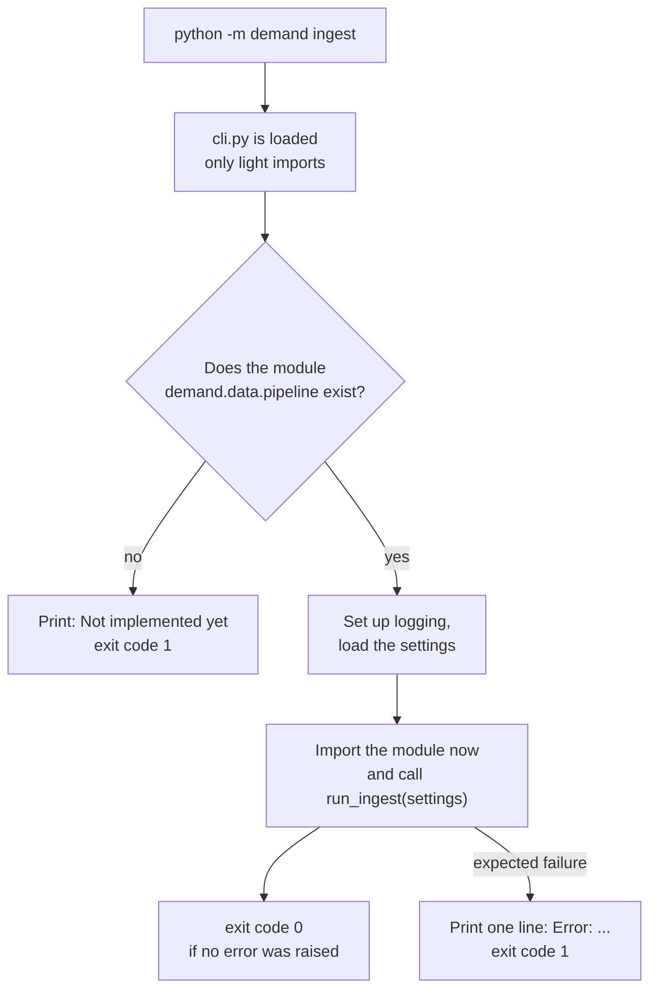

# Chapter 9 – The command line and logging

A project often ends up with a folder like this: `download.py`, `clean_v2.py`, `train_final.py`, `run_all.sh`. Each script reads its settings in its own way. The shell script works only on Linux. When a job fails during the night, the only record is a few lines written with `print`, without times. This chapter shows how this project gives every task the same entrance, and how it records what happened in a form that can be searched.

## What you will learn

- What a command-line interface is and why one entry point is better than many scripts.
- How Typer turns a Python function into a command.
- Why the heavy parts of the program are imported only when they are needed.
- What an exit code is and who reads it.
- Why logs are written as structured data and not with `print`.

## One entrance for everything

A **command-line interface**, or **CLI**, is a program that you control by typing commands in a shell. An **entry point** is the place where a program starts.

This project will be started in many ways: by you in a shell, by a scheduler, inside a container, and by an automatic check on every push. If each of them starts the work differently, they will slowly do different things. So there is one rule: every task is started as `python -m demand <command>`. Chapter 5 explained how that line reaches the code.

A common tool for this purpose is a Makefile, a file of named shell commands. It was not chosen because the program that reads Makefiles is not part of Windows, and this project is developed on Windows and run on Linux. A CLI written in Python works the same on both.

## From a function to a command

The CLI is built with a library named Typer. It is in the file [`src/demand/cli.py`](../../src/demand/cli.py). Here is the simplest command.

```python
@app.command()
def config() -> None:
    """Print the resolved configuration as JSON."""
    typer.echo(get_settings().model_dump_json(indent=2))
```

The first line is a **decorator**, a marker placed above a function that changes how the function is used. This one registers the function as a command of the program `app`.

The name of the function, `config`, becomes the name of the command.

The docstring becomes the help text. It is the sentence you see next to `config` when you run `python -m demand --help`.

The last line is the work: get the settings, turn them into **JSON** (a standard text format for structured data), and print them.

So a command is a normal function with a marker. Nothing about arguments or help texts must be written separately.

## Worked example: a command that calls a stage

Most commands start one step of the pipeline. A step is called a **stage**. All stage commands look the same.

```python
@app.command()
def ingest() -> None:
    """Download trip and weather files into the raw layer."""
    _run_stage("demand.data.pipeline", "run_ingest")
```

The command contains no logic. It passes two texts to a helper: the name of a module and the name of a function inside it. Here is the helper.

[`src/demand/cli.py`](../../src/demand/cli.py)

```python
def _run_stage(module: str, function: str, *args: object) -> None:
    """Import ``module`` lazily and call ``function(settings, *args)``."""
    if importlib.util.find_spec(module) is None:
        raise _not_implemented(module)
    configure_logging()
    try:
        getattr(importlib.import_module(module), function)(get_settings(), *args)
    except NotImplementedError as error:
        # The module exists but this stage is still a placeholder.
        raise _not_implemented(str(error) or f"{module}.{function}") from error
    except PipelineError as error:
        # An expected failure: the message is enough, a traceback would only hide it.
        typer.secho(f"Error: {error}", fg=typer.colors.RED, err=True)
        raise typer.Exit(code=1) from error
```

Line 3 asks Python whether a module with this name exists, without loading it. If it does not exist, line 4 stops the command with the message "Not implemented yet" and a failure code.

Line 5 sets up logging, which the second half of this chapter covers.

Line 7 does three things, from the inside out. `importlib.import_module(module)` loads the module now. `getattr(..., function)` takes the function with the given name out of it. The final brackets call that function and give it the settings as its first argument.

The first `except` block handles a stage whose module exists while the stage itself is not written yet. Such a stage is a **placeholder**: a function that only raises `NotImplementedError`. Without the `except` block, the user would see a long error report with file names and line numbers. With it, the user sees one line, "Not implemented yet", followed by the text of the placeholder, and the exit code is 1. No command is in this state today. The last one was `train`, which became a real stage in Chapter 26. The block stays for the next stage that is added in two steps, and a test keeps it working.

The second `except` block handles a failure that the program expects, such as an input file that is missing. Every error of this kind belongs to the class `PipelineError`. The user sees one line that begins with "Error:", and the exit code is 1. Any other error is a mistake in the code and keeps its long report. Chapter 20 explains the difference and the class.

This fixes a simple agreement for all stages, stated at the top of the file: every stage function takes the settings object first and returns nothing. The CLI needs to know nothing else about a stage.

## Why the import waits

Normally imports are at the top of a file. Here the stage modules are imported inside the function, at the moment a command runs. This is called a **lazy import**. There are three reasons.

The first is the dependency groups of Chapter 6. The training stage needs LightGBM, MLflow and SHAP, and the tuning command needs Optuna. All of them are in the group `ml`. The web service image will not install that group. If `cli.py` imported the training module at the top, every command would fail in that image, even `--help`, because the import at the top would fail. With lazy imports, a command needs only what it uses itself.

The second is speed. Loading large libraries takes seconds. Printing a help text should not wait for them.

The third is the order of building. The full list of commands existed before any stage did, and today ten stages are written: `ingest`, `select-zones`, `silver`, `gold`, `validate`, `backtest`, `train`, `tune`, `promote` and `set-champion` (Chapters 14 to 29). A missing module is not an import error that breaks the whole program. It is a clear message for that one command.



*Figure 9.1 – What happens when a stage command runs. A stage that is still a placeholder ends in the same way as a missing module: one line "Not implemented yet" and exit code 1.*

## Exit codes

When a program ends, it gives one number back to whatever started it. This is the **exit code**. Zero means success. Any other number means failure.

People rarely look at exit codes. Machines look at nothing else. A scheduler that runs "clean, then validate, then train" continues to the next step only if the step before returned zero. So the exit code is how a failed quality gate stops a pipeline. The help text of the `validate` command says this directly: "exits non-zero if it fails".

Typer also checks arguments. The `validate` command accepts a layer, and the allowed values are defined as a small list in the code:

```python
class Layer(StrEnum):
    """Data layers that have a quality gate."""

    SILVER = "silver"
    GOLD = "gold"
```

If you type any other word, Typer refuses before the command starts, and the exit code is 2. You will try this below.

## The problem with print

Now the second topic. While a program runs, you want a record of what it did. The first tool everyone uses is `print("cleaning done, 1200 rows")`.

This has several weaknesses. There is no time, so you cannot say when it happened or how long a step took. There is no level, so an error looks the same as a routine message. It cannot be switched off for one noisy library. And it is a free sentence: to find all messages about the silver stage with fewer than 1,000 rows, a program would have to understand English.

In a system with several containers, nobody reads logs from top to bottom. Logs are collected in one place and searched. They must be data.

## Structured logging

**Structured logging** writes each event as a record with named fields, not as a sentence. This project writes each event as one line of JSON. The code is in [`src/demand/logs.py`](../../src/demand/logs.py).

```python
        payload: dict[str, Any] = {
            "time": datetime.fromtimestamp(record.created, tz=UTC).isoformat(),
            "level": record.levelname,
            "logger": record.name,
            "message": record.getMessage(),
        }
        payload.update(
            {key: value for key, value in record.__dict__.items() if key not in _RESERVED}
        )
```

This is the centre of the class `JsonFormatter`, which turns one log event into text. Python's standard logging system creates a `record` for each event. The formatter builds a dictionary from it.

`"time"` is the moment of the event, in **UTC**, the world standard time without summer time. Machines in different places then write times that can be compared directly.

`"level"` is the importance: `INFO` for routine messages, `WARNING`, `ERROR`.

`"logger"` is the name of the part of the program that wrote the event.

`"message"` is the text.

The `payload.update` lines add every extra value that the caller attached to the event. This is the important part. A caller can write:

```python
log.info("cleaned trips", extra={"stage": "silver", "rows_out": 1200})
```

Here `stage` and `rows_out` become fields of their own. A log system can then answer "show all events where `stage` is `silver` and `rows_out` is below 1000" without reading any sentence.

## Two streams

A program has two output channels. **stdout** is for results. **stderr** is for messages about the run. The function `configure_logging` sends all logs to stderr.

The reason shows in the `config` command. Its result is JSON on stdout. If log lines were mixed into the same channel, another program could not read that JSON any more. With two channels, the result stays clean and the logs can still be seen. The `select-zones` command of Chapter 18 follows the same rule: the line for the config file goes to stdout, and the log line goes to stderr.

> [!TIP]
> When you write a command whose output another program will read, send only the result to stdout. Send everything else to stderr.

## Try it yourself

Give a command a wrong argument and read the exit code.

```powershell
.venv\Scripts\python.exe -m demand validate bronze
$LASTEXITCODE
```

You should see a message that says `Invalid value for 'layer': 'bronze' is not one of 'silver', 'gold'.` and then the number `2`. In PowerShell, `$LASTEXITCODE` holds the exit code of the last program. This proves that Typer checks the argument against the list `Layer` and reports failure through the exit code.

Read the result of a command with another program.

```powershell
(.venv\Scripts\python.exe -m demand config | ConvertFrom-Json).features.lags
```

You should see `48` and `168`. PowerShell read the output as JSON and took one value out of it. This proves that stdout contains only the result.

Write one log line.

```powershell
.venv\Scripts\python.exe -c "from demand.logs import configure_logging, get_logger; configure_logging(); get_logger('demo').info('cleaned trips', extra={'stage': 'silver', 'rows_out': 1200})"
```

You should see one line of this form, with the current time:

```text
{"time": "2026-10-12T18:19:01.763758+00:00", "level": "INFO", "logger": "demo", "message": "cleaned trips", "stage": "silver", "rows_out": 1200}
```

The two extra values are separate fields. The `+00:00` at the end of the time shows that it is UTC.

Run a command whose stage does not exist yet.

```powershell
.venv\Scripts\python.exe -m demand forecast
$LASTEXITCODE
```

You should see `Not implemented yet: demand.flows.forecast_flow` and then the number `1`. This is the branch "no" of Figure 9.1: the module of the forecast stage is not written, and the command says so in one line, without a long error report, and with a failure code.

No real command is a placeholder today, so the other way to this message cannot be shown with a command. A test shows it. It puts a fake stage in the place of a real one, and the fake only raises `NotImplementedError("validate arrives later")`.

```powershell
.venv\Scripts\python.exe -m pytest tests/unit/test_cli.py -q -k "placeholder"
```

You should see `1 passed, 23 deselected`. The test checks that the command prints `Not implemented yet: validate arrives later` and that the exit code is 1.

Run the test that checks every stage command.

```powershell
.venv\Scripts\python.exe -m pytest tests/unit/test_cli.py -q -k "each_command"
```

You should see `11 passed, 13 deselected`. Many stages do not exist yet, so how can their commands be tested? Chapter 10 explains the method: the test puts a fake module in the place of the real one.

## Key takeaways

- One entry point, `python -m demand <command>`, is used by people and by every machine that starts the work.
- With Typer, a command is a function. Its name, docstring and type hints become the command name, help text and argument checks.
- A command contains no logic. It loads the settings and calls one stage function.
- Lazy imports keep each command independent of libraries it does not use, and let commands exist before their stages do.
- The exit code is how a program tells a machine that it failed.
- Logs are records with fields, written as JSON to stderr, so they can be searched and do not mix with results.

## Exercises

**1.** The web service image installs the `serving` group only. Someone moves `import mlflow` to the top of `cli.py` "to keep imports tidy". What happens when the container starts with `python -m demand serve`?

<details>
<summary>Answer</summary>

It fails immediately with `ModuleNotFoundError: No module named 'mlflow'`. Python executes all imports at the top of `cli.py` before it looks at which command was asked for. MLflow is in the `ml` group, which this image does not have. The `serve` command never needs MLflow in this file, but it cannot start. This is the first reason for lazy imports.

</details>

**2.** A stage function catches every exception, logs "something went wrong", and returns normally. What exit code does the command give, and why is that a serious problem?

<details>
<summary>Answer</summary>

Zero, which means success. The scheduler sees success and starts the next step with missing or bad data. The failure is now hidden inside the log, and the pipeline continues. An error must travel up as an exception so that the program ends with a non-zero exit code. Logging an error is not a way of handling it.

</details>

**3.** You must find out how many rows the silver stage produced each night last week. Compare the work with `print("cleaning done, 1200 rows")` and with the structured log line from this chapter.

<details>
<summary>Answer</summary>

With `print` there is no time in the line, so you first need another source for the date of each run. Then you need a text pattern for the sentence, which breaks when somebody changes the wording. With structured logs you filter on `stage` equal to `silver`, read the fields `time` and `rows_out`, and you are done. The wording of the message can change freely, because nothing depends on it.

</details>

---

[Previous: Chapter 8 – Data contracts](08-data-contracts.md) | [Contents](README.md) | [Next: Chapter 10 – Testing](10-testing.md)
