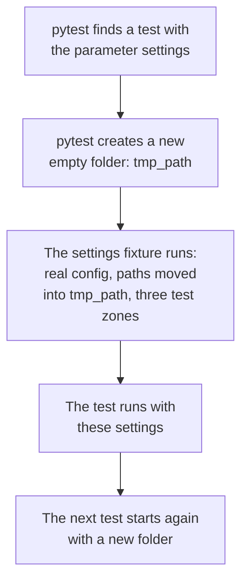

# Chapter 10 – Testing

You change one line in the settings code to support a new option. Everything seems fine. Three weeks later someone notices that a lag of one hour is accepted again: your change switched off the check from Chapter 7, and nothing told you. How could you have known on the same day? The answer is a test that states the rule and runs after every change.

## What you will learn

- What an automated test is and what it is for.
- How fixtures prepare what a test needs.
- How `tmp_path` and `monkeypatch` keep tests away from your real files and settings.
- How one parametrised test replaces many copies.
- What coverage measures, what it does not measure, and how the coverage gate works.
- Why the tests of this project never use the network.

## A test is a rule that runs

An **automated test** is a small function that runs a piece of your code and checks the result with `assert`. If the condition after `assert` is false, the test fails. The tool that finds and runs the tests is pytest. It collects every function whose name starts with `test_` in the folder `tests/`.

The most useful way to think about a test is as a rule of the project written in a form that a machine can check. Here is the rule about lags.

[`tests/unit/test_config.py`](../../tests/unit/test_config.py)

```python
def test_lag_shorter_than_horizon_is_rejected(tmp_path: Path) -> None:
    path = _write_config(tmp_path, features={"horizon_hours": 24, "lags": [1, 24]})

    with pytest.raises(
        ValidationError, match=r"features\.lags \[1\] are shorter than the 24 h.*leak"
    ):
        load_settings(path)
```

The name says what must be true. Line 2 writes a config file in which the horizon is 24 hours and the lags are 1 and 24. The helper `_write_config` copies the real config and replaces the given values. The test states its own horizon on purpose. When the horizon in the real config changed from 24 to 48 (Chapter 2), this test kept testing the same thing.

The last lines say: "loading this file must raise a `ValidationError`, and its message must name the lag 1, the horizon of 24 h and the word leak". The text after `match=` is a pattern: `\.` and `\[` stand for a real dot and a real bracket, and `.*` stands for any text in between. If loading succeeds, or the message is a different one, the test fails.

This test would have caught the mistake at the start of the chapter on the same day.

Notice the shape. Most tests have three steps: **arrange** (prepare the input), **act** (run the code), **assert** (check the result). Here the last two are combined in the `with` block.

## Fixtures: preparing what a test needs

Many tests need the same preparation. In this project, most need a settings object. Loading it in every test would repeat the same lines everywhere.

A **fixture** is a function that prepares something for tests. A test asks for a fixture by using its name as a parameter. pytest sees the name, runs the fixture, and passes the result in.

[`tests/conftest.py`](../../tests/conftest.py)

```python
@pytest.fixture
def settings(tmp_path: Path) -> Settings:
    """Project settings with a small frozen zone list and all paths under ``tmp_path``."""
    base = load_settings(CONFIG_FILE)
    return base.model_copy(
        update={
            "paths": base.paths.model_copy(
                update={"data_dir": tmp_path / "data", "reports_dir": tmp_path / "reports"}
            ),
            "data": base.data.model_copy(update={"zones": TEST_ZONES}),
        }
    )
```

The marker `@pytest.fixture` makes this function a fixture named `settings`.

The line starting with `base` loads the real config file of the project.

The `return` statement builds a changed copy. Chapter 7 said the settings are frozen, so the fixture does not modify them. It copies them with two changes. The data and report folders are moved to a temporary folder. The zone list is set to three zones, defined a few lines above as `TEST_ZONES = [132, 161, 237]`. The gold schemas of Chapter 8 need a zone list, and with a fixed small one the tests do not depend on the 20 zones in the config file.

The file name `conftest.py` is special. Fixtures in this file are available to every test in the folder without an import. A test uses the fixture like this:

```python
def test_valid_silver_trips_pass(settings: Settings) -> None:
    schemas.silver_trips_schema(settings).validate(_silver_trips())
```

The parameter is named `settings`, so pytest runs the fixture and gives the test its result.

## A new empty folder for every test

The fixture has a parameter of its own: `tmp_path`. This is a fixture that comes with pytest. It gives each test a new, empty folder that pytest removes later. Fixtures can ask for other fixtures in the same way that tests do.



*Figure 10.1 – What happens before each test that asks for `settings`.*

This protects two things. Your real `data/` folder cannot be damaged by a test, because no test knows where it is. And tests cannot affect each other, because each one starts with an empty folder. A test that passes alone and fails when run after another test is one of the most confusing problems in testing. Separate folders prevent a large class of such problems.

> [!IMPORTANT]
> Tests must be independent. Each test prepares what it needs and leaves nothing behind. Then the tests can run in any order, and a failure always points to one cause.

## Changing the world for one test

Some code depends on things outside itself: environment variables, the current folder, installed modules. To test it, you must change those things, and you must undo the change afterwards, even if the test fails. The pytest fixture **`monkeypatch`** does both: it changes something for the time of one test and restores it automatically.

```python
def test_environment_overrides_yaml(monkeypatch: pytest.MonkeyPatch) -> None:
    monkeypatch.setenv("DEMAND_MLFLOW__TRACKING_URI", "http://mlflow:5000")

    settings = load_settings(CONFIG_FILE)

    assert settings.mlflow.tracking_uri == "http://mlflow:5000"
    assert settings.mlflow.experiment_name == "taxi-demand"
```

Line 2 sets an environment variable for this test only. Then the settings are loaded. The first `assert` checks that the variable replaced the YAML value. The second checks that a value that was not overridden still comes from YAML. After the test, the variable is gone, and your real environment was never touched.

## Testing code that does not exist yet

Chapter 9 ended with a question: how can the stage commands be tested when many stages do not exist? The answer uses `monkeypatch` again.

[`tests/unit/test_cli.py`](../../tests/unit/test_cli.py)

```python
def _fake_module(monkeypatch: pytest.MonkeyPatch, name: str, **functions: object) -> None:
    module = types.ModuleType(name)
    module.__spec__ = types.SimpleNamespace(name=name)  # type: ignore[assignment]
    for function_name, function in functions.items():
        setattr(module, function_name, function)
    monkeypatch.setitem(sys.modules, name, module)
```

This helper creates an empty module object in memory, gives it the functions that the test passes in, and registers it in `sys.modules`, the table where Python keeps loaded modules. When the CLI then looks for `demand.data.pipeline`, it finds the fake. The fake function only records that it was called.

A replacement like this is called a **test double**: a simple object that stands in for a real one during a test. The test does not check that data is downloaded. It checks one thing: the command `ingest` calls the function `run_ingest` and passes the settings. That is the whole responsibility of the CLI, so it is the whole test.

## One test, many inputs

The silver schema must reject a zone of 264, a distance of zero, a distance of 150, and five more bad values. Eight functions that differ in one value would be tiresome to read and easy to get wrong. A **parametrised test** is one test function that pytest runs once for each entry in a list of inputs.

[`tests/unit/test_schemas.py`](../../tests/unit/test_schemas.py)

```python
@pytest.mark.parametrize(
    ("column", "value"),
    [
        (schemas.PICKUP_ZONE_ID, 264),
        (schemas.TRIP_DISTANCE, 0.0),
        (schemas.TRIP_DISTANCE, 150.0),
        (schemas.DURATION_MINUTES, 0.5),
        (schemas.DURATION_MINUTES, 361.0),
        (schemas.PASSENGER_COUNT, 0.0),
        (schemas.PASSENGER_COUNT, 9.0),
        (schemas.TOTAL_AMOUNT, -3.0),
    ],
)
def test_silver_trips_reject_bad_values(settings: Settings, column: str, value: float) -> None:
    frame = _silver_trips()
    frame.loc[0, column] = value

    with pytest.raises(pandera.errors.SchemaError):
        schemas.silver_trips_schema(settings).validate(frame)
```

The marker names two parameters, `column` and `value`, and gives eight pairs. pytest runs the function eight times and reports each run separately.

The body shows a pattern worth remembering. Build one correct table. Break exactly one value. Expect a refusal. Because only one thing is wrong, a pass proves that this one rule works. If you built a table with five problems, the test would pass even if four of the rules were missing.

## Coverage

**Coverage** is the share of your code that the tests execute. If the tests never run a function, coverage shows it. This project also measures **branch coverage**: for every `if`, both outcomes must be executed.

Coverage has a clear limit. It tells you which code is not tested. It does not tell you that tested code is tested well. A test that calls a function and checks nothing gives full coverage for that function. Use coverage to find gaps, not as a measure of quality.

The project sets a minimum in [`pyproject.toml`](../../pyproject.toml):

```toml
[tool.coverage.report]
fail_under = 80
```

When you run the tests with the option `--cov`, pytest measures coverage, and the run fails if the total is under 80%, even if every test passes. This is the **coverage gate**. It ensures that new code does not arrive without tests.

Coverage is measured only when you ask for it. The same file says why:

```toml
# Coverage is opt-in (`--cov`), so running a single test file does not trip the
# 80% gate below. The full check and CI always pass `--cov`.
addopts = "-ra --strict-markers"
```

While you work on one test file, you run that file many times. One file executes only part of the code, so a gate on every run would fail every time. The gate is applied to the complete run. Chapter 13 tells the story behind this comment.

## No network in tests

The first line of `conftest.py` states a rule: "Tests never touch the network or the real data folders."

Imagine a test that downloads a real TLC file. It takes minutes. It fails when the website is slow or your connection is down. It gives a different result when the file is corrected at the source. A failed test then no longer means "the code is broken", and after a few false alarms people stop reading failures. Tests are only useful if a failure can be trusted.

So the tests build tiny tables in memory, as `_silver_trips()` does with two rows, and replace outside services with test doubles. The complete suite runs in about six to twelve minutes on the machines of this book. Chapter 14 shows how the download code, which does almost nothing except use the network, is tested under the same rule.

## Try it yourself

Run one test file.

```powershell
.venv\Scripts\python.exe -m pytest tests/unit/test_config.py -q
```

You should see `19 passed`. Each dot in the output is one passed test. No coverage is shown, because `--cov` was not given.

Run one test by a part of its name.

```powershell
.venv\Scripts\python.exe -m pytest tests/unit/test_config.py -q -k "lag_shorter"
```

You should see `1 passed, 18 deselected`. This is the test from the start of this chapter.

Run everything with coverage.

```powershell
.venv\Scripts\python.exe -m pytest --cov -q
```

You should see `1003 passed, 173 warnings` after about six to twelve minutes, depending on the machine (5 minutes 57 seconds for this book), a table with one line per source file, and the line `Required test coverage of 80.0% reached. Total coverage: 99.93%`. The warnings all come from libraries. One is from the test client of FastAPI (Chapter 30), ten from NumPy and Litestar, two libraries that Evidently imports (Chapter 35), and three from MLflow and its database library SQLAlchemy (Chapter 26): fourteen, as before. The other 159 are new: SQLAlchemy complains about a column type of Prefect's server. They appear in the tests of the retraining flow, which set up an MLflow database after the tests of Chapter 38 have loaded Prefect's server code into the same process. Run alone, those tests give their usual 12 warnings. The numbers grow as the project grows. In the table, the column `Missing` lists line numbers that no test executed. This proves the gate is active for the complete run.

## Key takeaways

- A test is a rule of the project in a form that a machine checks after every change.
- A fixture prepares what tests need. Tests ask for it by parameter name.
- `tmp_path` gives each test its own empty folder, so tests cannot damage real data or each other.
- `monkeypatch` changes the environment or a module for one test and restores it.
- A parametrised test runs the same check with many inputs. Break one thing at a time.
- Coverage finds code that is not tested. The gate applies to the complete run with `--cov`.
- Tests never use the network, so a failure always means something about the code.

## Exercises

**1.** A test passes when you run it alone and fails when you run the whole suite. Name two possible causes, and say which feature of this project's tests protects against each.

<details>
<summary>Answer</summary>

One cause: an earlier test left files behind that this test reads. `tmp_path` protects against this, because each test has its own empty folder. Another cause: an earlier test changed shared state, such as an environment variable or the cached settings object, and did not restore it. `monkeypatch` restores what it changed, and the CLI tests clear the settings cache before and after each test.

</details>

**2.** A project reports 100% coverage, and a serious bug is still found in a tested function. How is that possible?

<details>
<summary>Answer</summary>

Coverage counts executed lines, not checked results. The test may call the function without an `assert` on its output, or check only one easy input. A function that divides two numbers has full coverage after one call with 6 and 3, and nothing has tested a divisor of zero. Coverage shows where tests are missing. It cannot show that existing tests are good.

</details>

**3.** In `test_silver_trips_reject_bad_values`, why does each case change only one value of a table that is otherwise correct?

<details>
<summary>Answer</summary>

So that the refusal can have one cause only. If the table had a bad distance and a bad total amount, the schema would refuse it even if the rule for the total amount were missing completely. The test would pass and prove nothing about that rule. One change per case means each case is evidence for exactly one rule.

</details>

**4. Interview question.** "How do you test code that depends on an external service, such as a download?"

<details>
<summary>Points of a good answer</summary>

- Unit tests do not call the service. They are fast and give the same result every time.
- Separate the logic from the access: functions that transform data take a table and return a table, so they can be tested with a small table built in memory.
- Replace the access with a test double, for example with `monkeypatch`, and check how your code reacts to success, to an error and to bad content.
- Use small fixed sample data stored in the repository where realistic input is needed.
- A slower test against the real service can exist separately, marked as such, and not as part of the normal run.

</details>

---

[Previous: Chapter 9 – The command line and logging](09-command-line-and-logging.md) | [Contents](README.md) | [Next: Chapter 11 – Code quality tools](11-code-quality-tools.md)
