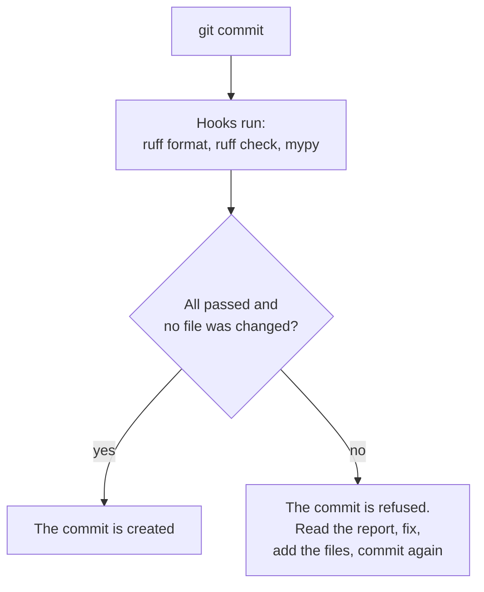

# Chapter 11 – Code quality tools

A function is called with the text `"data/raw"` where it expects a path object. The call sits in a branch of the code that runs only when a download fails. So the mistake stays hidden until the first failed download, at night, in production. A person reviewing the code could have seen it, on a good day. A program can see it every time, in one second. This chapter introduces three such programs.

## What you will learn

- What a linter, a formatter and a static type checker do, and how they differ from tests.
- How ruff and mypy are configured in this project, and why mypy runs in strict mode.
- What a git hook is and how pre-commit uses hooks.
- Why a configured tool is not the same as an active tool.

## Checking code without running it

A test runs your code and checks the result. The tools in this chapter do something different: they read the code as text and find problems without executing it. This is called **static analysis**. It is fast, it covers every line including the ones that rarely run, and it needs no test to be written first.

Static analysis and tests find different problems. A static tool can see that a variable is never used or that a text is passed where a number is expected. It cannot know that your cleaning rule removes the wrong trips. You need both.

## The linter and the formatter: ruff

A **linter** is a tool that reads code and reports likely mistakes and bad habits. A **formatter** is a tool that rewrites the layout of code (spaces, line breaks, quotes) in one fixed style, without changing what the code does. The tool ruff does both jobs.

The formatter ends a kind of discussion that wastes time in every team: where to break a line, which quotes to use. Nobody decides. The tool decides, and everyone's code looks the same. This also keeps the history clean, because a change in a file shows only real changes and never a new layout.

The linter is configured in [`pyproject.toml`](../../pyproject.toml).

```toml
[tool.ruff.lint]
select = ["E", "F", "W", "I", "B", "UP", "N", "SIM", "PTH", "C4", "D", "RUF"]
ignore = ["D100", "D104", "D105", "D107"]
```

Each code in `select` switches on a family of rules. The table explains the ones that matter most in this project.

| Code | What the rules check | Why it is useful here |
|---|---|---|
| `F`, `E`, `W` | Unused imports, undefined names, basic style | Finds dead code and simple mistakes |
| `I` | The order of imports | The same order in every file, so fewer conflicts between changes |
| `B` | Patterns that are often bugs | For example a list used as a default argument |
| `UP` | Old ways of writing things | Keeps the code in the style of Python 3.12 |
| `PTH` | Use of `os.path` where `pathlib` exists | Paths that work on Windows and on Linux |
| `D` | Missing or badly formed docstrings | Every public function says what it does |

*Table 11.1 – Selected rule families of ruff.*

The rule family `PTH` is a good example of a tool protecting a project decision. The code is written on Windows and runs on Linux, and the two systems write paths differently. `pathlib` handles the difference. The linter makes sure nobody goes back to the old way by habit.

One more setting is worth a look.

```toml
[tool.ruff.lint.per-file-ignores]
"tests/**" = ["D"]
```

The docstring rules are switched off for tests. A test has a long descriptive name, such as `test_lag_shorter_than_horizon_is_rejected`, and a docstring would only repeat it. Rules should be applied where they help.

## The type checker: mypy

A **type hint** is a note in the code that says which type a value has. In `def get_logger(name: str) -> logging.Logger`, the hints say that `name` is text and that the function returns a logger. Python itself ignores type hints when it runs.

A **static type checker** reads the hints and reports every place where they contradict each other. If a function says it wants a `Path` and somewhere it is called with a `str`, the checker reports that line. This project uses the checker mypy.

Go back to the opening of the chapter. With type hints, the wrong call is found when the code is written. It does not matter that the branch rarely runs, because the checker reads every line.

Type hints also work as documentation that cannot become false. A comment that says "this returns a list of zone numbers" may be wrong a month later. The hint `-> list[int]` is checked on every run of mypy.

```toml
[tool.mypy]
python_version = "3.12"
strict = true
files = ["src"]
plugins = ["pydantic.mypy"]
```

`strict = true` is the important line. Without it, mypy checks only functions that have hints and stays silent about the others. In strict mode, every function must have hints, so nothing is skipped. Starting a project in strict mode is easy. Switching it on later means fixing hundreds of reports at once.

`files = ["src"]` means the package is checked. `plugins` loads an extension that teaches mypy how the settings classes of Chapter 7 behave.

> [!NOTE]
> Some libraries do not provide type information. For those, a block named `[[tool.mypy.overrides]]` in `pyproject.toml` tells mypy not to complain that the information is missing. This is a normal compromise: your own code is fully checked, and calls into such a library are trusted.

## Checking at the right moment: pre-commit

These tools help only if they run. A person who must remember to run three commands before every commit will forget.

A **git hook** is a script that git runs automatically at a certain moment, for example just before it creates a commit. If the script fails, git stops. The tool pre-commit manages such hooks from a config file, [`.pre-commit-config.yaml`](../../.pre-commit-config.yaml).

```yaml
      - id: ruff-check
        name: ruff check
        entry: python -m ruff check --fix
        language: system
        types: [python]
```

This is one of three hooks. The others run `ruff format` and `mypy`.

`entry` is the command that runs. `--fix` lets ruff repair simple problems itself.

`types: [python]` means the hook runs only when Python files are part of the commit.

`language: system` means: use the tools that are already installed, do not download separate ones. The first line of the file gives the reason: "Hooks run the tools installed in the project venv, so versions always match CI." The more common setup lets pre-commit download its own copy of each tool. Then the hook might use one version of ruff and the lock file another, and the two could disagree about the same code. With `language: system` there is one version, the one in the lock file.



*Figure 11.1 – What happens when you commit with the hooks installed.*

## Configured is not active

The choice of `language: system` has a consequence. The command is `python -m ruff ...`, so the word `python` must mean the Python of the project. The virtual environment must be active in the shell where you type `git commit`.

There is a second condition, and it is easy to miss. The config file is stored in the repository. The hook itself, the small script that git runs, is stored in the folder `.git/hooks/`, and that folder is not shared through git. Every person who clones the repository must run `pre-commit install` once. Until then, the config file is present and nothing runs.

> [!WARNING]
> A config file in the repository describes what should happen. It does not prove that it happens. Check that the tool really runs. Chapter 13 tells how this project made exactly this mistake.

The setup steps in the [project README](../../README.md) include the install command, and the README lists the complete set of checks:

```powershell
python -m ruff format --check .
python -m ruff check .
python -m mypy
python -m pytest --cov
```

These four lines are what "the checks pass" means in this project.

## Try it yourself

Run the linter, the format check and the type checker.

```powershell
.venv\Scripts\python.exe -m ruff check .
.venv\Scripts\python.exe -m ruff format --check .
.venv\Scripts\python.exe -m mypy
```

You should see `All checks passed!`, then `102 files already formatted`, then `Success: no issues found in 48 source files`. The numbers grow with the project. `--check` makes the formatter report without changing files.

Give the linter a line with a problem. The text before the `|` is sent to ruff as if it were a file named `demo.py`.

```powershell
"import os" | .venv\Scripts\python.exe -m ruff check --stdin-filename demo.py -
```

You should see a report that begins with:

```text
F401 [*] `os` imported but unused
```

The code `F401` belongs to the family `F` from Table 11.1. This proves the linter found an unused import without running anything.

Give the type checker a line with a problem.

```powershell
.venv\Scripts\python.exe -m mypy --config-file= --strict -c "import math; math.sqrt('nine')"
```

You should see:

```text
<string>:1: error: Argument 1 to "sqrt" has incompatible type "str"; expected "SupportsFloat | SupportsIndex"  [arg-type]
Found 1 error in 1 file (checked 1 source file)
```

The function `math.sqrt` wants a number and received text. mypy reports it without executing the line. The option `--config-file=` tells mypy to ignore the project settings for this demonstration, because those settings say "check the folder `src`".

Check that the hook is installed in your copy.

```powershell
Test-Path .git\hooks\pre-commit
```

You should see `True`. If you see `False`, run `pre-commit install` with the virtual environment active, as the README describes.

## Key takeaways

- Static analysis reads code without running it. It covers every line, including branches that rarely run.
- A formatter removes all discussion about layout. A linter finds likely mistakes and keeps project decisions, such as the use of `pathlib`.
- A type checker finds contradictions between type hints. Strict mode means no function is skipped.
- pre-commit runs the checks before each commit, using the tool versions from the lock file.
- The hook must be installed in each clone, and the virtual environment must be active when you commit.

## Exercises

**1.** mypy reports no problems. Does that mean the code is correct? Give an example of a bug it cannot find.

<details>
<summary>Answer</summary>

No. mypy checks that types agree, not that the logic is right. A function that should remove trips longer than 6 hours and uses `<` where it should use `>` has perfectly correct types: a table goes in and a table comes out. Only a test that gives it a long trip and checks that the trip is gone will find the mistake.

</details>

**2.** A colleague says: "Strict mode is too much work. Let us add type hints later, where we need them." What is the argument against this?

<details>
<summary>Answer</summary>

Without strict mode, mypy does not check functions that have no hints, and it does not tell you that it skipped them. The parts of the code "where we need them" are usually the complicated parts that nobody had time to annotate. So the checking is missing where it matters most. Also, adding hints later means changing every function at once, and the first run reports hundreds of problems. Starting strict costs a few seconds per function.

</details>

**3.** The hooks pass on your machine, and the same checks fail on a colleague's machine with a different message from ruff. The code is identical. What is the most likely cause, and how does this project reduce the risk?

<details>
<summary>Answer</summary>

Different versions of ruff. A newer version can contain new rules or change old ones. This project reduces the risk in two ways: the lock file pins the version of ruff, and the hooks use `language: system`, so they run the pinned version from the virtual environment and not a separate copy. The colleague has probably not installed from the lock file.

</details>

---

[Previous: Chapter 10 – Testing](10-testing.md) | [Contents](README.md) | [Next: Chapter 12 – Working with git](12-working-with-git.md)
