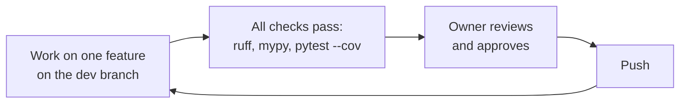

# Chapter 12 – Working with git

You fix one line in a file and look at the change before you commit. Git shows all 200 lines as modified. In another project, someone commits a file with a database password, removes it one hour later, and learns that it can still be read by anyone who has the repository. Both problems come from not telling git, at the start, how to treat the files of the project. This chapter covers that, and the working rules for commits and branches.

## What you will learn

- Why Windows and Linux disagree about the end of a line, and how `.gitattributes` settles it.
- Which files stay out of the repository and why.
- Why a secret that was committed once is never really removed.
- How conventional commit messages are written.
- How the `dev` branch and the "one feature per push" rule work.

## The invisible character at the end of a line

A text file marks the end of each line with invisible characters. Windows uses two of them, called **CRLF**. Linux and macOS use one, called **LF**. You cannot see the difference in an editor, but programs can.

This project is written on Windows and runs in Linux containers. Without a rule, two things go wrong. First, a tool on one system rewrites the line endings of a file, and git reports every line as changed, although no visible character is different. A real one-line change is then hidden among 200 false ones. Second, a script with Windows line endings can fail on Linux with an error that mentions a command that is not in the file.

The file [`.gitattributes`](../../.gitattributes) tells git how to treat files. Here it is, complete.

```gitattributes
* text=auto eol=lf
*.parquet binary
*.png binary
*.ps1 text eol=crlf
```

Line 1 applies to all files (`*`). `text=auto` lets git decide which files are text. `eol=lf` says that text files use LF, in the repository and in your working folder, also on Windows. Modern editors on Windows handle LF without problems.

Lines 2 and 3 mark two kinds of files as **binary**, which means "not text, never change any byte". Parquet is the format of the data files. If git "corrected" bytes inside a Parquet file that happen to look like line endings, the file would be destroyed.

Line 4 is an exception. PowerShell scripts are Windows files and keep CRLF.

The rule goes from general to specific: one default, then exceptions.

## What does not belong in the repository

A git repository keeps every version of every file for ever. That is its purpose, and it is the reason to be careful about what goes in. The file [`.gitignore`](../../.gitignore) lists patterns for files that git should not track. The entries of this project fall into four groups.

**Things that can be rebuilt.** The virtual environment `.venv/`, the folders `__pycache__/`, `build/` and `dist/`, and the caches of the tools. They are created from other files in the repository, they are large, and some differ between Windows and Linux. Storing them would only add size and conflicts.

**Data and models.** This is the most important group for an ML project.

```gitignore
# Data and model artefacts (versioned by DVC / MLflow, not git)
/data/
/reports/
/mlruns/
/mlartifacts/
mlflow.db
*.parquet
!tests/fixtures/**/*.parquet
```

One month of trip data is a large file. Git keeps every version, so each new download would be added to the history and stay there. The repository would grow by gigabytes and every clone would be slow. Data and models are versioned by tools made for large files, which arrive in Parts III and IV.

The last line starts with `!`, which means "do not ignore". Small Parquet files in the test folder are an exception. Tests must run without a download (Chapter 10), so their sample data must be in the repository.

**Secrets.**

```gitignore
# Secrets and local settings
.env
.env.*
!.env.example
```

The `.env` file of Chapter 7 may hold passwords. It is ignored, together with any variant such as `.env.local`. The exception is `.env.example`, which contains names and no real values.

> [!WARNING]
> Deleting a committed secret in a later commit does not remove it. The old version stays in the history, and everyone who has a copy of the repository can read it. If a secret was ever committed, treat it as public: change the password or cancel the key.

**Personal files.** The settings of your editor and files that the operating system creates. They are different for each person.

## Messages that explain

A commit message is read much later, by someone who is searching for the change that broke something. A history of messages such as "update", "fix" and "more changes" gives that person nothing.

**Conventional commits** is a simple format for the first line of a message: a type, a colon, and a short description. The history of this project starts like this:

```text
72b97b4 chore: project foundation (phase 0)
```

The type tells the reader what kind of change it is before they read further.

| Type | Meaning |
|---|---|
| `feat` | New behaviour |
| `fix` | A bug is repaired |
| `docs` | Documentation only |
| `test` | Tests only |
| `refactor` | Better structure, same behaviour |
| `chore` | Setup and maintenance |
| `ci` | Automatic checks and delivery |

*Table 12.1 – Common commit types.*

With this format, a long history can be scanned quickly. When a forecast becomes worse, you look at the `feat` and `fix` commits in the data and model code first, and skip `docs` and `test`.

## Small steps on a branch

A **branch** is a named line of commits. Work in this project happens on a branch named `dev`. A branch named `main` is planned as the stable line: work will arrive there after review, and the automatic delivery of Part IX will start from it.

To **push** is to send your commits to the shared copy of the repository. This project has a rule for pushes: each push contains one finished feature, with its tests and its part of this book, and the owner approves it first.



*Figure 12.1 – The cycle of one push.*

The reason is the size of what a person can check. A change of 200 lines about one thing can be read and understood. A change of 2,000 lines that mixes a cleaning rule, a renamed function and a new library cannot. Reviewers of large changes look for a while and then approve.

Small pushes also make mistakes cheap. If a push causes a problem, you know which feature caused it, and you can undo that one push without losing anything else.

> [!TIP]
> Before you commit, read your own change with `git diff`. Many mistakes are found by the author in this minute: a forgotten `print`, a file that should not be there, a line that was changed by accident.

## Try it yourself

All commands here only read. They change nothing.

See the line endings of a file as git knows them.

```powershell
git ls-files --eol pyproject.toml
```

You should see a line beginning with `i/lf    w/lf    attr/text=auto eol=lf`. The `i` is the version in the repository, the `w` is the version in your working folder. Both are LF, on Windows. This proves `.gitattributes` is applied.

Ask git how it would treat two files that do not exist yet.

```powershell
git check-attr -a -- tests/fixtures/x.parquet run.ps1
```

You should see, among other lines, `tests/fixtures/x.parquet: binary: set` and `run.ps1: eol: crlf`. These are lines 2 and 4 of `.gitattributes` at work.

Ask git why a file is ignored.

```powershell
git check-ignore -v .env data/raw/x.parquet tests/fixtures/a/b.parquet
```

You should see three lines:

```text
.gitignore:31:.env	.env
.gitignore:18:/data/	data/raw/x.parquet
.gitignore:24:!tests/fixtures/**/*.parquet	tests/fixtures/a/b.parquet
```

Each line gives the file, the line number and the pattern that decided. For the third file the deciding pattern starts with `!`: it is the exception, so this file is not ignored.

Read the history.

```powershell
git log --oneline
```

You should see one line per commit, newest first, each in the form `type: description`. The oldest line, at the bottom, is `72b97b4 chore: project foundation (phase 0)`.

## Key takeaways

- `.gitattributes` fixes line endings to LF for text and protects binary files from any change.
- `.gitignore` keeps out what can be rebuilt, what is large, what is secret and what is personal.
- Data and models are not stored in git, because git keeps every version for ever.
- A committed secret stays in the history. The only fix is to change the secret.
- A commit message starts with a type and says what changed.
- One feature per push keeps changes small enough to review and to undo.

## Exercises

**1.** A teammate proposes to commit the `data/` folder "so that everyone has the same data". Give two reasons against it, and say how this project gives everyone the same data.

<details>
<summary>Answer</summary>

First, size: git keeps every version of every file, so each new or changed data file stays in the history and every clone becomes slower. Second, git cannot show a meaningful difference between two versions of a binary data file, so the main benefit of git is lost. In this project the raw data is public and the download is repeatable, so everyone can rebuild the same data from the source, and a tool made for large files will record the versions.

</details>

**2.** You see that a file with an API key was committed and pushed ten minutes ago. Put these actions in order and explain: delete the file in a new commit; cancel the key and create a new one; add the file name to `.gitignore`.

<details>
<summary>Answer</summary>

Cancel the key first. It is the only action that makes the leak harmless, because the key is already in the history and possibly in other people's copies. Then add the file name to `.gitignore` so that it cannot happen again, and delete the file in a new commit. The last two actions are tidying. They do not protect the old key.

</details>

**3.** A commit has the message `fix: handle empty zone list`. It also renames ten functions and upgrades pandas. What is wrong, and how should it have been done?

<details>
<summary>Answer</summary>

The message describes one of three changes. A reader who searches for the cause of a new problem will skip this commit, because a small fix for an empty list looks harmless, and the pandas upgrade is hidden inside it. It should be three commits: one `fix`, one `refactor` for the renames, and one `chore` for the upgrade. Then each can be reviewed, understood and undone alone.

</details>

---

[Previous: Chapter 11 – Code quality tools](11-code-quality-tools.md) | [Contents](README.md) | [Next: Chapter 13 – A code review of our own foundation](13-a-code-review-of-our-own-foundation.md)
