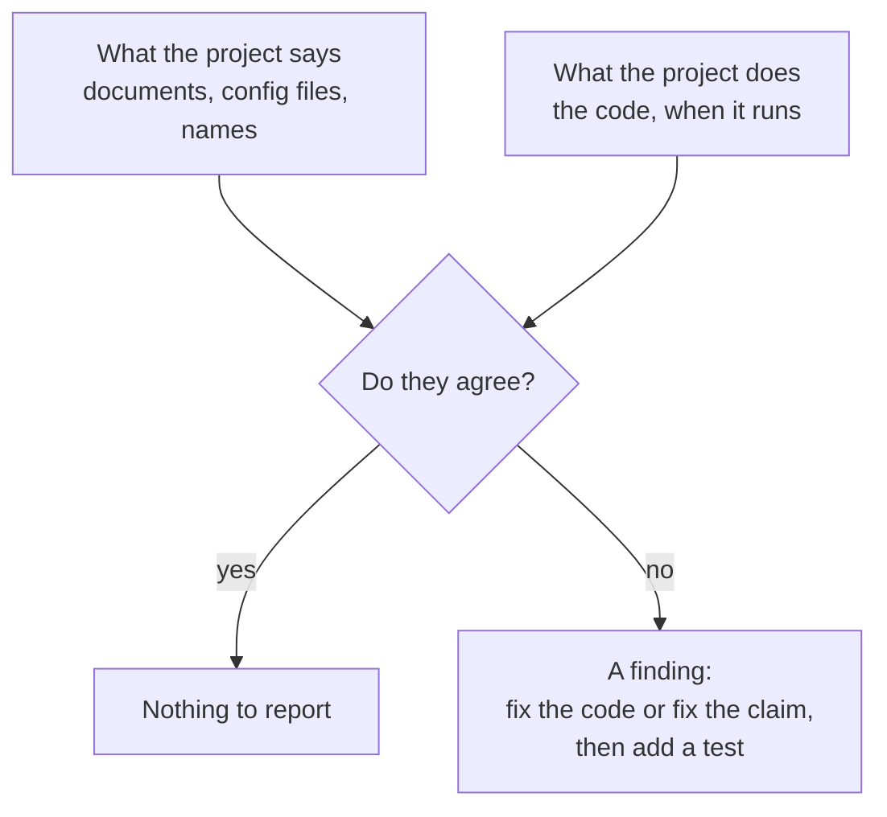

# Chapter 13 – A code review of our own foundation

After the foundation was finished, all tests passed, the linter and the type checker reported nothing, and coverage was above 99%. Then the code was read from start to end in order to write this book, and every documented command was run. That reading found five problems. None of them was a crash. Each was a place where the project said one thing and did another. This chapter tells the five stories, because the way they were found is a skill you will use for the rest of your career.

## What you will learn

- What a code review is and what it can find that tests cannot.
- Five kinds of problems to look for, each with a real example from this repository.
- The questions a careful reader asks.
- How each problem was fixed, and how the fix is kept in place.

## What tests cannot see

A **code review** is the reading of a change by someone other than its author, before the change is accepted. Its purpose is to find mistakes and to check that the code, the tests and the documents agree with each other.

Tests check what their author thought of. If the author did not think about an empty zone list, no test covers it, and the test report stays green. A reviewer brings different questions. The most useful questions are simple: "What happens with the default settings?" "Is this sentence in the documentation true?" "Does this tool really run?"

The reading that found these problems had a particular form: it had to explain the code to a beginner. To explain a thing you must know exactly what it does, so you check. This is why writing documentation and teaching are good ways to review.

## Story 1: the document promised something the code did not do

The file `.env.example` began with the instruction "Copy to .env and adjust." The natural next step for a reader is to do that. But the settings code read only real environment variables. A `.env` file was never opened. You could put a value in it, start the program, and nothing would change. No error told you so.

It was found by comparing the sentence with the code that should make it true. The function that loads the settings contained nothing that opens a `.env` file.

A wrong document is worse than no document. With no document, people read the code. With a wrong one, they trust it and search for their mistake somewhere else.

The fix was to make the code do what the document says. The loading function now begins with this line, which Chapter 7 explained:

[`src/demand/config.py`](../../src/demand/config.py)

```python
    load_dotenv(DOTENV_FILE, override=False)
```

A new test, `test_dotenv_file_is_read_and_the_environment_wins_over_it`, writes a `.env` file in a temporary folder and checks two things: a value from the file is used, and a real environment variable wins over the file. The promise is now a rule that runs.

> [!TIP]
> When you review, treat every instruction in a README or a comment as a claim, and test it. Follow the setup steps on a clean copy. Run the examples. Documents become false silently, because no test fails when they do.

## Story 2: a gate that was open

The gold tables may contain only the chosen zones. The schema helper had this logic: if a zone list is configured, accept only those zones; otherwise accept any zone from 1 to 263.

The word "otherwise" was the problem. In the config file the list is empty, because the zones are not chosen yet. So the "otherwise" case was not a rare exception. It was the normal state of the project. The gold gate would have accepted a table with every zone and reported success.

It was found by asking: "What does this function do with the config as it is today?"

Chapter 8 introduced the idea behind the fix. A check that cannot do its job can **fail open**, which lets everything pass, or **fail closed**, which stops. The helper now fails closed: it raises an error that names the missing list and the command that creates it. The test `test_frozen_zone_schemas_refuse_an_empty_zone_list` checks this for all three schemas that use the list.

| | Before | After |
|---|---|---|
| Zone list has entries | Only those zones pass | Only those zones pass |
| Zone list is empty | Every zone from 1 to 263 passes | Error: "data.zones is empty: run ..." |
| What "passed" means | Unclear | The zones were checked |

*Table 13.1 – The gold zone check before and after the fix.*

The original code was written with a good intention: do not block work while the list is missing. This is how most gates that fail open are created. Someone adds a helpful default for the case where the information is not there.

## Story 3: a gate in the wrong place

The coverage gate of Chapter 10 requires 80%. Originally the option that measures coverage was part of the default options of pytest, so it applied to every run.

Running one test file is the normal way to work on that file. One file executes only part of the code. So this happened: all 14 tests of the file passed, and the run ended with a failure, because coverage was 50%.

It was found by running a command that every developer runs many times a day and seeing a red result for correct work.

A check that fails during normal, correct work is harmful. People learn that a red result means nothing, or they add an option that switches the check off and then use that option everywhere. Both remove the protection.

The fix did not lower the limit. It moved the moment of checking. Coverage is now measured when you pass `--cov`, which the complete check does:

[`pyproject.toml`](../../pyproject.toml)

```toml
# Coverage is opt-in (`--cov`), so running a single test file does not trip the
# 80% gate below. The full check and CI always pass `--cov`.
addopts = "-ra --strict-markers"
```

The general rule: a gate should be strict at the point where a decision is made, such as accepting a change, and silent everywhere else.

> [!NOTE]
> The comment mentions CI, the automatic checks that will run on every push. They arrive in Part IX. Until then, running `python -m pytest --cov` before a push is a manual step.

## Story 4: a tool that was configured but not active

The repository contained `.pre-commit-config.yaml` with three hooks. It looked as if every commit was checked. But, as Chapter 11 explained, the hooks run only after `pre-commit install` has been executed in each copy of the repository. In this copy it had not been executed, and the setup steps in the README did not mention it. So no hook ran when a commit was made.

It was found by looking for the effect and not the intention: does the file `.git\hooks\pre-commit` exist? It did not.

Nobody would have noticed for a long time, because the absence of a check produces no message. The fix was to install the hooks and to add the command, and a note about the virtual environment, to the README.

This pattern is common outside git too: an alert that is defined and sent to nobody, a backup that is scheduled and has never been restored, a test file that the test runner does not collect. For each safety tool, ask: "How would I know if this had stopped working?"

## Story 5: the formatter that rewrote the book

The last story happened while the others were being fixed. The command `ruff format .` formats Python code. It also formats Python code blocks inside Markdown files. An earlier version of this book contained a code excerpt that started in the middle of a function, with the original indentation. The formatter treated it as a complete program, "corrected" the indentation, and the excerpt no longer matched the source file.

It showed up as a change in a document that nobody had edited. That is visible only to someone who looks at the list of changed files before committing.

The fix is one setting:

[`pyproject.toml`](../../pyproject.toml)

```toml
# Markdown code blocks are short excerpts, not complete code; leave them as written.
extend-exclude = ["*.md"]
```

The lesson is about automatic tools in general. A tool that rewrites files will, one day, rewrite something you did not expect. The protection is the habit from Chapter 12: read your own change before you commit it.

## What the five have in common



*Figure 13.1 – The question behind every finding in this chapter.*

In every story there was a difference between a claim and the real behaviour. And every one was silent: no exception, no failing test, no warning.

The fixes also have something in common. Where possible, the claim was turned into a test, so that it cannot become false again without a red result. A fix without a test is correct today. A fix with a test stays correct.

## Try it yourself

See story 2 in its fixed state.

```powershell
.venv\Scripts\python.exe -c "from demand.config import get_settings; from demand.schemas import gold_demand_schema; gold_demand_schema(get_settings())"
```

You should see an error ending with `ValueError: data.zones is empty: run ...`. The gate refuses to exist without its list.

Run the tests that keep stories 1 and 2 fixed.

```powershell
.venv\Scripts\python.exe -m pytest tests/unit/test_config.py -q -k dotenv
.venv\Scripts\python.exe -m pytest tests/unit/test_schemas.py -q -k "empty_zone_list or does_not_need"
```

You should see `1 passed, 14 deselected` and then `4 passed, 23 deselected`. The second group has three tests for the three schemas that need the list, and one that checks the silver schema still works without it.

See story 3 in its fixed state.

```powershell
.venv\Scripts\python.exe -m pytest tests/unit/test_config.py -q
```

You should see `15 passed`, and the run ends without a failure. Before the fix, this command ended with a coverage failure.

Check story 4 in your own copy.

```powershell
Test-Path .git\hooks\pre-commit
```

You should see `True`. If it says `False`, your commits are not checked: run the setup steps from the README.

## Key takeaways

- Passing tests show that the code does what its author thought of. A review asks about what the author did not think of.
- Treat every sentence in a document as a claim and check it against the code.
- Ask what a check does when its information is missing. It must fail closed.
- A gate belongs where a decision is made. A gate that fails during normal work will be switched off.
- A config file does not prove that a tool runs. Look for the effect.
- Read the complete change before committing, especially after an automatic tool has run.
- Turn each fixed problem into a test.

## Exercises

**1.** You review a function that sends an alert when the forecast error is above a limit. The limit is read from the settings, and the code says: "if no limit is configured, skip the check". What do you write in your review?

<details>
<summary>Answer</summary>

This check fails open. If the limit is missing, because of a typing mistake or a new environment, no alert is ever sent and nothing shows that monitoring is off. Ask for one of two changes: make the limit a required setting, so that the program does not start without it, or raise an error when it is missing. Also ask for a test of the case without a limit.

</details>

**2.** In story 3, a simpler fix was available: lower the limit from 80% to 40%, so that single files pass. Why is that worse?

<details>
<summary>Answer</summary>

It weakens the gate at the place where it matters, the complete run, in order to remove a problem at a place where it should not apply at all. With a limit of 40%, a large amount of new code without tests would be accepted. The real problem was not the height of the limit but the moment of the check. A good fix removes the cause and keeps the protection.

</details>

**3.** Choose one safety tool from the earlier chapters, such as the lock file, the `.gitignore` entry for `.env`, or the leakage validator. Describe how you would confirm that it is really active, without trusting the config file.

<details>
<summary>Answer</summary>

Examples. Lock file: compare an installed version with the pinned one, as in Chapter 6 (`pandas.__version__` against the line in `requirements.lock`). `.gitignore`: run `git check-ignore -v .env` and see that a pattern matches. Leakage validator: set a lag of 1 through an environment variable and see that the program refuses to start, as in Chapter 2. In every case you cause the situation the tool should handle and observe the effect.

</details>

**4. Interview question.** "Tell me about a problem you found in a code review."

<details>
<summary>Points of a good answer</summary>

- Choose one concrete case, for example the schema gate that accepted every zone when its list was empty.
- Say how you found it: by asking what the code does with the default settings, not by waiting for a failure.
- Explain why it mattered: a passed check that had checked nothing, and zones in training that were never selected from the training period.
- Describe the fix and how it stays fixed: the gate fails closed with a message that says what to do, and a test covers the empty case.
- Add the general idea you took from it: a check that cannot run must stop, not pass.

</details>

---

[Previous: Chapter 12 – Working with git](12-working-with-git.md) | [Contents](README.md) | [Next: Appendix A – Stack map](appendix-a-stack-map.md)
