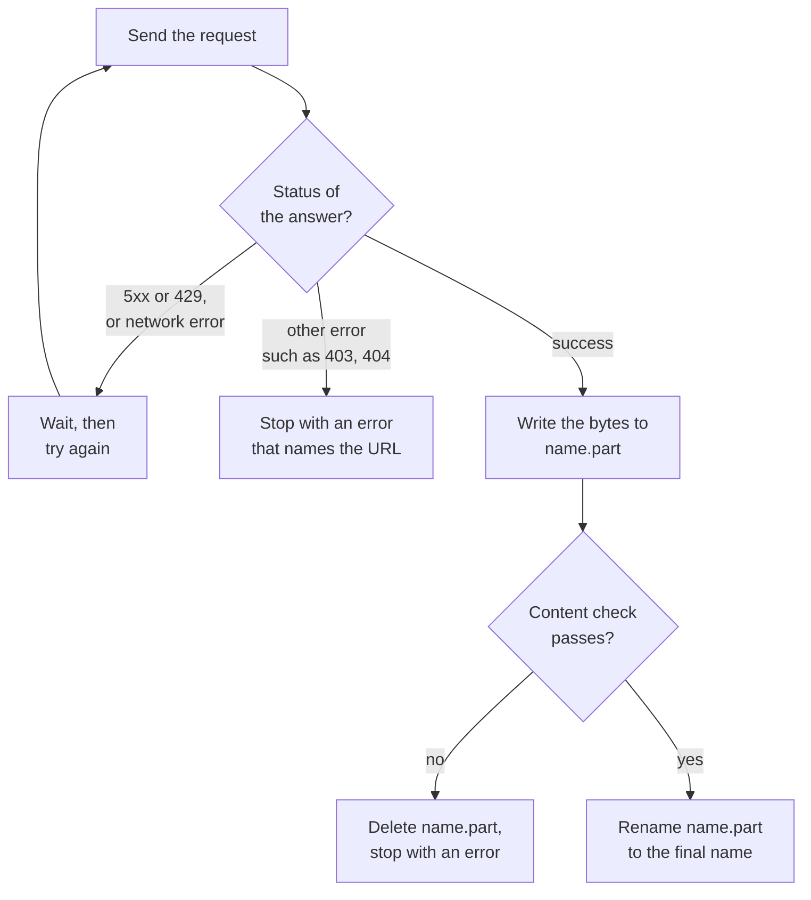

# Chapter 14 – Getting the data: downloads you can trust

You start a download of a 70 MB file and close the laptop. The next morning the file is there, with the right name. You train a model on it. Days later you learn that the file holds only the first half of the month, because the connection dropped at 35 MB and the script did not notice. A download looks like the simplest step of a pipeline. This chapter shows what can go wrong in it and how the ingestion code of this project defends against each problem.

## What you will learn

- What the raw layer contains and why its files are stored exactly as received.
- Three ways a download can fail without an error message.
- How a temporary file and an atomic rename guarantee that a file is complete.
- Why a file is checked before it is accepted.
- Which failures are worth a second attempt, which are not, and what exponential backoff is.
- How network code is tested without a network.

## The first stage: ingest

Chapter 1 showed the path of a forecast, and its first box was "Download". In the code this stage is called **ingest**: bringing data from outside sources into the project. The command is `python -m demand ingest`, and it fills the raw layer of Chapter 4.

The code is in three files. [`src/demand/data/ingest.py`](../../src/demand/data/ingest.py) downloads one file safely. [`src/demand/data/weather.py`](../../src/demand/data/weather.py) handles the weather request. [`src/demand/data/pipeline.py`](../../src/demand/data/pipeline.py) contains `run_ingest`, the stage function that the command calls. This chapter is about the first file. Chapter 15 covers the rest.

After a complete run, the raw folder looks like this. The layout is written at the top of `ingest.py`:

```text
raw/
  manifest.json                           record of every file (see manifest.py)
  trips/yellow_tripdata_2025-01.parquet   one TLC file per configured month
  zones/taxi_zone_lookup.csv              zone ID -> borough and zone name
  weather/open_meteo_hourly.json          Open-Meteo response (see weather.py)
```

*Figure 14.1 – The raw folder. With the current settings there are six trip files, one for each month from January to June 2025.*

## Exactly as received

Chapter 4 gave the rule of the raw layer: nothing is corrected and nothing is removed. The ingestion code takes this literally. It writes the bytes that the server sent, and it does not open the trip files to convert, rename or filter anything. The weather answer is stored as the JSON text that the weather service returned.

There is a temptation to "tidy a little" during the download: drop columns that are not needed, or convert a format. Do not. Every such step is a decision, and a decision made while downloading is invisible later. If the stored file is what the source published, then every difference between the source and your tables is in code that you can read.

## Three ways a download fails silently

A failed download that raises an error is not dangerous. You see it and run it again. The dangerous failures are the ones that leave a file behind.

**A half file.** The connection drops in the middle. The part that arrived stays on disk under the final name. Later steps find a file with the right name and use it.

**An error page saved as data.** A server has a problem and answers with a short HTML page that says "temporarily unavailable". A careless script saves that page as `yellow_tripdata_2025-01.parquet`. The file exists, and it is not data.

**An unreliable network.** A request fails once for a reason that is gone a second later. If the script stops at once, a run of six large files fails at file five because of one bad second.

The download code has one defence for each. The figure shows them together.



*Figure 14.2 – The life of one download. A file gets its final name only in the last box.*

## Defence 1: a temporary file and an atomic rename

The idea is simple: never write to the final name. Write to a temporary name first. When the file is complete, rename it.

The rename is the important part. An operation is **atomic** when it happens completely or not at all, with no state in between that anyone can observe. Renaming a file inside one folder is atomic: at every moment, the final name refers to the old file or to the new one, and never to a half-written one.

Think of writing a letter. You do not write it while it lies in the post box, where it could be collected half-finished. You write it at your desk, and when it is complete you post it in one movement.

## Worked example: one attempt

[`src/demand/data/ingest.py`](../../src/demand/data/ingest.py)

```python
            with temp_path.open("wb") as file:
                for chunk in response.iter_bytes(_DOWNLOAD_CHUNK_BYTES):
                    file.write(chunk)
                    digest.update(chunk)
                    size_bytes += len(chunk)
        if check is not None:
            check(temp_path)
        temp_path.replace(destination)
    except httpx.TransportError as error:
        raise TransientDownloadError(f"{type(error).__name__} for {url}: {error}") from error
    finally:
        # After a successful rename there is nothing left to delete.
        temp_path.unlink(missing_ok=True)
```

This is the second half of the function `_download_once`, which makes one attempt. `temp_path` is the final path with `.part` added to the name.

The first five lines receive the file in pieces of one megabyte, called chunks. This is **streaming**: the file is never held in memory as a whole. A 78 MB file needs one megabyte of memory at a time. Each chunk is written to the temporary file. The line `digest.update(chunk)` feeds the same chunk into a checksum calculation, which Chapter 15 explains. So the checksum is ready when the download ends, without reading the file a second time.

The two lines starting with `if check` run a content check on the temporary file, if one was given. The next section covers it.

`temp_path.replace(destination)` is the atomic rename. Only now does the final name exist.

The `except` block catches network failures from the HTTP library and turns them into one error type of this project, `TransientDownloadError`. **Transient** means "temporary: it may go away on its own".

The `finally` block runs in every case, success or failure. It deletes the temporary file if it still exists. After a failure, no half file is left behind, under any name.

> [!IMPORTANT]
> A file under its final name is always complete. Every later stage can rely on this without checking, because the only way to get the final name is the rename at the end of a successful download.

There is a second benefit. If a good file from an earlier run already exists and a new download fails in the middle, the old file is untouched. A failed update never destroys what you had.

## Defence 2: check before you accept

The rename protects against half files. It does not protect against a complete file with the wrong content, such as the error page. For that, the caller can pass a `check` function, and the download runs it on the temporary file before the rename.

For trip files the check is this small function inside `ingest_file`:

```python
    def check_parquet(temp_path: Path) -> None:
        parquet_row_count(temp_path)

    check = check_parquet if path.suffix == PARQUET_SUFFIX else None
```

`parquet_row_count` opens the file as Parquet and reads its **footer**. A Parquet file ends with a small block of information about itself: its columns, their types and the number of rows. Reading the footer takes milliseconds, even for a file with four million rows, because the rows themselves are not loaded. If the file is not Parquet, there is no valid footer, and the function raises an error. An HTML page saved with the ending `.parquet` fails here, and the `finally` block deletes it.

The last line applies the check only to files whose name ends in `.parquet`. The zone table is a small CSV file and has no such check.

The check also gives something useful for free: the row count. It is stored in the record of the file, and you will read it in Chapter 15.

## Defence 3: try again, but only when it can help

Networks fail for short moments. The sensible reaction is to wait and try again. But not every failure deserves a second attempt. The code separates two kinds.

```python
def is_retryable_status(status_code: int) -> bool:
    """Whether an HTTP status means "try again later" (server error or rate limit)."""
    return status_code >= 500 or status_code == _TOO_MANY_REQUESTS
```

Every answer from a web server has a **status code**, a number that says how the request went. Codes from 500 mean "the server has a problem". Code 429 means "too many requests, slow down". Both are temporary conditions, so a retry can succeed.

Codes from 400 to 499, except 429, mean "your request is wrong": the address does not exist, or you are not allowed. Asking again gives the same answer. The comment at the top of the file says it well: "waiting does not create a file that is not there". The same test file confirms both groups: 429, 500, 502 and 503 are retried, and 400, 403 and 404 are not.

A refused request gets its own kind of error, so that other code can tell it apart from a failure that was retried:

```python
                raise RejectedRequestError(
                    f"HTTP {status} from {url}. The server refused the request, so "
                    "trying again will not help; check the configured URL and its "
                    "parameters."
                )
```

This message is true for every source, because the download function does not know which server it is talking to. One detail of the trip source is still worth telling the reader of the error. The usual code for "not found" is 404, but the TLC server answers 403 for a month that is not published yet. A person who sees "403" would look for a permission problem. So the code that downloads the trip files adds a hint to the message:

```python
TRIP_NOT_PUBLISHED_HINT = (
    "The TLC server answers 403 for a month that is not published yet; "
    "check data.start_month and data.end_month."
)
```

The weather download adds a different hint, which points to the weather settings. The first version of this code had the TLC sentence inside the general message, so a failed weather request talked about taxi files. Advice that is specific to one source belongs to the code that knows the source.

A good error message says what happened, where, and what to check.

## Waiting longer each time

How long should the code wait between attempts? If the server is overloaded, asking again immediately makes the overload worse. **Exponential backoff** means that the wait doubles after every failed attempt.

```python
def backoff_seconds(attempt: int, policy: RetryPolicy) -> float:
    """Wait after failed attempt number ``attempt`` (1-based): base, 2x base, 4x base..."""
    return float(policy.backoff_base_seconds * 2 ** (attempt - 1))
```

With a base of one second, the waits are 1, 2 and 4 seconds. A short problem is solved after one second. A longer one gets more time. After the last allowed attempt, the code gives up with an error that contains the last failure.

The number of attempts and the base wait are not written in the code. Chapter 7 said that values which may change belong in the configuration, and here is a new section of [`configs/config.yaml`](../../configs/config.yaml):

```yaml
  # Download behaviour. A timeout limits one network operation, not a whole file.
  download:
    max_attempts: 4            # tries per file for transient failures (network, 5xx, 429)
    backoff_base_seconds: 1.0  # wait 1 s, 2 s, 4 s ... between tries
    connect_timeout_seconds: 10.0
    read_timeout_seconds: 60.0
```

The last two values are **timeouts**: the longest time the code waits for one network operation before it treats it as failed. Without a timeout, a connection that stops sending and never closes would make the program wait for ever. The comment explains an important point: the limit of 60 seconds applies to one read, not to the whole file. A large file may take minutes in total. It fails only if nothing arrives for 60 seconds.

> [!NOTE]
> On a slow connection you can raise a limit for one run without editing the file, with the environment variable `DEMAND_DATA__DOWNLOAD__READ_TIMEOUT_SECONDS`. This is the three-level naming pattern from Chapter 7: section, sub-section, name.

## Testing network code without a network

Chapter 10 gave a rule: tests never use the network. This code does almost nothing except use the network. How is it tested?

The answer is in how the functions are written. `download_file` does not create its own connection. It receives a `client` object as an argument. It does not call the real `time.sleep` directly either. It receives a `sleep` function. Giving a function the things it depends on, so that a test can give it different ones, is called **dependency injection**.

In normal use, the client talks to the internet and `sleep` really waits. In a test, both are replaced. The HTTP library has a tool made for this, `MockTransport`: a real client whose requests are answered by a Python function in memory. The test helpers build a small fake server on it.

[`tests/unit/data/conftest.py`](../../tests/unit/data/conftest.py)

```python
def broken_stream(first_chunk: bytes) -> Reply:
    """Send ``first_chunk``, then lose the connection in the middle of the body."""

    def body() -> Iterator[bytes]:
        yield first_chunk
        raise httpx.ReadError("connection lost")

    return lambda request: httpx.Response(200, content=body())
```

This helper creates the "half file" situation from the start of the chapter. It answers with status 200, sends some bytes, and then raises the same error that a lost connection raises. No cable has to be pulled. Now the test:

[`tests/unit/data/test_ingest.py`](../../tests/unit/data/test_ingest.py)

```python
def test_failure_in_the_middle_of_the_stream_keeps_the_previous_file(
    tmp_path: Path, server: FakeServer, waits: list[float]
) -> None:
    destination = tmp_path / "lookup.csv"
    destination.write_bytes(b"old but complete")
    server.add(CSV_URL, broken_stream(b"first half"))

    with pytest.raises(DownloadError):
        download_file(server.client(), CSV_URL, destination, retry=FAST_RETRY, sleep=waits.append)

    assert destination.read_bytes() == b"old but complete"
    assert _files_in(tmp_path) == ["lookup.csv"]
```

Arrange: a complete old file exists, and the fake server will break every answer in the middle.

Act: the download is expected to fail with a `DownloadError`. Look at `sleep=waits.append`. In place of a function that waits, the test passes the `append` method of a list. Each time the code wants to sleep, the number of seconds is added to the list and no time passes. The test of the retries takes milliseconds, and another test can check that the list contains exactly the waits that were expected.

Assert: the old file still has its old content, and it is the only file in the folder. No `.part` file is left.

This one test proves both promises of the atomic rename: a failure leaves no rubbish, and it does not damage what was there.

> [!TIP]
> When you write a function that uses the network, the clock or the file system, pass that dependency in as an argument with a sensible default. The function becomes testable, and normal callers do not notice any difference.

## Try it yourself

None of these commands downloads anything.

See which status codes are retried.

```powershell
.venv\Scripts\python.exe -c "from demand.data.ingest import is_retryable_status; print({code: is_retryable_status(code) for code in (403, 404, 429, 500, 503)})"
```

You should see `{403: False, 404: False, 429: True, 500: True, 503: True}`. This proves the split between "ask again" and "asking again will not help".

See the waits between attempts.

```powershell
.venv\Scripts\python.exe -c "from demand.data.ingest import RetryPolicy, backoff_seconds; print([backoff_seconds(attempt, RetryPolicy()) for attempt in (1, 2, 3)])"
```

You should see `[1.0, 2.0, 4.0]`: each wait is twice the one before.

Read the download settings as the program sees them.

```powershell
(.venv\Scripts\python.exe -m demand config | ConvertFrom-Json).data.download
```

You should see a small table with `max_attempts` 4, `backoff_base_seconds` 1.0, `connect_timeout_seconds` 10.0 and `read_timeout_seconds` 60.0. This proves the limits come from the configuration.

Run the tests for the two silent failures.

```powershell
.venv\Scripts\python.exe -m pytest tests/unit/data/test_ingest.py -q -k "middle_of_the_stream or error_page"
```

You should see `3 passed, 30 deselected`. Two tests break the stream in the middle. The third serves an HTML page under a `.parquet` name and checks that nothing reaches the raw folder.

Run all tests of the data code and look at the time.

```powershell
.venv\Scripts\python.exe -m pytest tests/unit/data -q
```

You should see `178 passed` in about five seconds. The number includes the tests of the cleaning code of Chapters 16 and 17. The download tests include many retries with waits of several seconds each. The short time proves that no test really waits and none uses the network.

## Key takeaways

- The raw layer stores the bytes that the source sent. Nothing is converted or filtered while downloading.
- The dangerous download failures are the silent ones: a half file, an error page saved as data.
- Write to a temporary file and rename at the end. The rename is atomic, so the final name always refers to a complete file.
- Check the content before the rename. For Parquet, reading the footer is a fast and reliable check.
- Retry failures that can go away (network errors, 5xx, 429) with exponential backoff. Do not retry failures that will repeat (other 4xx).
- Pass the client and the sleep function in as arguments, so the code can be tested without a network and without waiting.

## Exercises

**1.** A colleague simplifies the code: it now writes directly to the final name and deletes the file if an error occurs. Name a situation in which a half file still stays on disk.

<details>
<summary>Answer</summary>

Any situation in which the clean-up code does not run: the computer loses power, the process is stopped by the operating system, or the container is shut down in the middle of the download. The delete is code, and code needs a running program. With a temporary name the protection needs no clean-up. If the program dies, the half file has the name `.part`, and no later stage will read it.

</details>

**2.** The check for trip files reads only the footer. Does a passed check prove that every row of the file is correct? What does it prove?

<details>
<summary>Answer</summary>

No. It proves that the file is a Parquet file with a complete, readable footer, which means the file was received to its end and is not an error page. It says nothing about the values in the rows: a trip with a date in 2090 passes. Checking values is the job of the cleaning step and the silver contract. The download check answers one question only: "Is this a usable file of the right kind?"

</details>

**3.** A server answers 404 for a file that should exist. A colleague wants to retry 404 as well, "just in case". What are the costs?

<details>
<summary>Answer</summary>

With four attempts and waits of 1, 2 and 4 seconds, every wrong address costs seven seconds before the same error appears. More important, the error message arrives later and looks like a network problem ("gave up after 4 attempts"), although the real cause is a wrong month or a wrong address in the configuration. A fast, clear failure leads the person to the config. A slow, vague one leads them to the network.

</details>

**4.** In the tests, `sleep` is replaced by `waits.append`. What could a test check with the list `waits` that it could not check with the real `time.sleep`?

<details>
<summary>Answer</summary>

It can check the exact waits that the code asked for, for example that one failed attempt leads to exactly `[1.0]`, or that three failures give 1, 2 and 4 seconds in that order. With the real `sleep` the test could only measure the total time, which is slow and not exact. The fake turns "how long did it wait?" into a list of numbers that can be compared directly.

</details>

**5. Interview question.** "How do you make a file download reliable in a data pipeline?"

<details>
<summary>Points of a good answer</summary>

- Write to a temporary file and rename it atomically, so that a file under its final name is always complete.
- Validate the content before accepting it, for example by reading the Parquet footer, so that an error page is never stored as data.
- Retry temporary failures with exponential backoff and a limit. Fail at once on errors that will repeat, with a message that names the address.
- Set timeouts, so that a dead connection cannot block the run for ever.
- Keep limits in configuration, and make the client and the wait function injectable so that all of this is tested without a network.

</details>

---

[Previous: Chapter 13 – A code review of our own foundation](13-a-code-review-of-our-own-foundation.md) | [Contents](README.md) | [Next: Chapter 15 – Knowing what you have](15-knowing-what-you-have.md)
