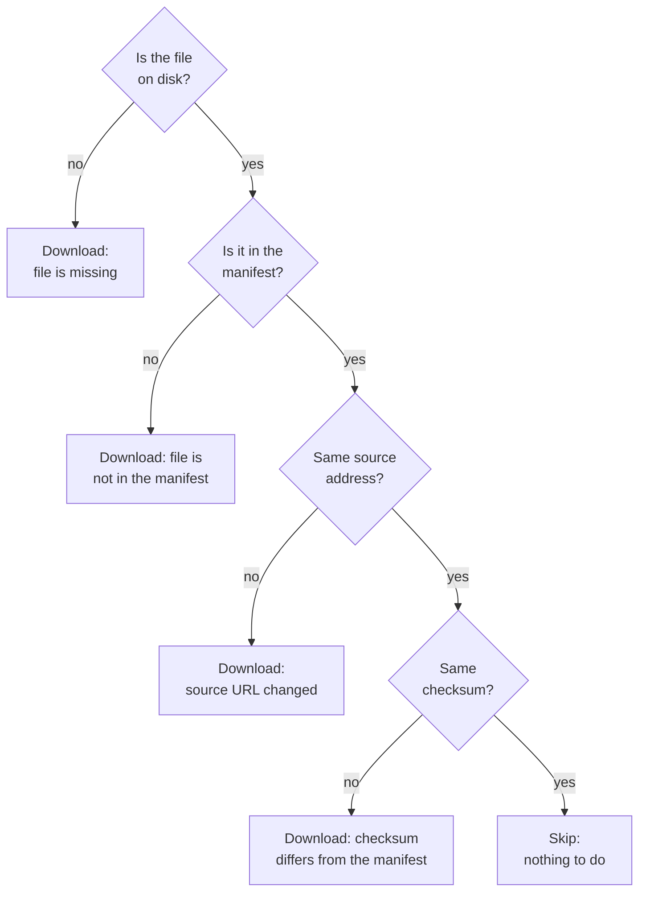

# Chapter 15 – Knowing what you have: the manifest and idempotency

Three weeks after the download, a result looks strange and you start to doubt the data. Is the January file on disk the same file you downloaded? Was it complete? Did a program, or a person, change it since then? And if you run the download again to be safe, will it fetch 390 MB a second time? Without a record of what you have, none of these questions has an answer. This chapter is about that record, and about a stage that can be run again at any time without harm.

## What you will learn

- What a checksum is and what it can prove about a file.
- What the manifest of the raw layer records.
- What idempotent means, and how the ingest stage decides to skip or to download.
- How the weather decision from Chapter 2 is carried out in code, and why a fallback is recorded and not hidden.
- Why the weather is requested in UTC with one extra day on each side.
- What a first look at the raw data shows.

## A fingerprint for a file

To know whether a file has changed, you could keep a second copy and compare the two. For 390 MB that is wasteful. A **checksum** is a short code calculated from the content of a file. The same content always gives the same code. If one byte changes, the code is completely different.

This project uses the method **SHA-256**, which gives a code of 64 characters. Think of it as a fingerprint: much smaller than the person, and enough to tell whether it is the same person.

[`src/demand/data/manifest.py`](../../src/demand/data/manifest.py)

```python
def sha256_of_file(path: Path) -> str:
    """Return the SHA-256 checksum of a file, reading it in chunks to save memory."""
    digest = hashlib.sha256()
    with path.open("rb") as file:
        while chunk := file.read(_HASH_CHUNK_BYTES):
            digest.update(chunk)
    return digest.hexdigest()
```

`hashlib.sha256()` creates an empty calculation. The loop reads the file one megabyte at a time and feeds each piece in. The form `while chunk := ...` reads a piece, stores it in `chunk`, and stops when nothing is left. The last line returns the code as text. As in Chapter 14, the file is never in memory as a whole.

A checksum proves one thing: this file has the same content as the file whose checksum you stored. It does not prove that the content is good. It tells you that nothing has changed.

## The manifest

A **manifest** is a list of what a delivery contains. The manifest of the raw layer is one file, `manifest.json`, in the raw folder. It has one entry for every downloaded file. This is the real entry for January, from the machine on which this chapter was written:

```text
"trips/yellow_tripdata_2025-01.parquet": {
  "downloaded_at": "2026-10-12T23:54:36.107226Z",
  "row_count": 3475226,
  "sha256": "9af277e4c0d3f9deb30644da822981e1e7df6af58313170fd3aa8a474485488a",
  "size_bytes": 59158238,
  "url": "https://d37ci6vzurychx.cloudfront.net/trip-data/yellow_tripdata_2025-01.parquet"
},
```

Each line answers one of the questions from the start of the chapter. `url` says where the file came from. `downloaded_at` says when, in UTC. `size_bytes` and `sha256` describe the content exactly. `row_count` says how many trips the file holds: about 3.5 million in January.

The entry is not a free dictionary. Like the settings in Chapter 7, it is a typed, frozen object that rejects unknown names:

```python
class ManifestEntry(BaseModel):
    """What is known about one downloaded file."""

    model_config = ConfigDict(frozen=True, extra="forbid")

    url: str
    """Full source URL, including the query string."""
    downloaded_at: datetime
    """When the download finished, in UTC."""
    size_bytes: int = Field(ge=0)
    sha256: str = Field(pattern=r"^[0-9a-f]{64}$")
```

The last line shows a check you have not seen before. `pattern` requires the text to have a certain form: exactly 64 characters, each a digit or a letter from a to f. A manifest that was edited by hand and has a damaged checksum is rejected when it is loaded, with a message that names the file.

Two more details. The names in the manifest are written with forward slashes on every operating system, and the file is written with sorted names. So the manifest is the same text on Windows and Linux, and two versions of it can be compared line by line.

## Idempotent: safe to run again

Pipelines are run again all the time: after a failure, after a change in the settings, or because someone is not sure whether the last run finished. A stage must give the right result in all these cases.

An operation is **idempotent** when running it again gives the same result as running it once. A light switch with two buttons, "on" and "off", is idempotent: pressing "on" five times leaves the light on. A single button that changes the state is not: the result depends on how often you pressed.

A simple download script is the single button. Run twice, it downloads everything twice. If it is run twice at the wrong moment, it may replace a good file with a failed one. The ingest stage of this project is the "on" button. Its meaning is "make sure the raw layer is complete and correct", not "download".

## Worked example: skip or download

For each file, one function compares three things: the entry in the manifest, the checksum of the file on disk, and the addresses the file may come from with the current settings.

[`src/demand/data/manifest.py`](../../src/demand/data/manifest.py)

```python
    if actual_sha256 is None:
        return "file is missing"
    if entry is None:
        return "file is not in the manifest"
    if entry.url not in accepted_urls:
        return "source URL changed"
    if entry.sha256 != actual_sha256:
        return "checksum differs from the manifest"
    return None
```

This is the body of `download_reason`. It returns a reason for a download, as text, or `None` when no download is needed.

The first check: there is no file on disk, so there is no checksum. Download.

The second: a file exists, but the manifest does not know it. Nobody can say where it came from, so it is not trusted. Download.

The third: the manifest knows the file, but it came from an address that the current settings no longer ask for. For example, someone changed the address of the source. Download.

The fourth: everything matches except the content. The file was changed or damaged after the download. Download.

If none applies, the file on disk is exactly what the manifest describes, and the function returns `None`.



*Figure 15.1 – The decision for one file. There is one way to skip and four reasons to download.*

Two design choices are worth noticing.

The function returns the reason, not only yes or no. The reason is written into the log. When a run downloads a file that you expected to be skipped, the log tells you why, and you do not have to guess.

The function touches no file and no network. It receives three values and returns one. Chapter 10 showed why this matters: such a function can be tested completely with a few lines per case. The file-reading part lives in a separate small function that calls this one.

> [!IMPORTANT]
> "The file exists" is not a reason to skip a download. A file with the right name can be half of an old run, a damaged copy, or a file from another source. Skip only when the content is proven to be what you recorded.

## Progress is saved after every file

The manifest is written again after every finished download, not once at the end. The description of the function that does it says why: "The manifest is saved after every file, so an interrupted run keeps what it has already finished."

Suppose the run stops at the fifth file because the network is gone. Four files are on disk and in the manifest. The next run finds them, checks their checksums, skips them, and continues with the fifth. Idempotency turns "start again from zero" into "continue".

The manifest itself is saved with the method of Chapter 14: written to a temporary file, then renamed. A crash while saving cannot leave half a manifest.

## The weather decision, in code

Chapter 2 explained the weather leak. The real system will only have a weather forecast, so the model must be trained on forecasts and not on observed weather. Chapter 2 also said that observed weather is used as a fallback and that this must be written down. Here is that decision as code.

[`src/demand/data/weather.py`](../../src/demand/data/weather.py)

```python
    source: WeatherSource = "forecast"
    try:
        download = fetch(source)
    except RejectedRequestError as error:
        # The observed weather would hide a wrong setting, so there is no fallback here.
        raise RejectedRequestError(f"{error} {WEATHER_REJECTED_HINT}") from error
    except DownloadError as error:
        extra = {"url": urls[source], "error": str(error)}
        if has_observed:
            log.warning("weather forecast still unavailable, keeping observed weather", extra=extra)
            return skipped(raw_dir, manifest, path)
        log.warning("weather forecast unavailable, falling back to observed weather", extra=extra)
        source = "archive"
        download = fetch(source)
    return record_download(raw_dir, manifest, path, urls[source], download, weather_source=source)
```

The first line names the preferred source: the forecast service.

The `try` block downloads from it. `fetch` is a small helper defined just above: it downloads from one source and checks the answer. The check rejects an incomplete answer: it requires the expected number of hours for every weather variable and no missing value. An answer with gaps counts as a failure, like a network error.

The first `except` block handles a request that the forecast service refused, the 4xx codes of Chapter 14. A refusal means a setting is wrong, for example a misspelled variable name. The service is not down. Using observed weather here would hide the mistake behind data that looks fine, so the run stops and the message points to the weather settings.

The second `except` block handles every other failure: the service did not answer after all retries, or its answer was incomplete. Ignore the `if` for a moment. The block writes a warning to the log, changes the source to `"archive"`, which is the observed weather, and downloads from there.

The last line records the download, and with it the source that was really used.

The fallback is the weaker choice, and the code does not hide it. The manifest entry of the weather file has a field `weather_source`. On the machine of this chapter it says `"forecast"`. If it ever says `"archive"`, anyone who reads the manifest knows that the weather features of that data contain information a real forecast would not have, and can judge the model results with that in mind.

A fallback should also not last longer than its cause. Both addresses, forecast and archive, count as accepted sources for the weather file, so by the skip rule above a file from the archive would be skipped by every later run, and one bad hour of the forecast service would decide the weather data for good. The stage therefore treats observed weather as temporary. A few lines earlier it looks at the manifest:

```python
    has_observed = reason is None and manifest.files[key].weather_source == "archive"
    if reason is None and not has_observed:
        return skipped(raw_dir, manifest, path)
```

A valid file of forecast weather is skipped, like any other file. A valid file of observed weather is not: the stage asks the forecast service again. If the service answers, the forecast replaces the file and the manifest says `"forecast"`. If it still fails, the `if has_observed` branch in the code above keeps the file that is already there, writes a warning, and the run goes on. The price is one request to the forecast service on every run while the weaker source is in use, which is also a reminder that it is.

The first version of this stage did not do this. It kept the archive file until someone deleted it, and it fell back for a wrong setting as well. Both were found when the code was read again for this book.

> [!WARNING]
> A fallback that happens silently is a hidden change of your data. When code takes the second-best path, it must leave a record in a place that people will read later, not only a log line that scrolls away.

The weather is fetched with one request for the whole period, not one per month. The reason is the same idea: one request means one source. With a request per month, some months could come from forecasts and others from observations, and the weather column would mean different things in different rows.

## Two clocks: UTC and New York

The trips are recorded in New York local time. The weather is requested in UTC, the world standard time from Chapter 9. Why not ask for local time directly?

Local time has a problem once a year. When summer time ends, the clock goes back one hour, and the hour from 01:00 to 02:00 happens twice. A timestamp "01:30" on that night is ambiguous. UTC has no summer time, so every hour exists exactly once. The raw layer stores the unambiguous form. Converting to New York time is a job for the silver layer (Chapter 17).

But mixing two clocks creates a trap at the edges of the period. New York is four or five hours behind UTC.

```text
New York time   30 June 19:00   30 June 20:00  ...  30 June 23:00
UTC             30 June 23:00    1 July 00:00  ...   1 July 03:00
                      |                |
        last hour of a request   these hours are needed too,
        that ends on 30 June     but they are on 1 July in UTC
```

*Figure 15.2 – The last evening of the period in two clocks.*

A request for "1 January to 30 June" in UTC days ends at 23:00 UTC on 30 June. In New York that is 19:00. The last four hours of the period in local time would have no weather. The code therefore asks for more:

```python
def request_period(start_date: date, end_date: date) -> tuple[date, date]:
    """First and last UTC day to request: the period plus a day of padding each side."""
    padding = timedelta(days=PADDING_DAYS)
    return start_date - padding, end_date + padding
```

One day is subtracted from the start and added to the end. For New York the day at the end is the one that matters. A day on both sides costs 48 small rows and keeps the rule simple and independent of the direction of the time difference.

Errors like this are easy to make and hard to see, because only a few hours at the edge are affected and everything else looks right.

## A first look at the raw data

The raw layer is complete: six trip files with 24,083,384 trips in total, the table of 265 zones, and 4,392 hours of weather. Before anything is cleaned, it is worth looking at what arrived. You will run these checks yourself below. Three facts stand out.

The pickup times have no timezone. The column type is `timestamp[us]`: a date and a time, and nothing that says in which clock. The data means New York local time, but the file does not say so.

The file of a month contains trips from outside that month. The January file has 22 of them, and its earliest pickup is on 31 December 2024. The March file contains a pickup dated in 2007.

The passenger count is often missing. In January it is empty for 540,149 of 3,475,226 trips, which is 15.5%. In June the share is 28%.

None of this was changed during ingestion, and that is correct. The raw layer shows the source as it is. Each of these facts needs a decision: which clock, which trips belong to a month, what to do with a missing value. Those decisions belong to the cleaning step, where they are written as rules that can be read and tested. Chapter 16 covers the rules for the trips, and Chapter 17 covers the clocks, the weather and the stage as a whole.

## Try it yourself

Run the ingest stage.

```powershell
.venv\Scripts\python.exe -m demand ingest
```

If the raw layer is already complete, you should see eight lines with `"message": "skipped"`, one per file, and a last line like this:

```text
{"time": "2026-10-12T23:58:02.834750+00:00", "level": "INFO", "logger": "demand.data.pipeline", "message": "ingest finished", "raw_dir": "data\\raw", "files_downloaded": 0, "files_skipped": 8, "bytes_downloaded": 0, "seconds": 0.39}
```

Nothing is downloaded, and the run takes about one second. That second is spent calculating eight checksums. This proves the stage is idempotent.

> [!NOTE]
> On a fresh copy of the repository, the same command downloads about 390 MB. On the machine of this chapter that took about half a minute. This is the intended behaviour: the command makes the raw layer complete, whatever its state was.

List what the manifest knows.

```powershell
.venv\Scripts\python.exe -c "from demand.config import get_settings; from demand.data.manifest import load_manifest; m = load_manifest(get_settings().paths.raw); [print(name, entry.size_bytes, entry.row_count, entry.weather_source) for name, entry in m.files.items()]"
```

You should see eight lines. The first and the last two are:

```text
trips/yellow_tripdata_2025-01.parquet 59158238 3475226 None
weather/open_meteo_hourly.json 168579 None forecast
zones/taxi_zone_lookup.csv 12331 None None
```

Only Parquet files have a row count, and only the weather file has a source. The word `forecast` proves that the preferred weather source was used.

Calculate a checksum yourself and compare it with the manifest.

```powershell
(Get-FileHash data\raw\zones\taxi_zone_lookup.csv -Algorithm SHA256).Hash.ToLower()
.venv\Scripts\python.exe -c "from demand.config import get_settings; from demand.data.manifest import load_manifest; print(load_manifest(get_settings().paths.raw).files['zones/taxi_zone_lookup.csv'].sha256)"
```

You should see the same 64 characters twice. The first line uses a tool of Windows, the second reads the record. Two independent tools agree, which proves the file on disk is the file that was downloaded.

Ask the decision function directly.

```powershell
.venv\Scripts\python.exe -c "from demand.data.manifest import download_reason; print(download_reason(None, None, []))"
```

You should see `file is missing`. The call passes no manifest entry and no checksum, which is the first case of Figure 15.1.

See the padded weather period.

```powershell
.venv\Scripts\python.exe -c "from datetime import date; from demand.data.weather import expected_hours, request_period; first, last = request_period(date(2025, 1, 1), date(2025, 6, 30)); print(first, last, expected_hours(first, last))"
```

You should see `2024-12-31 2025-07-01 4392`: one day earlier, one day later, and 183 days of 24 hours.

Look at the raw trip data. The first command reads only the footer of the file and the second reads two columns, so both are fast.

```powershell
.venv\Scripts\python.exe -c "import pyarrow.parquet as pq; s = pq.read_schema('data/raw/trips/yellow_tripdata_2025-01.parquet'); print(s.field('tpep_pickup_datetime')); print(s.field('passenger_count'))"
.venv\Scripts\python.exe -c "import duckdb; print(duckdb.read_parquet('data/raw/trips/yellow_tripdata_2025-01.parquet').aggregate('count(*), count(passenger_count), min(tpep_pickup_datetime)').fetchall())"
```

You should see:

```text
pyarrow.Field<tpep_pickup_datetime: timestamp[us]>
pyarrow.Field<passenger_count: int64>
[(3475226, 2935077, datetime.datetime(2024, 12, 31, 20, 47, 55))]
```

The first line shows a timestamp without a timezone. In the last line, the first number is the count of all rows and the second is the count of rows that have a passenger count. The difference, 540,149, is the number of missing values. The date is the earliest pickup in the "January" file: the evening of 31 December.

Run the tests of the decision and of the fallback.

```powershell
.venv\Scripts\python.exe -m pytest tests/unit/data/test_manifest.py -q -k "download_when or no_download"
.venv\Scripts\python.exe -m pytest tests/unit/data/test_weather.py -q -k "falls_back"
```

You should see `5 passed, 7 deselected` and `2 passed, 15 deselected`. The first group has one test for each path in Figure 15.1. The second group makes the forecast service fail in two ways, with a server error and with an answer that has a missing value, and checks that the manifest then says `archive`.

Three more tests in the same file cover what happens afterwards. Run them with `-k "observed or refused"` in place of `-k "falls_back"`. You should see `3 passed, 14 deselected`: observed weather is replaced when the forecast service works again, it is kept while the service stays down, and a refused request stops the run without a fallback.

## Key takeaways

- A checksum is a short code of the content of a file. It proves that a file has not changed.
- The manifest records, for every raw file, its source, download time, size, checksum and row count.
- An idempotent stage can be run again safely. The ingest stage skips a file only when its content matches the manifest.
- The decision function returns a reason, and the reason is logged.
- The manifest is saved after every file, so an interrupted run continues where it stopped.
- Forecast weather is preferred. If observed weather is used, the manifest says so, and every later run tries the forecast again.
- A fallback is for an outage. A request that the server refuses is a wrong setting and must stop the run.
- Mixing UTC and local time needs care at the edges of a period. One day of padding covers the difference.
- Raw data is not cleaned. What you find in it becomes rules in the next step (Chapter 16).

## Exercises

**1.** You change `end_month` in the config from `2025-06` to `2025-07` and run `python -m demand ingest`. Which files are downloaded? Use Figure 15.1 and the weather address in the manifest.

<details>
<summary>Answer</summary>

Two files. The trip file for July is new: it is not on disk, so the reason is "file is missing". The six older trip files and the zone table match the manifest and are skipped. The weather file is downloaded again, although it is on disk and unchanged: its address contains the end date of the period, so the address in the manifest is no longer one that the settings ask for, and the reason is "source URL changed". This is correct, because the old weather file does not cover July.

</details>

**2.** A program damages one byte in the March trip file. Describe what the next ingest run does, and what would happen with a script that only checks whether the file exists.

<details>
<summary>Answer</summary>

The run calculates the checksum of the file, finds that it differs from the manifest, logs "checksum differs from the manifest", and downloads March again. All other files are skipped. A test in the project checks exactly this. A script that only checks for existence would skip the file. The damage would then appear as a read error in a later stage or, worse, as wrong values that nobody notices.

</details>

**3.** Why does the weather check treat an answer with missing values as a failure, when the trip files are accepted with a passenger count that is missing in up to 28% of the rows?

<details>
<summary>Answer</summary>

The two cases are different. For the trips, a missing passenger count is a property of the source: downloading again gives the same file, and the raw layer must show the source as it is. For the weather, there are two sources that can answer the same request. An incomplete answer from the first is a reason to try the second, which may be complete. The check is not a judgement about data quality. It is the condition for choosing between two sources.

</details>

**4.** A city east of UTC, such as Tokyo, is nine hours ahead. With a request in UTC days and no padding, which part of the local period would have no weather?

<details>
<summary>Answer</summary>

The beginning. Midnight in Tokyo on the first day is 15:00 UTC on the day before, so the first nine local hours of the period fall on a UTC day that was not requested. For New York the gap is at the end, for Tokyo at the start. Padding on both sides covers both cases with the same rule, which is why the function does not need to know where the city is.

</details>

**5. Interview question.** "What does idempotent mean, and why does it matter for a data pipeline?"

<details>
<summary>Points of a good answer</summary>

- Running a step again gives the same result as running it once.
- Pipelines are run again after failures, by schedulers and by people who are unsure. A step that is not idempotent then creates duplicates, repeats expensive work or destroys good data.
- A concrete design: a manifest with a checksum per file, and a decision "skip or download" based on content and source, not on the existence of a file.
- Saving progress after every file, so that a new run continues and does not restart.
- Atomic writes, so that a failed run leaves no half result that the next run would trust.

</details>

---

[Previous: Chapter 14 – Getting the data](14-getting-the-data.md) | [Contents](README.md) | [Next: Chapter 16 – Cleaning the trips](16-cleaning-the-trips.md)
