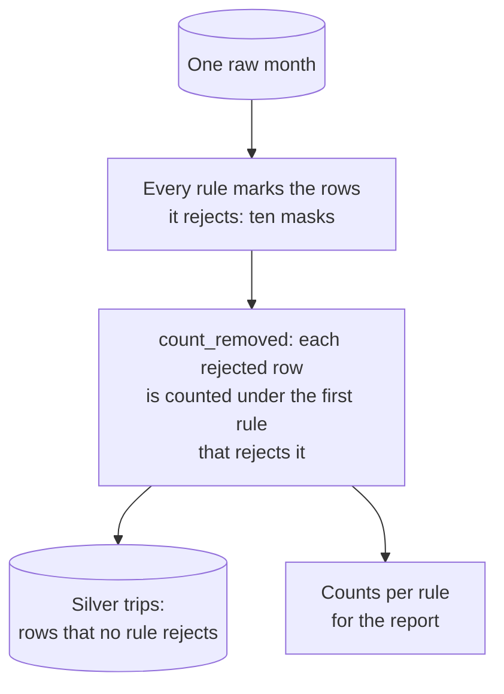

# Chapter 16 – Cleaning the trips: rules you can count

The plan for this project had a line that nobody questioned: "drop trips with a negative fare". A fare cannot be negative, so the row must be an error. It is one line of code. Before the line was written, someone looked at the rows it would remove. In June it would have hit 201,799 rows, almost 5% of the month, and most of them are real pickups. Nobody would have seen it happen. This chapter is about cleaning rules: how they are written, how they are counted, and how one of them was found to be wrong.

## What you will learn

- Why trips are cleaned one by one, before they are counted per hour.
- The ten cleaning rules and why their order is fixed.
- Why the numbers of a cleaning step must add up, and how the code enforces it.
- How to read the cleaning report.
- How a rule from the plan was checked against the data and changed.
- What to do with a value that was not recorded: remove the row, fill the value in, or keep it as missing.
- How cleaning rules are tested.

## One row, one valid trip

The raw layer of Chapter 15 has 24,083,384 rows, as the source published them. The silver layer of Chapter 4 makes a promise about every row it holds: **one row is one valid trip**. A valid trip is a ride that really happened, is recorded once, and has values that are possible.

The target of the model is a count: pickups per zone and hour. Why not count first and clean afterwards? Because a count hides its rows. If an hour has 312 pickups, nothing in the number 312 says that one of them is a refund and another lasted two seconds. A bad row can only be recognised while it is still a row. So the cleaning happens at trip level, and the counting comes later, in the gold layer (Chapter 18).

The rules are in [`src/demand/data/clean.py`](../../src/demand/data/clean.py). Every function in this file is **pure**: a table goes in, a table and some numbers come out, and no file is read or written. Such functions are easy to test.

## The ten rules

A cleaning rule is a condition that marks a row as not valid. This table lists the rules in their order, with the rows that each one removed from the six months of real data.

| # | Rule | A row is rejected when | Rows removed |
|---|---|---|---|
| 1 | `duplicate` | it is equal to an earlier row in every raw column | 0 |
| 2 | `missing_required_value` | pickup time, pickup zone, dropoff time, distance or total amount is missing | 0 |
| 3 | `pickup_outside_month` | the pickup is not in the month the file is named after | 137 |
| 4 | `nonexistent_local_time` | a time is in the hour that the clocks skipped (Chapter 17) | 0 |
| 5 | `dropoff_before_pickup` | the trip ends before it starts | 793 |
| 6 | `duration_out_of_range` | it is shorter than 1 minute or longer than 6 hours, and the dropoff time was recorded | 272,353 |
| 7 | `distance_out_of_range` | the distance is zero, negative or above 100 miles, and the distance was recorded | 36,606 |
| 8 | `negative_total_amount` | the total amount is below zero | 399,647 |
| 9 | `passenger_count_out_of_range` | a passenger count is recorded and is not from 1 to 8 | 133,711 |
| 10 | `unknown_pickup_zone` | the zone number is below 1 or above 263 | 43,105 |

*Figure 16.1 – The cleaning rules in their order, with the real totals for January to June 2025.*

The limits (1 minute, 6 hours, 100 miles, 1 to 8 passengers, zone 263) come from the `cleaning` section of the config file, the same values that the silver contract of Chapter 8 reads. The order goes from "this is not a usable record" to "the record is readable, but a value is impossible".

Rules 6 and 7 say "was recorded". A later section, "A value that was not recorded", explains these words.

Rule 9 has a detail. A missing passenger count is allowed. Chapter 15 found that this value is empty in 15.5% of the January rows. Those trips are valid in every other way, and removing them would remove real pickups.

## Every rule looks at every row

The rules are not a chain in which each rule sees only the rows that the rule before it left. Every rule looks at all rows and marks the ones it rejects. Such a column of true and false values is called a **mask**. Then one function decides under which rule each rejected row is counted.



*Figure 16.2 – How one month is cleaned. A row is kept only if no rule rejects it.*

[`src/demand/data/clean.py`](../../src/demand/data/clean.py)

```python
    removed: dict[str, int] = {}
    first_mask = next(iter(rejected.values()))
    already_removed = pd.Series(False, index=first_mask.index)
    for rule, is_rejected in rejected.items():
        removed[rule] = int((is_rejected & ~already_removed).sum())
        already_removed = already_removed | is_rejected
    return removed, ~already_removed
```

This is the body of `count_removed`. `rejected` holds the ten masks in rule order. For each rule, the loop counts the rows that this rule rejects and that no earlier rule has rejected (`~` means "not"). Then it adds the rows of this rule to `already_removed`. The last line returns the counts and the opposite mask: the rows to keep.

A row that breaks three rules is therefore counted once, under the first of the three. The order decides the label of a removed row. It never decides whether the row is removed. The order is fixed in one tuple, `RULE_ORDER`, so that two reports can be compared.

## The counts must add up

Every row that comes in is either kept or removed by exactly one rule. So one equation is always true: rows in = rows out + the sum of all removed rows. The object that carries the counts checks this equation when it is created.

```python
    @model_validator(mode="after")
    def _check_counts_add_up(self) -> CleaningCounts:
        if self.rows_in != self.rows_out + self.rows_removed:
            raise ValueError(
                f"cleaning counts do not add up: {self.rows_in} rows in, "
                f"{self.rows_removed} removed, {self.rows_out} out"
            )
        return self
```

This is a validator, as in Chapter 7. A `CleaningCounts` object with numbers that do not add up cannot exist. Rows that disappear without a count are a common way for a pipeline to go wrong: a filter added in a hurry changes the target, and no error appears. Here the stage would stop and no report would be written.

## Reading the report

The **cleaning report** is the record of what was removed and why. The stage writes it to `reports/silver_cleaning_report.json`: one block of counts per month and one for the total.

The total: 24,083,384 rows in, 23,197,032 rows out. 886,352 rows were removed, which is 3.7%. Figure 16.1 shows where they went.

Three rules removed nothing. A zero is a result too: this problem was looked for and does not exist in this data. The 137 rows of rule 3 are trips of a neighbouring month, like the pickups of 31 December in the January file. They are dropped and not moved to the other file, so that every silver file comes from exactly one raw file. The cost is 137 real trips.

## The rule that was wrong

Rule 8 says "negative total amount". The plan said "negative fare". These are two columns of the raw file: `fare_amount` is the fare calculated by the meter, and `total_amount` is everything charged to the passenger. The rows with a negative fare are of two different kinds.

```text
                pickup      dropoff   zone  miles    fare    total  payment_type
Kind 1   14 May 08:04:28   08:09:35    164   0.48    6.50    11.25             4
         14 May 08:04:28   08:09:35    164   0.48   -6.50   -11.25             4

Kind 2   14 May 08:00:00   08:17:00    249   1.91   -4.75     8.00             0
```

*Figure 16.3 – Real rows from the May 2025 file. Kind 1 is one trip written twice. Kind 2 is one trip written once.*

**Kind 1: a charge that was taken back.** Fare and total are both negative, and the same trip is there a second time with positive values: same pickup, same dropoff, same zone, same distance. The negative row is a **reversal**, a row that cancels a charge. Counting it would count one trip twice. Of the 446,311 rows with a negative total, 403,881 have such a positive partner.

**Kind 2: a trip with a broken fare field.** The fare is negative and the total is positive. The distance and the duration are ordinary. There is no second row: in May, 213,260 rows are of this kind, and only 23 of them share pickup time, dropoff time and zone with another row. All of them come from one vendor, and all except one have payment type 0. Two out of three have exactly the same fare, −4.75. This is a ride that happened, with one field that cannot be trusted.

| Month | Negative fare, positive total | Share of the month | Negative total |
|---|---|---|---|
| January | 81,402 | 2.3% | 63,037 |
| February | 127,864 | 3.6% | 55,179 |
| March | 140,446 | 3.4% | 68,686 |
| April | 114,410 | 2.9% | 72,608 |
| May | 213,260 | 4.6% | 112,544 |
| June | 201,799 | 4.7% | 74,257 |

*Figure 16.4 – Rows per raw file, before any other rule. The numbers for rule 8 in the report are lower, because earlier rules take some of these rows first.*

The second kind adds up to 879,181 rows, and its share doubles from January to June. The target is a count of pickups. A rule that removes 2.3% of the rows in January and 4.7% in June makes demand seem to fall when it did not. And the change sits on the most sensitive date of the project. Up to 30 April, the end of the training period, the share is 3.1%. In May and June, the months that are replayed as "production", it is 4.7%. The model would look worse in the replay for a reason that is in no log and no test.

So the rule was changed to "negative total amount", and silver keeps `total_amount` and not the fare.

What is not known must be said too. The data dictionary of the TLC calls payment type 0 a "Flex Fare trip". It does not say why the meter fare of such a trip is negative. The conclusion "these are real pickups" rests on the pattern in the data: no partner row, ordinary distance, ordinary duration. For a count of pickups that is enough. The total of these rows is positive but low, so do not trust it as a price.

> [!WARNING]
> A cleaning rule is a claim about the data, and a claim must be checked. Common advice says "just drop negative fares, they are a tiny fraction". That was written for older data. It is not true for these files.

Three lessons are general.

**Look at what a rule removes, not only how much.** A percentage says nothing. A few removed rows on the screen show the two kinds at once.

**Ask whether the removed share changes over time.** A constant share lowers every count a little. A growing share changes the shape of the target.

**The check is never finished.** After this change, the report showed the same warning sign again. The share of all removed rows was about 5.5% from January to April and above 7% in May and June, and most of the rise was in rules 6 and 7. The next section is about what was found there.

## A value that was not recorded

Rule 6 removed trips shorter than one minute. Rule 7 removed trips with a distance of zero. Both sound safe. These are rows that the two rules removed from the June file.

```text
                pickup      dropoff   from   to   miles    total  vendor
Group 1  11 Jun 08:00:04   08:13:30     48  107    0.00    24.80       1
         11 Jun 08:05:56   08:45:43      4  166    0.00    53.00       1

Group 2  11 Jun 08:00:51   08:00:51    236  239    1.00    13.44       7
         11 Jun 08:01:19   08:01:19     13  246    3.49    28.62       7
```

*Figure 16.5 – Real rows from the June 2025 file. "from" and "to" are the pickup zone and the dropoff zone.*

**Group 1: a distance of zero.** The taxi started in one zone and stopped in another, 13 and 40 minutes later, and an ordinary amount was charged. A taxi cannot change zone without moving. The trip happened, and the distance was not written down. In June, 97% of the zero-distance trips of this kind end in a different zone.

**Group 2: a dropoff at the second of the pickup.** A first guess is that the driver ended the trip early on the meter, to be free for the next passenger. It is a reasonable guess, and a guess about data can be tested. If drivers did this, the trips of one vendor would have many different durations, and some of them would be very short. The data shows something else. Vendor 7 has 191,785 trips in the six months, and in every one of them the dropoff time is equal to the pickup time. Not one trip of this vendor has a duration. No group of drivers behaves the same way 191,785 times. The system of this vendor does not record the dropoff time and writes the pickup time into both fields.

Both groups grow. Vendor 7 has 1,206 trips in January and 67,573 in June. As with the negative fare, the two rules were removing more real pickups every month.

These values are **missing values** that do not look missing. A zero or a copied time that stands in the place of a measurement is called a **placeholder value**. There are three common ways to handle a missing value, and the right one depends on two questions: why is the value missing, and what is the value needed for?

| Way | What it does | Right when | Wrong here because |
|---|---|---|---|
| Remove the row | The trip is not counted | Few rows, missing by chance, and the row is useless without the value | The rows are many, come from one growing group, and are real pickups |
| Fill the value in | A calculated value replaces the missing one, for example the average. This is called **imputation**. | The value is an input of the model, and a good estimate exists | Nothing in this project uses the distance or the duration of a trip, and an invented value looks like a measurement |
| Keep it as missing | The row stays, and the value is stored as empty | The row is useful without the value | – |

*Figure 16.6 – Three ways to handle a missing value.*

The silver layer exists to count pickups. A pickup needs a time and a zone, and both are there. So the row is kept and the placeholder value is replaced by a real missing value: no dropoff time and no duration for group 2, no distance for group 1. This is the same decision as for the passenger count in rule 9.

[`src/demand/data/clean.py`](../../src/demand/data/clean.py)

```python
    has_distance = raw[RAW_TRIP_DISTANCE] > 0
    same_time = raw[RAW_DROPOFF_DATETIME] == raw[RAW_PICKUP_DATETIME]
    changed_zone = raw[RAW_DROPOFF_ZONE_ID].notna() & (
        raw[RAW_DROPOFF_ZONE_ID] != raw[RAW_PICKUP_ZONE_ID]
    )
    return {
        DROPOFF_DATETIME: same_time & has_distance,
        TRIP_DISTANCE: (raw[RAW_TRIP_DISTANCE] == 0) & changed_zone,
    }
```

This is the body of `find_unrecorded_values`. It returns two masks. The first marks a dropoff time as not recorded when it is equal to the pickup time and the trip has a distance. The second marks a distance as not recorded when it is zero and the zone changed. Each test asks for a second sign that the trip happened. A row with a distance of zero and a duration of zero has no such sign, matches neither test, and is still removed.

The rules do not look at vendor numbers. A rule such as "vendor 7 has no dropoff time" would be true today and wrong on the day the vendor repairs its system or another vendor has the same fault.

Rules 6 and 7 then skip the marked rows:

```python
        DISTANCE_OUT_OF_RANGE: ((distance <= 0) | (distance > cleaning.max_distance_miles))
        & ~unrecorded[TRIP_DISTANCE],
```

The report counts the kept rows under `not_recorded`: 189,657 trips without a dropoff time and 440,734 without a distance. With this change the share of removed rows no longer rises. It is between 3.4% and 4.2% in every month.

> [!NOTE]
> A missing value is information. Removing the row throws the trip away, and filling the value in hides that it was missing. Keeping it as missing keeps the trip and tells the truth about the value. The price is paid by the code that reads the table later: it must expect empty values in these columns, and the contract of Chapter 8 now says so.

## Testing the rules

The tests in [`tests/unit/data/test_clean.py`](../../tests/unit/data/test_clean.py) use two patterns again and again.

**One bad row next to one good row.** A dictionary lists twenty-one ways to break a rule, each with the rule that must catch it:

```python
    "too far": (DISTANCE_OUT_OF_RANGE, raw_trip(GOOD_PICKUP, trip_distance=100.1)),
    "negative total amount": (NEGATIVE_TOTAL_AMOUNT, raw_trip(GOOD_PICKUP, total_amount=-0.01)),
```

`raw_trip` is a helper that builds one valid raw trip and changes single values. One parametrised test (Chapter 10) cleans each bad trip together with a good one:

```python
    silver, counts = _clean(settings, [bad_trip, good_trip])

    assert list(silver[TRIP_DISTANCE]) == [7.7]
    assert counts == CleaningCounts(rows_in=2, removed=_only(rule), rows_out=1)
```

The first check proves that the good trip, the one with 7.7 miles, is the row that stays. The second proves that the bad row was counted under the expected rule and under no other. Without the good row, a function that removes everything would pass.

**Values on the edge that must be kept.** A rule that says "above 100 miles" must keep exactly 100. A second dictionary has twelve such trips, for example exactly one minute, a total of 0.0, and the trip of kind 2 under the name "negative fare with a positive total". Mistakes with `<` and `<=` are found here.

## Try it yourself

These commands need the raw layer of Chapter 15 and the report of the silver stage. If `reports\silver_cleaning_report.json` does not exist, run `.venv\Scripts\python.exe -m demand silver` first. It takes about half a minute, and Chapter 17 explains what it does.

Check that the numbers of the report add up.

```powershell
.venv\Scripts\python.exe -c "import json; t = json.load(open('reports/silver_cleaning_report.json'))['total']; print(t['rows_in'] - t['rows_out'], sum(t['removed'].values()))"
```

You should see `886352 886352`. The rows that are gone and the rows that the rules counted are the same number.

Find the trip that is written twice.

```powershell
.venv\Scripts\python.exe -c "import duckdb; print(duckdb.read_parquet('data/raw/trips/yellow_tripdata_2025-05.parquet').filter('tpep_pickup_datetime = make_timestamp(2025, 5, 14, 8, 4, 28) and PULocationID = 164').project('trip_distance, fare_amount, total_amount, payment_type').order('fare_amount').fetchall())"
```

You should see `[(0.48, -6.5, -11.25, 4), (0.48, 6.5, 11.25, 4)]`: the reversal and the trip of Figure 16.3.

Count both kinds per month.

```powershell
.venv\Scripts\python.exe -c "import duckdb; [print(month, duckdb.read_parquet(f'data/raw/trips/yellow_tripdata_2025-0{month}.parquet').aggregate('count(*) filter (fare_amount < 0 and total_amount > 0), count(*) filter (total_amount < 0)').fetchall()) for month in range(1, 7)]"
```

You should see six lines, one per month. The first is `1 [(81402, 63037)]` and the last is `6 [(201799, 74257)]`. These are the columns of Figure 16.4.

Run the tests of the two patterns.

```powershell
.venv\Scripts\python.exe -m pytest tests/unit/data/test_clean.py -q -k "bad_trip_is_removed"
.venv\Scripts\python.exe -m pytest tests/unit/data/test_clean.py -q -k "on_the_edge"
```

You should see `21 passed, 41 deselected` and then `12 passed, 50 deselected`.

Check the vendor that never records a dropoff time.

```powershell
.venv\Scripts\python.exe -c "import duckdb; print(duckdb.sql('select VendorID, count(*), count(*) filter (tpep_dropoff_datetime = tpep_pickup_datetime) from read_parquet(\'data/raw/trips/*.parquet\') group by 1 order by 1').fetchall())"
```

You should see `[(1, 4863684, 3983), (2, 19024265, 525), (6, 3650, 33), (7, 191785, 191785)]`. For vendor 7 the two numbers are equal.

Run the tests of the values that were not recorded.

```powershell
.venv\Scripts\python.exe -m pytest tests/unit/data/test_clean.py -q -k "unrecorded or without_a_recorded"
```

You should see `4 passed, 58 deselected`. One of them proves that a missing value does not protect a row: a refund without a dropoff time is still removed as a refund.

## Key takeaways

- In silver, one row is one valid trip. Rows are cleaned before they are counted, because a count hides its rows.
- Every rule looks at every row. A removed row is counted under the first rule that rejects it, in a fixed order.
- Rows in must equal rows out plus rows removed. The code refuses counts that do not add up.
- A cleaning rule is a claim about the data. Look at the rows it removes before you accept it.
- A rule that removes a changing share over time changes the target. "Negative fare" would have removed more real pickups after the training cut-off than before it.
- A zero or a copied value can be a placeholder value for "not recorded". Ask for a second sign that the trip happened.
- A missing value can be handled in three ways: remove the row, fill the value in, or keep it as missing. Keep it as missing when the row is useful without the value.
- Test each rule with one bad row next to a good row, and with values on the edge.

## Exercises

**1.** In the report, `negative_total_amount` for May is 103,472. Figure 16.4 says that the May file has 112,544 rows with a negative total. Both numbers are correct. Explain the difference.

<details>
<summary>Answer</summary>

Figure 16.4 counts every row with a negative total. The report counts a row under the first rule that rejects it. A reversal that is also shorter than one minute is counted under `duration_out_of_range`, rule 6. So 9,072 of these rows appear under earlier rules. All 112,544 rows are removed. They are only labelled differently.

</details>

**2.** A later phase adds the average trip distance per zone and hour as an input of the model. Is "keep it as missing" still enough for the 440,734 trips without a distance?

<details>
<summary>Answer</summary>

The rows still count as pickups, so they stay. But now the distance is needed, and the question of Figure 16.6 has a different answer. An average ignores empty values, so each hourly average would be calculated from the trips that have a distance. That is acceptable if the trips without a distance are like the others. They come mostly from one vendor and one payment type, so this must be checked first, for example by comparing their durations with those of the other trips. If they differ, the choice is between filling in an estimate, for example from the usual distance between the two zones, and giving the model a second input that says how many trips had no distance. The decision in silver does not change. Silver keeps the truth, and each use decides what to do with it.

</details>

**3. Interview question.** "You are told to remove invalid rows from a dataset before training. How do you do it so that the result can be trusted?"

<details>
<summary>Points of a good answer</summary>

- Write each rule as a named condition with limits from the configuration, in a fixed order.
- Count the rows removed by each rule, check that the counts add up, and save them in a report for every run.
- Before accepting a rule, look at the rows it removes and at how their share changes over time, especially across the training cut-off.
- A concrete case: "drop negative fares" would have removed a growing group of real trips. Only a negative total marks a reversed charge.
- Separate "impossible" from "not recorded". Keep a row whose missing value is not needed, store the value as empty, and count such rows in the report.
- Test every rule with a bad row next to a good one and with values on the edge.

</details>

---

[Previous: Chapter 15 – Knowing what you have](15-knowing-what-you-have.md) | [Contents](README.md) | [Next: Chapter 17 – Clocks, weather and the silver stage](17-clocks-weather-and-the-silver-stage.md)
