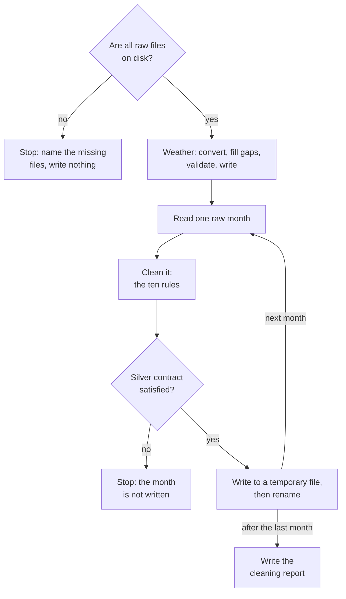

# Chapter 17 – Clocks, weather and the silver stage

A trip in a raw file has the pickup time `2025-03-09 02:30:00`. It looks like any other time. But in New York that moment never happened: at 02:00 on that night the clocks jumped to 03:00. Later in the year, a pickup time of 01:30 on 2 November has the opposite problem. That time happened twice, and the file does not say which one is meant. This chapter shows what the cleaning code does with times like these, how the weather is brought onto the same clock, and how the whole silver stage is put together.

## What you will learn

- What a timestamp without a timezone is, and what it means to attach one.
- What happens to a local time that does not exist, and to one that exists twice.
- Why a duration must be measured in real elapsed time.
- How the weather is converted from UTC to local hours, and how missing hours are found.
- Which weather gaps are filled and which stop the stage.
- How the silver stage reads, checks and writes, and what its limits are.

## A time without a clock

Chapter 15 showed that the pickup times in the raw files have the type `timestamp[us]`: a date and a time, and nothing that says in which clock. Such a timestamp is called **naive**. A timestamp that carries its timezone is called **timezone-aware**. The silver contract of Chapter 8 demands the second kind, in `America/New_York`.

To **localize** a naive timestamp is to attach the timezone in which it was recorded. No clock is moved: 08:00 stays 08:00, and it gains the label "New York". After that, the computer knows which moment in the world is meant. On 363 days of the year this step is trivial. On two days it needs a decision.

**Daylight saving time** is the summer clock, one hour ahead of the winter clock. New York changes twice a year.

```text
Spring, 9 March 2025                      Autumn, 2 November 2025

00:00  01:00  [02:00]  03:00  04:00       00:00  01:00  01:00  02:00  03:00
              skipped                            first  second
The local day has 23 hours.               The local day has 25 hours.
```

*Figure 17.1 – The two nights on which the local clock is not a faithful record of time.*

## Worked example: attaching the timezone

[`src/demand/data/clean.py`](../../src/demand/data/clean.py)

```python
    is_first_occurrence = np.ones(len(local_time), dtype=bool)
    localized: pd.Series = local_time.dt.tz_localize(
        timezone, nonexistent="NaT", ambiguous=is_first_occurrence
    )
    return localized
```

This is the body of the function `localize`. The work is done by `tz_localize` of pandas, and its two arguments are the two decisions.

`nonexistent="NaT"` is the decision for spring. A time in the skipped hour was written by a clock that was wrong, and nobody can say what the right time was. The result is `NaT`, "not a time", which is the missing value for timestamps. Rule 4 of Chapter 16, `nonexistent_local_time`, then removes the row. In the real data this rule removed nothing: no pickup and no dropoff of the six months falls between 02:00 and 03:00 on 9 March. The meters handled the change correctly. That is worth knowing, and only a rule with a counter can tell you.

`ambiguous=is_first_occurrence` is the decision for autumn. The first line builds a list that says "true" for every row, and pandas reads "true" as "the first of the two". Every 01:30 on that night is therefore read as the first 01:30, in summer time.

Why are these rows not removed too? Because they are real trips. Removing them would empty one hour of real demand. Keeping them has a price, and the description of the function states it: on that one night, the first 01:00 hour holds the pickups of both hours and the second holds none. A trip that starts before the change and ends after it can also get a duration that is wrong by one hour.

The current data ends in June, so no such row exists yet. The decision is made and tested before the first one arrives.

> [!NOTE]
> Both choices are written down as arguments, and that is the point. Without them, pandas raises an error for the first such row it meets. Code that was only tried on data from April would then fail in November.

## Duration is elapsed time

A trip starts at 01:50 on 9 March and ends at 03:10. The clock on the wall shows 80 minutes between the two. But the hour from 02:00 to 03:00 did not exist, so the passenger sat in the car for 20 minutes.

The cleaning code calculates the duration after both times have their timezone. Subtracting two timezone-aware timestamps gives the real time that passed. A test keeps this fixed with exactly this trip and expects `[20.0]`. If the duration were calculated from the naive values, some trips of that night would be 60 minutes too long, and the six-hour limit of rule 6 would judge them wrongly.

## The weather on the same clock

The weather has the opposite situation. Chapter 15 stored it in UTC, which has no summer time, with one extra day on each side. The silver layer needs it in New York time, for exactly the configured period. The code is in [`src/demand/data/clean_weather.py`](../../src/demand/data/clean_weather.py).

Converting from UTC to local time is always safe. Every UTC hour is exactly one moment, and every moment has exactly one local name. So no decision is needed here: the day in March gets 23 rows, with 01:00 followed directly by 03:00.

The interesting part is which hours the table should contain.

```python
    weather = parse_weather(payload, data.weather.variables, timezone)
    # Hours outside the period are dropped; hours the file lacks appear as missing rows.
    weather = weather.reindex(local_hours(data.start_date, data.end_date, timezone))
    filled, interpolated = fill_gaps(weather, settings.cleaning.max_weather_gap_hours)
```

The first line reads the raw answer into a table with one row per hour, converted to local time. `local_hours` builds the list of hours that must exist: every hour from 00:00 on the first day to 23:00 on the last day of the period in the config. `reindex` then makes the table follow that list.

This one line does two things. Hours of the padding, before 1 January and after 30 June in local time, are not on the list and disappear. And an hour that is on the list and not in the file becomes a row of missing values.

The second effect is the reason for the design. The list is built from the config, not from the file. If the table were built from the hours the file contains, a missing hour would be a missing row, and a missing row is invisible. Built from the expected hours, a missing hour is a visible gap.

The result has 4,343 rows: 181 days of 24 hours, minus the one hour that spring skipped. The raw file has 4,392.

## Short gaps are filled, long gaps stop the stage

A model cannot use an hour without weather, so every gap must be closed or refused. The function `fill_gaps` does this for each weather variable.

A gap of at most three hours is filled by **linear interpolation**: the missing values are placed on a straight line between the last known value before the gap and the first known value after it. Between 10 and 18 degrees, three missing hours become 12, 14 and 16. The limit of three is the setting `cleaning.max_weather_gap_hours`.

A longer gap raises an error that names the variable, the first missing hour and the length. A gap at the very start or end of the period raises an error too, because it has only one neighbour and there is no line to draw. Weather that is invented over many hours would mislead the model, and nobody would notice.

The cleaning report has a `weather` block with the number of filled values per variable. For the real data all four are 0: the forecast source of Chapter 15 delivered every hour.

> [!WARNING]
> A straight line is a fair guess for temperature, which changes slowly. For rain it is a weak guess: between a dry hour and a wet hour, the line invents light rain. The code accepts this for gaps of up to three hours and counts every filled value in the report, so the weakness is visible if it is ever used.

## The stage as a whole

The command `python -m demand silver` calls `run_silver` in `pipeline.py`, which calls `build_silver` in [`src/demand/data/silver.py`](../../src/demand/data/silver.py). This file contains no rule. It moves data between the disk and the pure functions of the two cleaning files.



*Figure 17.2 – The silver stage. Every table passes its contract before it gets its final name.*

Each box is an idea from an earlier chapter.

**Check the input first.** Before any work starts, the stage checks that every raw file the config asks for exists. If one is missing, the error names all missing files and tells you to run the ingest stage.

**Validate before writing.** This is the centre of the loop over the months:

```python
        raw = read_raw_trips(raw_path)
        trips, counts = clean_trips(raw, year, month, settings)
        # Free the raw month before validating; it is several times larger than silver.
        del raw
        schema.validate(trips)
        write_parquet(trips, silver_path)
```

`schema.validate(trips)` is the quality gate of Chapter 8, and `schema` is the silver contract. The rules and the contract read the same limits from the config, so the gate should never fail. It is there for the day when someone changes a rule and makes a mistake. A test does exactly that: it replaces the cleaning function with one that produces a negative total, and checks that the stage stops and no trip file exists.

**Write atomically.** `write_parquet` uses the method of Chapter 14: write to a temporary file, then rename. A file under its final name is always complete.

**One month at a time.** The six months together would need far more memory than one. The loop reads one month, cleans it, writes it, and only then reads the next. `del raw` gives the raw table back before the contract is checked. The highest memory use of the whole run is still between 1.7 and 1.8 GB, because one raw month with all its twenty columns is large.

**The same result on a second run.** The ingest stage was idempotent because it skipped work. This stage is idempotent in a simpler way: it has no memory of earlier runs. It rebuilds every file from the raw layer, and the same raw files and the same config give the same silver files, byte for byte. A test runs the stage twice and compares all files.

Three limits should be stated plainly. If the stage stops at the fourth month, the first three are already replaced and the report is still the old one. If you make the period in the config shorter, the silver files of the months that are no longer asked for stay on disk. Nothing deletes them. And as Chapter 16 said, a trip of a neighbouring month is dropped, not moved.

## Try it yourself

Run the stage. It needs the raw layer of Chapter 15.

```powershell
.venv\Scripts\python.exe -m demand silver
```

You should see eight log lines after about half a minute: one `weather cleaned`, six `trips cleaned`, and a last line like this:

```text
{"time": "2026-10-13T05:55:08.376605+00:00", "level": "INFO", "logger": "demand.data.silver", "message": "silver finished", "silver_dir": "data\\silver", "report": "reports\\silver_cleaning_report.json", "rows_in": 24083384, "rows_out": 23197032, "percent_removed": 3.68, "removed": {"duplicate": 0, "missing_required_value": 0, "pickup_outside_month": 137, "nonexistent_local_time": 0, "dropoff_before_pickup": 793, "duration_out_of_range": 272353, "distance_out_of_range": 36606, "negative_total_amount": 399647, "passenger_count_out_of_range": 133711, "unknown_pickup_zone": 43105}, "not_recorded": {"dropoff_datetime": 189657, "trip_distance": 440734}, "weather_hours": 4343, "seconds": 30.06}
```

Prove that a second run gives the same file.

```powershell
(Get-FileHash data\silver\trips\trips_2025-01.parquet).Hash
.venv\Scripts\python.exe -m demand silver
(Get-FileHash data\silver\trips\trips_2025-01.parquet).Hash
```

You should see the same 64 characters before and after the run. The file was written again, and its content did not change.

Localize three times: a normal one, one in the skipped hour, and one in the repeated hour.

```powershell
.venv\Scripts\python.exe -c "import pandas as pd; from demand.data.clean import localize; print(localize(pd.Series(pd.to_datetime(['2025-03-09 01:30', '2025-03-09 02:30', '2025-11-02 01:30'])), 'America/New_York').to_list())"
```

You should see:

```text
[Timestamp('2025-03-09 01:30:00-0500', tz='America/New_York'), NaT, Timestamp('2025-11-02 01:30:00-0400', tz='America/New_York')]
```

The second value is `NaT`. The third ends in `-0400`, four hours behind UTC, which is summer time: the first 01:30.

Measure the trip across the spring change.

```powershell
.venv\Scripts\python.exe -c "import pandas as pd; from demand.data.clean import localize; t = localize(pd.Series(pd.to_datetime(['2025-03-09 01:50', '2025-03-09 03:10'])), 'America/New_York'); print(t[1] - t[0])"
```

You should see `0 days 00:20:00`: twenty minutes, not eighty.

Look at the weather of the night with 23 hours.

```powershell
.venv\Scripts\python.exe -c "import pandas as pd; w = pd.read_parquet('data/silver/weather/weather_hourly.parquet'); print(len(w)); print(w[w.hour_start.dt.day_of_year == 68].head(4).to_string(index=False))"
```

You should see:

```text
4343
               hour_start  temperature_2m  precipitation  snowfall  wind_speed_10m
2025-03-09 00:00:00-05:00             2.1            0.0       0.0            18.2
2025-03-09 01:00:00-05:00             1.4            0.0       0.0            10.9
2025-03-09 03:00:00-04:00             0.9            0.0       0.0            11.6
2025-03-09 04:00:00-04:00             0.1            0.0       0.0            12.4
```

After 01:00 comes 03:00, and the offset changes from `-05:00` to `-04:00`. No hour is missing: these two rows are 60 real minutes apart.

Run the tests of the clocks, of the gaps and of the stage.

```powershell
.venv\Scripts\python.exe -m pytest tests/unit/data/test_clean.py -q -k "skipped or twice or repeated or spring"
.venv\Scripts\python.exe -m pytest tests/unit/data/test_clean_weather.py -q -k "gap"
.venv\Scripts\python.exe -m pytest tests/unit/data/test_silver.py -q
```

You should see `6 passed, 56 deselected`, then `10 passed, 19 deselected`, then `14 passed`. The stage tests build two tiny months and a small weather file in a temporary folder, so they never touch the real data.

## Key takeaways

- A naive timestamp has no timezone. Localizing attaches one and does not move the clock.
- A local time in the skipped hour of spring becomes missing, and the row is removed and counted. A local time in the repeated hour of autumn is kept and read as the first of the two.
- The autumn choice has a price: two hours of pickups in one. Write the price down next to the choice.
- A duration is calculated from timezone-aware times, so it is real elapsed time.
- Build the list of expected hours from the config. Then a missing hour is a visible gap and not an invisible missing row.
- Short weather gaps are interpolated and counted. Long gaps and gaps at the edge stop the stage.
- The silver stage checks its input, validates each table before writing, writes atomically, holds one month in memory, and gives the same files on every run.

## Exercises

**1.** A colleague suggests removing the trips of the repeated autumn hour, "to be consistent with spring". What is different about the two cases?

<details>
<summary>Answer</summary>

In spring, a time in the skipped hour is a value that cannot be true. The record is wrong, and there is no way to repair it. In autumn the record is right: the trip happened at 01:30. Only the information "first or second" is missing. Removing these rows would delete real pickups and leave an hour with a demand of zero, which is a larger error than putting two hours into one.

</details>

**2.** The stage stops with a schema error while cleaning April. What is on disk afterwards, and is anything damaged?

<details>
<summary>Answer</summary>

The weather file and the trip files of January to March are new. April was not written, because the check comes before the write. April, May and June are as they were before the run, and so is the report. No file is half-written. But the folder now mixes files of two runs. The repair is to fix the cause and run the stage again: it rebuilds everything.

</details>

**3. Interview question.** "Your data has local timestamps without a timezone. What can go wrong, and how do you handle it?"

<details>
<summary>Points of a good answer</summary>

- Attach the timezone explicitly. Twice a year this needs a decision: a skipped hour in spring and a repeated hour in autumn.
- A time in the skipped hour cannot be repaired. Mark it as missing, remove the row and count it.
- A time in the repeated hour is real and ambiguous. Choose one reading, keep the row, and document the cost.
- Calculate durations from timezone-aware values, and expect days of 23 and 25 hours in every hourly table.
- Test both nights with fixed dates, long before the calendar reaches them.

</details>

---

[Previous: Chapter 16 – Cleaning the trips](16-cleaning-the-trips.md) | [Contents](README.md) | [Next: Appendix A – Stack map](appendix-a-stack-map.md)
