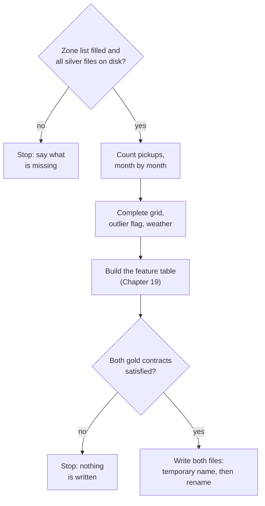

# Chapter 18 – From trips to a demand table

On 12 February 2025, between 02:00 and 05:00, nobody took a yellow taxi at LaGuardia Airport. The silver layer has no row that says so. It has 23,197,032 rows, and each one is a trip that happened. An hour in which nothing happened leaves no trace. But "zero pickups" is exactly what the model must be able to predict for that hour. This chapter shows how trips become a table with one row per zone and hour, including the hours in which nothing happened.

## What you will learn

- Why the project forecasts 20 zones, and why they are chosen from the training period only.
- Why the list of zones is frozen in the config file.
- What a complete grid is, and why an hour without pickups must be a row with a zero.
- How the weather is joined, and why a missing hour stops the stage.
- How unusual hours are flagged and not deleted, and why the flag is never a model input.

## Twenty zones, chosen without May and June

New York has 263 taxi zones. More than half of them have fewer than two yellow-taxi pickups per hour, and a model learns little from such a zone. The config asks for `n_zones: 20`. In the training period these 20 zones hold 59.4% of all pickups.

Chapter 2 named the trap: counting the pickups of all six months would let May and June help to decide what the model is trained on. The command `python -m demand select-zones` therefore counts only trips that started before the end of the training period.

[`src/demand/data/aggregate.py`](../../src/demand/data/aggregate.py)

```python
    in_period = trips[PICKUP_DATETIME] < before
    counts: pd.Series = trips.loc[in_period, PICKUP_ZONE_ID].value_counts()
    return counts.rename_axis(ZONE_ID).rename(TARGET)
```

This is the body of `count_pickups_per_zone`. `before` is midnight at the start of 1 May, and the first line is the whole protection. The function `busiest_zones` then sorts the counts and takes the first 20. Two zones with the same count are ordered by zone number, so the result never depends on the order of the rows.

Does the rule change anything here? Yes, at the last place of the list.

| Zone | Pickups, January to April | Pickups, January to June |
|---|---|---|
| 140 Lenox Hill East | 290,915 (rank 20) | 447,498 (rank 21) |
| 107 Gramercy | 288,178 (rank 21) | 449,776 (rank 20) |

*Figure 18.1 – The two zones around the cut. Counted on all six months, zone 107 would replace zone 140.*

The difference is small. The principle is not: a choice is something learned from data, like a model parameter, and only the training period may teach it.

## Why the list is frozen

The command writes nothing. It prints one line, and a person pastes it into [`configs/config.yaml`](../../configs/config.yaml):

```yaml
  zones: [161, 237, 236, 132, 230, 186, 162, 142, 234, 170, 163, 239, 68, 138, 79, 48, 249, 141, 164, 140]
```

Why not calculate the list at the start of every run? Figure 18.1 gives the reason. Places 20 and 21 are 2,737 pickups apart, less than 1%. A changed cleaning rule could swap them. Then a model trained on one set of zones would be asked to forecast another, and the contracts of Chapter 8, which accept only the listed zones, would change without anybody deciding it. A list in the config changes only through a commit that someone reviews. It is calculated again only when `train_end_date` changes.

## Counting, and the hours that are missing

Counting is short: keep the trips of the 20 zones, round each pickup time down to the start of its hour, and count the rows per zone and hour. The stage does this one month at a time and reads only two columns, so the 23 million trips are never in memory together.

The result has a hole wherever no trip started. This is LaGuardia (zone 138) on 12 February:

| Hour | After counting | On the complete grid |
|---|---|---|
| 01:00 | 18 | 18 |
| 02:00 | no row | 0 |
| 03:00 | no row | 0 |
| 04:00 | no row | 0 |
| 05:00 | 2 | 2 |

*Figure 18.2 – Real counts. Counting cannot produce a zero.*

A **complete grid** is a table that has one row for every combination of zone and hour, whether something happened or not. There are two reasons to demand it.

First, a missing row is a wrong target. Without the three rows, the model never sees that demand at LaGuardia can be zero at night, and every average of that zone is too high.

Second, a missing row moves every row after it. Chapter 2 wrote a lag as `shift(24)`: "24 rows up". That equals "24 hours earlier" only if no row is missing in between. In the middle column of Figure 18.2, 24 rows above 08:00 is not 08:00 of the day before. It is 05:00 of the day before, three hours too early, and no error is raised.

[`src/demand/data/aggregate.py`](../../src/demand/data/aggregate.py)

```python
    grid = pd.MultiIndex.from_product([sorted(zones), hours], names=[ZONE_ID, HOUR_START])
    return counts.reindex(grid, fill_value=0).astype("int64").rename(TARGET).reset_index()
```

This is the body of `to_complete_grid`. The first line builds every pair of zone and hour. The second puts the counts on that grid, and `fill_value=0` writes the zero where no count exists.

The real table has 86,860 rows: 20 zones times 4,343 hours. 570 rows are zero, which is 0.66%. All of them lie in the hours from 00:00 to 06:00, and 391 belong to LaGuardia, where 9% of all hours are empty.

> [!NOTE]
> The list of hours comes from `local_hours`, the function that Chapter 17 used for the weather. It is built from the config and not from the trips. So the day the clocks went forward, 9 March, has 23 rows per zone, with 01:00 followed directly by 03:00, and the period has 181 × 24 − 1 = 4,343 hours. Neighbouring rows are always 60 real minutes apart.

## Adding the weather

The weather is one series for the whole city, so every zone gets the same four values for the same hour. The join is one `merge` on the hour. The lines after it matter more:

```python
    without_weather = joined[variables].isna().any(axis=1)
    if without_weather.any():
        first = joined.loc[without_weather, HOUR_START].iloc[0]
        raise WeatherCoverageError(
```

A join that finds no partner fills the row with missing values and continues. This code refuses to continue. It counts the rows without weather, names the first hour, and tells you to run the silver stage again. Silver weather has every hour of the period, so the error can only mean that trips and weather were built for different periods.

> [!WARNING]
> The weather values themselves are not judged here. The forecast data has 46.8 mm of rain in the single hour of 02:00 on 6 May, and very high values on 4 and 5 May too. These numbers have not been checked against a second source. Keep this in mind when the model's errors in early May are studied.

## Unusual hours: flag, do not delete

On New Year's Day at 01:00, Midtown Center had 236 pickups. A normal working day at that hour has about 20. The count is correct, and deleting it would break the grid again. The demand table therefore gets a column `is_outlier`: the hour stays, and it carries a mark.

The definition has three parts.

- A **slot** is one zone, one hour of the day, and one kind of day: Monday to Friday, or weekend. 08:00 on a Tuesday is compared with 08:00 on other working days.
- For every slot, the mean and the standard deviation of the pickups are calculated **from the training period only**.
- An hour is flagged when it is more than `outlier_zscore` standard deviations away from the mean of its slot. The config sets 4.0. A distance counted in standard deviations is called a **z-score**.

```python
    training_pickups = demand[TARGET].where(hours < training_end).groupby(slot)
    typical = training_pickups.transform("mean")
    spread = training_pickups.transform("std")
    distance = (demand[TARGET] - typical).abs()
    # A comparison with a missing spread is False, so such a slot flags nothing.
    is_outlier: pd.Series = (spread > 0) & (distance > zscore * spread)
```

`where(hours < training_end)` turns the replay hours into missing values, so they take no part in the mean or the standard deviation. `transform` then gives every row, also the replay rows, the two numbers of its slot.

**Why not one slot per day of the week?** That would give 168 slots per zone and sounds more exact. But the training period has 17 weeks, so most slots would hold 17 values. Take 16 equal values and one that is enormous. The enormous value pulls the mean towards itself, and it makes the standard deviation large. Because of both effects, one value among *n* can never be more than (*n* − 1) / √*n* standard deviations away from their mean. For 17 values that is 16 / 4.12 = 3.88. A threshold of 4.0 could never fire. With the two kinds of day, a slot holds 86 values for working days and up to 34 for weekends, and the limits are 9.2 and 5.7.

**What is flagged?** 398 hours, 0.46% of the table. The four busiest dates are New Year's Day (107 hours), Juneteenth on 19 June (31), Memorial Day on 26 May (19) and 14 May (14). The 9 March has 12, all from 03:00 to 05:00: the night was one hour shorter, so the clock was ahead of the people. The three largest groups are holidays that fell on a working day. These flags mark real events, not bad data.

> [!WARNING]
> The flag is calculated from the pickups of its own hour, the value the model must predict. It may be used to leave strange hours out of training or out of a score. It must never be a model input. It is not in `feature_columns`, and a test checks that.

The flag has one honest weakness. The yardstick is frozen on January to April, and demand in May and June is about 10% higher. Replay hours are flagged almost three times as often as training hours: 0.80% against 0.29%. In the replay, the flag partly means "different from winter".

## The stage as a whole

`python -m demand gold` runs `build_gold` in [`src/demand/data/gold.py`](../../src/demand/data/gold.py). Like `silver.py`, this file holds no rule. It moves data between the disk and pure functions.



*Figure 18.3 – The gold stage. Both tables are checked before either is written, so the two files always come from the same run.*

The ideas are those of Chapter 17: check the input first, validate before writing, write atomically, and give the same bytes on every run. Three limits should be stated plainly.

- Gold trusts silver. It does not check the silver files again. The command `validate`, the quality gate between the layers, is the next feature and still answers "Not implemented yet".
- There is no gold report file. The numbers of a run are in one log line, and a log line is easy to lose.
- On the night the clocks go back, silver puts the pickups of two hours into one (Chapter 17). The grid will have 25 rows for that day, and one of them will be too high.

## Try it yourself

These commands need the silver layer of Chapter 17. Select the zones.

```powershell
.venv\Scripts\python.exe -m demand select-zones
```

You should see a log line with the pickups per zone and `"share_of_all_pickups": 0.5944`, and then two lines on standard output:

```text
  # The 20 busiest pickup zones from 2025-01-01 to 2025-04-30 (training period only), busiest first.
  zones: [161, 237, 236, 132, 230, 186, 162, 142, 234, 170, 163, 239, 68, 138, 79, 48, 249, 141, 164, 140]
```

The second line is already in the config. Now build the gold layer.

```powershell
.venv\Scripts\python.exe -m demand gold
```

After about three seconds you should see one line like this:

```text
{"time": "2026-10-13T07:16:10.011474+00:00", "level": "INFO", "logger": "demand.data.gold", "message": "gold finished", "gold_dir": "data\\gold", "zones": 20, "hours": 4343, "demand_rows": 86860, "pickups": 13553058, "pickups_outside_grid": 0, "zero_pickup_share": 0.0066, "outlier_hours": 398, "feature_rows": 83040, "rows_dropped_for_history": 3820, "seconds": 3.06}
```

Count the rows and the zeros.

```powershell
.venv\Scripts\python.exe -c "import pandas as pd; d = pd.read_parquet('data/gold/demand_hourly.parquet'); print(d.shape, d.zone_id.nunique(), d.hour_start.nunique()); z = d[d.pickups == 0]; print(len(z), sorted(z.hour_start.dt.hour.unique().tolist())); print(z.zone_id.value_counts().head(3).to_dict())"
```

You should see:

```text
(86860, 8) 20 4343
570 [0, 1, 2, 3, 4, 5, 6]
{138: 391, 236: 57, 142: 25}
```

Look at the night with 23 hours.

```powershell
.venv\Scripts\python.exe -c "import pandas as pd; d = pd.read_parquet('data/gold/demand_hourly.parquet'); print(d[(d.zone_id == 161) & (d.hour_start.dt.day_of_year == 68)].head(4).iloc[:, :4].to_string(index=False))"
```

You should see:

```text
 zone_id                hour_start  pickups  is_outlier
     161 2025-03-09 00:00:00-05:00      159       False
     161 2025-03-09 01:00:00-05:00       71       False
     161 2025-03-09 03:00:00-04:00       49        True
     161 2025-03-09 04:00:00-04:00       38       False
```

After 01:00 comes 03:00, and that hour is flagged: 49 pickups, where a normal weekend has 11 at 03:00.

Check the limit of 3.88 with 16 zeros and one very large value.

```powershell
.venv\Scripts\python.exe -c "import numpy as np; x = np.array([0.0] * 16 + [1000000.0]); print(round((x[-1] - x.mean()) / x.std(ddof=1), 2))"
```

You should see `3.88`. Make the last value as large as you like. The result stays the same.

Run the tests of this chapter.

```powershell
.venv\Scripts\python.exe -m pytest tests/unit/data/test_aggregate.py -q
.venv\Scripts\python.exe -m pytest tests/unit/data/test_gold.py -q
```

You should see `31 passed` and then `24 passed`.

## Key takeaways

- A choice made from data, such as the list of zones, is learned from the training period only.
- The chosen list is frozen in the config, so it changes only through a reviewed commit.
- Counting cannot produce a zero. A complete grid has a row for every zone and hour, built from the config.
- A missing row is a wrong target, and it moves every lag that is counted in rows.
- A join must fail loudly when a row finds no partner.
- An unusual hour is flagged and kept. Its yardstick comes from the training period, and the flag is never a model input.
- With few values, a single value cannot be far from the mean in standard deviations: at most (*n* − 1) / √*n*.

## Exercises

**1.** A colleague wants to add `is_outlier` to the model inputs: "The model should know that an hour is special." What do you answer?

<details>
<summary>Answer</summary>

The flag is calculated from the pickups of the same hour. At the moment of the forecast those pickups are not known, so the flag cannot be calculated either. In training, the model would learn "flag is true, so demand is far from normal", which is the answer itself. In use, the column would not exist. What the colleague wants is information that is known in advance, such as `is_holiday`. That is a feature of Chapter 19.

</details>

**2.** The training period is made longer, to 52 weeks. Is one slot per day of the week now possible with a threshold of 4.0?

<details>
<summary>Answer</summary>

Yes. With 52 values the limit is 51 / √52 = 7.07, so a value can be more than 4.0 standard deviations away. The limit depends only on the number of values. A slot that separates Mondays from Fridays would then describe "normal" more exactly. One slot would still contain every holiday that falls on its weekday, so holidays would still be flagged.

</details>

**3. Interview question.** "You aggregate events into an hourly time series. What can go wrong?"

<details>
<summary>Points of a good answer</summary>

- Hours without events are missing after a count. Build the grid from the expected hours and fill it with zeros, or lags and rolling windows read the wrong hours.
- Build the expected hours with the timezone, so that days of 23 and 25 hours come out right.
- Check a join for rows without a partner and stop if there are any.
- Any selection, such as "the busiest zones", is made on the training period and then frozen.
- Flag unusual hours with a yardstick from the training period. Do not delete them, and do not use the flag as an input.

</details>

---

[Previous: Chapter 17 – Clocks, weather and the silver stage](17-clocks-weather-and-the-silver-stage.md) | [Contents](README.md) | [Next: Chapter 19 – Features without leakage](19-features-without-leakage.md)
