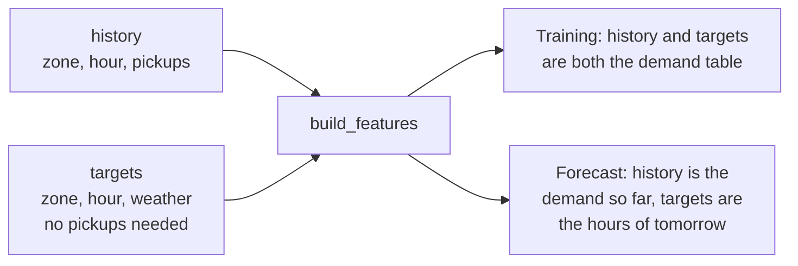

# Chapter 19 – Features without leakage

Zone 48, Clinton East, on Wednesday 8 January 2025 at 23:00: 120 pickups. That is the answer. The model must give it one day earlier, on Tuesday at 23:00. What may it be told? Not the 284 pickups of one hour before, although the demand table holds that number in the row directly above. This chapter shows how the model inputs are built so that nothing from the last 24 hours can enter them, and how a test proves it.

## What you will learn

- The four families of features, with one real row.
- Why a rolling window must end 24 hours before the target hour, and the usual way to get this wrong.
- Why "24 hours earlier" means elapsed time, and what that costs on two days of the year.
- Why the first 191 hours of every zone are dropped and not filled.
- How one function builds the features for training and for serving.
- How a test proves that no feature reads the future.

## One row, four families

Chapter 1 defined a feature as an input column of the model. The gold feature table, `data/gold/features.parquet`, has 83,040 rows and 20 columns: the zone and the hour, the target `pickups`, the flag `is_outlier`, and 16 features. This is its first row, the hour from the opening.

| Family | Column | Value | What it is |
|---|---|---|---|
| Lags | `lag_24h` | 72 | pickups on 7 January at 23:00 |
| | `lag_48h` | 50 | pickups on 6 January at 23:00 |
| | `lag_168h` | 60 | pickups on 1 January at 23:00 |
| Rolling statistics | `roll_mean_24h`, `roll_std_24h` | 87.83, 52.75 | mean and standard deviation of the 24 hours of 7 January |
| | `roll_mean_168h`, `roll_std_168h` | 95.67, 54.25 | the same for the 168 hours from 1 to 7 January |
| Calendar | `hour`, `day_of_week`, `month` | 23, 2, 1 | read from the local clock; Monday is 0 |
| | `is_weekend`, `is_holiday` | False, False | |
| Weather | `temperature_2m`, `wind_speed_10m` | −5.1, 29.0 | the forecast for the target hour itself |
| | `precipitation`, `snowfall` | 0.0, 0.0 | |

*Figure 19.1 – The features of zone 48 at 23:00 on 8 January 2025. The zone number is the seventeenth model input.*

The calendar and the weather describe the target hour itself. That is allowed: the calendar is known years ahead, and the weather is a forecast (Chapter 2). The lags and the rolling statistics are made from the target, and they need care.

`is_holiday` marks the federal holidays of the United States, from the library `holidays`. Holidays of New York State only, such as Lincoln's Birthday, are not marked. The table contains four holidays, and only two of them are in the training period, so the model has little to learn this column from.

## Lags and the config

A lag is the simple case. `lag_24h` is the value 24 rows above on the complete grid of Chapter 18. The validator of Chapter 7 refuses any lag shorter than the horizon, so nothing here can be too new.

The config class got one more rule with this feature:

[`src/demand/config.py`](../../src/demand/config.py)

```python
    # A standard deviation needs at least two values.
    rolling_windows: list[Annotated[int, Field(ge=2)]] = Field(min_length=1)
```

A window of one hour has no spread. Without this line, such a window would fill a column with missing values, and every row would be dropped.

## The window that ends a day earlier

A rolling statistic summarises a window of hours. The question is where the window ends. For a target hour *t* and a window of 24 hours:

```text
hours before t:   47  46  ...  25  24 | 23  22  ...   2   1 |  t
                  [ the 24-hour window ] [  not known yet    ]  target
```

*Figure 19.2 – The window covers the hours t − 47 to t − 24. For the row of Figure 19.1 that is 7 January from 00:00 to 23:00.*

This is the place where most real projects leak. The pandas line that everybody writes first is `rolling(24).mean()`. Its window ends at the row itself, so the mean contains the target. The usual repair is `shift(1)`, which makes the window end at *t* − 1. That is correct for a forecast one hour ahead. For a day-ahead forecast it is a leak: 23 of the 24 hours in the window are not known when the forecast is made. The score improves, and nothing warns you.

[`src/demand/data/features.py`](../../src/demand/data/features.py)

```python
    # At row t this holds the pickups of t - horizon: the newest value that is known
    # when t is predicted. Every window ends there.
    newest_known = shift_later(pickups, config.horizon_hours)
    for window in config.rolling_windows:
        mean, std = window_statistics(newest_known, window)
```

`pickups` is a table with one row per hour and one column per zone. `shift_later` moves every value 24 rows down. `window_statistics` then calculates the mean and the standard deviation of the last 24 or 168 rows of this shifted table. The shift comes first, so no window can reach past *t* − 24, whatever its length.

## Elapsed hours, not clock hours

On Sunday 9 March at 08:00, Midtown Center (zone 161) had 48 pickups. Which hour is "24 hours earlier"? The clocks went forward that night. On the clock, Saturday at 08:00 is only 23 real hours back. 24 real hours back is Saturday at 07:00.

The code counts **elapsed time**: real hours that passed, not hours on the clock. It converts every hour to UTC before it counts. So `lag_24h` of that row is 24, the pickups of Saturday at 07:00, and not the 48 of Saturday at 08:00.

There are three reasons. The leakage rule is a rule about elapsed time, and the clock-time lag would be one hour too new. Clock time has a hole in spring and a repeated hour in autumn, and each would need special code. And elapsed hours are a fixed number of rows on the grid.

The price is visible in the example: for the 24 hours after a clock change, the lag points at the clock hour next to the one a person expects, and the 168-hour lag does so for a week. The calendar features are not affected. `hour` is 8 for that row.

## Warm-up rows are dropped, not filled

The first hour of the data is 1 January at 00:00. Its lags would need December, which is not there. The longest window ends 24 hours back and is 168 hours long, so its oldest value is 24 + 168 − 1 = 191 hours back. The first 191 hours of every zone therefore cannot have complete features. These are the **warm-up rows**: 3,820 of them, 4.4% of the demand table.

`build_features` leaves such a feature empty. The function that builds the training table then removes the rows:

```python
    has_history = features.notna().all(axis=1)
    columns = list(gold_features_schema(settings).columns)
    table = features.loc[has_history, columns].reset_index(drop=True)
    return table, int((~has_history).sum())
```

Why not fill the gaps with 0? Because 0 is a value. `lag_168h = 0` in Midtown says "nobody took a taxi here a week ago". The truth is "we do not know". A model trained on such rows learns something false. The stage returns the number of dropped rows and logs it as `rows_dropped_for_history`.

## One function for training and serving

Chapter 4 described training/serving skew: training builds a feature one way, the service builds it another way, and the forecasts get worse without an error. The defence is a single function.

```python
def build_features(
    history: pd.DataFrame, targets: pd.DataFrame, settings: Settings
) -> pd.DataFrame:
```

It takes two tables. `history` has zone, hour and pickups: the past. `targets` has zone, hour and weather for the rows to build. It needs no pickups, so its hours may lie in the future.



*Figure 19.3 – One function, two uses. The forecast job, the API and the drift monitor of later phases will call the same function.*

Training passes the whole demand table as both arguments. That history reaches far beyond each target hour, and it is still safe, because the function cannot read past *t* − 24. The safety is in the function, not in the care of the caller.

## The test that proves it

How do you know that no feature reads the future? You can read the code. But a reader checks what the author meant. A test checks what the code does.

The idea is an experiment. Change the pickups of one zone at one hour *t*. Build the features again. Compare all rows before and after.

[`tests/unit/data/test_features.py`](../../tests/unit/data/test_features.py)

```python
    changed_demand = demand.copy()
    changed_demand.loc[is_changed_cell, TARGET] += 1000
    after = build_features(changed_demand, changed_demand, settings)

    changed = _changed_rows(before, after, inputs)
    too_early = before[HOUR_START] < changed_hour + horizon
    other_zone = before[ZONE_ID] != zone
    assert not (changed & too_early).any()
    assert not (changed & other_zone).any()
```

`changed` marks every row in which at least one model input is different. The first `assert` says: no row with a target hour before *t* + 24 may be different, because such a row is predicted before the pickups of *t* are known. The second says: no row of another zone may be different at all.

The next lines of the test matter just as much:

```python
    assert changed.any()
    assert before.loc[changed, HOUR_START].min() == changed_hour + horizon
```

A function that returned the same numbers for every input would pass the first two checks. So the test also demands that the change is seen, and first at exactly *t* + 24. The test runs nine times: for three zones and three hours, one of them the last hour before the clocks go forward.

This test is stronger than a review for one reason: it knows nothing about how the features are built. Someone can add a new window, replace numpy with another library or rewrite the whole function. If any column in the list of model inputs then reads something newer than the horizon, the test fails.

> [!NOTE]
> A test that has never failed has not shown that it can fail. To check this one, the feature code was broken on purpose: every window was made to end one hour later, at *t* − 23. All nine runs failed. Then the change was removed. Do this once with every test that guards an important rule.

## A consequence for later phases

The forecast for tomorrow at 23:00 needs the pickups of today at 23:00. So the features for all 24 hours of tomorrow can be built only when today is complete. Every single hour respects the horizon, but a job that writes the whole of tomorrow in one run must wait until midnight. The forecast phase has to be designed around this.

## Try it yourself

These commands need the gold layer of Chapter 18. Print the first row of the feature table.

```powershell
.venv\Scripts\python.exe -c "import pandas as pd; f = pd.read_parquet('data/gold/features.parquet'); print(f.shape); print(f.iloc[0].to_string())"
```

You should see `(83040, 20)` and then the twenty values of Figure 19.1, beginning with:

```text
zone_id                                  48
hour_start        2025-01-08 23:00:00-05:00
pickups                                 120
is_outlier                            False
lag_24h                                72.0
```

Calculate the lags and the 24-hour window by hand, from the demand table.

```powershell
.venv\Scripts\python.exe -c "import pandas as pd; d = pd.read_parquet('data/gold/demand_hourly.parquet'); p = d[d.zone_id == 48].set_index('hour_start').pickups; t = pd.Timestamp('2025-01-08 23:00', tz='America/New_York'); h = pd.Timedelta(hours=1); print([int(p[t - k * h]) for k in (24, 48, 168)]); w = p[t - 47 * h : t - 24 * h]; print(w.index[0], w.index[-1], len(w), round(w.mean(), 6), round(w.std(), 6))"
```

You should see:

```text
[72, 50, 60]
2025-01-07 00:00:00-05:00 2025-01-07 23:00:00-05:00 24 87.833333 52.74769
```

These are the numbers of the stored row. The window is the whole of 7 January.

Build the features of the last day as a forecast would: history up to 29 June, and targets without pickups.

```powershell
.venv\Scripts\python.exe -c "import pandas as pd; from demand.config import get_settings; from demand.data.features import build_features; d = pd.read_parquet('data/gold/demand_hourly.parquet'); day = pd.Timestamp('2025-06-30', tz='America/New_York'); served = build_features(d[d.hour_start < day], d[d.hour_start >= day].drop(columns=['pickups', 'is_outlier']), get_settings()); stored = pd.read_parquet('data/gold/features.parquet'); stored = stored.loc[stored.hour_start >= day, served.columns]; print(len(served), served.reset_index(drop=True).equals(stored.reset_index(drop=True)))"
```

You should see `480 True`: 24 hours for 20 zones, and every value is equal to the one in the training table.

Look at the lag across the clock change.

```powershell
.venv\Scripts\python.exe -c "import pandas as pd; d = pd.read_parquet('data/gold/demand_hourly.parquet'); f = pd.read_parquet('data/gold/features.parquet'); t = pd.Timestamp('2025-03-09 08:00', tz='America/New_York'); p = d[d.zone_id == 161].set_index('hour_start').pickups; print(f[(f.zone_id == 161) & (f.hour_start == t)].lag_24h.item(), p[t - pd.Timedelta(hours=24)], p[pd.Timestamp('2025-03-08 08:00', tz='America/New_York')])"
```

You should see `24.0 24 48`: the stored lag, the pickups 24 real hours earlier, and the pickups at 08:00 on Saturday.

Run the two leakage tests, and then all tests of the feature code.

```powershell
.venv\Scripts\python.exe -m pytest tests/unit/data/test_features.py -q -k "newer_than_the_horizon or later_pickups"
.venv\Scripts\python.exe -m pytest tests/unit/data/test_features.py -q
```

You should see `10 passed, 42 deselected` and then `52 passed`.

## Key takeaways

- Features come in four families: lags, rolling statistics, calendar and weather. Only the first two are made from the target.
- A rolling window must be shifted by the horizon. A window that ends at *t* − 1 is a leak for a day-ahead forecast.
- Lags and windows count elapsed hours. After a clock change they point at the neighbouring clock hour for a while.
- Rows without full history are dropped and counted. A filled-in zero would be a false fact.
- One function builds the features for training and for serving, and it needs no pickups for the target hours.
- The leakage test changes one value and checks which rows change. It also checks that the change is seen.
- Break the code once on purpose to see that the test fails.

## Exercises

**1.** A colleague adds `demand.groupby("zone_id")["pickups"].rolling(3).mean()` to the feature function and to the list of model inputs, as a feature named "recent trend". Which test fails, and at which line?

<details>
<summary>Answer</summary>

`test_no_feature_reads_anything_newer_than_the_horizon` fails at the first `assert`. The window of that feature ends at the target hour itself. When the test changes the pickups at hour *t*, the new feature changes in the rows *t*, *t* + 1 and *t* + 2 of that zone. All three are earlier than *t* + 24. The colleague does not need to know the test exists. This is its value.

</details>

**2.** The horizon is changed to 48 hours. How many warm-up hours does every zone have now, and which other setting must change?

<details>
<summary>Answer</summary>

The longest window now ends 48 hours back, so its oldest value is 48 + 168 − 1 = 215 hours back. The longest lag is 168. The larger number decides: 215 warm-up hours. The setting `lags` must change too, because it contains 24, and the validator refuses a lag shorter than the horizon. The program would not start.

</details>

**3. Interview question.** "How do you make sure that your features do not leak the target?"

<details>
<summary>Points of a good answer</summary>

- State the rule in terms of the horizon: a feature for hour *t* reads nothing newer than *t* − horizon.
- Name the place where it usually goes wrong: a rolling window that ends at *t* − 1, or at *t*.
- Enforce it in three layers: a config check for the lags, a feature function that shifts by the horizon before it builds any window, and a test.
- Describe the test: change the target at one hour, rebuild, and assert that no earlier row changed and that the change does appear at *t* + horizon.
- Use the same function for training and serving, and compare their output bit for bit.

</details>

---

[Previous: Chapter 18 – From trips to a demand table](18-from-trips-to-a-demand-table.md) | [Contents](README.md) | [Next: Appendix A – Stack map](appendix-a-stack-map.md)
