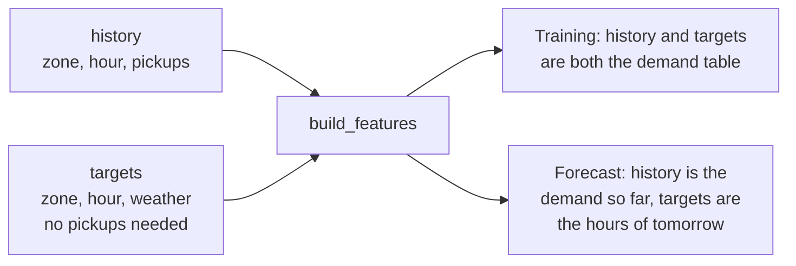

# Chapter 19 – Features without leakage

Zone 48, Clinton East, on Thursday 9 January 2025 at 23:00: 149 pickups. That is the answer. The forecast for the whole of that Thursday is issued at 00:00 on Wednesday. What may the model be told? Not the 257 pickups of one hour before. Not the 120 pickups of Wednesday at 23:00 either: when the forecast is issued, Wednesday has only begun. This chapter shows how the model inputs are built so that nothing from the last 48 hours can enter them, and how a test proves it.

## What you will learn

- The four families of features, with one real row.
- At what moment the features of a whole day can be built, and why.
- Why a rolling window must end 48 hours before the target hour, and the usual way to get this wrong.
- Why "48 hours earlier" means elapsed time, and what that costs on two days of the year.
- Why the first 215 hours of every zone are dropped and not filled.
- How one function builds the features for training and for serving.
- How a test proves that no feature reads the future.

## One row, four families

Chapter 1 defined a feature as an input column of the model. The gold feature table, `data/gold/features.parquet`, has 82,560 rows and 19 columns: the zone and the hour, the target `pickups`, the flag `is_outlier`, and 15 features. This is its first row, the hour from the opening.

| Family | Column | Value | What it is |
|---|---|---|---|
| Lags | `lag_48h` | 72 | pickups on Tuesday 7 January at 23:00 |
| | `lag_168h` | 86 | pickups on Thursday 2 January at 23:00 |
| Rolling statistics | `roll_mean_24h`, `roll_std_24h` | 87.83, 52.75 | mean and standard deviation of the 24 hours of 7 January |
| | `roll_mean_168h`, `roll_std_168h` | 95.67, 54.25 | the same for the 168 hours from 1 to 7 January |
| Calendar | `hour`, `day_of_week`, `month` | 23, 3, 1 | read from the local clock; Monday is 0 |
| | `is_weekend`, `is_holiday` | False, False | |
| Weather | `temperature_2m`, `wind_speed_10m` | −2.9, 24.2 | the forecast for the target hour itself |
| | `precipitation`, `snowfall` | 0.0, 0.0 | |

*Figure 19.1 – The features of zone 48 at 23:00 on 9 January 2025. The zone number is the sixteenth model input.*

The calendar and the weather describe the target hour itself. That is allowed: the calendar is known years ahead, and the weather is a forecast (Chapter 2). The lags and the rolling statistics are made from the target, and they need care.

`is_holiday` marks the federal holidays of the United States, from the library `holidays`. Holidays of New York State only, such as Lincoln's Birthday, are not marked. The table contains four holidays, and only two of them are in the training period, so the model has little to learn this column from.

## The moment a row can be built

Chapter 2 gave the rule: a feature for hour *t* reads no pickups newer than the hour that starts at *t* − 48 hours. Follow the row of Figure 19.1 through time. Every time below is the start of an hour.

| Moment | What happens |
|---|---|
| Tuesday 7 January, 23:00 | The newest hour the row reads begins. It has 72 pickups. |
| Wednesday 8 January, 00:00 | That hour is complete. Every input of the row now exists. |
| Wednesday 8 January, 23:00 | 120 pickups. The row does not read them. |
| Thursday 9 January, 23:00 | The target hour begins, 47 hours after the row could be built. |
| Friday 10 January, 00:00 | The target, 149 pickups, is complete. |

*Figure 19.2 – The life of one row. Its inputs exist 47 hours before its target hour starts.*

Now take the other rows of the same Thursday. The row for 00:00 reads Tuesday at 00:00, which is complete at 01:00 on Tuesday. Each row can be built 47 hours before its own hour. The row for 23:00 is the last one that becomes possible, at 00:00 on Wednesday. So all 24 rows of a day can be built together at 00:00 on the day before, and not one hour earlier. You will check both halves of this sentence below.

One detail follows from the same rule. The features of an hour depend on that hour only, not on the moment the row is built. The row for Thursday 00:00 reads Tuesday 00:00 and nothing newer, although 23 more hours are complete by Wednesday 00:00. Building the rows later on Wednesday changes no value.

## Lags and the config

A lag is the simple case. `lag_48h` is the value 48 rows above on the complete grid of Chapter 18. The validator of Chapter 7 refuses any lag shorter than the horizon, so nothing here can be too new. For the windows the config refuses one thing: a window shorter than 2 hours, because a standard deviation needs at least two values.

## The window that ends two days earlier

A rolling statistic summarises a window of hours. The question is where the window ends. For a target hour *t* and a window of 24 hours:

```text
hours before t:   71  70  ...  49  48 | 47  46  ...   2   1 |  t
                  [ the 24-hour window ] [   not allowed     ]  target
```

*Figure 19.3 – The window covers the hours t − 71 to t − 48. For the row of Figure 19.1 that is 7 January from 00:00 to 23:00.*

This is the place where most real projects leak. The pandas line that everybody writes first is `rolling(24).mean()`. Its window ends at the row itself, so the mean contains the target. The usual repair is `shift(1)`, which makes the window end at *t* − 1. That is correct for a forecast one hour ahead. For a day-ahead forecast it is a leak: none of the 24 hours in that window exists when the forecast is issued. The score improves, and nothing warns you.

[`src/demand/data/features.py`](../../src/demand/data/features.py)

```python
    # At row t this holds the pickups of t - horizon: the newest value that is known
    # when t is predicted. Every window ends there.
    newest_known = shift_later(pickups, config.horizon_hours)
    for window in config.rolling_windows:
        mean, std = window_statistics(newest_known, window)
```

`pickups` is a table with one row per hour and one column per zone. `shift_later` moves every value 48 rows down. `window_statistics` then calculates the mean and the standard deviation of the last 24 or 168 rows of this shifted table. The shift comes first, so no window can reach past *t* − 48, whatever its length.

## Elapsed hours, not clock hours

On Sunday 9 March at 10:00, Midtown Center (zone 161) had 133 pickups. Which hour is "48 hours earlier"? The clocks went forward that night. On the clock, Friday at 10:00 is only 47 real hours back. 48 real hours back is Friday at 09:00.

The code counts **elapsed time**: real hours that passed, not hours on the clock. It converts every hour to UTC before it counts. So `lag_48h` of that row is 167, the pickups of Friday at 09:00, and not the 223 of Friday at 10:00. A test in `test_features.py` keeps this behaviour fixed.

There are three reasons. The leakage rule is a rule about elapsed time, and the clock-time lag would be one hour too new. Clock time has a hole in spring and a repeated hour in autumn, and each would need special code. And elapsed hours are a fixed number of rows on the grid.

The price is visible in the example: for the 48 hours after a clock change, the lag points at the clock hour next to the one a person expects, and the 168-hour lag does so for a week. The calendar features are not affected. `hour` is 10 for that row.

## Warm-up rows are dropped, not filled

The first hour of the data is 1 January at 00:00. Its lags would need December, which is not there. The longest window ends 48 hours back and is 168 hours long, so its oldest value is 48 + 168 − 1 = 215 hours back. The first 215 hours of every zone therefore cannot have complete features. These are the **warm-up rows**: 4,300 of them, 5.0% of the demand table. The first row with complete features is the one of Figure 19.1, on 9 January at 23:00.

`build_features` leaves such a feature empty. The function that builds the training table then removes the rows:

```python
    has_history = features.notna().all(axis=1)
    columns = list(gold_features_schema(settings).columns)
    table = features.loc[has_history, columns].reset_index(drop=True)
    return table, int((~has_history).sum())
```

Why not fill the gaps with 0? Because 0 is a value. `lag_168h = 0` in Midtown says "nobody took a taxi here a week ago". The truth is "we do not know". A model trained on such rows learns something false. The stage returns the number of dropped rows and logs it as `rows_dropped_for_history`.

## One function for training and serving

Chapter 4 described training/serving skew: training builds a feature one way, the service builds it another way, and the forecasts get worse without an error. The defence is a single function.

```python
def build_features(
    history: pd.DataFrame, targets: pd.DataFrame, settings: Settings
) -> pd.DataFrame:
```

It takes two tables. `history` has zone, hour and pickups: the past. `targets` has zone, hour and weather for the rows to build. It needs no pickups, so its hours may lie in the future.



*Figure 19.4 – One function, two uses. The API of Chapter 30 and the replay of Chapter 34 call it, and the drift check of Chapter 35 reads the rows the replay built with it. Chapter 31 shows that the API's rows equal the training rows.*

Training passes the whole demand table as both arguments. That history reaches far beyond each target hour, and it is still safe, because the function cannot read past *t* − 48. The safety is in the function, not in the care of the caller.

## The test that proves it

How do you know that no feature reads the future? You can read the code. But a reader checks what the author meant. A test checks what the code does.

The idea is an experiment. Change the pickups of one zone at one hour *t*. Build the features again. Compare all rows before and after.

[`tests/unit/data/test_features.py`](../../tests/unit/data/test_features.py)

```python
    changed_demand = demand.copy()
    changed_demand.loc[is_changed_cell, TARGET] += 1000
    after = build_features(changed_demand, changed_demand, settings)

    changed = _changed_rows(before, after, inputs)
    too_early = before[HOUR_START] < changed_hour + horizon
    other_zone = before[ZONE_ID] != zone
    assert not (changed & too_early).any()
    assert not (changed & other_zone).any()
```

`changed` marks every row in which at least one model input is different. The first `assert` says: no row with a target hour before *t* + horizon may be different, because such a row is predicted before the pickups of *t* are known. The second says: no row of another zone may be different at all.

The next lines of the test matter just as much:

```python
    assert changed.any()
    assert before.loc[changed, HOUR_START].min() == changed_hour + horizon
```

A function that returned the same numbers for every input would pass the first two checks. So the test also demands that the change is seen, and first at exactly *t* + horizon. The test runs eighteen times: for three zones, three hours and two horizons, 24 and 48. One of the hours is the last one before the clocks go forward. The test sets its own horizon and lags, so it did not have to change when the config did.

This test is stronger than a review for one reason: it knows nothing about how the features are built. Someone can add a new window, replace numpy with another library or rewrite the whole function. If any column in the list of model inputs then reads something newer than the horizon, the test fails.

> [!NOTE]
> A test that has never failed has not shown that it can fail. When this test was written, the feature code was broken on purpose: every window was made to end one hour too late. Every run failed. Then the change was removed. Do this once with every test that guards an important rule.

## Try it yourself

These commands need the gold layer of Chapter 18. Print the first row of the feature table.

```powershell
.venv\Scripts\python.exe -c "import pandas as pd; f = pd.read_parquet('data/gold/features.parquet'); print(f.shape); print(f.iloc[0].to_string())"
```

You should see `(82560, 19)` and then the nineteen values of Figure 19.1, beginning with:

```text
zone_id                                  48
hour_start        2025-01-09 23:00:00-05:00
pickups                                 149
is_outlier                            False
lag_48h                                72.0
```

Calculate the lags and the 24-hour window by hand, from the demand table.

```powershell
.venv\Scripts\python.exe -c "import pandas as pd; d = pd.read_parquet('data/gold/demand_hourly.parquet'); p = d[d.zone_id == 48].set_index('hour_start').pickups; t = pd.Timestamp('2025-01-09 23:00', tz='America/New_York'); h = pd.Timedelta(hours=1); print([int(p[t - k * h]) for k in (48, 168)]); w = p[t - 71 * h : t - 48 * h]; print(w.index[0], w.index[-1], len(w), round(w.mean(), 6), round(w.std(), 6))"
```

You should see:

```text
[72, 86]
2025-01-07 00:00:00-05:00 2025-01-07 23:00:00-05:00 24 87.833333 52.74769
```

The window is the whole of 7 January.

Build the features of a whole day as a forecast would. It is 00:00 on Tuesday 29 April (`now`). The history ends there, and the targets are the 24 hours of Wednesday 30 April, without pickups.

```powershell
.venv\Scripts\python.exe -c "import pandas as pd; from demand.config import get_settings; from demand.data.features import build_features; d = pd.read_parquet('data/gold/demand_hourly.parquet'); now = pd.Timestamp('2025-04-29 00:00', tz='America/New_York'); day = pd.Timestamp('2025-04-30', tz='America/New_York'); in_day = d.hour_start.dt.date == day.date(); served = build_features(d[d.hour_start < now], d[in_day].drop(columns=['pickups', 'is_outlier']), get_settings()); stored = pd.read_parquet('data/gold/features.parquet'); stored = stored.loc[stored.hour_start.dt.date == day.date(), served.columns]; print(len(served), served.reset_index(drop=True).equals(stored.reset_index(drop=True))); print(int(served.isna().any(axis=1).sum()))"
```

You should see `480 True` and then `0`: 24 hours for 20 zones, every value equal to the one in the training table, and no empty feature. Now run the same command one hour too early: replace `2025-04-29 00:00` with `2025-04-28 23:00`. You should see `480 False` and then `20`. One row of every zone has an empty feature. It is the row for 23:00, the last hour of the day: the hour it reads, Monday at 23:00, has not ended.

Run the two leakage tests, and then all tests of the feature code.

```powershell
.venv\Scripts\python.exe -m pytest tests/unit/data/test_features.py -q -k "newer_than_the_horizon or later_pickups"
.venv\Scripts\python.exe -m pytest tests/unit/data/test_features.py -q
```

You should see `19 passed, 52 deselected` and then `71 passed`.

## Key takeaways

- Features come in four families: lags, rolling statistics, calendar and weather. Only the first two are made from the target.
- A row can be built 47 hours before its target hour starts. The last hour of a day decides for the day: all 24 rows can be built at 00:00 on the day before.
- A rolling window must be shifted by the horizon. A window that ends at *t* − 1 is a leak for a day-ahead forecast.
- Lags and windows count elapsed hours. After a clock change they point at the neighbouring clock hour for a while.
- Rows without full history are dropped and counted. A filled-in zero would be a false fact.
- One function builds the features for training and for serving, and it needs no pickups for the target hours.
- The leakage test changes one value and checks which rows change. It also checks that the change is seen.

## Exercises

**1.** A colleague adds `demand.groupby("zone_id")["pickups"].rolling(3).mean()` to the feature function and to the list of model inputs, as a feature named "recent trend". Which test fails, and at which line?

<details>
<summary>Answer</summary>

`test_no_feature_reads_anything_newer_than_the_horizon` fails at the first `assert`. The window of that feature ends at the target hour itself. When the test changes the pickups at hour *t*, the new feature changes in the rows *t*, *t* + 1 and *t* + 2 of that zone. All three are earlier than *t* + 48. The colleague does not need to know the test exists. This is its value.

</details>

**2.** It is 15:00 on Wednesday 8 January. Which rows of Thursday 9 January can be built, and which rows of Friday 10 January?

<details>
<summary>Answer</summary>

The newest complete hour is Wednesday 14:00, which ended at 15:00. All 24 rows of Thursday can be built, as they could since 00:00. For Friday, the rows from 00:00 to 14:00 can be built, because they read Wednesday 00:00 to 14:00. The rows from 15:00 to 23:00 cannot. The whole of Friday is possible at 00:00 on Thursday.

</details>

**3. Interview question.** "How do you make sure that your features do not leak the target?"

<details>
<summary>Points of a good answer</summary>

- State the rule in terms of the horizon: a feature for hour *t* reads nothing newer than *t* − horizon. Say at what moment the forecast is issued and for which hours.
- Name the place where it usually goes wrong: a rolling window that ends at *t* − 1, or at *t*.
- Enforce it in three layers: a config check for the lags, a feature function that shifts by the horizon before it builds any window, and a test.
- Describe the test: change the target at one hour, rebuild, and assert that no earlier row changed and that the change does appear at *t* + horizon.
- Use the same function for training and serving, and compare their output bit for bit.

</details>

---

[Previous: Chapter 18 – From trips to a demand table](18-from-trips-to-a-demand-table.md) | [Contents](README.md) | [Next: Chapter 20 – Quality gates: checking the files on disk](20-quality-gates.md)
