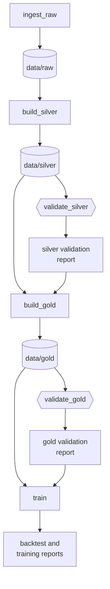

# Chapter 21 – A pipeline that knows what changed

You change `outlier_zscore` in the config from 4.0 to 3.5. The pipeline has six commands: `ingest`, `silver`, `validate silver`, `gold`, `validate gold`, `train`. Which of them must run again? The honest answer of most people is "I am not sure, so I run all of them", or "only gold, I think". The first answer costs time. The second is a risk: if it is wrong, a layer on disk no longer matches the config, and nothing says so. This chapter gives the question to a tool.

## What you will learn

- What DVC is, and which one of its jobs this project uses.
- What `deps`, `params` and `outs` mean in `dvc.yaml`.
- What `dvc.lock` records, and why a second run does nothing.
- How a quality gate is placed between two stages.
- Why the raw layer is marked `persist`.
- What DVC cannot see in this project.
- A real mistake with a date in a YAML file.

## Six commands and a memory

Until now the order of the pipeline was in your head. That has three weaknesses. You can run too much: the ingest stage alone compares 390 MB of files with their checksums. You can run too little, as in the opening. And nothing forces the gates of Chapter 20 to run: a person in a hurry types `silver` and then `gold`.

The answer to "what must run again?" is mechanical. A stage must run again when something it reads has changed since its last run. A program can decide this, if it knows what every stage reads and writes.

## DVC, and the file that describes the stages

**DVC** (Data Version Control) is a tool that works next to git. It has two main jobs: to store versions of large data files outside git, and to run a pipeline of stages and repeat only the stages that need it. This project uses the second job. The stages are described in one file.

[`dvc.yaml`](../../dvc.yaml)

```yaml
  build_gold:
    cmd: python -m demand gold
    deps:
      - data/silver
      # The gate: gold is built only from a silver layer that passed validate_silver.
      - reports/silver_validation_report.json
      - src/demand/data/gold.py
      - src/demand/data/aggregate.py
      - src/demand/data/features.py
      - src/demand/data/clean_weather.py
      - src/demand/schemas.py
    params:
      - configs/config.yaml:
          - project.timezone
          - data.start_month
          - data.end_month
          # The outlier statistics are learned from the training period only.
          - data.train_end_date
          - data.zones
          - data.weather.variables
          - features
    outs:
      - data/gold
```

This is one of the six stages. It has four parts.

`cmd` is the command that DVC runs. It is the same command you typed in Chapter 18. DVC adds no logic of its own.

`deps` is short for dependencies. Chapter 6 used that word for libraries. Here it means the files and folders that the stage reads, and to keep the two meanings apart this chapter writes `deps`. For this stage they are the silver layer, a report, and the source files that hold the logic of the stage. If one byte of `features.py` changes, the stage must run again, because the same data would give different features.

`params` are keys of the config file. Listing `configs/config.yaml` under `deps` would be wrong: a change to the port of the web service would then rebuild the gold layer. So the stage names only the keys it uses. `features` names a whole section, which includes `outlier_zscore`.

`outs` (outputs) are what the stage writes.

Now the opening has an answer. `features` is in the `params` of `build_gold`, so that stage runs. Its output `data/gold` changes, and `data/gold` is in the `deps` of `validate_gold`, so the gate runs too. The last stage, `train`, runs for two reasons. It lists `features` among its own `params`, because the model inputs are defined there. And it reads the feature table `data/gold/features.parquet`, which holds the column `is_outlier`. The first three stages list neither the key nor anything that changed. They are skipped.

## What "changed" means: dvc.lock

After a stage has run, DVC writes down what it saw. The record is the file [`dvc.lock`](../../dvc.lock). This is part of the entry for `build_gold`:

```yaml
    params:
      configs/config.yaml:
        data.end_month: 2025-06
        data.start_month: 2025-01
        data.train_end_date: '2025-04-30'
```

```yaml
    outs:
    - path: data/gold
      hash: md5
      md5: 7bacf1bf80cf4612d40552e74ef11cc5.dir
      size: 3025585
      nfiles: 2
```

For every key under `params` it stores the value. For every entry under `deps` and `outs` it stores a checksum, calculated with **MD5**, a method like the SHA-256 of Chapter 15 with a shorter result. A folder gets one checksum for all its files together, marked with `.dir`.

`dvc repro` (reproduce) is the command that runs the pipeline. For every stage it calculates the checksums and reads the config keys again, and compares them with `dvc.lock`. If all are equal, the stage is skipped. A run in which the five data stages were forced took about 46 seconds here. The sixth stage, `train`, adds the time to fit five models (Chapter 26). A second `dvc repro` takes about one second and prints `Data and pipelines are up to date.`

`dvc.yaml` and `dvc.lock` are stored in git. The data is not: `.gitignore` still excludes `data/` and `reports/` (Chapter 12). `requirements.lock` records the exact libraries of a commit (Chapter 6). `dvc.lock` does the same for the data: it records the exact content that the pipeline produced.

## A gate between two stages

The order of the stages is not written anywhere. DVC works it out: `build_gold` reads `data/silver`, `build_silver` writes it, so `build_silver` comes first.

Look again at the second entry under the `deps` of `build_gold`: `reports/silver_validation_report.json`. The gold stage never opens this file. It is listed for one reason. The report is the output of `validate_silver`, so DVC must run the silver gate before the gold stage.



*Figure 21.1 – The six stages. `build_gold` depends on the silver layer and on the report of the silver gate. `train` depends on the feature table and on the report of the gold gate.*

When the gate fails, its command ends with exit code 1 (Chapter 9). DVC stops and does not run the stages that come after it.

When the gate passes, the report matters in a second way. It contains no time (Chapter 20), so the same silver files give the same report, byte for byte. A report with a time in it would have a new checksum after every run of the gate, and `build_gold` would be rebuilt for no reason.

The data engineer of this project tested the gate inside the pipeline once. One silver trip file was written again with five rows in zone 264, which is not a valid pickup zone. `dvc repro --downstream validate_silver` ran the gate. The gate failed, DVC stopped, and `build_gold` did not run. A plain `dvc repro` then restored the silver layer from the cache in about two seconds.

The option was needed for a reason that is worth knowing. A plain `dvc repro` first sees that an output of `build_silver` no longer matches `dvc.lock`, and it repairs that output before any gate runs. `--downstream validate_silver` starts at the named stage and does not touch the stages before it.

> [!NOTE]
> The stage `train` of Chapter 26 is connected to the gold gate in the same way. It lists `reports/gold_validation_report.json` under its `deps`, so a model is scored and trained only on a gold layer that passed its gate. Its two reports are listed under `metrics`, like the cleaning report of the silver stage: an output whose numbers the command `dvc metrics show` can print. Until Chapter 26 this stage was named `backtest` and ran only the backtest of Chapter 23.

## The raw layer keeps its files

Before DVC runs a stage, it deletes the outputs of that stage. This is useful for silver and gold: no file of an older run can stay in the folder. It removes a limit that Chapter 17 named, the old month files that stay when the period becomes shorter, for every run that DVC starts.

For the raw layer it would be wrong. The ingest stage compares every file on disk with the manifest and downloads only what is missing or different (Chapter 15). On an empty folder it would download 390 MB every time. So the output is marked:

```yaml
      - data/raw:
          persist: true
```

`persist: true` tells DVC to leave this output in place.

The ingest stage has a second special property. Its `deps` are four source files and no data, because its data comes from the internet. DVC therefore has no reason to run it again while the source files and its config keys stay the same. `dvc repro --force ingest_raw` runs it anyway.

> [!WARNING]
> Be exact about what this command does. It runs `python -m demand ingest`, and that command decides by its own rules from Chapter 15: a file that is on disk and matches the manifest is skipped. The ingest code never asks the server whether a file has changed. So the forced run downloads a missing file, and it asks for forecast weather again if the stored weather is the observed fallback. It does not find a trip file that the source has published again with new content. To get such a file, delete it from `data/raw` and then run the stage.

## The cache

DVC keeps a copy of every output in the folder `.dvc/cache`. This is what made the repair in two seconds possible. The copies are full copies: `data` has 764 MB, and the cache has about as much again.

A DVC **remote** is a shared storage place, to which the cache can be sent so that a colleague can fetch the same data. This project has none. The sources are public, and the pipeline rebuilds every layer from them. The price: a new clone of the repository gets `dvc.lock`, but it cannot fetch the files that the checksums describe. It runs `dvc repro` and downloads from the sources. If a source has changed a file by then, the clone gets other data, and its `dvc.lock` will differ.

## What DVC does not see

DVC compares what it was told to compare. Four things are outside its view here.

- **A source that publishes a file again.** The warning above explains it.
- **Files that are not listed.** The comment at the top of `dvc.yaml` says that `config.py`, `cli.py`, `logs.py` and `errors.py` are left out on purpose, because every stage uses them and most changes to them cannot alter the data. "Most" is not "all". `config.py` holds the code that turns `start_month` and `end_month` into the list of months. A change there could alter every layer, and DVC would report that everything is up to date.
- **The installed libraries.** `requirements.lock` is not in the `deps` of any stage. A new version of pandas does not start a rebuild.
- **The record of trained models.** The MLflow database of Chapter 26 is not an output of any stage. If it is deleted, DVC still reports that everything is up to date.

For the second and the third case there is `dvc repro --force`, which runs every stage again whatever `dvc.lock` says. For the fourth, `dvc repro --force train` runs the last stage alone.

## A real mistake: the date without quotes

The first `dvc repro` of this project failed. The config had this line:

```yaml
  train_end_date: 2025-04-30
```

The two month values above it had quotes: `start_month: "2025-01"`. YAML gives a type to every value it reads. `"2025-01"` is text, because of the quotes. `2025-04-30` without quotes looks like a date, so YAML makes a date object. The program never noticed, because the settings class of Chapter 7 wants a date in this field and accepts both forms.

DVC noticed. It turns the `params` values of a stage into JSON, and JSON has no type for dates. The run stopped with `Object of type date is not JSON serializable`. By then DVC had already deleted `data/gold`, as it does before every run of a stage. The repair was two quote characters. The next run built the gold layer again, identical to the one before.

The lesson has two parts. A value in YAML that looks like a date, a number or `yes` gets a type you did not ask for, so text goes in quotes. And a second tool that reads your config is a second reader with its own rules.

## Try it yourself

Ask DVC whether anything changed. This command only reads.

```powershell
.venv\Scripts\dvc.exe status
```

You should see `Data and pipelines are up to date.` If it lists a stage with a change, find out what you changed before you go on, because the next command would run that stage.

Run the pipeline.

```powershell
.venv\Scripts\dvc.exe repro
```

After about one second you should see:

```text
Stage 'ingest_raw' didn't change, skipping
Stage 'build_silver' didn't change, skipping
Stage 'validate_silver' didn't change, skipping
Stage 'build_gold' didn't change, skipping
Stage 'validate_gold' didn't change, skipping
Stage 'train' didn't change, skipping
Data and pipelines are up to date.
```

The day a stage does have to run, DVC calls `python`, and that must be the Python of the virtual environment. Activate it first, as the [project README](../../README.md) shows, and then type `dvc repro`.

Compare one checksum yourself: calculate the MD5 of the gold report, and read the stored value.

```powershell
(Get-FileHash reports\gold_validation_report.json -Algorithm MD5).Hash.ToLower()
.venv\Scripts\python.exe -c "import yaml; out = yaml.safe_load(open('dvc.lock'))['stages']['validate_gold']['outs'][0]; print(out['path'], out['md5'], out['size'])"
```

You should see the same 32 characters twice:

```text
e1b02e60c2bb93b72aa9f2f73de480f0
reports/gold_validation_report.json e1b02e60c2bb93b72aa9f2f73de480f0 997
```

List the stages with their outputs.

```powershell
.venv\Scripts\dvc.exe stage list
```

You should see:

```text
ingest_raw       Outputs data/raw
build_silver     Outputs data/silver; Reports reports/silver_cleaning_report.json
validate_silver  Outputs reports/silver_validation_report.json
build_gold       Outputs data/gold
validate_gold    Outputs reports/gold_validation_report.json
train            Reports reports/backtest_report.json, reports/training_report.json
```

`dvc dag` draws the same stages as a graph of boxes.

Repeat the mistake with the date, without DVC.

```powershell
.venv\Scripts\python.exe -c "import yaml, json; v = yaml.safe_load('day: 2025-04-30'); print(v); json.dumps(v)"
```

You should see `{'day': datetime.date(2025, 4, 30)}`, then a traceback that ends with `TypeError: Object of type date is not JSON serializable`. Check the type that the config gives today:

```powershell
.venv\Scripts\python.exe -c "import yaml; print(yaml.safe_load(open('configs/config.yaml'))['data']['train_end_date'].__class__.__name__)"
```

You should see `str`.

## Key takeaways

- A stage must run again when a file it reads, or a config key it uses, has changed. DVC decides this from `dvc.yaml` and `dvc.lock`.
- `deps` are the files a stage reads, `params` are single config keys, `outs` are what the stage writes. Listing the whole config file would rebuild everything for every change.
- `dvc.lock` stores checksums and the values of the listed config keys, and it is stored in git. The data is not.
- A gate stands between two stages when the next stage depends on the report of the gate. The report must be the same for the same data.
- DVC deletes outputs before a run. `persist: true` keeps the raw layer.
- DVC sees only what is listed. Sources that change, unlisted files and library versions are outside its view.
- Put quotes around text in YAML that looks like a date.

## Exercises

**1.** You change `cleaning.max_distance_miles` from 100 to 80 and run `dvc repro`. Which stages run? Use the `params` lists in `dvc.yaml`.

<details>
<summary>Answer</summary>

`build_silver` runs, because it lists the whole section `cleaning`. Its output `data/silver` changes, because 31 trips of January alone are longer than 80 miles (Chapter 20). `validate_silver` runs: it lists the key, and `data/silver` is in its `deps`. `build_gold` runs because `data/silver` changed. `validate_gold` runs only if `data/gold` changed, which depends on whether one of the removed trips started in one of the 20 zones. `train` runs in any case: the cleaning report has changed, and it is among the `deps` of `train`, because it is stored with the record of the model (Chapter 26). `ingest_raw` is skipped. The stale silver layer of the opening of Chapter 20 cannot happen when the pipeline is run through DVC.

</details>

**2.** A colleague removes `reports/silver_validation_report.json` from the `deps` of `build_gold`: "Gold does not read this file." What changes?

<details>
<summary>Answer</summary>

Nothing connects the gate to the gold stage any more. Both depend on `data/silver`, and neither depends on the other, so DVC may run them in any order, and a failed gate no longer has a stage after it to stop. If gold runs first, the gold layer is built from a silver layer that then fails its gate. The entry is not there because gold reads the file. It is there to state: gold needs a silver layer that passed.

</details>

**3. Interview question.** "How do you make sure a data pipeline is reproducible, and that it does not repeat work?"

<details>
<summary>Points of a good answer</summary>

- Describe every stage with its command, its inputs, the config keys it uses and its outputs, in a file under version control.
- Record checksums of inputs and outputs after each run. Skip a stage when nothing it depends on changed.
- Let a stage depend on single config keys, not on the whole config file.
- Make stages deterministic, including their reports, or the checksums change for no reason.
- Place quality gates as stages, and let the next stage depend on the gate's report.
- Know the limits: sources outside the pipeline, files that are not listed, library versions. Without shared storage for the data, a checksum proves a difference and cannot bring the old data back.

</details>

---

[Previous: Chapter 20 – Quality gates: checking the files on disk](20-quality-gates.md) | [Contents](README.md) | [Next: Chapter 22 – A number to beat: the baseline and three metrics](22-a-number-to-beat.md)
