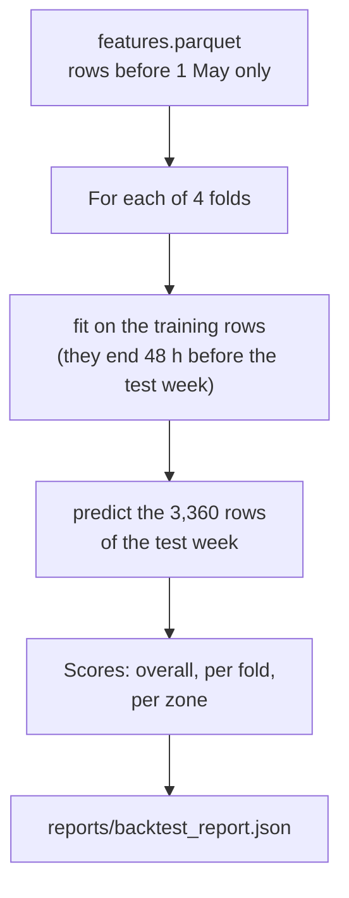

# Chapter 23 – The backtest: four weeks the forecaster has not seen

It is 00:00 on Wednesday 2 April 2025. The forecast for all 24 hours of Thursday 3 April is issued now. The model that makes it was trained some time earlier. Which is the newest hour whose pickups that model may have learned from? Not Wednesday: it has only begun. This chapter builds the test that scores a forecaster on four past weeks, and most of its care goes into this one question.

## What you will learn

- How the four test weeks are cut, and what an expanding training window is.
- How the code makes sure that no row after the training period is read.
- Why a gap of 47 hours separates the training rows from every test week.
- What real procedure one fold imitates.
- How to read the result of the baseline: per week, per zone, per day.
- What this backtest does not prove.

## Four test weeks

Chapter 3 defined a backtest and a fold. The config sets `n_folds: 4` and `fold_days: 7`. The test weeks are the last four blocks of seven days of the training period, and the last block ends on `train_end_date`.

| Fold | Last training hour | Test week | Training rows | Test rows |
|---|---|---|---|---|
| 1 | Tuesday 1 April, 00:00 | 3 to 9 April | 38,900 | 3,360 |
| 2 | Tuesday 8 April, 00:00 | 10 to 16 April | 42,260 | 3,360 |
| 3 | Tuesday 15 April, 00:00 | 17 to 23 April | 45,620 | 3,360 |
| 4 | Tuesday 22 April, 00:00 | 24 to 30 April | 48,980 | 3,360 |

*Figure 23.1 – The folds, from `reports/backtest_report.json`. A test week has 20 zones times 168 hours.*

Every fold trains from the first row of the feature table, 9 January at 23:00. The training rows grow from fold to fold, and none is dropped at the start. This is called an **expanding window**.

A test week runs from 00:00 on its first day to 23:00 on its last, in local time. The code builds these boundaries from calendar dates and then gives them the timezone. It does not add 168 hours to a start time. A week with a clock change would otherwise end at 23:00 or at 01:00. None of these four weeks has one.

## Nothing after 30 April is read

May and June are kept for the simulated clock (Chapter 3). A backtest that had looked at them would spoil that later test, which Chapter 34 takes. The code in [`src/demand/models/backtest.py`](../../src/demand/models/backtest.py) protects them twice.

The first protection is in the function that loads the table:

```python
    return pd.read_parquet(
        path, columns=columns, filters=[(HOUR_START, "<", training_period_end(settings))]
    )
```

`filters` is applied by the Parquet reader. The rows from 1 May on are not loaded and then removed. They never reach memory.

The second protection is in the function `backtest`, which receives a table:

```python
    after_training = int((hours >= training_period_end(settings)).sum())
    if after_training:
        raise ValueError(
```

If the table has one row after the training period, the function stops. It does not cut the row away and continue. A caller that passes such a table has a mistake, and a silent repair would hide it.

## The gap before each test week

Chapter 19 proved that the features cannot leak: the row of hour *t* reads no pickups newer than *t* − 48 hours, whatever table it is built from. One thing remains. A model also learns from the **target** of every training row, the pickups of that hour. So the question from the opening must be asked about the training rows: did those pickups exist when the model made its first forecast?

Take fold 1. Its test week starts on Thursday 3 April at 00:00. Suppose the training rows ended directly before it, on Wednesday at 23:00, as in most drawings of a backtest. The forecast for Thursday is issued on Wednesday at 00:00 (Chapter 2). A model that had learned from the pickups of Wednesday would have learned from hours that had not happened. That is a leak in the target.

The product needs this: the model that forecasts Thursday at 00:00 on Wednesday has learned only from hours that are complete at that moment. The newest of them is Tuesday at 23:00.

The code is stricter than that. It applies the rule of the features to the training rows: a model may learn from no target that its own features would not be allowed to read. The features of the first test hour read nothing newer than 48 hours before it. So the training rows end 48 hours before the first test hour.

| Each time is the start of an hour | What it is in fold 1 |
|---|---|
| Tuesday 1 April, 00:00 | The last training hour. |
| Tuesday 1 April, 01:00 | The first of 47 hours that are used for neither. |
| Wednesday 2 April, 00:00 | The forecast for all of Thursday can be issued. |
| Wednesday 2 April, 23:00 | The last of the 47 hours. |
| Thursday 3 April, 00:00 | The first test hour, 48 hours after the last training hour. |
| Wednesday 9 April, 23:00 | The last test hour. |

*Figure 23.2 – The first fold on a timeline.*

The difference between "what the product needs" and "what the code does" is 23 hours: Tuesday from 01:00 to 23:00. The code gives these hours up. For the baseline this changes nothing, because the baseline learns nothing. For a model it removes 23 of the 1,945 training hours of each zone in fold 1, about 1%. The test is slightly harder than real use, never easier.

## What a fold imitates

A fold stands for a real procedure. The model is trained once a week, on Tuesday at 01:00, on every hour that is complete by then. Then it is frozen for the week. During the week only the features move: each test hour gets its own features, which read pickups up to 48 hours before that hour. The row of Wednesday 9 April reads the pickups of Monday 7 April, an hour inside the test week. That is allowed. Those pickups are known in time, and the model does not learn from them. It only receives them as inputs.

The loop of `backtest` is short:

```python
        for name, forecaster in forecasters.items():
            forecaster.fit(train)
            forecast = np.asarray(forecaster.predict(test[inputs]), dtype="float64")
```

`fit` receives the training rows of the fold. `predict` receives `test[inputs]`: the hour and the model inputs of the test week. The target and the outlier flag are not in that table, so no forecaster can read them by mistake.



*Figure 23.3 – The backtest. The overall score is one mean over all 13,440 test rows, not the mean of four fold scores.*

The command is `python -m demand backtest`. In `dvc.yaml` the sixth stage is `train`, which runs this backtest as its first step (Chapter 26). The report holds no time and every score is rounded to six decimals, so the same table and config give the same bytes (Chapter 21).

## Reading the result

The weekly baseline has an MAE of 27.70 pickups, an RMSE of 44.51 and a sMAPE of 24.64% on 13,440 test rows. Against a mean demand of 156.4, the MAE is 17.7% (Chapter 22). One number hides a lot, so read the parts.

**Per week.** The MAE of the four folds is 27.61, 26.57, 27.92 and 28.70. The weeks differ by about 2 pickups. No week was an accident.

**Per zone.** The lowest MAE is in Lenox Hill East (zone 140) with 15.9, then zones 141 and 249. The highest is in Upper East Side North (zone 236) with 39.3, then zones 237 and 186. This order mostly follows the size of the zones. Zone 237 has the second highest MAE, and with 248.8 pickups per hour its MAE is only 15.6% of its demand.

**Per hour of the day.** The MAE is largest at 21:00 and 22:00, about 50 and 52, and smallest from 03:00 to 05:00, between 5.5 and 7.

**Unusual hours.** Eight test rows carry the outlier flag of Chapter 18. They are scored like all others. Without them the MAE is 27.68, a difference of 0.016.

**One unusual week.** The worst day of the four weeks is Friday 18 April, Good Friday.

| Friday | Mean pickups per zone and hour | Mean forecast (the Friday before) | MAE |
|---|---|---|---|
| 11 April | 180.6 | 157.6 | 34.3 |
| 18 April, Good Friday | 141.5 | 180.6 | 47.5 |
| 25 April | 170.6 | 141.5 | 36.5 |

*Figure 23.4 – Three Fridays. The forecast of each row is the actual value of the row above.*

On Good Friday the city was quiet, and the baseline copied a normal Friday: 39 pickups too many per zone and hour. One week later it copied the quiet Friday and was 29 too low. The four days from 24 to 27 April are all forecast too low: they copy the quiet days from 17 to 20 April. An unusual week damages a weekly baseline twice: once when it arrives, and once when it is copied.

Good Friday and Easter Sunday, 20 April, are not federal holidays. So `is_holiday` is false in every one of the 13,440 test rows. This limits what these folds can tell. They show how a forecaster handles an unusual day that no column announces. They say nothing about whether a model uses `is_holiday` well, because no test row has it set.

## What the backtest does not prove

- **Pickups are assumed to be known when the hour ends.** A real data feed is late. This project has no feed at all (Chapter 3).
- **The weather column is assumed to be what a forecast would have said up to 47 hours ahead.** This is not verified. The archive of past forecasts may hold forecasts made closer to the hour, which are more accurate (Chapter 2).
- **The folds lie inside the period that also chose the 20 zones** and gave the outlier flag its yardstick. This is the same for every forecaster, so comparisons between forecasters stay fair.
- **The folds stop being a clean test once they are used to choose.** Chapter 25 makes four choices on these four weeks, and Chapter 27 tunes the model on them. The score of the chosen settings is then too good. Chapter 27 estimates by how much, and May and June remain the clean test (Chapter 34).

## What a model adds

This chapter read the result of the baseline only. The same command now scores a second forecaster, the LightGBM model of Chapter 24, on the same rows. With the tuned values of Chapter 27 its MAE is 24.11, which is 13.0% better than 27.70. Before tuning it was 24.93, 10.0% better.

An earlier version of this section reported 25.96 from a scratch script. That was the same model with the zone read as a number (Chapter 25).

The gain is only about an eighth, because the weekly copy is a strong forecast. Without the baseline, 24.11 would look like a result. With it, it is a modest step.

## Try it yourself

These commands need the gold layer of Chapter 18. Run the backtest. It reads the feature table, fits the model of Chapter 24 four times, and writes the report in about seven seconds.

```powershell
.venv\Scripts\python.exe -m demand backtest
```

You should see three lines. The first is like this:

```text
{"time": "2026-10-13T14:56:20.566882+00:00", "level": "INFO", "logger": "demand.models.backtest", "message": "forecaster scored", "forecaster": "weekly_naive", "mae": 27.70067, "rmse": 44.509467, "smape": 24.637605, "rows": 13440, "mae_without_outliers": 27.684783, "mae_per_fold": {"1": 27.614583, "2": 26.572619, "3": 27.91756, "4": 28.697917}}
```

The second has the same form for the forecaster `lightgbm`. The third has the message `backtest finished` and the path of the report.

Print the folds from the report.

```powershell
.venv\Scripts\python.exe -c "import json; r = json.load(open('reports/backtest_report.json')); [print(f['number'], f['last_train_hour'], f['first_test_hour'], f['last_test_hour'], f['train_rows'], f['test_rows']) for f in r['folds']]"
```

You should see four lines, the first of them:

```text
1 2025-04-01T00:00:00-04:00 2025-04-03T00:00:00-04:00 2025-04-09T23:00:00-04:00 38900 3360
```

Load the table as the backtest does, and calculate the MAE by hand.

```powershell
.venv\Scripts\python.exe -c "from demand.config import get_settings; from demand.models.backtest import load_training_features; t = load_training_features(get_settings()); print(len(t), t.hour_start.max()); test = t[t.hour_start >= '2025-04-03']; print(len(test), round((test.lag_168h - test.pickups).abs().mean(), 6), round(test.pickups.mean(), 1))"
```

You should see:

```text
53280 2025-04-30 23:00:00-04:00
13440 27.70067 156.4
```

The feature file has 82,560 rows, and 53,280 were loaded. The newest is the last hour of 30 April.

Give the backtest the whole file and see the second protection.

```powershell
.venv\Scripts\python.exe -c "import pandas as pd; from demand.config import get_settings; from demand.models.backtest import backtest; from demand.models.baseline import baselines; s = get_settings(); backtest(pd.read_parquet('data/gold/features.parquet'), baselines(s), s)"
```

You should see a traceback that ends with:

```text
ValueError: the backtest was given 29280 rows after data.train_end_date (2025-04-30); those are reserved for the replay
```

Calculate the three Fridays of Figure 23.4.

```powershell
.venv\Scripts\python.exe -c "from demand.config import get_settings; from demand.models.backtest import load_training_features; t = load_training_features(get_settings()); t = t[t.hour_start.dt.day_of_week == 4].assign(day=t.hour_start.dt.date, error=(t.lag_168h - t.pickups).abs()); print(t[t.hour_start >= '2025-04-11'].groupby('day').agg(actual=('pickups', 'mean'), forecast=('lag_168h', 'mean'), mae=('error', 'mean')).round(1))"
```

You should see:

```text
            actual  forecast   mae
day                               
2025-04-11   180.6     157.6  34.3
2025-04-18   141.5     180.6  47.5
2025-04-25   170.6     141.5  36.5
```

Run the tests of the backtest.

```powershell
.venv\Scripts\python.exe -m pytest tests/unit/models/test_backtest.py -q
```

You should see `64 passed`.

## Key takeaways

- The backtest scores every forecaster on four test weeks, 3 to 30 April, with an expanding training window.
- No row after the training period is read: the loader filters them out, and the backtest refuses a table that contains one.
- Features cannot leak, but the targets of training rows can. The training rows of a fold end 48 hours before its first test hour, and 47 hours per zone are used for neither.
- A fold imitates a model that is trained once a week and then frozen, while its features keep moving.
- The baseline has an MAE of 27.70, which is 17.7% of the mean demand. The four weeks agree within about 2 pickups.
- An unusual week damages a weekly baseline twice. No test row has `is_holiday` set, so these folds cannot judge that feature.
- A backtest that is used to choose settings is no longer a clean test. May and June are.

## Exercises

**1.** The test week of fold 2 starts on Thursday 10 April at 00:00. Which is its last training hour? At what moment can the forecast for the whole of that Thursday be issued? The hours between the two belong to the test week of fold 1. Is that a problem?

<details>
<summary>Answer</summary>

The last training hour is 48 hours before the first test hour: Tuesday 8 April at 00:00. The forecast for all of Thursday can be issued on Wednesday 9 April at 00:00. The 47 hours from Tuesday 01:00 to Wednesday 23:00 are used for neither in fold 2. That they are test hours in fold 1 is no problem: each fold is a separate experiment with its own model. In fold 3 the same hours are training rows, because by then they are in the past.

</details>

**2.** A colleague removes the gap: "Chapter 19 has a test that proves the features cannot leak, so the training rows can end at Wednesday 23:00." What do you answer?

<details>
<summary>Answer</summary>

The test of Chapter 19 is about the inputs of a row. The gap is about the target of the training rows. A model fitted on rows up to Wednesday 23:00 has learned from the pickups of Wednesday. The forecast for Thursday is issued on Wednesday at 00:00, when those pickups do not exist. In real use the model could never be that fresh, so the backtest would describe a better model than the one that will run. For the baseline the gap changes nothing. For a fitted model it keeps the score honest.

</details>

**3.** Thirty settings of a model are tried on the four folds. The best has an MAE of 24.9. Is 24.9 the error to expect in May?

<details>
<summary>Answer</summary>

No. The best of thirty is partly good and partly lucky on these four weeks, and the luck does not repeat. The folds were used to choose, so they are no longer an unbiased estimate for the chosen settings. The error to expect is somewhat higher. The honest number comes from data that took no part in any choice: the replay of May and June. This is why those months are never read by the backtest. For the real model, the backtest said 24.11 and the replay gave 27.80 (Chapter 34).

</details>

**4. Interview question.** "How did you validate your forecasting model?"

<details>
<summary>Points of a good answer</summary>

- A rolling-origin backtest: several test weeks, each forecast by a model that was fitted only on earlier data.
- Say what leaks and how it is closed: features respect the horizon, and the training rows end one horizon before the test period, because the targets of newer rows did not exist when the forecast was issued.
- Say what a fold imitates: retraining once a week, a frozen model, features that keep moving.
- Compare with a baseline on the same rows, and read the result per week, per zone and per day, not only as one number.
- Name the limits: the folds are used for tuning, so the final estimate comes from a period that no decision touched.

</details>

---

[Previous: Chapter 22 – A number to beat: the baseline and three metrics](22-a-number-to-beat.md) | [Contents](README.md) | [Next: Chapter 24 – A model behind the same two methods: LightGBM as a forecaster](24-a-model-behind-the-same-two-methods.md)
