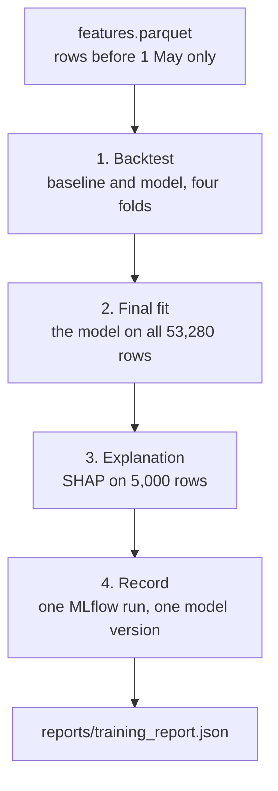

# Chapter 26 – The model that is kept: the final fit and MLflow

Three months from now a planner complains: the forecast for a Saturday in July was far too high. Four questions follow at once. Which model made that forecast? Which data was it trained on? Which version of the code trained it? And how good was it expected to be? With what the project has after Chapter 25, none of them has an answer. The backtest fits four models and throws them away. Its report is overwritten by the next run. This chapter fits the model that is kept, and writes down everything needed to answer the four questions.

## What you will learn

- What one training run does, and why it is one pipeline stage.
- Which rows the final model is fitted on, why there is no gap, and the one day for which that is not correct.
- What experiment tracking is, and how it differs from what DVC does.
- What an MLflow run holds: parameters, metrics, tags and artifacts.
- What a model signature is, and why the stored model is the forecaster itself.
- What the model registry gives.
- Four limits of this record.

## One run, four steps

The command is `python -m demand train`. The work is in [`src/demand/models/training.py`](../../src/demand/models/training.py).



*Figure 26.1 – One training run. The third step was added with Chapter 28.*

In `dvc.yaml` the stage `train` has replaced the stage `backtest`. The two are one stage for a reason: a model must be recorded together with the scores of the exact config it was trained with. `python -m demand backtest` still exists as a quick look that keeps nothing.

## The final fit

The backtest scored a recipe: these inputs, these parameters. The final fit uses the same recipe once more, on every row of the training period: 53,280 rows, from 9 January at 23:00 to 30 April at 23:00.

**The scores belong to the recipe, not to this model.** The final model has no test score of its own, because every April week it could be tested on is now among its training rows. The backtest scores are the estimate of how such a model performs on weeks it has not seen.

**Why there is no gap.** In a fold, the training rows end 48 hours before the test week (Chapter 23). The rule behind that gap was: a model may learn from no pickups that did not exist when it made its forecast. The final fit follows the same rule. It needs no gap, because the days this model will forecast are not in the table.

| Moment | What is true |
|---|---|
| 30 April, 23:00 | The last training hour of the final model. |
| 1 May, 00:00 | That hour is complete. This is the earliest moment the model can exist. |
| 1 May, 00:00 | The forecast for all of 2 May is issued (Chapter 2). The model exists. |

*Figure 26.2 – From 2 May on, every forecast of this model is one it could really have made.*

**The one exception.** The forecast for 1 May was due at 00:00 on 30 April. At that moment the pickups of 30 April did not exist, and this model has learned from them. Its features for 1 May are still correct: they read nothing newer than 48 hours before each hour. But the model is one day younger than it could have been. Whoever scores the replay must start at 2 May, or say that 1 May is included. The docstring of `training.py` states this, and the code agrees with it: the function `final_training_rows` returns the whole table and only refuses a row after 30 April.

## What DVC does not answer

DVC knows which files a stage read and wrote, and whether they changed (Chapter 21). It answers "is the pipeline up to date?". Its lock file describes one state, the latest. It has no list of earlier runs with their scores, and no place for a model that a service can load by name.

**Experiment tracking** is the practice of recording every training run so that runs can be found and compared later. **MLflow** is the tool used here. Its unit is the **run**: one execution of the training, with an id. A run holds four kinds of record.

| Kind | What it is | In the real run of this repository |
|---|---|---|
| Parameter | A setting chosen before the run | 20, for example `model.learning_rate` = 0.104 and `features.lags` = [48, 168] |
| Metric | A number the run produced | 52, for example `lightgbm.mae` = 24.106025, `improvement.mae_percent` = 12.977, and the 16 values `shap.mean_abs.<input>` of Chapter 28 |
| Tag | A label that says where the run came from | `git_commit`, `git_dirty`, `data_version`, `forecaster`, `baseline` |
| **Artifact** | A file stored with the run | `backtest_report.json`, `shap_importance.json`, `shap_summary.png`, `silver_cleaning_report.json` |

*Figure 26.3 – The four kinds of record, for a run with the tuned values of Chapter 27. The first run of this repository, before tuning and before SHAP, has 36 metrics and two artifacts. Runs are compared by their parameters and sorted by their metrics.*

The config says where this is written: `tracking_uri: "sqlite:///mlflow.db"`, one database file in the project folder. Files do not go into the database. MLflow puts them into the folder `mlruns`. Both are ignored by git (Chapter 12).

## What makes a run reproducible

A good number that cannot be produced again is worth little. Three tags tie the run to its origin.

`git_commit` is the commit of the code. `git_dirty` says whether files were changed or added since that commit. `data_version` is the checksum that DVC wrote into `dvc.lock` for the folder `data/gold`: `7bacf1bf80cf4612d40552e74ef11cc5.dir`, the value Chapter 21 showed. The parameters complete the picture.

## The stored model is the forecaster

MLflow can store a bare LightGBM model. This project stores the forecaster of Chapter 24 instead, the object with the checks, the column order and the cut at zero.

[`src/demand/models/tracking.py`](../../src/demand/models/tracking.py)

```python
class ForecasterModel(PythonModel):
    """A fitted forecaster in the form MLflow stores and loads."""

    def __init__(self, forecaster: Forecaster) -> None:
        self.forecaster = forecaster
```

MLflow calls each storage format a flavour. This one is the "python function" flavour, `pyfunc`: any Python object with a `predict` method. The reason for the choice: a service that loaded the bare model would have to repeat the checks, and a step that is written twice is sooner or later different in the two places. The model that will be served is the object the backtest scored.

The price is the file format. The object is saved as a **pickle**, Python's own format for saving objects. A pickle can only be loaded where the class is installed, so loading needs this project's package, and the versions of LightGBM and pandas that MLflow lists in a `requirements.txt` next to the model. A pickle can also run code when it is loaded, so it must only come from a store you trust. MLflow prints a warning about this in every training run.

## The signature

The model is stored with a **model signature**: the names and types of its 16 input columns, in order, and the type of its output. An **input example**, the first five training rows, is stored next to it.

When the model is loaded through MLflow, every table is checked against the signature before the forecaster sees it. Columns in another order are put back in order. A column the signature does not name is dropped with a warning. A missing column is refused. A column of the wrong type is refused too: the zone as a decimal number gives `Incompatible input types for column zone_id. Can not safely convert float64 to int64.`

This matters for the serving phase. A web request arrives as JSON, where 161 and 161.0 are easy to confuse and the order of fields means nothing. The signature turns such differences into an error before the model is asked.

## The registry

Chapter 1 introduced the **model registry**. Every training run registers its model under the name `taxi-demand` and gets a **model version**: 1 for the first run, 2 for the second. In this repository, version 1 is the model before tuning. The training run of Chapter 27, with the tuned values, adds version 2 next to it. Version 1 is not changed or removed. A later step can then say "load `models:/taxi-demand/1`".

A version can also carry a label that moves, an alias. The config names two, `champion` and `challenger`. Training sets neither: which version is served is decided by the promotion gate of Chapter 29, a command of its own. In this repository the gate has made version 2 the champion, so the service of Phase 3 will load it as `models:/taxi-demand@champion`.

## MLflow in two modules

Only two modules of the project import `mlflow`. `tracking.py` writes the runs: the forecaster, the backtest and the training code hand it plain values and get back a run id and a version number. `registry.py`, added with Chapter 29, reads versions and moves aliases. Two things follow. MLflow could be replaced by changing two files. And the command `python -m demand backtest` never loads MLflow, which takes between one and two seconds to import here: `pipeline.py` imports the training module inside the function `run_training`, the lazy import of Chapter 9.

## Four limits

**A run can be marked dirty.** A run made while files are changed or not committed gets `git_dirty = true`, and it cannot be rebuilt from its commit alone. Version 1 of this repository was made the clean way, from commit `7bffb9e`, with `git_dirty = false`. The order that gives a clean record is: commit the code, train, then commit `dvc.lock`.

**The MLflow database is not a DVC output.** DVC tracks the small file `reports/training_report.json` in its place. If `mlflow.db` is deleted, `dvc repro` still says that everything is up to date. The comment in `dvc.yaml` gives the repair: `dvc repro --force train`.

**The project folder cannot be moved.** MLflow stores the absolute path of `mlruns` when the experiment is created: `file:C:/nyc-taxi-demand-mlops/mlruns/1` on the machine of this book. After a move, the database points to a folder that is no longer there.

**The data version can be stale.** It is read from `dvc.lock`, not calculated. After `python -m demand gold` by hand, the lock still describes the older files. Training through `dvc repro` cannot go wrong in this way.

## Try it yourself

> [!WARNING]
> Every `python -m demand train` and every `dvc repro --force train` adds a run and a model version. Nothing is overwritten. The commands below only read.

Ask DVC whether the pipeline is up to date.

```powershell
.venv\Scripts\dvc.exe repro --dry
```

You should see six lines that end in `didn't change, skipping`, the last of them for `train`, and then `Data and pipelines are up to date.`

Read the training report.

```powershell
.venv\Scripts\python.exe -c "import json; r = json.load(open('reports/training_report.json')); print(r['registered_model'], r['model_version'], r['train_rows']); print(r['first_train_hour'], r['last_train_hour']); print(r['model']['mae'], r['baseline']['mae'], r['mae_improvement_percent']); print(r['git_dirty'], r['data_version'])"
```

After the training run with the tuned values you should see:

```text
taxi-demand 2 53280
2025-01-09T23:00:00-05:00 2025-04-30T23:00:00-04:00
24.106025 27.70067 12.977
False 7bacf1bf80cf4612d40552e74ef11cc5.dir
```

The report holds only the newest run. For version 1 it said `24.929918 27.70067 10.002`.

Ask MLflow for the newest run and for the model versions.

```powershell
.venv\Scripts\python.exe -c "from mlflow import MlflowClient; c = MlflowClient('sqlite:///mlflow.db'); e = c.get_experiment_by_name('taxi-demand'); runs = c.search_runs([e.experiment_id]); r = runs[0]; print(len(runs), r.info.status, len(r.data.params), len(r.data.metrics)); print(r.data.metrics['lightgbm.mae'], r.data.metrics['weekly_naive.mae'], r.data.metrics['improvement.mae_percent']); [print(k, '=', r.data.tags[k]) for k in ('forecaster', 'baseline', 'git_commit', 'git_dirty', 'data_version')]; print([a.path for a in c.list_artifacts(r.info.run_id)]); [print(v.name, v.version, v.status, c.get_model_version(v.name, v.version).aliases, v.run_id == r.info.run_id) for v in c.search_model_versions()]"
```

With the two runs in the store, after the promotion of Chapter 29, you should see:

```text
2 FINISHED 20 52
24.106025 27.70067 12.977
forecaster = lightgbm
baseline = weekly_naive
git_commit = <the commit that was checked out>
git_dirty = false
data_version = 7bacf1bf80cf4612d40552e74ef11cc5.dir
['backtest_report.json', 'shap_importance.json', 'shap_summary.png', 'silver_cleaning_report.json']
taxi-demand 2 READY ['champion'] True
taxi-demand 1 READY [] False
```

The newest run comes first. The last two lines say: two versions, both ready, version 2 is the champion, and it belongs to this run. The aliases are asked for each version with `get_model_version`, because in the MLflow version installed here `search_model_versions` returns every version with an empty list of aliases. Before the promotion, the list of version 2 was empty too. The commit and the id of the run are not printed here, because they differ for every run.

Load the model from the registry, forecast three rows, and then give it the zone as a decimal number.

```powershell
.venv\Scripts\python.exe -c "import mlflow; from demand.config import get_settings; from demand.models.backtest import load_training_features; from demand.schemas import feature_columns; s = get_settings(); mlflow.set_tracking_uri(s.mlflow.tracking_uri); m = mlflow.pyfunc.load_model('models:/taxi-demand/2'); x = load_training_features(s)[feature_columns(s)].head(3); print(m.predict(x)); print(m.predict(x[x.columns[::-1]])); m.predict(x.astype({'zone_id': 'float64'}))"
```

You should see the same forecasts twice, the second time from columns in reverse order:

```text
[155.41703452  91.80989147  46.57368484]
[155.41703452  91.80989147  46.57368484]
```

With `models:/taxi-demand/1`, the model before tuning, the first forecast is 145.66432939.

and then a traceback whose last line ends with `Incompatible input types for column zone_id. Can not safely convert float64 to int64.` Loading through the registry writes one small file, `registered_model_meta`, next to the model in `mlruns`. It holds the name and the version.

Check that the backtest path does not load MLflow.

```powershell
.venv\Scripts\python.exe -c "import sys; import demand.models.pipeline; print('lightgbm' in sys.modules, 'mlflow' in sys.modules)"
```

You should see `True False`.

Look at the same record in a browser.

```powershell
.venv\Scripts\mlflow.exe ui --backend-store-uri sqlite:///mlflow.db
```

The command prints an address, by default `http://127.0.0.1:5000`, and keeps running. Open the address. The experiment `taxi-demand` lists one line per training run, and the page of a run shows its parameters, metrics, tags and artifacts. The registered model `taxi-demand` is listed with its versions. Stop the server with Ctrl+C when you are done.

Run the tests of the training code and of the tracking module.

```powershell
.venv\Scripts\python.exe -m pytest tests/unit/models/test_training.py tests/unit/models/test_tracking.py -q
```

You should see `48 passed, 2 warnings`. The warnings come from MLflow and its database library. The tests write their MLflow store into a temporary folder, and one test checks that nothing was written into the repository.

## Key takeaways

- One training run does four things: the backtest, the final fit on all 53,280 training rows, the explanation of Chapter 28, and the record.
- The backtest scores belong to the recipe. The final model has no score of its own until the replay.
- The final fit needs no gap. Its forecasts are consistent from 2 May on, and the forecast for 1 May is the one exception.
- DVC answers "is the pipeline up to date?". MLflow answers "which model is this, what made it, and how good was it?".
- A run holds parameters, metrics, tags and artifacts. The git commit, the dirty flag and the data version make it reproducible.
- The stored model is the forecaster itself, with a signature that enforces column names, order and types when it is loaded.
- Every run registers a new version of `taxi-demand`: version 1 before tuning, version 2 after. Training sets no alias; the promotion gate of Chapter 29 does.
- Know the limits: a dirty run, a database DVC does not track, an absolute path, and a data version that is read and not calculated.

## Exercises

**1.** A colleague wants to report the MAE of the final model on the week of 24 to 30 April: "It is the newest week, and the final model is the one we ship." What is wrong?

<details>
<summary>Answer</summary>

Those 3,360 rows are training rows of the final model. A score on them is a training error, and Chapter 24 showed the size of the difference: 13.35 on training rows against 24.11 on test weeks. The honest number for that week is the score of fold 4, 26.31, which comes from a model that was fitted on rows up to 22 April only. The final model gets its own score when the replay of May and June runs.

</details>

**2.** The replay scores the final model on 1 May to 30 June and reports one MAE. Which statement in this chapter does the report have to include, and why is the effect probably small?

<details>
<summary>Answer</summary>

It has to say that 1 May is included although this model could not have made that forecast in time: the forecast for 1 May was due at 00:00 on 30 April, and the model has learned from the pickups of 30 April. The effect is probably small, because one more day is 480 of 53,280 training rows and 1 May is one of 61 test days. "Probably small" is not measured. The clean choice is to start the score at 2 May.

</details>

**3.** A run in MLflow has `git_dirty = true` and the best MAE so far. Your lead asks you to promote it. What do you answer?

<details>
<summary>Answer</summary>

The run cannot be rebuilt from its commit, because files differed from the commit when it was made, and the record does not say how. If the model misbehaves later, nobody can inspect the exact code that trained it. Commit the code, train again, and commit `dvc.lock`. On the same machine the scores come out the same (Chapter 25), so nothing is lost except a few minutes, and the new run has `git_dirty = false`. The promotion gate of Chapter 29 refuses a dirty version for this reason.

</details>

**4. Interview question.** "How do you know which data and code produced the model that is in production?"

<details>
<summary>Points of a good answer</summary>

- Every training run is recorded: parameters, metrics, the model, and tags for the git commit and the version of the data.
- The data version is a checksum from the pipeline tool, so the exact files can be identified.
- The record says when it cannot be trusted: a flag for uncommitted changes, `unknown` when a fact was not found.
- The model is registered with a version number, and the service loads a named version or alias, not a file path.
- The model is stored with a signature, so a wrong input is refused when it arrives.
- Name the weak points: here the tracking database is a local file outside the pipeline's outputs, and it stores an absolute path.

</details>

---

[Previous: Chapter 25 – Deciding by measurement: four choices and the noise of a seed](25-deciding-by-measurement.md) | [Contents](README.md) | [Next: Chapter 27 – Tuning: a search, and how much of its score to believe](27-tuning-and-how-much-to-believe.md)
