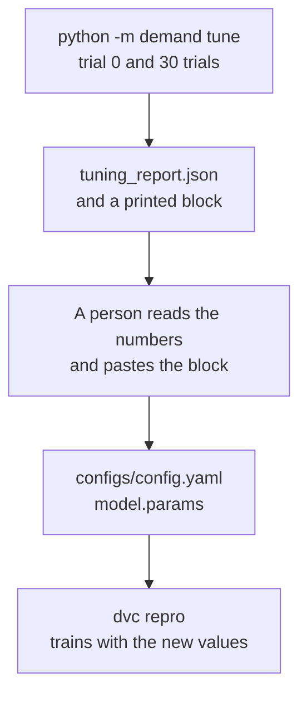

# Chapter 27 – Tuning: a search, and how much of its score to believe

A search tries 30 settings of the model on the four April weeks of the backtest. The best of them lowers the MAE from 25.04 to 24.14, as the mean of three seeds. Then the same search is run on four weeks in March, and the setting it chooses is scored on April, which that search never saw. How much of the gain of 0.90 is left? This chapter builds the search and answers this question with real numbers. The answer is its main lesson.

## What you will learn

- What a hyper-parameter is, and what Optuna does.
- Why `tune` changes nothing itself, and why it is not a DVC stage.
- Which five settings are searched, and which are not.
- Why the score of the best trial is too good, and by how much here.
- What was decided about the two-week lag of Chapter 25.

## Settings that are not learned

Chapter 24 showed the first question of the first tree: "is `lag_168h` at most 155.5?". Nobody wrote 155.5 into the code: training found it. A value that training finds is a **parameter** of the model, and the model has many thousands of them.

Other values are fixed before training starts: how many leaves a tree may have, how much each tree may correct, how many rows each tree sees. Such a value is a **hyper-parameter**. Training cannot find it, because it decides how training works. The config keeps them under `model.params`, because LightGBM calls them parameters.

The values of Chapter 24 were reasonable first choices. **Tuning** is the search for better ones, by trying.

## What a search does

One try is a **trial**: one set of hyper-parameters, scored with the backtest of Chapter 23. The ranges in which values may be chosen are the **search space**.

The library **Optuna** chooses the values. It proposes a set, receives the score, and uses all scores so far to propose the next set. The part that makes the proposals is the **sampler**. This project uses the sampler TPE: the first ten trials are drawn at random, and after that it draws more often near values that scored well. The sampler is seeded with `project.seed`, and a fit is repeatable (Chapter 25), so a second search on the same machine gives the same report, byte for byte.

The real search shows the two phases. Of the first ten trials, drawn at random, one beat the config. Of the next twenty, all twenty did.

| Trial | `learning_rate` | `num_leaves` | `min_child_samples` | `subsample` | `colsample_bytree` | MAE |
|---|---|---|---|---|---|---|
| 0 (the config) | 0.05 | 63 | 20 | 0.8 | 0.8 | 24.93 |
| 1 | 0.0307 | 112 | 72 | 0.8 | 0.5 | 24.37 |
| 2 | 0.016 | 9 | 121 | 0.8 | 0.85 | 26.98 |
| 14 (best) | 0.104 | 110 | 161 | 0.85 | 0.8 | 24.11 |
| 28 | 0.0772 | 123 | 164 | 0.9 | 0.6 | 24.11 |

*Figure 27.1 – Five of the 31 trials, from `reports/tuning_report.json`. The MAE is over all 13,440 test rows, with seed 42.*

## Five settings, and what stays fixed

Thirty trials cannot explore many dimensions. So only five hyper-parameters are searched, the ones that decide how closely the trees follow the training rows.

| Hyper-parameter | Range | Scale | What it controls |
|---|---|---|---|
| `learning_rate` | 0.01 to 0.2 | log | how much of its correction each tree applies |
| `num_leaves` | 8 to 128 | log | how many leaves a tree may have |
| `min_child_samples` | 5 to 200 | log | the fewest training rows a leaf may hold |
| `subsample` | 0.5 to 1.0 | steps of 0.05 | the share of rows each tree is built from |
| `colsample_bytree` | 0.4 to 1.0 | steps of 0.05 | the share of inputs each tree may use |

*Figure 27.2 – The search space, from [`src/demand/models/tuning.py`](../../src/demand/models/tuning.py).*

A **log scale** means that every doubling is equally likely to be tried: values between 8 and 16 leaves as often as values between 64 and 128. It is used where the ratio matters and not the difference. 8 leaves against 16 is a large change. 120 against 128 is almost none.

Other settings are not searched, each for a reason.

- **The objective and the zone handling.** They were decided in Chapter 25. A search could undo a decision without anyone reading the numbers.
- **The seed.** A search over seeds only finds the seed that is lucky on these four weeks.
- **`n_estimators`, the number of trees.** It does the same job as the learning rate from the other side: half the rate with twice the trees gives nearly the same model, so a search over both wastes trials on equally good pairs. The number of trees stays at 600.

## Compute, show, freeze by hand

`python -m demand tune` does three things. It runs the search, writes `reports/tuning_report.json`, and prints a block for the config. Here is the block of the real search:

```text
  # Best of 30 trials: backtest MAE 24.11, against 24.93 for the config (seed 42).
  # Mean of 3 seeds: 24.14 against 25.04, a gain of 0.90, better in 4 of 4 folds.
  # The seed alone moves the score by 0.19 (best) and 0.19 (config).
  # Paste only if the gain is clearly larger than that, in every fold.
  # The test weeks chose these values: the score is too good by an unknown amount.
  params:
    objective: poisson
    learning_rate: 0.104
    n_estimators: 600
    num_leaves: 110
    min_child_samples: 161
    subsample: 0.85
    subsample_freq: 1
    colsample_bytree: 0.8
    verbosity: -1
```

It does not change the config, and it does not train a model. A person reads the numbers and pastes the block under `model:` in `configs/config.yaml`. This is the pattern of `select-zones` in Chapter 18: compute, show, freeze by hand. The config stays the one place that says what the model is, and a person reads the evidence before the model changes.



*Figure 27.3 – The search proposes, a person decides, and the pipeline trains.*

**Why `tune` is not a DVC stage.** The first trial of a search is the current `model.params`, so `model.params` would be an input of the stage. After every paste the input has changed, DVC would run the search again, and the new search would start from the new values and report something else. The stage would chase its own output. The comment above the stage `train` in [`dvc.yaml`](../../dvc.yaml) says this.

## Trial 0, and two things the search does not do

**Trial 0 is the config.** Before Optuna proposes anything, the values in the config are scored. The best trial is the one with the lowest MAE, and on a tie the earlier one. So the result can never be worse than what the project has, and if nothing beats the config, the block says "Keep them".

**No early stopping.** LightGBM can stop adding trees when the score on a second set of rows stops improving. Inside a fold the only such rows are the test week, which would then choose the number of trees and also score the result: an exam marked with its own answers. Rows could be taken from the training period instead, but that is one more moving part for a value that is not searched.

**No pruning.** Optuna can stop a trial whose first folds look bad. The search takes about four minutes, so pruning would save perhaps one, and a stopped trial has no score to compare.

**The seed check.** One score with one seed can be lucky. When a trial beats trial 0, both are scored again with the seeds 43 and 44: the second and third lines of the printed block. The rule of Chapter 25 then applies: the gain must be clearly larger than the range of the seeds, in every fold. Here it is 0.90 against 0.19, in every fold. The search does not apply the rule. A person does.

## A score from the weeks that chose is too good

The search kept the set of values that did best on exactly these four weeks. Part of its lead is skill. Part is luck on these weeks, and that part will not repeat. A score on the data that chose the values is **in-sample**. A score on data that took no part in the choice is **out-of-sample**. Settings chosen on a validation set fit it a little better than they fit new data. This is **over-fitting to the validation set**, and its size can be measured.

The modeller ran two more searches. Each was scored on the April weeks with the seeds 42, 43 and 44. For this chapter all of them were run again outside the repository, and gave the same numbers.

| Values | All four weeks | Fold 1 | Fold 2 | Fold 3 | Fold 4 |
|---|---|---|---|---|---|
| Before tuning | 25.04 (0.19) | 24.37 | 22.80 | 25.96 | 27.02 |
| Tuned on the April folds (the weeks that are scored) | 24.14 (0.19) | 23.43 | 22.07 | 24.68 | 26.37 |
| Tuned on four March folds, which never saw April | 24.40 (0.30) | 23.86 | 22.06 | 25.06 | 26.63 |

*Figure 27.4 – Mean MAE of three seeds; the range of the seeds in brackets; every fold column is a mean of three seeds.*

**In-sample**, the gain is 0.90, about 4.6 times the range of the seeds, and it is there in all four folds.

**Out-of-sample**, the search on March chose values without seeing April. On April they gain 0.64, again in all four folds, by 0.40 to 0.89. So most of the gain is real: about 70% of it remains on weeks the search did not see. The honest size of the gain is "about 0.6", not the 0.90 that the search reports about itself.

The March test is strict. Its four test weeks run from 6 March to 2 April. Every March fold has four weeks less history to learn from than the April fold in the same place. And the clocks changed on 9 March, inside its first test week.

A second check agrees: a search on April folds 1 and 2 chose values that gained 1.41 and 0.87 on folds 3 and 4, which it had not seen.

The three searches agree on the direction: 107 to 125 leaves, at least 61 to 175 rows per leaf, and `subsample` of 0.85 or 0.9. They do not agree on the exact values, and their mean April scores lie between 23.94 and 24.40. Trial 28 of Figure 27.1 shows the same inside one search: other values, and an MAE only 0.004 higher. A search finds a good region, not one best point.

One detail weakens the agreement a little. The March and April searches use the same seeded sampler, and their first 13 proposals are the same. The March winner is trial 13, which the April search also tried. It was chosen by its March score, so the test of April stays fair.

> [!IMPORTANT]
> A score measured on the data that chose the settings is too good. Report the honest size from data the choice did not see.

Two chosen values lie near the upper end of their range: 110 of at most 128 leaves, and 161 of at most 200 rows per leaf. The ranges were not widened, because every wider search is one more look at April, and each look makes the April scores less clean. The clean exam is still the replay of May and June, which `tune` never reads. Chapter 34 takes it.

## The new values

The block was pasted. The config now holds `learning_rate` 0.104, `num_leaves` 110, `min_child_samples` 161 and `subsample` 0.85, where it held 0.05, 63, 20 and 0.8.

With seed 42 the model now has an MAE of 24.11, an RMSE of 38.24 and a sMAPE of 21.88%. The baseline has 27.70, so the model is 12.98% better, where it was 10.0% before tuning. Per fold the MAE is 23.51, 21.85, 24.75 and 26.31. Take the 12.98% with the lesson above: part of the step from 10.0% was chosen on these weeks.

## The two-week lag, closed

Chapter 25 left one decision open. The owner of this project proposed `lag_336h`, the pickups of the same hour two weeks earlier. It helped on average, was worse in some weeks, and was not added until a new test after tuning. Here it is, with the tuned values, three seeds, and the same 50,860 rows on both sides.

| Test | Without `lag_336h` | With `lag_336h` | Before tuning, the gain was |
|---|---|---|---|
| Four April weeks | 24.149 | 24.132 | 0.65 |
| Eight weeks, 6 March to 30 April | 25.24 | 25.56 | 0.27 |

*Figure 27.5 – Mean MAE of three seeds with the tuned values.*

On the four weeks the gain is 0.02, far inside the noise. Per fold the lag gains 0.05, loses 1.07, gains 0.72 and gains 0.37. On eight weeks the lag makes the MAE worse by 0.32. It is better in only 4 of the 8 weeks, and the week of 13 March is worse by 3.34.

An interpretation, not a measurement: a better-tuned model takes more from the one-week lag and the rolling means, and that already covers what the second week added. The decision is now clear. The lag is not added, and this is no longer a narrow decision.

The idea was not wrong. The reasoning about weekdays was correct, and the model agrees with it: `lag_168h` is still its strongest input. An idea that is tested twice, with the result written down as a clear "no", is the work going as it should.

## Try it yourself

The report is in `reports/`, which is not stored in git (Chapter 12). On the machine where the search ran, read its summary. The list `trials` in the same file holds every row of Figure 27.1.

```powershell
.venv\Scripts\python.exe -c "import json; r = json.load(open('reports/tuning_report.json')); print(r['suggested_trials'], r['stopped_by'], r['best_trial'], r['current_mae'], r['best_mae']); c = r['seed_check']; print(c['current']['mae_mean'], c['current']['mae_range'], c['best']['mae_mean'], c['best']['mae_range'], c['mae_gain'], c['folds_better'])"
```

You should see:

```text
30 trials 14 24.929918 24.106025
25.036255 0.194539 24.136528 0.192245 0.899727 4
```

> [!WARNING]
> `python -m demand tune` takes about four minutes and overwrites `reports/tuning_report.json`. With the tuned config, trial 0 is now the values of trial 14. The sampler does not see trial 0, so its proposals are the same as before, and trial 14 ties with trial 0. On a tie the earlier trial wins. For this book it ran on a busy machine, stopped at the time limit of 900 seconds after 21 trials, all identical to the first 21 of the real search, and printed `None of 21 trials beat the parameters of the config (backtest MAE 24.11). Keep them:` and the block of the config.

Run the tests of the search:

```powershell
.venv\Scripts\python.exe -m pytest tests/unit/models/test_tuning.py -q
```

You should see `43 passed`. They run real searches on tiny tables with 20 trees.

## Key takeaways

- A hyper-parameter is fixed before training. Optuna proposes values, sees the score, and proposes better ones, with a seeded sampler.
- `tune` writes a report and prints a block that a person pastes into the config. It is not a DVC stage, because its first trial reads the values it would change.
- Trial 0 is the config, so the result is never worse. A winner is scored again with two more seeds.
- The in-sample gain was 0.90. A search that never saw April gained 0.64 there. Report the out-of-sample size.
- With tuned values, `lag_336h` gives no gain on four weeks and a loss on eight. It is not added.

## Exercises

**1.** A colleague proposes to search the seed as a sixth hyper-parameter: "Seed 44 gives 24.06, the best score we have." What do you answer?

<details>
<summary>Answer</summary>

Seed 44 was lucky on these four weeks, and in May it may be unlucky. The range of three seeds, 0.19, is noise (Chapter 25). A search over seeds selects the luckiest noise and reports it as a gain: over-fitting to the validation set in its purest form.

</details>

**2.** After the paste, someone runs `dvc repro`. Does it run the search? Does it run `train`? Why?

<details>
<summary>Answer</summary>

Not the search: `tune` is not a stage. It runs `train`, because `model.params` is in the `params` of that stage and its values changed. The run backtests the new values, fits and explains the final model (Chapter 28), and records a new model version.

</details>

**3. Interview question.** "You tuned your model and the validation score improved by 4%. What do you report?"

<details>
<summary>Points of a good answer</summary>

- Say what was searched, how many trials, and that the current settings were trial 0.
- Report the gain against the noise: several seeds, the mean and the range, and the gain per fold.
- Say that the gain is in-sample. The validation folds chose the settings, so the score is optimistic.
- Measure how optimistic: choose on another period and score on the validation period. Here about 0.6 of a 0.9 gain held.
- Keep a test period that no choice has touched.

</details>

---

[Previous: Chapter 26 – The model that is kept: the final fit and MLflow](26-the-final-fit-and-mlflow.md) | [Contents](README.md) | [Next: Chapter 28 – Explaining a forecast: SHAP](28-explaining-the-model-with-shap.md)
