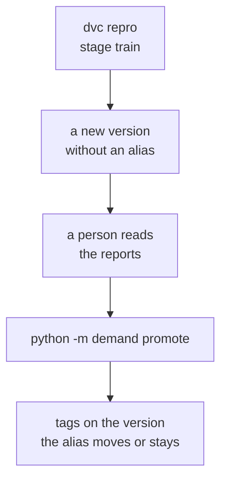

# Chapter 29 – Which model is served: the promotion gate and the model card

Every run of `python -m demand train` adds a version to the model registry. This repository holds two. The web service of Part V loads the model at the address `models:/taxi-demand@champion`. Which version should that address give, who decides, and how will a person find out next year why it was chosen? This chapter answers these questions and closes Part IV.

## What you will learn

- What an alias is, and why the decision is not part of `dvc repro`.
- The rule of the promotion gate, piece by piece, with the reason for each piece.
- When two stored scores may be compared.
- Why a rule must be tested as a sequence of actions.
- Where a decision is recorded, and what a model card is.

## An address that can move

Chapter 26 loaded a model with `models:/taxi-demand/2`. An **alias** is a name that points at one version of a registered model and can be moved to another. The address `models:/taxi-demand@champion` gives whichever version the alias `champion` points at now. The config holds this address under `serving.model_uri`: moving the alias changes the served model, and nothing in the service changes.

The config names two aliases. `champion` points at the served version. `challenger` points at the newest version that was judged and not promoted, so that a person can find the model that lost. This is narrower than the word challenger in Chapter 1. A promoted version loses it.

A **tag** is a label that stays with one version, for example `promotion.decision = promoted`. Aliases say what is true now; tags say what was decided, and why.

## Why the gate is its own command

The **promotion gate** is the rule that decides when the alias `champion` moves. It runs as `python -m demand promote`, after training, and is not part of `train`.

DVC tracks files (Chapter 21). The aliases live in the MLflow database, which it does not track. If the gate were part of `train`, `dvc repro` would change the served model as a side effect, and so would `dvc repro --force train`, the documented way to record a model again (Chapter 26). A command whose job is to bring files up to date must never change the model that is served.

Training answers "how good is this recipe?", and the gate answers "should it be served?". Between the two, a person can read the reports.



*Figure 29.1 – Training adds a version. Only the gate, or a person, moves the alias.*

## The rule, piece by piece

The module docstring of [`src/demand/models/promotion.py`](../../src/demand/models/promotion.py) states the rule in one sentence:

> The newest version becomes champion only if its backtest MAE is at least 0.2 lower than that of the weekly baseline and than that of the current champion, and not higher than either of them in any fold; the scores of the champion count only if they were measured on the same folds of the same data; and a version is judged once, never again.

**The pooled MAE decides.** Pooled means over all 13,440 test rows of the four folds. The RMSE and the sMAPE are reported but do not decide: the sMAPE is driven by quiet hours, the RMSE by a few large errors, and every extra metric that must improve is one more way to reject a real gain by chance.

**At least 0.2 lower.** This **margin**, the smallest gain that counts, comes from the seed check of Chapter 27. The same recipe trained with the seeds 42, 43 and 44 gave MAEs within a range of 0.194539 before tuning and 0.192245 after. A smaller gain can be the seed alone. Tuning gained 0.82 with seed 42, and about 0.64 on weeks the search had not seen, so a margin of 0.2 lets real gains through and stops a model that is only different. The same margin applies against the baseline, because the noise is in the challenger's own score.

**A tie never promotes.** On this machine the same recipe gives exactly the same scores (Chapter 25), so a retrained copy of the champion, with a gain of 0, is rejected.

**No fold higher.** A recipe can win the pooled MAE by being much better in one week and worse in the other three. So, as in Chapter 25, it must not be worse in any fold. In a single fold only the direction counts, with no margin. A fold has a quarter of the rows, so its seed noise is larger than 0.2 (it was not measured), and a margin in each fold would reject real gains.

**A constant in the code, not a key in the config.** `MIN_MAE_GAIN = 0.2` is written in `promotion.py`, because it is not a preference. It is a measured fact about this backtest. When the folds or the parameters change, it must be measured again and changed in a commit that shows the measurement. A key in the config could be lowered to let one model through, without anyone measuring anything.

Two recipes measured with one seed each can differ by the noise of both, so a model that is no better can still pass now and then. The gate makes that rare, not impossible.

## The rule on real numbers

These are the MAEs that the two training runs in the store recorded.

| | Fold 1 | Fold 2 | Fold 3 | Fold 4 | Pooled |
|---|---|---|---|---|---|
| Weekly baseline | 27.61 | 26.57 | 27.92 | 28.70 | 27.70 |
| Version 1, before tuning | 24.35 | 22.67 | 25.72 | 26.99 | 24.93 |
| Version 2, tuned | 23.51 | 21.85 | 24.75 | 26.31 | 24.11 |

*Figure 29.2 – From the metrics of the two runs in `mlflow.db`. The folds have the same number of rows, so the pooled MAE is the mean of the four fold values.*

With no champion, the first `promote` judges the newest version, 2, against the baseline only. Its gain is 27.70067 − 24.106025 = 3.594645, and it is lower in every fold. It is promoted. Version 1 is never judged, because the gate looks only at the newest version.

Suppose version 1 had been the champion. The gain of version 2 against it is 24.929918 − 24.106025 = 0.823893. Per fold the gains are 0.84, 0.82, 0.97 and 0.67, all positive, so version 2 would be promoted against version 1 too. The tests in [`tests/unit/models/test_promotion.py`](../../tests/unit/models/test_promotion.py) build a tie, a gain of 0.19 and a gain with one fold worse from these scores, and check that each is rejected.

## Scores that can be compared

The champion's scores were stored when it was trained. They may be compared with the challenger's only if both runs scored the same rows in the same way. Nine parameters must be equal: the end of the training period, the zones, the horizon, the lags, the rolling windows, the outlier threshold, the model inputs, and the number and length of the folds. Two tags must be equal: the data version and the name of the baseline. A value of `unknown` never counts as equal, not even to another `unknown`.

A second check uses the baseline as a witness. The baseline learns nothing, so on the same rows it must give exactly the same scores. In Figure 29.2 it scored 27.70067 in both runs, with the same value in every fold. If the keys agree and the baseline still scores differently, the data changed without a new data version: this happens after `python -m demand gold` by hand, when `dvc.lock` still names the old data (Chapter 26).

When either check fails, the gate refuses: it names every difference and changes nothing. It does not score the champion again on the new folds. That would mean training its recipe again inside this command, from parameters read back as text, with a feature config that may no longer exist. A person can compare by hand and use `set-champion`.

For Phase 5 this means: retraining after drift brings new data and new folds, so the retraining flow will have to score the champion again every time.

**The challenger must be reproducible.** A version is promoted only if its run came from a known commit with no changed files, and with a known data version. Otherwise nobody could rebuild the served model. Both versions here pass: commits `7bffb9e` and `5d1d9e4`, both with `git_dirty = false`, both on data version `7bacf1bf80cf4612d40552e74ef11cc5.dir`.

## Right in every decision, wrong over time

The lead tested an early version of the gate on a copy of the MLflow store.

| Step | Command | Champion afterwards |
|---|---|---|
| 1 | `promote` | version 2 |
| 2 | `set-champion 1 --reason ...` | version 1 |
| 3 | `promote` | version 2 |

*Figure 29.3 – The sequence that found the hole.*

Step 2 is a **rollback**: a person makes an earlier version champion again. Step 3 undid it. The gate compared the newest version, 2, with the champion, version 1, on the stored scores, found the gain of 0.82, and promoted it again.

Each decision followed the rule. The sequence was wrong. A rollback is made for a reason the backtest cannot see: the model misbehaved in real use. A routine `promote` overruled that reason with numbers that never knew it.

The fix is the last piece of the rule: **a version is judged at most once**. If the newest version already has the tag `promotion.decision` (promoted, rejected or manual), `promote` decides nothing and says so. A judged version comes back only through `set-champion`, by a person who gives a reason.

The same rule closes a second hole. Suppose version 3 was rejected against version 2, but is better than version 1. After a rollback to version 1, the early gate would have judged version 3 again, against the weaker champion, and let it in. Now version 3 keeps its decision. A version the gate refused (not reproducible, not comparable) carries no decision and is judged again later.

> [!IMPORTANT]
> A rule can be right in every single decision and wrong over time. Test it as a sequence of actions: promote, roll back, promote again.

The tests now do this, for example `test_a_rollback_by_hand_is_not_undone_by_the_next_promote`.

## The record

Every decision is written onto its version as tags.

| Tag | Value on version 2 after the first promotion |
|---|---|
| `promotion.decision` | `promoted` (otherwise `rejected`, or `manual` for `set-champion`) |
| `promotion.reason` | every number that was compared, and the margin: the sentence printed under *Try it yourself* |
| `promotion.decided_at` | the moment of the decision, in UTC |
| `promotion.champion_before` | `none` |

*Figure 29.4 – The record of one decision.*

"Why is version 2 the champion?" is answered by the tags of version 2, and "why not version 3?" by those of version 3. The full decision, with every fold, also goes to `reports/promotion_report.json`, which holds only the last decision and is not in git. The tags are the record that lasts.

Two limits remain. `set-champion` replaces the earlier tags of a version, so the tags hold its latest decision, not its history. And the tags are written before the alias moves, so an alias never moves without a record. If the command stops between the two writes, the version is recorded as promoted but not served; `promote` will not finish the job, because the version has been judged, and `set-champion` must.

## The model card

Numbers cannot say what a model is for, where it must not be used, or which days it gets wrong. A **model card** is a short document that says these things about one model version. The idea comes from a paper by Margaret Mitchell and others (2019). Its readers did not build the model: a reviewer, a planner, a future maintainer.

This project's card is [`docs/model-card.md`](../model-card.md), for version 2. It is written by hand, because its most useful parts are judgements. Every number carries a mark for its source, such as [T] for `reports/training_report.json`, so a reviewer can check it. Three of its weaknesses:

- On Good Friday, 18 April, the MAE was 36.96 against 24.11 overall, with forecasts 27.6 pickups too high on average.
- Zone 249 (West Village) is the only zone where the model is worse than the baseline: 22.34 against 22.04.
- LaGuardia (zone 138) has the worst sMAPE of all zones, 48.2% against 44.1% for the baseline.

When another version becomes champion, the card must be written again. Nothing updates it automatically.

## Part IV, looking back

Part IV started from a number to beat: the baseline, 27.70. The first LightGBM model scored 24.93, and tuning brought it to 24.11; about 0.6 of the tuning gain held on weeks the search had not seen. SHAP showed what the model leans on, the gate decides what is served, and the card says what it is good for.

Not proven yet: all these scores come from four April weeks that also helped to choose the settings. The clean exam is the replay of May and June, which no decision has read.

Part V builds on two pieces: the service of Chapter 30 loads `models:/taxi-demand@champion`, and the signature of Chapter 26 checks every table of inputs it builds.

## Try it yourself

Run the gate.

```powershell
.venv\Scripts\python.exe -m demand promote
```

The lead has already promoted version 2 in this repository's store, so you should see `"nothing to decide: the newest version was judged before, and a version is judged once"` with `"version": 2, "earlier_decision": "promoted", "champion": 2`. In a store without a champion you would see `"promotion decided"` with `"outcome": "promoted", "champion_before": null`, as the lead did. MLflow may first print a line with `INFO mlflow.agent.hint`; it can be ignored.

> [!WARNING]
> `set-champion` changes the served model and overwrites the record of a version. Rehearse on a copy of the database: the gate reads and writes only the database and its report. Do not load models from the copy.

```powershell
$demo = "$env:TEMP\promote-demo"
New-Item -ItemType Directory -Force $demo | Out-Null
Copy-Item mlflow.db $demo
$env:DEMAND_MLFLOW__TRACKING_URI = "sqlite:///$demo\mlflow.db"
$env:DEMAND_PATHS__REPORTS_DIR = "$demo\reports"
.venv\Scripts\python.exe -m demand promote
.venv\Scripts\python.exe -m demand set-champion 1 --reason rollback-test
.venv\Scripts\python.exe -m demand promote
```

`set-champion` prints `"champion set by hand", "version": 1, "champion_before": 2`. The last `promote` prints `"nothing to decide: ..."` with `"champion": 1`. The rollback lasts. Now ask the copy why each version has its state.

```powershell
.venv\Scripts\python.exe -c "import os; from mlflow import MlflowClient; c = MlflowClient(os.environ.get('DEMAND_MLFLOW__TRACKING_URI', 'sqlite:///mlflow.db')); print(c.get_registered_model('taxi-demand').aliases); [print(n, t.get('promotion.decision'), t.get('promotion.champion_before'), t.get('promotion.reason')) for n in ('1', '2') for t in [c.get_model_version('taxi-demand', n).tags]]"
```

You should see:

```text
{'champion': 1}
1 manual 2 Set by hand: rollback-test
2 promoted none Promoted: against the baseline (weekly_naive), MAE 24.106025 against 27.70067, a gain of 3.594645 (at least 0.2 needed), no fold higher. There was no champion, so only the baseline had to be beaten.
```

Remove the variables and the copy.

```powershell
Remove-Item Env:DEMAND_MLFLOW__TRACKING_URI
Remove-Item Env:DEMAND_PATHS__REPORTS_DIR
Remove-Item -Recurse $demo
```

Run the tests of the gate and of the registry module.

```powershell
.venv\Scripts\python.exe -m pytest tests/unit/models/test_promotion.py tests/unit/models/test_registry.py -q
```

You should see `60 passed, 1 warning`. They register versions in a temporary MLflow store.

## Key takeaways

- The alias `champion` is the address of the served model. Only `promote`, or a person with `set-champion`, moves it. `dvc repro` never does.
- The newest version is promoted only if its pooled MAE is at least 0.2 lower than both the baseline and the champion, with no fold higher. The margin is measured seed noise, so it is a constant in the code.
- Stored scores are compared only when both runs scored the same rows. Otherwise the gate refuses.
- A version is judged once, so a rollback lasts and a rejected version cannot slip in later.
- Tags record each decision with its reason. The model card says what numbers cannot.

## Exercises

**1.** A colleague proposes a margin of 0.1: "Version 3 gains 0.15 in every fold." What do you answer?

<details>
<summary>Answer</summary>

The margin is the measured range of the seeds on these folds, 0.19, so a gain of 0.15 can be the seed alone. Measure instead: score both recipes with the seeds 43 and 44 too, and compare means and ranges. A margin changes only with a new measurement, in `promotion.py`.

</details>

**2.** Version 2 is champion. After a bad week in May, a person makes version 1 champion again. The next night the retraining flow trains nothing new and runs `promote`. What happens, and what would the early gate have done?

<details>
<summary>Answer</summary>

Nothing happens: the newest version is still 2, it carries `promotion.decision = promoted`, and a version is judged once. The early gate would have judged version 2 again against version 1, found a gain of 0.82 on the old backtest scores, and served it again. The rollback would have been undone by numbers that knew nothing about May.

</details>

**3. Interview question.** "How do you decide when a new model replaces the one in production?"

<details>
<summary>Points of a good answer</summary>

- A rule applied by code: better than the current model and a baseline, on the same evaluation data, by a margin taken from measured noise, and in every period.
- Promotion outside the training pipeline, so that rebuilding never changes what is served.
- A reproducible champion: a clean commit and a known data version.
- A record of every decision, and a manual rollback that is not undone automatically.

</details>

---

[Previous: Chapter 28 – Explaining a forecast: SHAP](28-explaining-the-model-with-shap.md) | [Contents](README.md) | [Next: Chapter 30 – A forecast over HTTP: the prediction service](30-a-forecast-over-http.md)
