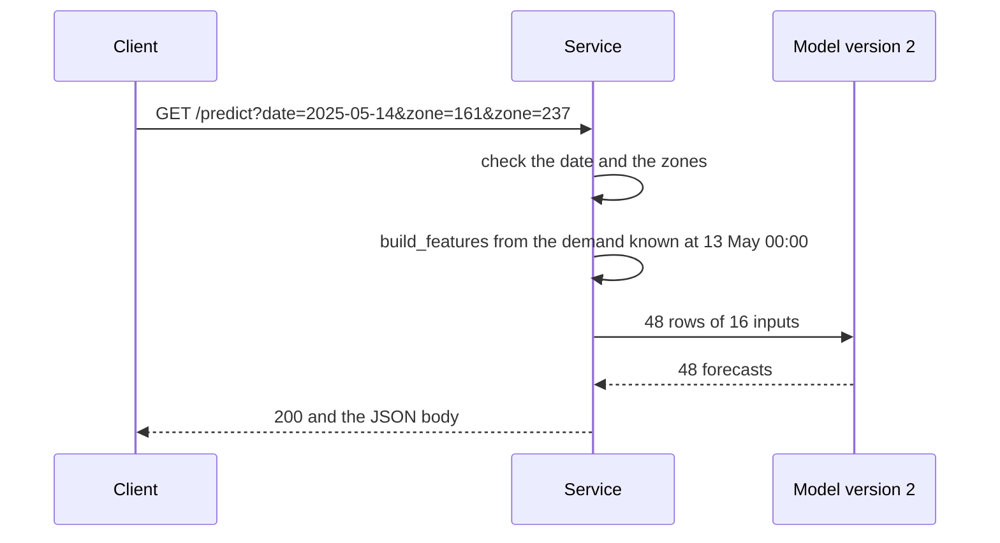

# Chapter 30 – A forecast over HTTP: the prediction service

Until now, every result of this project was a file or a line in a terminal. A dispatch app that needs the forecast for Midtown Center on Wednesday 14 May 2025 at 08:00 cannot open a notebook, load a model and build 16 features. It needs to send a short question and get the number back. This chapter builds the program that answers, starting from zero.

## What you will learn

- What a web service is: requests, responses, methods, paths, query parameters and status codes.
- What FastAPI and uvicorn each do, and what the page `/docs` gives you.
- Why a forecast is asked for with GET, and for a whole day.
- Why the client never sends features, and what `issued_at` means.
- Which days the service can forecast, and why.
- How the service refuses a request, and why it answers 422 and not 404.

## A program that waits

A notebook cell runs and ends. A **web service** is a program that starts, prepares itself, and then waits for questions from other programs over the network. It answers each one and waits again, until someone stops it.

The program that asks is the **client**, and the program that answers is the **server**. In Chapter 14 this project was a client of the TLC and Open-Meteo. Now it is the server. The question is a **request**, the answer is a **response**, and both are written in **HTTP**, the agreed format of the web. A browser, the program `curl` and the library httpx all use it.

A server listens on a **port**, a number that tells the computer which program a request is for. The config sets port 8000 and host `0.0.0.0`, which means "accept requests on every network address of this computer"; a container needs that, as Chapter 33 explains. From the same computer you send requests to `127.0.0.1`, the address that always means "this computer".

## One request, piece by piece

This is a real request to the service:

```text
GET /predict?date=2025-05-14&zone=161&zone=237
```

| Part | In this request | What it says |
|---|---|---|
| Method | `GET` | What the client wants to do. GET means "read". |
| Path | `/predict` | Which part of the service should answer. |
| Query parameters | `date=2025-05-14`, `zone=161`, `zone=237` | The values of the question, after the `?`, separated by `&`. |

*Figure 30.1 – The three parts of one request.*

A **query parameter** is a pair of a name and a value in the address. A name may appear more than once: `zone` appears twice to ask for two zones. An **endpoint** is one path with its method. This service has five, all GET: `/health`, `/ready`, `/predict`, `/model-info` and `/metrics`. Chapter 31 explains the ones this chapter does not use.

The response has a **status code**, the number of Chapter 14 that says how the request went, and a body. Here the code is 200, "here is the answer", and the body is JSON (Chapter 9). Shortened, it reads:

```json
{
  "date": "2025-05-14",
  "registered_model": "taxi-demand",
  "model_version": 2,
  "issued_at": "2025-05-13T00:00:00-04:00",
  "hours": 24,
  "forecasts": [
    {"zone_id": 161, "hour_start": "2025-05-14T00:00:00-04:00", "forecast": 47.33155834414378},
    ...
    {"zone_id": 237, "hour_start": "2025-05-14T23:00:00-04:00", "forecast": 152.49569829104868}
  ]
}
```

`forecasts` has 48 entries: the 24 hours of zone 161, then those of zone 237, in the order asked. Each `hour_start` carries its UTC offset, so no client guesses the timezone (Chapter 17). The values are not rounded; a client may round them. For zone 161 the forecasts at 07:00, 08:00 and 09:00 are 125.42, 184.54 and 247.88 pickups. `model_version` names the model that computed them; Chapter 31 explains why it is a number and not the alias `champion`.

## Why GET

The two common HTTP methods are GET, which asks to read something, and POST, which sends data for the server to process or store. The docstring of [`src/demand/serving/app.py`](../../src/demand/serving/app.py) gives the reasons for GET. A forecast changes nothing on the server, and the same question gets the same answer from the same model and data. A GET needs no body, so a browser or an automatic check can ask with the address alone. POST is usual when a client sends the model its features, which this service does not allow.

## FastAPI and uvicorn

**uvicorn** is the server program. It opens the port, reads each request from the network, hands it to the application, and sends the response back. **FastAPI** is the **web framework**, the library the application is written in. It decides which Python function answers which path, checks the parameters, and turns the return value into JSON. The two meet at a standard interface named ASGI, so either could be replaced alone.

```python
    @app.get(
        "/predict",
        summary="Forecast every hour of one day",
        responses={**refused, **not_ready},
    )
    def predict(query: Annotated[ForecastQuery, Query()]) -> ForecastResponse:
```

The decorator ties GET `/predict` to the function, as Typer ties a command to a function (Chapter 9). `ForecastQuery`, in [`schemas.py`](../../src/demand/serving/schemas.py), is a Pydantic class (Chapter 7) with the fields `date` and `zone`. FastAPI fills it from the query parameters and checks it before the function runs. It checks the answer against `ForecastResponse` and writes it as JSON.

From the same classes FastAPI writes a description of the service in a standard format, OpenAPI, at `/openapi.json`. The page `/docs` shows it in a browser: every endpoint, its parameters with examples, and the possible answers, with a button that sends a real request. This documentation cannot fall behind the code, because it is made from the code.

`python -m demand serve` starts uvicorn with this application, on the host and port of the config.

## A whole day, and no features

The product (Chapter 2) is the forecast of every hour of the next day. All hours of a day are issued at the same moment from the same data, so a request for one hour would ask for a slice of one answer. A request names a day. The field `hours` says how many it has: 24, or 23 on the day the clocks go forward (9 March 2025) and 25 on the day they go back.

The model reads 16 inputs; the client sends two values. The service builds the rest with `build_features`, the function of Chapter 19 that built every training row. The docstring of [`snapshot.py`](../../src/demand/serving/snapshot.py) explains why a client may not send features. It could send any numbers, and the model would answer without complaint. And every client would need its own copy of the feature code: the training/serving skew of Chapter 4. Built by the training function, a served row equals the training row of the same hour. Chapter 31 shows the check.



*Figure 30.2 – One request. The features never leave the service.*

## Issued at: what the service may know

`issued_at` is the **issue moment**: 00:00 on the day before, the moment of Chapter 2. It is simulated time. Whenever you ask, the service answers as if it were midnight on 13 May 2025, and it gives `build_features` only the demand that had ended by then:

```python
    known = history[
        history[ZONE_ID].isin(zones)
        & (history[HOUR_START] >= oldest_read)
        & (history[HOUR_START] + ONE_HOUR <= issued)
    ]
```

An hour is known when its start plus one hour is at or before the issue moment. `oldest_read` keeps only the 215 hours of history that the features read (Chapter 19).

The features never read anything newer than 48 hours before their hour, so this filter removes nothing they use. It is a second protection: even with a bug in the feature function, the service could not read the future. The leakage rule is a property of the service, not only of the feature code. The test `test_no_demand_after_the_issue_moment_is_read` sets every pickup from the issue moment on to 999 and checks that no row changes.

The 48 hours are elapsed hours (Chapter 19). The day the clocks go back has a 25th hour, so its last hour reads the hour that starts at 00:00 on the day before, which is complete at 01:00. That moves the issue moment to 01:00, for that day and the day after.

| Day forecast | `issued_at` |
|---|---|
| Wednesday 14 May 2025 | `2025-05-13T00:00:00-04:00` |
| Sunday 9 March 2025, 23 hours | `2025-03-08T00:00:00-05:00` |
| Sunday 2 November 2025, 25 hours | `2025-11-01T01:00:00-04:00` |
| Monday 3 November 2025 | `2025-11-02T01:00:00-04:00` |

*Figure 30.3 – Issue moments. The November rows come from the tests: those days are not in the data.*

## The data snapshot, and which days it allows

A real service would read the newest pickups from a live feed and the weather from a forecast service. This project has neither: the TLC publishes each month about two months late. So the service reads two files once, at startup: the gold demand table, of which it keeps zone, hour and pickups (86,860 rows: 4,343 hours for 20 zones), and the silver weather table, which stands in for a weather forecast as in training. Together they are a **snapshot**, a copy of the data as it was at one moment, read once and never written. It stands in for live feeds the project does not have. New data needs a restart.

The snapshot includes May and June, the replay period. The service answers for those days on purpose: for this project they are "production", and serving them decides nothing about the model.

The service forecasts every day from 10 January to 30 June 2025, and no other.

**The first day.** Every row needs 215 hours of demand before it. The demand starts on 1 January at 00:00, so the first row with complete features is 9 January at 23:00, the row of Figure 19.1. That leaves 9 January with one hour out of 24, so the first whole day is 10 January.

**The last day.** The weather ends on 30 June at 23:00, so 1 July has no weather. The demand alone would allow more: its last hour is complete at 00:00 on 1 July, the issue moment of 2 July.

## Refusing a request

The docstring of `schemas.py` states the rule: a forecast for a day the client did not mean is worse than a refusal. By default Pydantic converts generously. It would read `2025-05-14T00:00` as 14 May and `161.0` as zone 161. So the rules are strict: `date` must be written `YYYY-MM-DD`, `zone` must be a whole number, no zone may appear twice, and no other parameter is allowed. A client that writes `zones=237` for `zone=237` gets a refusal, not a forecast for zone 161 alone that it would take for both. Then the service checks the zone against the config and the day against the snapshot.

| Request | Status | Message |
|---|---|---|
| `date=2025-05-14&zone=999` | 422 | `Zone 999 is not forecast by this service. The zones are [48, 68, …, 249].` |
| `date=2025-07-01&zone=161` | 422 | `No forecast for 2025-07-01: this service forecasts the days 2025-01-10 to 2025-06-30. …` |
| `date=14-05-2025&zone=161` | 422 | `Value error, must be a day written as YYYY-MM-DD, such as 2025-05-14` |
| `date=2025-05-14&zone=161&zone=161` | 422 | `Value error, names zone 161 more than once` |
| `date=2025-05-14&zone=161&zones=237` | 422 | `Extra inputs are not permitted` |

*Figure 30.4 – Real refusals. "…" marks text left out here.*

Every 422 has the same shape, `{"detail": [{"type": ..., "loc": ..., "msg": ..., "input": ...}]}`, where `loc` names the parameter and `type` is a short name such as `unknown_zone`. A client handles all refusals in one place.

**Why 422 and not 404.** The code 422 means "the request was understood, but cannot be answered as asked". It covers everything the client can fix by asking for another value, including a day outside the period. The code 404 says "this address does not exist", and a client, a network proxy or an automatic check would read it as a wrong address. The allowed days are a published range, shown by `/model-info`, like the list of zones.

Two more codes complete the picture. 503, "service unavailable", means the model and the data are not loaded yet (Chapter 31). 500, "internal server error", is a bug: the service does not catch it, and the traceback goes to the log. As in Chapter 14, a code from 400 to 499 means the client must change the request; a code from 500 means the server has the problem.

## Try it yourself

In a PowerShell window in the repository root, start the service.

```powershell
.venv\Scripts\python.exe -m demand serve
```

After a few seconds you should see lines starting with `INFO:`, a progress bar `Downloading artifacts`, a JSON line with `"message": "service ready"`, `"version": 2`, `"first_day": "2025-01-10"` and `"last_day": "2025-06-30"`, and then `Uvicorn running on http://0.0.0.0:8000 (Press CTRL+C to quit)`. A line with `INFO mlflow.agent.hint` may come first; ignore it. Open a second PowerShell window in the repository root.

```powershell
Invoke-RestMethod http://127.0.0.1:8000/health
```

`Invoke-RestMethod` sends a GET and turns the JSON body into a PowerShell object. You should see `status` with the value `ok`. Now ask for the forecast of this chapter. The address is in quotes, because `&` has its own meaning in PowerShell.

```powershell
$r = Invoke-RestMethod "http://127.0.0.1:8000/predict?date=2025-05-14&zone=161&zone=237"
$r | Select-Object date, model_version, issued_at, hours | Format-List
$r.forecasts | Select-Object -Skip 7 -First 3
```

You should see:

```text
date          : 2025-05-14
model_version : 2
issued_at     : 2025-05-13T00:00:00-04:00
hours         : 24

zone_id hour_start                          forecast
------- ----------                          --------
    161 2025-05-14T07:00:00-04:00 125.41902442470894
    161 2025-05-14T08:00:00-04:00 184.54009872571862
    161 2025-05-14T09:00:00-04:00   247.882322551307
```

`Invoke-RestMethod` stops with an error for a status of 400 or more. To see a refusal as it is, use `curl.exe`, which comes with Windows. Write `curl.exe`: in Windows PowerShell, plain `curl` is another name for `Invoke-WebRequest`.

```powershell
curl.exe -s "http://127.0.0.1:8000/predict?date=2025-05-14&zone=999"
curl.exe -s -o NUL -w "%{http_code}" "http://127.0.0.1:8000/predict?date=2025-07-01&zone=161"
```

The first prints the body of the first row of Figure 30.4, with `"type":"unknown_zone"`. The second discards the body and prints only `422`.

Open `http://127.0.0.1:8000/docs` in a browser, open `/predict`, press "Try it out", enter a date and a zone, and press "Execute".

Stop the service with Ctrl+C in the first window. Then run the tests of the refusals.

```powershell
.venv\Scripts\python.exe -m pytest tests/unit/serving/test_app.py -q -k "cannot_be_answered"
```

You should see `13 passed, 24 deselected, 1 warning`. Each case sends one bad request and checks the status, the parameter in `loc` and the `type`. The warning comes from FastAPI's test client.

## Key takeaways

- A web service waits for requests and answers each with a status code and a body.
- A forecast is a GET with a day and zones: it changes nothing, and the same question gets the same answer.
- uvicorn moves requests and responses; FastAPI maps paths to functions, checks parameters and writes `/docs`.
- The service builds the features with the training function, from the demand known at the issue moment, so the client never sends features.
- `issued_at` is 00:00 on the day before in simulated time, or 01:00 around the night the clocks go back.
- The data is a snapshot read at startup; it allows the days from 10 January to 30 June 2025.
- What the client can fix is a 422 with a message that says what can be asked; 503 means "not loaded"; 500 is a bug.

## Exercises

**1.** A client asks for Sunday 9 March 2025 and gets 23 forecasts per zone. Its developer reports a bug: "a day has 24 hours". What do you answer?

<details>
<summary>Answer</summary>

It is not a bug. The clocks went forward that night, so 02:00 did not exist and the local day had 23 hours. The field `hours` says 23, and each `hour_start` carries its offset, `-05:00` before the change and `-04:00` after it. A client should read `hours` or count the entries, never assume 24.

</details>

**2.** The weather file is extended to 31 July and the demand stays as it is. Which days can the service forecast after a restart?

<details>
<summary>Answer</summary>

10 January to 2 July. Now the demand is the limit. Its last hour, 30 June at 23:00, is complete at 00:00 on 1 July, the issue moment of 2 July. The forecast for 3 July is issued at 00:00 on 2 July and would need the demand of 1 July, which the snapshot does not have.

</details>

**3. Interview question.** "Your model works in a notebook. How do you make it available to other applications?"

<details>
<summary>Points of a good answer</summary>

- A web service that loads the model once and answers over HTTP, for example FastAPI on uvicorn.
- An interface that matches the product: here a day and zones with GET, not a list of features.
- Features built inside the service by the training function, from data known at the issue moment, so training and serving cannot drift apart.
- Strict checks with clear refusals: 422 for what the client can fix, 503 when not ready, 500 for a bug.
- Every answer names the model version, and the documentation is generated from the code.

</details>

---

[Previous: Chapter 29 – Which model is served: the promotion gate and the model card](29-which-model-is-served.md) | [Contents](README.md) | [Next: Chapter 31 – Starting, proving and watching the service](31-starting-proving-and-watching-the-service.md)
