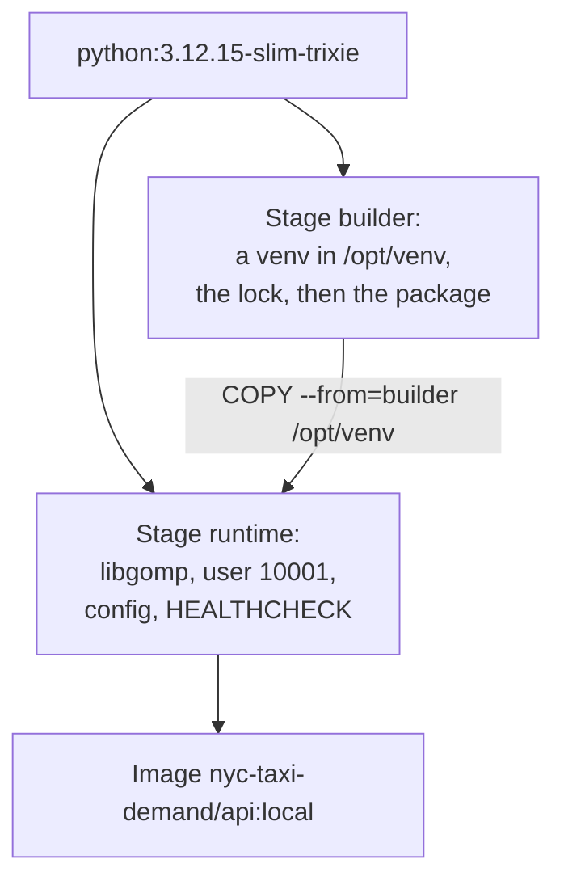

# Chapter 32 – Images: the service with everything it needs

A colleague clones the repository on a Linux laptop and starts the service of Chapter 30. Her Python is 3.11, so the install refuses. She installs 3.12 and tries again. Now LightGBM fails to import, because her system lacks a library that your Windows machine has. On your machine everything works. How do you hand over a program so that it runs the same way on every machine, including the servers of Phase 6?

## What you will learn

- What an image, a container, a volume and a network are.
- How the Dockerfile of the API builds its image, step by step.
- Why the base image is pinned twice, and why the build has two stages.
- Why each image has its own lock file, and what that saved.
- Why the service runs as user 10001, and how Docker knows it is healthy.
- What `.dockerignore` keeps out of an image.
- How the pipeline image differs, and why DVC stays on your machine.

## What "it runs on my machine" depends on

A program depends on more than its own code. The service needs Python 3.12, the 117 libraries of its lock file, and some files of the operating system, such as the OpenMP library `libgomp` that LightGBM is compiled against. It also needs its config, and environment variables such as the MLflow address of Chapter 7.

The lock file of Chapter 6 fixes the libraries. It does not fix Python, the operating system or its files. Those differ from machine to machine, and each difference is a place where the program can behave differently or fail.

## Image, container, volume, network

**Docker** is a tool that packs a program together with everything it depends on, and runs it in isolation from the rest of the machine. Four words describe how.

An **image** is a package of files and settings. It holds a small Linux filesystem, Python, the libraries, the code, and the command that starts the program. An image is built once, never changes afterwards, and can be copied to any machine that runs Docker. This project builds two images: `nyc-taxi-demand/api:local` and `nyc-taxi-demand/pipeline:local`.

A **container** is a program started from an image. It sees the files of the image as its own filesystem and its own network, and it sees nothing of the machine unless it is given access. Many containers can run from one image at the same time. An image is to a container what a class is to an object in Python: the image is the description, and every container is one running instance of it.

A **volume** is storage that lives outside every container. A container writes into the files of its image only in a thin layer of its own, which is deleted with the container. Data that must outlive it, such as the MLflow database, goes into a volume. A **named volume** is created and kept by Docker. A **bind mount** makes a folder of your machine, such as `data/`, visible inside a container.

A **network** is a private connection between containers. On it, one container reaches another by a name, such as `mlflow`, and not by an address of your machine.

On Windows, Docker Desktop runs a small Linux system in a virtual machine, and the containers run in it. So the service in a container runs on Linux, as it will on a server. Kubernetes, the system of Phase 6, does not install Python or libraries either: it runs images. Every later phase starts from the images of this chapter.

## The Dockerfile

An image is built from a **Dockerfile**, a text file with one instruction per step. This project has two, in the folder [`docker/`](../../docker). [`docker/api.Dockerfile`](../../docker/api.Dockerfile) builds the image of the service. Its comments give the reason for every line. This chapter follows them.

Each step adds a **layer** to the image: the files that this step added or changed. Docker keeps the layers. When you build again, it reuses every step whose instruction and copied files have not changed. This is the **layer cache**. It explains the order of several steps below.

The image is built with:

```powershell
docker build -f docker/api.Dockerfile -t nyc-taxi-demand/api:local .
```

`-f` names the Dockerfile, `-t` gives the image its name and **tag** (`local`), and the last `.` is the **build context**: the folder whose files the steps may copy. Chapter 33 builds the images through Docker Compose instead, with the same result.

## A base pinned twice

Every image starts from another image, its **base image**. This one starts from an official Python image:

```dockerfile
ARG PYTHON_IMAGE=python:3.12.15-slim-trixie@sha256:a6e34c598f2467ed0e9a8d349809fcd8b5c603269512df273a0bb1784edc11b1
```

The name has two parts. The tag `3.12.15-slim-trixie` is for people: Python 3.12.15 on Debian 13, named "trixie", in the "slim" variant without compilers and manuals. It is 179 MB.

A tag can be moved. Docker Hub publishes the image again under the same tag for every Debian security fix, so the same tag can mean another image next month. The part after `@` is the **digest**, the SHA-256 checksum (Chapter 15) of one exact image. A digest cannot be moved. With both, a person can read which version it is, and the build gets the same base on every machine until someone changes the line on purpose.

The line is written once, before the first stage, so that both stages use the same base.

## Two stages

Installing needs things that running does not: pip's download cache, the build backend of Chapter 5, and the source tree of the package. A **multi-stage build** has two images in one Dockerfile. The first installs. The second starts again from a clean base and copies across only the result.



*Figure 32.1 – The two stages of the API image. Only the virtual environment crosses from the first stage to the second.*

The builder creates a virtual environment (Chapter 6) in `/opt/venv`, so that everything installed is in one folder that one line can copy. The runtime stage installs `libgomp1` with `apt-get`, Debian's package tool, creates the user, and takes the folder:

```dockerfile
COPY --from=builder /opt/venv /opt/venv
```

This layer is 988 MB, most of the image. The first stage is thrown away.

## One lock per image

The service does not tune models and does not run tests. So the image does not install the full `requirements.lock`, which holds all groups. It installs [`docker/requirements-api.lock`](../../docker/requirements-api.lock), created by the command in its first lines:

```text
uv pip compile pyproject.toml --extra serving --universal --python-version 3.12 -c requirements.lock -o docker/requirements-api.lock
```

`--extra serving` takes only the group of the service, with what it includes. `-c requirements.lock` uses the main lock as a **constraint**: every version must be the version that `requirements.lock` already pins. So the image lock is a subset of the main lock, and no library moved to another version. The tests that ran on your machine ran against the same versions.

| Lock file | Libraries pinned |
|---|---|
| `requirements.lock` (all groups) | 282 |
| `docker/requirements-api.lock` (`serving`) | 117 |
| `docker/requirements-pipeline.lock` (`ml`) | 112 |

*Figure 32.2 – The three lock files.*

The container engineer of this project built the API image both ways. With the full lock it was 2.42 GB on disk and 512 MB compressed. With its own lock it is 1.45 GB and 331 MB. The compressed size is what a server downloads.

The install step uses `pip install --no-deps --requirement requirements-api.lock`. `--no-deps` has the meaning of Chapter 6: the lock already lists every library with one version, and pip installs that list without resolving anything itself.

The lock is copied and installed before the source code. The lock changes rarely and takes minutes to install. The code changes often and takes seconds. In this order, a change to the code reruns only the last two steps, and the layer cache keeps the libraries.

## A user without privileges

A program in a container runs as `root`, the administrator, unless the image says otherwise. A process that runs as root can change every file of its container, and if a bug ever let it escape the container, it would be one step closer to the machine. The runtime stage creates a user without privileges, with no home folder and no login shell, and switches to it:

```dockerfile
USER 10001:10001
```

The user is given by number, not by name. Kubernetes has a rule, `runAsNonRoot`, that refuses to start a container as root. It can check this rule only for a number: a name would have to be looked up inside the image. A fixed number also makes the permissions of mounted folders predictable, and 10001 is outside the range of normal users.

## How Docker knows the service is healthy

A **health check** is a command that Docker runs inside a container at intervals. Its result marks the container `healthy` or `unhealthy`.

```dockerfile
HEALTHCHECK --interval=30s --timeout=5s --start-period=90s --start-interval=5s --retries=3 \
    CMD ["python", "-c", "import urllib.request; urllib.request.urlopen('http://127.0.0.1:8000/ready', timeout=4)"]
```

It asks `/ready`, not `/health`, because here "healthy" means "can answer a forecast" (Chapter 31). `urlopen` raises an error for any status that is not 2xx, so a 503 fails the check. It is written in Python because the slim image has no `curl`. The start period gives the model download and the data load 90 seconds before failures count. During it, the check runs every 5 seconds, so the container is marked healthy soon after it is ready.

The last line starts the service:

```dockerfile
CMD ["demand", "serve"]
```

This form, a list without a shell, makes the service the first process of the container. It receives Docker's stop signal itself, so uvicorn shuts down in order instead of being killed after 10 seconds.

## What the build may see

`docker build` sends the build context to Docker before the first step. This folder holds 760 MB of data, the MLflow store, a Windows virtual environment, and on many machines a `.env` file with secrets (Chapter 7). A `COPY` of the wrong folder would put any of them into an image, and an image is made to be copied to other machines.

[`.dockerignore`](../../.dockerignore) decides what the build may see. It is an **allow-list**: its first line, `*`, leaves out everything, and the next lines let back in what the images are built from.

```text
*
!pyproject.toml
!README.md
!src/
!configs/
!docker/requirements-*.lock
```

The opposite, a list of what to leave out, sends every new folder to the build until someone remembers to add it. With an allow-list, a new folder stays out until someone decides it belongs in. The data and the model reach the containers when they run, through mounts and the network. So one image serves any champion and any data snapshot, and a new model needs a restart, not a new image.

## The pipeline image

[`docker/pipeline.Dockerfile`](../../docker/pipeline.Dockerfile) builds the image of the batch commands: `train`, `promote`, `tune` and the others. It has the same two stages, base and user number. Its comments name what differs.

- It installs `docker/requirements-pipeline.lock`, the `ml` group. It has no `prometheus-client`, which only the service uses.
- It installs `git`. `demand train` records the commit of the code and whether files differed from it (Chapter 26), and the promotion gate refuses a model without a clean commit (Chapter 29).
- The user has a home folder, because matplotlib and MLflow keep small files under it.
- Its entry point is `demand`, so `docker run nyc-taxi-demand/pipeline:local train` runs `demand train`.

The same image also runs the MLflow server of Chapter 33. The server is MLflow itself, version 3.17.0 from the same lock, so server and clients cannot differ.

**DVC stays on your machine.** The image has no DVC. The data stages write `data/`, `dvc.lock` and the DVC cache into the project folder. From a container they would write into your checkout as another user, through the slowest kind of mount that Docker Desktop has. So `dvc repro` runs on your machine, as in Chapter 21, and the containers only read the data.

**The checkout, read-only, with git.** In Chapter 33 the pipeline container runs from your project folder, mounted read-only at `/repo`. It reads the config, `data/` and `dvc.lock` from there, and git reads `.git`. So the model is recorded with its commit and its data version, which the promotion gate needs. The variable `PYTHONPATH=/repo/src` makes Python import the package from the mounted source before the copy in the image. The code that runs is then the code of the commit that git records, even if the image was built from an older checkout. The libraries still come from the image, so a change to the dependencies needs a new build.

## Try it yourself

These commands need Docker Desktop running and the images built. If `docker image ls` does not list them, run `docker compose build` in the repository root first. The container engineer measured 2 minutes 19 seconds for the API image without any cache, and 1 minute 45 seconds for the pipeline image with pip's download cache filled.

```powershell
docker image ls "nyc-taxi-demand/*"
```

You should see the two images, with `DISK USAGE` 1.45GB and 1.56GB and `CONTENT SIZE` 331MB and 359MB. The `ID` column will differ on your machine. Ask which user the service runs as.

```powershell
docker run --rm --entrypoint id nyc-taxi-demand/api:local
```

`docker run` starts a container from the image, `--entrypoint id` runs the program `id` in place of the service, and `--rm` deletes the container when it ends. You should see `uid=10001(app) gid=10001(app) groups=10001(app)`. Check that the pipeline image lacks the library of the service.

```powershell
docker run --rm --entrypoint python nyc-taxi-demand/pipeline:local -c "import prometheus_client"
```

The last line should be `ModuleNotFoundError: No module named 'prometheus_client'`. Count the pinned libraries of the API lock with the command of Chapter 6.

```powershell
(Select-String -Path docker/requirements-api.lock -Pattern '^[a-zA-Z0-9_.\-]+==').Count
```

You should see `117`.

## Key takeaways

- An image holds a small Linux system, Python, the libraries, the code and the start command. A container is one running instance of it. Volumes hold data that outlives containers, and a network connects containers by name.
- The base image is pinned by tag for people and by digest for the machine.
- Two stages keep the tools of installing out of the image that runs.
- Each image installs its own lock, a subset of `requirements.lock` with the same versions. The API image went from 2.42 GB to 1.45 GB.
- The service runs as user 10001, and Docker checks `/ready` to know it is healthy.
- `.dockerignore` is an allow-list, so no data, model store or `.env` can reach an image.
- DVC runs on your machine; the containers only read the data.

## Exercises

**1.** A colleague moves `COPY src ./src` above the step that installs the lock, "so that all the copies are together". What changes for the next ten builds after small code changes?

<details>
<summary>Answer</summary>

Every build installs all 117 libraries again. A step is reused only while the files it copied and the steps before it are unchanged. With the source copied first, every code change invalidates that step and every step after it, including the long install. The image is the same, but each build takes minutes instead of seconds.

</details>

**2.** Why not write `FROM python:3.12-slim` and save the long digest?

<details>
<summary>Answer</summary>

That tag moves. It means the newest 3.12 release on the newest Debian, and it is published again for security fixes. Two builds a month apart could start from different Python versions or Debian releases, with no change in the repository to show it. The digest makes the base part of the commit: a new base arrives as a visible change to one line.

</details>

**3. Interview question.** "How do you build a Docker image for a Python ML service?"

<details>
<summary>Points of a good answer</summary>

- A slim official Python base, pinned by version and digest.
- A multi-stage build: install into a virtual environment, copy only that into a clean runtime stage.
- Libraries from a lock file with exact versions, installed before the code, so the layer cache keeps them.
- Only what the service needs: its own dependency group, no tests, no data, no model. The model is fetched at startup, so a new model needs no new image.
- A non-root user by number, a health check against readiness, and the start command in exec form.
- A `.dockerignore` that allows only what the build needs.

</details>

---

[Previous: Chapter 31 – Starting, proving and watching the service](31-starting-proving-and-watching-the-service.md) | [Contents](README.md) | [Next: Chapter 33 – The whole stack with Docker Compose](33-the-whole-stack-with-docker-compose.md)
