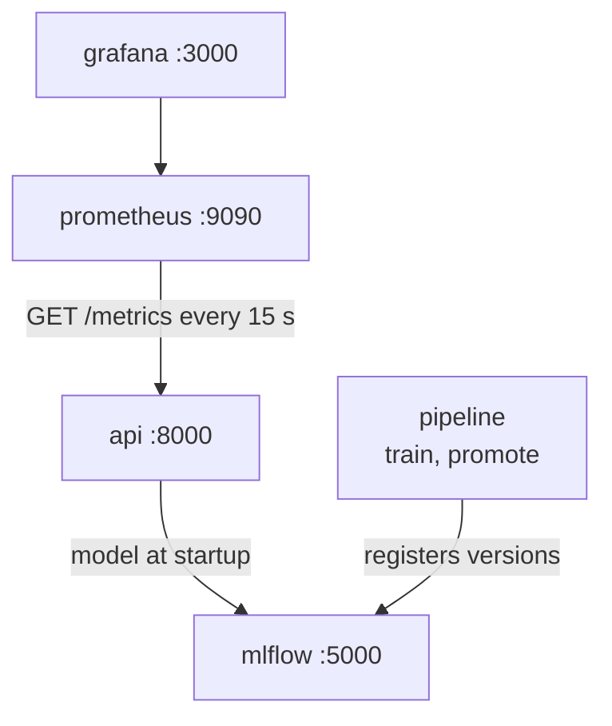

# Chapter 33 – The whole stack with Docker Compose

The images of Chapter 32 exist. The service in its container needs three more things: the data, a model from MLflow, and a Prometheus server that collects its numbers. Your laptop already has a model store with version 2 as champion. Why not point the container at it? This chapter tells what happened when that was tried, what was built instead, and what a second environment found in code that had passed all its tests.

## What you will learn

- Why the stack has its own MLflow server, and what that proved about the model.
- A bug that only the containers could find, and the test that now guards it.
- The five services of `docker-compose.yml`, and how they start in order.
- What a container does when the service exits with code 3.
- Volumes, mounts and ports, and four settings that harden the API container.
- How Prometheus and Grafana are set up from files.
- The order of commands from zero, and the limits.

## A store that names Windows paths

The store of Chapter 26 is the file `mlflow.db` and the folder `mlruns`. It records where the files of each model are, as an absolute address: `file:C:/nyc-taxi-demand-mlops/mlruns/...`. Inside a Linux container there is no `C:`. A container given the database would find the version and fail to open its files. And a fresh clone of the repository has no store at all, because `mlflow.db` and `mlruns` are not in git (Chapter 12).

So the stack does not use that store. **Docker Compose** is a tool that starts several containers together from one file, [`docker-compose.yml`](../../docker-compose.yml). Its service `mlflow` is an MLflow server with its own store. The database is a SQLite file in the named volume `mlflow-backend`. The model files are in the volume `mlflow-artifacts`, and the server sends them over HTTP. A client never reads them by a path. Their addresses start with `mlflow-artifacts:`. The training run in the stack has the address `mlflow-artifacts:/1/c2c39e815e354be3904809c7257e83cc/artifacts`, which names no folder of any machine.

The store starts empty. The service `pipeline` fills it: it runs `demand train` and `demand promote` on the data in `data/`, with the same code and config as on your machine. The store on your machine is neither read nor changed.

## The same model, trained again

Training in the stack gave version 1 of `taxi-demand` in the new store. Its backtest MAE is 24.106025, exactly the MAE of version 2 on Windows. The promotion gate decided:

```text
Promoted: against the baseline (weekly_naive), MAE 24.106025 against 27.70067, a gain of 3.594645 (at least 0.2 needed), no fold higher. There was no champion, so only the baseline had to be beaten.
```

The forecasts agree as well. Chapter 30 printed forecasts of version 2, served on Windows. The same requests to version 1, served in the stack:

| Zone | Hour on 14 May | Version 2, Windows | Version 1, container |
|---|---|---|---|
| 161 | 00:00 | 47.33155834414378 | 47.33155834414378 |
| 161 | 07:00 | 125.41902442470894 | 125.41902442470894 |
| 161 | 08:00 | 184.54009872571862 | 184.54009872571862 |
| 161 | 09:00 | 247.882322551307 | 247.882322551307 |
| 237 | 23:00 | 152.49569829104868 | 152.49569829104868 |

*Figure 33.1 – The same forecasts from two trainings. The lead engineer compared all 24 hours of zone 161: they are bit-identical.*

This shows that on this computer the result did not depend on Windows or Linux, or on the store: the seeds of Chapter 25 and the pinned libraries gave the same model from the same data. It does not prove more. Both trainings ran on the same computer, with an x86_64 processor. A computer with an ARM processor, such as a recent Mac, was not tested, and its numbers may differ in the last digits.

## A bug the containers found

The first start of the API in the stack failed. The loader of Chapter 31 asked MLflow to download `models:/taxi-demand/1` and passed the configured address, `http://mlflow:5000`. But MLflow 3.17 looked the version up in another registry: the one set for the whole process. That is the variable `MLFLOW_TRACKING_URI` or, without it, `sqlite:///mlflow.db` in the working folder.

| Where the service ran | Config `mlflow.tracking_uri` | Where the version was looked up | Result |
|---|---|---|---|
| Your machine, project folder | `sqlite:///mlflow.db` | `sqlite:///mlflow.db` | Worked: the two are the same file |
| API container, `/app` | `http://mlflow:5000` | `sqlite:///mlflow.db` in `/app` | Failed |

*Figure 33.2 – Why the bug was invisible on the machine of this book.*

On your machine it worked by coincidence: the config value equals MLflow's default. In the container, the default names a file in `/app`, which is read-only. Run in `/tmp` of the container, the old call created an empty database there and answered `Registered Model with name=taxi-demand not found`. A worse case was inferred and not run: a service on a laptop with a `mlflow.db`, configured to use a server, could have reported a version from the server and loaded a version of the same number from the local file.

The fix in [`model_loader.py`](../../src/demand/serving/model_loader.py) asks the configured registry where the files of the version are, and downloads that address:

```python
    source = registry.client.get_model_version_download_uri(name, str(version))
    with tempfile.TemporaryDirectory(prefix="demand-model-") as folder:
        local = mlflow.artifacts.download_artifacts(
            artifact_uri=source, dst_path=folder, tracking_uri=tracking_uri
        )
```

In the stack, `source` is `mlflow-artifacts:/1/models/m-71d37e5123f54b09ae1bf553896c8cd9/artifacts`. MLflow is never given a `models:/` address to look up.

The new test `test_the_model_comes_from_the_configured_store_and_not_from_mlflows_default` sets a decoy store for the whole process, moves to an empty working folder, loads the champion, and checks that its forecasts are those of the model in the configured store. The lead engineer ran it against the old code, where it failed, and against the new code, where it passed. A test that has never failed has not proved that it can.

The lesson: a second environment is a test. The unit tests ran in one place, with one coincidence that hid the bug. The containers changed the working folder, the filesystem and the address, and the bug appeared.

## Five services



*Figure 33.3 – The services and who calls whom. All run on one network that Compose creates.*

A **service** in Compose is one kind of container with its image and settings. `mlflow`, `api`, `prometheus` and `grafana` stay up. `pipeline` runs one command and ends, so it has a **profile**: a label that keeps it out of `docker compose up`. `docker compose run --rm pipeline train` starts it anyway.

The services reach each other by name: the API calls `http://mlflow:5000`, and Prometheus calls `api:8000`. These names exist only on the network of the stack.

## Starting in order

The API must not start before MLflow can answer. Each service that stays up has a health check: the API's own from its image, and one in the Compose file for the other three. A dependency waits for it:

```yaml
    depends_on:
      mlflow:
        condition: service_healthy
```

The API and the pipeline wait for a healthy `mlflow`, and Grafana for a healthy `prometheus`. Prometheus does not depend on the API, on purpose. Its job is to record that the API is down, so it must keep running when the API is not.

Every service that stays up has `restart: unless-stopped`: Docker starts it again whenever it ends, unless you stopped it. Here Chapter 31 meets Docker. Without a champion, the service exits with code 3. Docker starts it again, waits longer after each attempt, and `docker compose ps` shows `Restarting (3)`. Once a champion exists, the next attempt succeeds and the service stays up. Kubernetes does the same in Phase 6, and calls the state CrashLoopBackOff.

## Volumes, mounts and ports

The stack keeps five named volumes: the MLflow database and model files, the reports of the pipeline, the measurements of Prometheus and the database of Grafana. `docker compose down` removes the containers and keeps the volumes. `docker compose down -v` deletes them.

The API sees two folders of your machine through read-only bind mounts: `data/gold` and `data/silver/weather`, the two tables of its snapshot (Chapter 30). The pipeline sees the whole checkout read-only at `/repo` (Chapter 32), and writes its reports into a volume, so the `reports/` folder of your machine stays as it is.

A **port mapping** makes a port of a container reachable from your machine. The API's is `"127.0.0.1:8000:8000"`: port 8000 of the address `127.0.0.1` on your machine leads to port 8000 in the container. Every port of the stack is bound to `127.0.0.1`, so it is reachable from your machine and not from the network your machine is on. MLflow and Prometheus have no login, so this binding is their only protection, which is enough for a laptop. Inside the container the service listens on `0.0.0.0`, as Chapter 30 set: a request that arrives through the mapping comes in on the container's own network address, not on its `127.0.0.1`.

## A container that cannot change itself

The API container has four more settings.

- `read_only: true`. No file of the container can be written. A bug or an attacker cannot change the program or leave files behind, and every restart begins from the image as it was built.
- `tmpfs: [/tmp]`. One exception: `/tmp` is a folder in memory, where the model is downloaded at startup.
- `cap_drop: ["ALL"]`. Linux splits the power of root into **capabilities**, such as opening ports below 1024. The service needs none.
- `security_opt: ["no-new-privileges:true"]`. The process cannot gain privileges later, for example through a program marked to run as its owner.

## Prometheus and Grafana from files

[`monitoring/prometheus/prometheus.yml`](../../monitoring/prometheus/prometheus.yml) tells Prometheus to send `GET /metrics` to `api:8000` every 15 seconds. This is a **scrape**. A target that does not answer is recorded as down, which is the point of a monitor that asks.

Grafana is set up by **provisioning**: at every start it reads files that define its data source, Prometheus, and its dashboards. Nobody builds them by clicking in the web page, and the page cannot change them. The dashboard "Prediction API", in the folder "NYC taxi demand", has four panels: the served model version, requests per second, the 95th percentile of the response time, and the error rate. The request panels leave out `/health`, `/ready` and `/metrics`: those requests come from Docker's health check and from Prometheus, not from clients.

Anyone who opens Grafana sees the dashboards as a Viewer, without a login, and can change nothing. The admin login comes from `GRAFANA_ADMIN_USER` and `GRAFANA_ADMIN_PASSWORD` in `.env`, or `admin` and `admin` when they are not set. That default is for a laptop behind `127.0.0.1` only.

Prefect, the scheduler of the plan, is not in the stack. The replay of Chapter 34 runs as plain functions without it. Prefect arrives when the steps of Phase 5 are scheduled; until then it would be a container that runs and does nothing.

## From zero

```powershell
.venv\Scripts\dvc.exe repro
New-Item -ItemType Directory -Force data\predictions, data\predictions-stack | Out-Null
docker compose up -d --wait mlflow
docker compose run --rm pipeline train
docker compose run --rm pipeline promote
docker compose up -d --wait
```

1. `dvc repro` builds the data on your machine (Chapter 21). The second line creates two folders for the replay of Chapter 34. The `pipeline` service mounts `data/predictions-stack` on `data/predictions` inside the read-only checkout. Both must exist on the host, because Docker cannot create a mount point inside a read-only mount. It is a folder of its own because the stack's MLflow store numbers its versions separately from the store on the host, so the two replays must not share files.
2. `up -d --wait mlflow` starts an empty MLflow server and returns when it is healthy. `-d` runs the containers in the background.
3. `train` trains and registers version 1. It took 43 seconds when the container engineer ran it. Commit first: the gate of step 4 refuses a model trained from changed files.
4. `promote` prints the decision shown above.
5. `up -d --wait` starts the rest and returns when all four services are healthy.

The container engineer also ran the steps out of order. With step 5 before step 3, the API exits with code 3 and the message `No model is registered under 'taxi-demand' in http://mlflow:5000…`. Between steps 3 and 4 the message is `The alias 'champion' is not set on 'taxi-demand' (aliases set: none; versions: [1])…`. In both cases `docker compose ps` shows `Restarting (3)`, and the API comes up by itself after `promote`.

## The limits

- **Size.** The API image is 1.45 GB. Most of it is libraries: pyarrow 156 MB, scipy 109 MB, pandas 72 MB, MLflow 67 MB and DuckDB 58 MB. The `serving` group includes the whole `ml` group, with Optuna, SHAP and matplotlib. A smaller group for the service is possible, and nobody has checked that the service works with it.
- **Debian packages.** `libgomp1` and `git` are not pinned by version. The base digest fixes the Debian release, which receives only security fixes.
- **Time.** The first start from zero was not timed cleanly. With the images built and the volumes filled, `up -d --wait` took about 23 seconds on the machine of this book.
- **Processors.** Only x86_64 was tested.

## Try it yourself

This needs the images and the volumes of the steps above. Start the stack.

```powershell
docker compose up -d --wait
docker compose ps --format "table {{.Service}}\t{{.Status}}"
```

You should see four lines, each with `Up` and `(healthy)`. Ask the service which model it serves.

```powershell
Invoke-RestMethod http://127.0.0.1:8000/ready
(Invoke-RestMethod http://127.0.0.1:8000/model-info) | Select-Object version, alias, backtest_mae
$r = Invoke-RestMethod "http://127.0.0.1:8000/predict?date=2025-05-14&zone=161"
$r.forecasts | Select-Object -Skip 7 -First 3
```

You should see `ready` and `1`, then `1`, `champion` and `24.106025`, then the three rows of Figure 33.1. Try to write into the container.

```powershell
docker compose exec api touch /app/x
```

You should see `touch: cannot touch '/app/x': Read-only file system`. Start a second API container with an alias that is not set.

```powershell
docker compose run --rm -e DEMAND_SERVING__MODEL_URI=models:/taxi-demand@challenger api
$LASTEXITCODE
```

The traceback should end with `The alias 'challenger' is not set on 'taxi-demand' (aliases set: {'champion': 1}; versions: [1])`, then `ERROR:    Application startup failed. Exiting.`, and then `3`. Open `http://localhost:3000` and find the dashboard "Prediction API". Then stop the stack.

```powershell
docker compose down
docker compose ps -a
```

The second command should print only its header line: no container is left. The volumes, and with them the champion, are kept.

## Key takeaways

- The stack has its own MLflow server, whose files are served over HTTP, because the store on your machine records Windows paths and a clone has none.
- Trained again in the stack, the model had the same MAE and bit-identical forecasts. That covers Linux against Windows on one x86_64 machine, not ARM.
- The containers found a bug that a coincidence hid on the host. The loader now asks the configured registry for the files, and a test with a decoy store guards it.
- Health checks and `depends_on` start the services in order. Prometheus does not depend on the API.
- A service that exits is restarted with growing pauses: `Restarting (3)` now, CrashLoopBackOff in Kubernetes.
- Ports are bound to `127.0.0.1`, and the API container is read-only, with no capabilities and no way to gain privileges.

## Exercises

**1.** A colleague adds `depends_on: api: condition: service_healthy` to Prometheus, "so that it does not scrape too early". What does the stack lose?

<details>
<summary>Answer</summary>

Without a champion the API never becomes healthy, so Prometheus never starts, and Grafana, which waits for Prometheus, never starts either. The monitoring disappears exactly when the service is broken. A scrape of a target that is not up yet does no harm: Prometheus records it as down, which is true.

</details>

**2.** Why did all tests pass while the loader had the bug of this chapter?

<details>
<summary>Answer</summary>

The same coincidence as on the host. The fixture of the tests records the model with `log_training_run`, which calls `mlflow.set_tracking_uri` with the address of the temporary store ([`tracking.py`](../../src/demand/models/tracking.py)). That sets the registry of the whole process, and the fixture leaves it set until the tests of the file have run. So the store MLflow asked by itself and the configured store were the same file in every test. The new test sets a decoy store for the whole process, so a loader that asks the wrong registry fails.

</details>

**3. Interview question.** "How do you run an ML service and its dependencies locally in a way that matches production?"

<details>
<summary>Points of a good answer</summary>

- One Compose file with the service, its model registry and its monitoring, each from a pinned image.
- No dependency on one machine's folders: the registry has its own store in volumes, and the model is rebuilt from the data.
- Health checks and start conditions, a restart policy, and a service that exits when it cannot load its model.
- Data mounted read-only, ports bound to localhost, and a hardened, read-only service container.
- Monitoring set up from files, so it is the same at every start.
- Treat the new environment as a test: here it found a real bug.

</details>

---

[Previous: Chapter 32 – Images: the service with everything it needs](32-images.md) | [Contents](README.md) | [Next: Chapter 34 – The clean exam: replaying May and June](34-the-replay-of-may-and-june.md)
