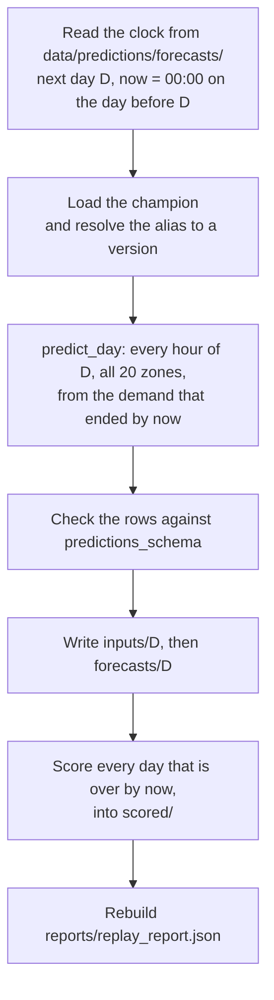

# Chapter 34 – The clean exam: replaying May and June

On 30 April 2025 the model stopped learning. After that, it forecast 60 days it had never seen, each from the pickups known at 00:00 on the day before. The April backtest said it would be wrong by 24.11 pickups per zone and hour. Chapter 3 promised a simulated clock and a clean exam. This chapter builds the clock, takes the exam, and reports how wrong the model really was.

## What you will learn

- Why the project replays May and June, and why they are the only clean test left.
- How one step of the simulated clock works, and why the clock is a folder.
- Why a forecast is written once, and its score goes into another table.
- What the exam gave, and how to read it.

## Why a replay

The TLC publishes each month about two months late, so there is no live feed of trips (Chapter 3). The project plays May and June as if they were happening: this is the **replay**. Each day is handled at the moment the system would have handled it. That moment comes from the **simulated clock**, a "now" that the program sets itself.

There is a second reason. Chapters 25 and 27 used the four April weeks to choose the zone handling, the objective and five parameters, so those weeks no longer give a clean score. May and June took part in no decision: the backtest refuses their rows (Chapter 23), and `tune` never reads them. A period kept away from every decision is a **hold-out**. Its score is the **clean exam** of the project.

## One step of the clock

`python -m demand forecast` runs one step, and `--days N` runs N steps in a row. The code is in [`src/demand/flows/`](../../src/demand/flows/): `clock.py`, `forecast_flow.py` and `scoring.py`.



*Figure 34.1 – One step of the simulated clock.*

**The clock is the folder of forecasts.** There is no state file and no counter. The newest day in `data/predictions/forecasts/` is the position of the clock. The next step forecasts the day after it, at that day's issue moment: 00:00 on the day before (Chapter 2). A state file would be a second record of the same fact, and after a crash between two writes the records could disagree. A clock read from the files cannot, and it survives a restart. If the days on disk are not one unbroken run, for example because someone deleted a file, the step stops and says what to do.

**There is no option `--day`.** It would let anyone forecast days out of order, or one day twice.

**The same code as the API.** The forecast of one day is one function, `predict_day` in [`src/demand/serving/forecasting.py`](../../src/demand/serving/forecasting.py). The service of Chapter 30 answers with it, and the replay writes its result to disk. The test `test_the_replay_forecasts_what_the_api_answers` checks this. Chapter 30 showed 125.42, 184.54 and 247.88 for zone 161 on 14 May from 07:00 to 09:00, and the replay file holds the same three numbers.

**The model is loaded at every step**, and the alias `champion` is resolved to a version number then, which goes into every row as `model_version`. In real use each step is a separate run on a separate day, and a new champion could be promoted in between.

**Check, then write the inputs, then the forecast.** The rows are checked against `predictions_schema` (Chapter 8) before anything is written, so a negative forecast stops the step with nothing on disk. Then the step writes the rows the model was given, and only then the forecast. The forecast file is what moves the clock. If a step stops between the two writes, the next run does the same step again.

## Written once

A forecast file is written at its issue moment and never opened for writing again. Its column `actual` stays empty. A record that is never changed after it is written is **write-once**.

When a day is over, at 00:00 on the next day, its rows are copied into `data/predictions/scored/` with `actual` filled from the counted pickups. Filling `actual` into the forecast file would mean rewriting the record of what was issued, and one bug in that rewrite could change a forecast without a trace. With two tables, the record of what was said cannot change.

| File | Zone 161, Wednesday 14 May 2025, 08:00 |
|---|---|
| `inputs/2025-05-14.parquet` | `lag_48h` 127, `lag_168h` 172, `temperature_2m` 14.6, and the other inputs |
| `forecasts/2025-05-14.parquet` | `forecast` 184.54, `actual` empty, `model_version` "2", `generated_at` 13 May 00:00 |
| `scored/2025-05-14.parquet` | the same row, with `actual` 292 |

*Figure 34.2 – One real zone-hour in the three folders.*

`generated_at` is the simulated issue moment, not the wall clock. It answers the later questions about a forecast: which model was in use, what could it know, how old was the forecast when its hour came. The wall clock would say that all of May and June were "generated" in a few minutes of one afternoon, and two runs would write different files. The real time is in the log.

The time from the issue moment to the start of a forecast hour is the **lead time**. The forecast of 14 May is issued at 00:00 on 13 May. Its first hour starts 24 hours later and its last hour 47 hours later. The day is over at 00:00 on 15 May, and the step that forecasts 16 May scores it.

## Where it starts and where it ends

Chapter 3 printed `replay_start_date`, 1 May, but the first day forecast is 2 May. The forecast for 1 May was due at 00:00 on 30 April. The champion learned from the pickups up to 30 April at 23:00 (Chapter 26), so at that moment it did not exist. A forecast for 1 May would have to be marked and left out everywhere it is read, so the function `first_replay_day` starts the replay on 2 May, and the report says why in `replay_start_note`.

The last day the data can forecast is 30 June. After its step the clock stands at 00:00 on 29 June, and 29 and 30 June are not over. One more step, the **closing step**, moves the clock to 00:00 on 1 July, the end of the demand history. It forecasts nothing and scores the last two days. The whole replay is 61 steps: `--days 61`. Every step after that is the closing step again.

## Safe to repeat, and two things left out

A forecast on disk is never computed again, a scored day is not scored again, and the report is rebuilt from the files. Two runs from an empty folder wrote byte-identical files. For this book the closing step ran again on the real files, and the 180 files and the report kept the same SHA-256 checksums. The lead engineer also recomputed the pooled scores with a separate SQL query.

**Not a DVC stage.** A stage turns its inputs into its outputs in one run, and DVC deletes the outputs before it runs a stage (Chapter 21). The replay moves one day per step and keeps every file. Its next step reads its own earlier output and the alias `champion`, which DVC does not see (Chapter 29).

**No Prefect yet.** The steps are plain functions that a Prefect flow will call when orchestration is added. A Prefect wrapper now would start a temporary server at every run and add nothing.

## The result

The replay ran with version 2 for all 60 days. These are the numbers as they came out, from `reports/replay_report.json`.

| 2 May to 30 June | MAE | RMSE | sMAPE |
|---|---|---|---|
| Model, version 2 | 27.80 | 43.29 | 22.6% |
| Weekly baseline | 31.83 | 50.51 | 26.3% |
| The same recipe in the April backtest | 24.11 | 38.24 | 21.9% |

*Figure 34.3 – The clean exam: 28,800 zone-hours, 20 zones, 60 days.*

The model is 12.6% better than the baseline on MAE; in the backtest it was 13.0%. Its MAE is 1.15 times its backtest MAE, the field `live_to_backtest_mae`. It beat the baseline on 37 of the 60 days.

The **bias** of a forecast is the mean of forecast minus actual. Here it is −8.41: the forecasts were 8.4 pickups too low on average, 157.1 against 165.5. Chapter 18 found demand in May and June about 10% higher than in the training months, so a model that learned the winter level forecasts too low. That is a likely reading, not a measured cause.

| Week from Monday | Days | Model MAE | Baseline MAE |
|---|---|---|---|
| 28 April | 3 | 22.74 | 22.91 |
| 5 May | 7 | 27.78 | 28.00 |
| 12 May | 7 | 29.46 | 31.37 |
| 19 May | 7 | 29.28 | 36.43 |
| 26 May | 7 | 28.11 | 40.18 |
| 2 June | 7 | 28.70 | 34.39 |
| 9 June | 7 | 24.50 | 26.36 |
| 16 June | 7 | 27.40 | 29.49 |
| 23 June | 7 | 29.96 | 30.98 |
| 30 June | 1 | 23.55 | 40.44 |

*Figure 34.4 – Per calendar week. The first week has only 2 to 4 May, the last only 30 June.*

The model won every week, and its weekly MAE stays between 22.7 and 30.0. The baseline moves between 22.9 and 40.4.

| Day | Model MAE | Baseline MAE | `is_holiday` |
|---|---|---|---|
| Friday 2 May, the best day | 19.15 | 19.28 | false |
| Thursday 19 June, Juneteenth | 46.90 | 59.41 | true |
| Saturday 24 May, Memorial Day weekend | 42.93 | 63.94 | false |
| Monday 26 May, Memorial Day | 39.66 | 76.62 | true |
| Monday 2 June | 29.29 | 60.10 | false |

*Figure 34.5 – The best day, the three worst days of the model, and the day the baseline copied Memorial Day.*

The three worst days of the model lie on or next to the two federal holidays of the replay. On both holidays `is_holiday` was true, but the training rows hold only two holidays, 20 January and 17 February, so the model had little to learn from. On Saturday 24 May no column marked anything: the model forecast 159.5 pickups per zone and hour on average, and 121.2 came. On Juneteenth the means were close, 156.0 against 165.8, and the MAE was still the worst of all: errors of different zones and hours cancel in a mean, not in the MAE.

The baseline fails in another place: a week after a holiday, when it copies the holiday. On 2 June it copied Memorial Day, and on 26 June Juneteenth: 51.75 against 31.22 for the model. Chapter 23 saw the same after Good Friday.

Read these as links with the calendar, not as proven causes. The replay also had heat that training never saw: the training rows reach 29.8 °C, and 23 to 25 June reached 36.0, 39.1 and 38.2 °C. A tree splits only between values it has seen, so it treats 39 °C like the warmest training hour.

## Reading it honestly

The backtest said 24.11, and the clean exam says 27.80. A gap was expected, for three reasons. The settings were chosen on April, and Chapter 27 measured that part of the tuning gain was luck. May and June have two holidays and heat beyond the training data. And the model was frozen on 30 April: its inputs stay fresh, but what it learned gets older every day.

The config sets the alert threshold `monitoring.mae_degradation_ratio: 1.25`. Over the whole period the ratio is 1.15, below it. But one number for 60 days hides when the errors came. A **rolling window** score is computed over the last few days and moved forward one day at a time; the config sets `window_days: 7`. With 7 days, the ratio is above 1.25 for the windows that end on 26 to 30 May, with a peak of 1.41 on 28 May, and again on 24 and 25 June, at about 1.30 and 1.29. The engineer computed these by hand. No code computes them yet: that is the next feature.

> [!IMPORTANT]
> These numbers were reported as they came out. No model, feature or parameter was changed after they were seen.

The reason is the lesson of Chapter 27. Suppose someone adds a feature for long weekends because 24 May was bad, and runs the replay again. The new score would come from a choice made on May and June. The exam would become another April: too good by an unknown amount, with no period left to check it. A fix belongs to retraining with a later cutoff, judged on the days after it.

## What the next features build on

The monitoring feature reads the three folders: `forecasts/` for prediction drift, also on days not yet over; `inputs/` for input drift against the training features; `scored/` for accuracy and the rolling window. Retraining needs a cutoff, the moment up to which a new model may learn, and the simulated clock gives it a "now".

## Try it yourself

Read the summary of the report.

```powershell
.venv\Scripts\python.exe -c "import json; r = json.load(open('reports/replay_report.json')); print(r['clock'], r['first_replay_day'], r['days_scored'], r['days_model_beat_baseline']); print(r['model']['mae'], r['baseline_score']['mae'], r['versions'][0]['live_to_backtest_mae'])"
```

You should see:

```text
2025-07-01T00:00:00-04:00 2025-05-02 60 37
27.802077 31.826632 1.1533
```

Recompute the pooled MAE and the bias from the scored files, without the report. pandas reads every file of the folder as one table.

```powershell
.venv\Scripts\python.exe -c "import pandas as pd; t = pd.read_parquet('data/predictions/scored'); e = t.forecast - t.actual; print(len(t), round(e.abs().mean(), 6), round(e.mean(), 3))"
```

You should see `28800 27.802077 -8.406`.

Run one step on the real files. The clock stands at 00:00 on 1 July, so this is the closing step.

```powershell
.venv\Scripts\python.exe -m demand forecast
```

You should see a line with `"message": "replay step done"`, `"now": "2025-07-01T00:00:00-04:00"`, `"forecast_day": null` and `"scored": []`, then one with `"message": "replay over: the data has no day left to forecast"`. Nothing new was written.

Now watch the first three steps in a copy of the data. The two environment variables (Chapter 7) point the program at the copy; the model still comes from the real MLflow store.

```powershell
$replay = "$env:TEMP\replay"
New-Item -ItemType Directory -Force "$replay\data\silver", "$replay\data\predictions", "$replay\reports" | Out-Null
Copy-Item -Recurse data\gold "$replay\data\gold"
Copy-Item -Recurse data\silver\weather "$replay\data\silver\weather"
$env:DEMAND_PATHS__DATA_DIR = "$replay\data"
$env:DEMAND_PATHS__REPORTS_DIR = "$replay\reports"
.venv\Scripts\python.exe -m demand forecast --days 3
Remove-Item Env:DEMAND_PATHS__DATA_DIR, Env:DEMAND_PATHS__REPORTS_DIR
```

After the progress bars of MLflow you should see six JSON lines. The first has `"message": "forecast issued"`, `"day": "2025-05-02"` and `"issued_at": "2025-05-01T00:00:00-04:00"`. The last ends with `"now": "2025-05-03T00:00:00-04:00", "forecast_day": "2025-05-04", "scored": ["2025-05-02"], "days_scored": 1, "live_mae": 19.152725, "baseline_mae": 19.277083}`: the third step is the first that scores a day. Delete the copy with `Remove-Item -Recurse -Force $replay`.

Run the tests of the replay.

```powershell
.venv\Scripts\python.exe -m pytest tests/unit/flows -q
```

You should see `42 passed, 1 warning`.

## Key takeaways

- The replay plays May and June day by day. No decision used them, so they are the clean exam.
- The clock is the folder of forecasts. A step forecasts the next day at 00:00 on the day before, with the code of the API.
- A forecast is written once; its actual values go into `scored/`. 1 May is not forecast, and a closing step scores 29 and 30 June.
- The exam: MAE 27.80 against 31.83 for the baseline and 24.11 in the backtest, a ratio of 1.15. The forecasts were 8.4 too low on average, and the worst days lie around the holidays.
- A 7-day window would have crossed the alert ratio of 1.25 around Memorial Day and on 24 and 25 June.
- Nothing was changed after the result was seen.

## Exercises

**1.** The simulated clock stands at 00:00 on 20 June. Which day does this step forecast, and which day does it score?

<details>
<summary>Answer</summary>

It forecasts 21 June, because 00:00 on 20 June is the issue moment of 21 June. It scores 19 June: that day ended at 00:00 on 20 June, which is now. 20 June is not over yet.

</details>

**2.** A colleague deletes `forecasts/2025-06-19.parquet` "because Juneteenth spoils the average" and runs `python -m demand forecast`. What happens, and what do you answer?

<details>
<summary>Answer</summary>

The step stops with the message that day 2025-06-19 is missing, and writes nothing. Removing a bad day is also wrong in itself: holidays happen in real use, and a score without them describes a world that does not exist.

</details>

**3. Interview question.** "How did your model do on data it had never seen?"

<details>
<summary>Points of a good answer</summary>

- The setup: a replay of two months no decision had used, each day forecast at 00:00 on the day before with the code of the API.
- The numbers against the baseline and the backtest: 27.80 against 31.83 and 24.11.
- Why live is worse: tuning on the backtest weeks, holidays and heat outside the training data, a model that ages.
- Where it fails, and that nothing was changed after seeing the result.

</details>

---

[Previous: Chapter 33 – The whole stack with Docker Compose](33-the-whole-stack-with-docker-compose.md) | [Contents](README.md) | [Next: Appendix A – Stack map](appendix-a-stack-map.md)
