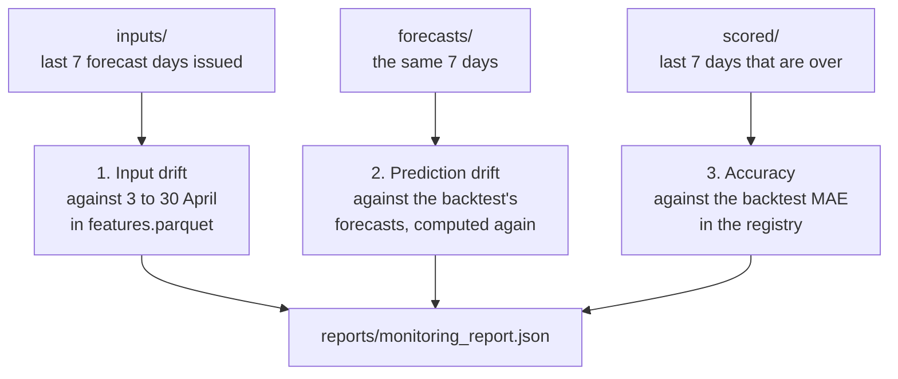

# Chapter 35 – Watching a model when the truth arrives late

It is 00:00 on Thursday 29 May 2025 on the simulated clock. The forecast for 30 May has just been issued. The pickups of 28 May are counted, and those of 29 May are not. The champion was chosen with a backtest MAE of 24.11. Is it still working as it did then? Monitoring asks this question every day. This chapter builds the three checks that answer it, and shows what each of them can tell.

## What you will learn

- Why there are three checks, and why drift and accuracy answer different questions.
- How input drift is tested with Evidently, and what the Wasserstein distance measures.
- Why prediction drift needs a reference of forecasts on unseen hours.
- Why the two windows end on different days, and how monitoring reads only what existed at its "now".

## Three questions

The truth arrives late (Chapter 3): the forecast for 30 May can be scored only at 00:00 on 31 May. Until then, monitoring can look only at what the model was given and what it said. So it asks three questions.

**Input drift**: do the model inputs still look like the inputs the model learned from? **Prediction drift**: do the forecasts still look like the forecasts the model made on hours it had not learned from? **Accuracy**: once the actual values have arrived, is the model as accurate as its backtest promised?

The first two need no actual values, so they can be answered as soon as a forecast is issued. Only the third measures the model. Drift says that the world has changed, for example that June is warmer than April. It does not say whether the forecasts became worse: a model that learned "next Tuesday is like last Tuesday" can follow a slow change without any loss. So drift is a warning about the world, and accuracy is the measure of the model.



*Figure 35.1 – The three checks, what each reads, and what each compares it with.*

The checks are in [`src/demand/monitoring/checks.py`](../../src/demand/monitoring/checks.py), and [`src/demand/flows/monitoring_flow.py`](../../src/demand/flows/monitoring_flow.py) chooses the files and writes the report. The command is `python -m demand monitor`. Each check has a number, a threshold from the section `monitoring:` of the config, and a yes or no. The accuracy check raises an **alert**, and the two drift checks raise **warnings**: Chapter 36 explains why.

Each check looks at a **window**, the last days it uses: `window_days: 7`. A week holds every weekday once, so a window does not change only because a Saturday entered it.

## Input drift: the window and the reference

The window of input drift is the model inputs of the last 7 forecast days that were issued by "now": the files in `data/predictions/inputs/`, which the replay wrote at every step (Chapter 34). They are exactly the rows the model was given, 3,360 for 7 days of 20 zones and 24 hours.

The **reference** is what the window is compared with: the same columns in the last 28 days of the training period, 3 to 30 April, from `data/gold/features.parquet`. That is 13,440 rows. The config sets `reference_days: 28`. These are the inputs the model saw last before it was frozen.

**Which inputs.** Of the 16 model inputs, 10 are tested: the two lags, the four rolling means and standard deviations, and the four weather columns. The six others are left out, because a test on them can only ever give one answer, whatever happens in the world.

| Input | Why it is not tested |
|---|---|
| `zone_id`, `hour`, `day_of_week`, `is_weekend` | Every whole week has the same share of each value: 20 zones, 24 hours, each weekday once. Window and reference always agree. |
| `month` | It is 5 or 6 in every window and 4 in the reference. It always differs. |
| `is_holiday` | A fact of the calendar, known a year ahead. The report lists the holidays of the window in `holidays_in_window` instead. |

*Figure 35.2 – The six inputs that are not tested. `UNTESTED` in `checks.py` gives the same reasons, and the report repeats them.*

A column that can never drift would lower the share of drifted columns, and one that always drifts would raise it, both for no reason. Drift in a lag has a plain meaning: the distribution of `lag_48h` over a week of rows is the distribution of recent demand. If it moves, demand has moved.

## How far a column moved: the Wasserstein distance

A test of drift compares the values of one column in the window with its values in the reference. This project uses the **Wasserstein distance**: the average distance that the values have to travel to turn one distribution into the other.

Here is the smallest example, from the test `test_the_distance_is_the_wasserstein_distance_divided_by_the_reference_spread`. The reference holds fifty times 0 and fifty times 2. The window holds fifty times 1 and fifty times 3.

| | Values | Mean | Standard deviation |
|---|---|---|---|
| Reference | 0, 2, 0, 2, … | 1 | 1 |
| Window | 1, 3, 1, 3, … | 2 | 1 |

*Figure 35.3 – Two tiny columns.*

To turn the reference into the window, move every 0 to 1 and every 2 to 3. Every value travels 1, so the distance is 1.

A distance means little without a scale: 1 °C is a small move for a temperature, and 1 pickup is nothing for a busy zone. So the distance is divided by the standard deviation of the reference. This is the **normed** Wasserstein distance, which Evidently calls `"wasserstein"`. Here it is 1 / 1 = 1.0: the values moved by one standard deviation. A column has drifted when the normed distance is 0.1 or more, a tenth of a standard deviation. That is Evidently's default for this test, and the constant `DRIFT_THRESHOLD` in `checks.py`. The test `test_the_threshold_itself_counts_as_drift` moves the same values by exactly 0.1 and expects "drifted".

**A real column.** In the window of 24 to 30 June, `temperature_2m` has a mean of 27.1 °C. In the reference it has a mean of 13.0 °C and a standard deviation of 6.64. The difference of the means is 14.0, and 14.0 / 6.64 = 2.11. The report says 2.110786. The distance equals the difference of the means here because the whole distribution moved in one direction, as in the small example. When some values move up and others down, the distance counts every move, and is larger.

**Why the test is fixed.** Evidently can choose a test by itself. For a reference of 1,000 rows or fewer it uses the Kolmogorov-Smirnov test, or the chi-square or Z test for a column with five distinct values or fewer. Above 1,000 rows it uses the Wasserstein distance, or the Jensen-Shannon distance for five distinct values or fewer. Left to choose, the same code would run one test in a unit test, with its small tables, and another on the real data. It would also treat `snowfall`, which has four distinct values in April to June, differently from `precipitation`. So `drift_snapshot` names the method for every column.

There is a second reason. Kolmogorov-Smirnov and chi-square are tests of **significance**. Their p-value assumes that every row is an independent draw. The hours of a zone are not independent: one busy evening fills several rows, and the rolling means of neighbouring hours share most of their values. A p-value then treats 3,360 rows as 3,360 independent observations, and calls the smallest difference "significant". The Wasserstein distance measures how far the values moved, and does not grow with the number of rows.

**The share.** The **share of drifted columns** is the number of drifted columns divided by the number tested, here out of 10. The inputs count as drifted when the share is `drift_share_threshold`, 0.3, or more: three columns or more. The test `test_the_share_agrees_with_evidently` checks that this share equals Evidently's own.

## Prediction drift and an honest reference

The second check compares the forecasts of the window with forecasts of the past, with the same distance on the column `forecast`. Which forecasts of the past?

The champion's own forecasts for April are wrong for this purpose. The champion was fitted on every hour of April (Chapter 26), so those forecasts are in-sample (Chapter 27), and better behaved than any forecast it makes live.

The honest reference is the forecasts of the backtest (Chapter 23). Each of the four test weeks, 3 to 30 April, was forecast by a model fitted only on the weeks before it. The backtest keeps their scores, not the forecasts. So [`reference.py`](../../src/demand/monitoring/reference.py) fits the same folds with the same deterministic, seeded recipe again (Chapter 25), and keeps the 13,440 forecasts.

That they are the forecasts behind the champion's score is checked, not assumed. Their pooled MAE must equal the backtest MAE that the registry holds for the champion, to the six decimals stored. Here both are 24.106025. If the config, the data or the code no longer matched the champion, the numbers would differ, and the check would not be evaluated; its `note` would say why. A comparison with forecasts of some other model would be worse than none.

Fitting four models takes time: 86.6 seconds in the day-by-day run of Chapter 36, which computed the reference once for all days. A single run of the command computes it again. The check needs 7 days forecast by the newest model version. At 1 July the distance is 0.031821, below 0.1: the forecasts have not drifted.

## Accuracy, two days later

The third check is the one Chapter 34 computed by hand. It takes the scored rows of the last 7 days that are over, from `data/predictions/scored/`, and divides their pooled MAE by the backtest MAE of the model version in the registry. It raises an alert when the ratio is `mae_degradation_ratio`, 1.25, or more. The weekly baseline is scored on the same rows, for context: if it became worse by as much, the week was hard for anyone. Like prediction drift, the check needs 7 days of the newest model version, so a new champion is not judged on a few days, or on days of the model before it.

The two windows do not end on the same day. Take "now" = 00:00 on 29 May.

| Check | Newest day it can use | Window | Why |
|---|---|---|---|
| Input and prediction drift | 30 May | 24 to 30 May | The forecast for 30 May was issued at 00:00 on 29 May, with its inputs. |
| Accuracy | 28 May | 22 to 28 May | 28 May ended at 00:00 on 29 May. 29 May is not over. |

*Figure 35.4 – The windows at 00:00 on 29 May.*

The two days are the time a forecast waits, from its issue moment on the day before until its day is over. At 1 July both windows are 24 to 30 June, because the closing step of Chapter 34 forecast nothing more.

## Only what existed at "now"

Without options, `monitor` evaluates at the position of the replay clock, 00:00 on 1 July. With `--as-of 2025-05-29` it evaluates at 00:00 on that day. That shows on which days a check would have fired, and the retraining feature will use it to replay its decisions day by day.

The rule is the rule of Chapter 2, applied to monitoring: **monitoring may only read what existed at its "now"**. A forecast and its inputs exist from their issue moment, a scored day from the end of the day. `monitoring_flow.py` chooses the days from the file names and opens only the chosen files.

The test `test_as_of_reads_no_file_of_a_later_day` checks this strictly. It evaluates at 00:00 on 10 May. Then it writes garbage, bytes that are no Parquet file, in place of every file that did not exist at that moment, and evaluates again. The two reports must be equal. A program that opened one of those files would fail.

A moment after the clock is refused, and so is a moment before 1 May.

## The report at 1 July

`monitor` writes `reports/monitoring_report.json`, and Evidently's page `reports/monitoring_input_drift.html`, which draws both distributions of every tested input. The JSON report holds no wall-clock time, so the same files give the same bytes; for this book a second run gave the same SHA-256 checksum. The HTML page differs from run to run.

| Check | Number | Threshold | Result |
|---|---|---|---|
| Input drift, 24 to 30 June | share 0.5: 5 of 10 inputs | 0.3 | drifted: a warning |
| Prediction drift, 24 to 30 June | distance 0.031821 | 0.1 | not drifted |
| Accuracy, 24 to 30 June | 28.501161 / 24.106025 = 1.1823 | 1.25 | no alert |

*Figure 35.5 – The three checks at 00:00 on 1 July 2025.*

The five drifted inputs are `roll_mean_24h`, `roll_mean_168h`, `temperature_2m`, `precipitation` and `wind_speed_10m`. The weekly baseline had an MAE of 32.195238 on the same rows. The report ends with `"alerts": []`, one warning for `input_drift`, `"alert": false` and `"warning": true`.

## Try it yourself

Read the three checks from the report.

```powershell
.venv\Scripts\python.exe -c "import json; r = json.load(open('reports/monitoring_report.json')); d = r['input_drift']; print(r['now'], d['window_first_day'], d['window_last_day'], d['reference_rows'], d['drift_share']); print([c['column'] for c in d['columns'] if c['drifted']]); p = r['prediction_drift']; a = r['accuracy']; print(p['reference_mae'], p['recorded_backtest_mae'], p['distance']); print(a['first_day'], a['last_day'], a['live_mae'], a['backtest_mae'], a['live_to_backtest_mae'])"
```

You should see:

```text
2025-07-01T00:00:00-04:00 2025-06-24 2025-06-30 13440 0.5
['roll_mean_24h', 'roll_mean_168h', 'temperature_2m', 'precipitation', 'wind_speed_10m']
24.106025 24.106025 0.031821
2025-06-24 2025-06-30 28.501161 24.106025 1.1823
```

Evaluate as of 00:00 on 29 May, into a scratch folder, so that the report in `reports/` stays as it is (Chapter 7 explained the variable). It takes one to two minutes, mostly for the reference: between 100 and 115 seconds on the machine of this book.

```powershell
$env:DEMAND_PATHS__REPORTS_DIR = "$env:TEMP\monitoring"
.venv\Scripts\python.exe -m demand monitor --as-of 2025-05-29
```

You may first see a line from MLflow that starts with `INFO mlflow.agent.hint`. Then one JSON line ends with `"now": "2025-05-29T00:00:00-04:00", "alerts": ["accuracy"], "warnings": ["input_drift"], "drift_share": 0.7, "prediction_drift_distance": 0.041337, "live_to_backtest_mae": 1.4081` and the seconds the run took. Ask for a moment the clock has not reached.

```powershell
.venv\Scripts\python.exe -m demand monitor --as-of 2025-07-02
$LASTEXITCODE
Remove-Item Env:DEMAND_PATHS__REPORTS_DIR
```

You should see `Error: Monitoring cannot be evaluated as of 2025-07-02: the replay clock stands at 2025-07-01T00:00:00-04:00, and nothing after it exists yet.`, the advice to run the forecast step further, and `1`. Run the tests of monitoring, then the test with the garbage files alone.

```powershell
.venv\Scripts\python.exe -m pytest tests/unit/monitoring -q
.venv\Scripts\python.exe -m pytest tests/unit/monitoring -q -k "later_day"
```

You should see `52 passed, 10 warnings` after about one and a half minutes, then `1 passed, 51 deselected, 10 warnings`. The warnings come from NumPy and Litestar, two libraries that Evidently imports.

## Key takeaways

- Monitoring watches inputs and forecasts at once, and accuracy when the days are over. Drift says that the world changed; only accuracy measures the model.
- Input drift compares 10 of the 16 inputs in the last 7 issued days with 3 to 30 April.
- The normed Wasserstein distance is how far the values moved, in standard deviations of the reference. A column drifts at 0.1, the inputs at a share of 0.3. The test is fixed and is not a test of significance.
- The reference of prediction drift is the backtest's out-of-sample forecasts, used only because their MAE equals the registry's 24.106025.
- Accuracy divides the live MAE of the last 7 days that are over by the backtest MAE, with an alert at 1.25. Its window ends two days before the drift window.

## Exercises

**1.** The clock stands at 00:00 on 12 June. Which days are in the drift window, and which in the accuracy window?

<details>
<summary>Answer</summary>

Drift: 7 to 13 June. The forecast for 13 June was issued at 00:00 on 12 June, so its inputs exist now. Accuracy: 5 to 11 June. 11 June ended at 00:00 on 12 June, and 12 June is not over.

</details>

**2.** A colleague says: "Computing the backtest forecasts again costs 90 seconds. Use the champion's forecasts for April as the reference of prediction drift." What do you answer?

<details>
<summary>Answer</summary>

Those forecasts are in-sample, so live forecasts would be compared with a reference that no live forecast can match. The backtest's forecasts were made for weeks the fold model had not learned from, which is the situation of a live forecast. The 90 seconds also buy a check: the reference is used only if its MAE equals the champion's recorded backtest MAE.

</details>

**3. Interview question.** "How do you monitor a model whose ground truth arrives days later?"

<details>
<summary>Points of a good answer</summary>

- Watch the inputs and the predictions at once, and the accuracy when the actual values arrive. Only accuracy measures the model.
- Compare the inputs with the end of the training period, and the predictions with out-of-sample predictions, not with predictions on the training rows.
- Use a distance with a fixed method and threshold, not a p-value, because the rows of a time series are not independent.
- Respect time in the windows: drift can use the newest issued forecast, accuracy only the days that are over. Read only what existed at the moment of the check, and test it.

</details>

---

[Previous: Chapter 34 – The clean exam: replaying May and June](34-the-replay-of-may-and-june.md) | [Contents](README.md) | [Next: Chapter 36 – Alerts that mean something, and the numbers in Grafana](36-alerts-that-mean-something.md)
