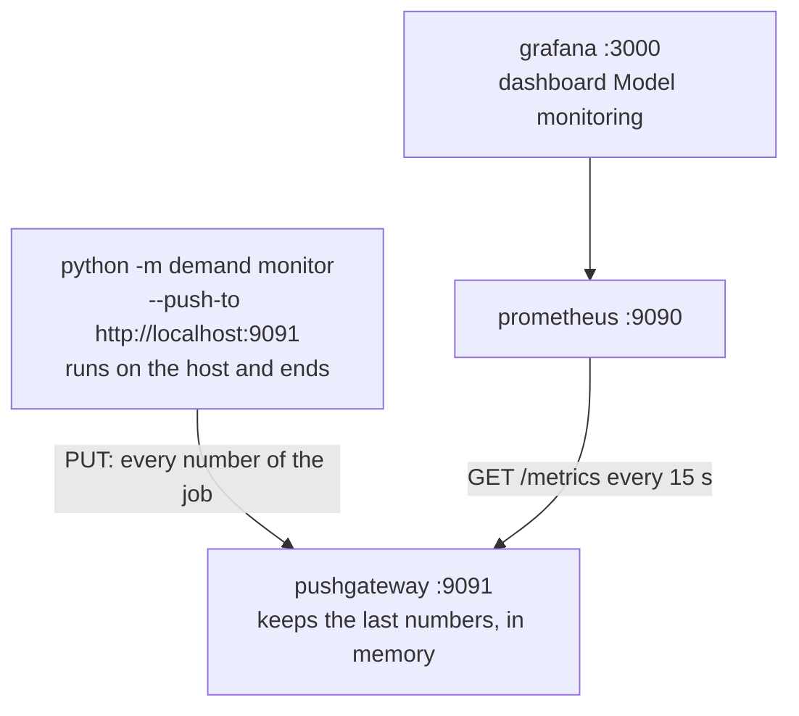

# Chapter 36 – Alerts that mean something, and the numbers in Grafana

The thresholds of Chapter 35 were written into the config in Phase 0, long before the replay. Then the checks were run as of every day of May and June. The input-drift check fired on every day it could be evaluated: 56 days out of 56. Connected to retraining, it would have retrained the model every day and told nobody anything. This chapter shows what each check did, how a check is tested before it may trigger an action, what was decided, and how the numbers reach Grafana.

## What you will learn

- What the three checks said on every day of the replay.
- What a false alarm is, and how to measure how often a check gives one.
- The difference between an alert and a warning, and why no threshold was changed.
- How a batch command reaches Prometheus through a Pushgateway, what Grafana shows, and the limits.

## The replay, day by day

The lead engineer ran the checks as of 00:00 on every day from 2 May to 1 July: 61 evaluations with `--as-of`, after one computation of the reference in 86.6 seconds. For this book, three of those days were run again with the command, as of 21 May, 29 May and 1 July, and gave the same numbers.

| As of 00:00 on | Input drift share | Prediction drift distance | Live MAE / backtest MAE |
|---|---|---|---|
| 2 to 6 May | not evaluated | not evaluated | not evaluated |
| 7 and 8 May | 0.8 | 0.042 and 0.046 | not evaluated |
| 9 to 26 May | 0.6 to 0.9 | 0.044 to 0.100032 | 1.0601 to 1.2363 |
| 27, 28, 29, 30, 31 May | 0.7, 0.7, 0.7, 0.5, 0.5 | 0.041 to 0.047 | **1.3053, 1.3518, 1.4081, 1.3471, 1.3251** |
| 1 to 24 June | 0.4 to 0.8 | 0.028 to 0.057 | 0.9394 to 1.2129 |
| 25 and 26 June | 0.5 | 0.031 and 0.025 | **1.2980 and 1.2899** |
| 27 June to 1 July | 0.5 | 0.026 to 0.032 | 1.1823 to 1.2462 |

*Figure 36.1 – The three checks on every day of the replay. Thresholds: 0.3, 0.1 and 1.25. A ratio in bold is at or above 1.25.*

A check needs seven days: drift has them from 7 May, accuracy from 9 May, two days later (Chapter 35).

**Accuracy** crossed 1.25 on 7 days, in two runs: as of 27 to 31 May, and as of 25 and 26 June. Their windows are the weeks that end on 26 to 30 May and on 24 and 25 June: the two bad periods that Chapter 34 found by hand, around Memorial Day and around Juneteenth with the heat of late June. On no other day did it fire, though it came close as of 28 to 30 June, at 1.2374 to 1.2462.

**Prediction drift** crossed once: as of 21 May, at 0.100032 against 0.1. That is 0.000032 above the line, on a day when the accuracy ratio was 1.1892. On every other day the distance was at most 0.087741. One crossing by this little, never repeated, looks like noise and not like a signal.

**Input drift** was at or above 0.3 on all 56 days it could be evaluated, between 0.4 and 0.9. `temperature_2m` drifted on all 56 days and `wind_speed_10m` on 55. Look also at when the share was highest: 0.9 in mid-May, while the accuracy ratio stayed between 1.10 and 1.22. During the accuracy alert of late May it fell to 0.5 to 0.7. The share did not rise when the forecasts became worse.

## How often a check fires when nothing is wrong

A **false alarm** is a check that fires when nothing that it should report has happened. The share of quiet periods on which a check fires is its **false-alarm rate**. A check that fires on almost every day has a false-alarm rate near 100%. Knowing that it fired then tells you nothing that you did not know before it ran.

So, before a check may trigger an action, measure how often it fires on a period where nothing was wrong. For input drift, the training period is such a period: the model learned from those weeks. The lead engineer ran the same test on 11 of its weeks, each week against the 28 days before it, the shape of a window and its reference.

| Week ending | Share | | Week ending | Share |
|---|---|---|---|---|
| 13 February | 0.7 | | 27 March | 0.5 |
| 20 February | 0.4 | | 3 April | 0.3 |
| 27 February | 0.5 | | 10 April | 0.2 |
| 6 March | 0.5 | | 17 April | 0.6 |
| 13 March | 0.6 | | 24 April | 0.7 |
| 20 March | 0.5 | | | |

*Figure 36.2 – The input-drift test on weeks of the training period. It was run again for this book, with the same result.*

The test fired in 10 of the 11 weeks. Only the week ending 10 April stayed below 0.3, at 0.2. `temperature_2m` and `wind_speed_10m` drifted in all 11. And this was the friendliest case: each reference lay directly before its week, while in the replay it stays in April.

The reason is mostly the weather. A week holds one or two weather systems, a warm spell or a few days of rain, and the four weeks before it hold others. In spring the weeks also get warmer. At a tenth of a standard deviation, one week of weather is never like the four before it. The test measures this correctly. It is only not news.

The lesson goes beyond this project: **a check must be tested for how often it fires when nothing is wrong, before it may trigger an action.** A threshold that sounds reasonable, such as "a tenth of a standard deviation", says nothing about how often normal data crosses it.

## The decision: one alert and two warnings

The owner of this project was asked how to handle this, and asked the lead engineer to decide. The decision has two parts.

**What the checks may do.** The two drift checks raise **warnings**: "look at this". Only the accuracy check raises an **alert**: "act on this". The report keeps them apart, in `alerts` and `warnings`, each entry with the check and a sentence giving the number and the threshold. The retraining flow of Chapter 37 reads only the accuracy alert. The test `test_drift_alone_never_raises_an_alert` gives both drift checks a clear drift and accuracy a ratio of 1.0, and expects warnings and no alert.

**What stayed the same.** Every threshold: 0.1 per column, 0.3 for the share, 0.1 for the forecasts, 1.25 for accuracy.

> [!IMPORTANT]
> No threshold is tuned after the replay was seen. Only what the drift checks are allowed to do was changed.

The reason is the rule of Chapter 34. Suppose the share threshold were raised to 0.95 so that the warning stops. That number would be chosen by looking at where the check fired in May and June. The replay would become a test the thresholds were chosen to pass, and nothing would be left to show how they behave on new days. A different threshold must be chosen on other data, and judged on days after it.

**Drift still has a use**: it explains an alert afterwards, so it is still computed, reported and drawn. As of 25 June the accuracy alert fired, and the warning in the same report named `roll_mean_24h`, `roll_mean_168h`, `temperature_2m`, `precipitation` and `wind_speed_10m`, the same five as at 1 July. On 24 June the temperature reached 39.1 °C; the warmest training hour had 29.8 °C. A reader of the alert sees at once that the model was forecasting in heat it had never seen. That is a likely reading, not a proven cause.

The accuracy threshold was not tested on a quiet period either. It was set before the replay, and the replay is the first time it ran. Two months with two bad periods are a small record.

## Getting batch numbers into Prometheus

Chapter 33 showed that Prometheus **pulls**: it asks a running program for its page of numbers every 15 seconds. `python -m demand monitor` is not a running program but a **batch job**: a command that runs once, writes its result and ends. When Prometheus asks, nothing is left to answer.

The **Pushgateway** is Prometheus's own answer for this case: a small server that keeps the last numbers a batch job sent it, and shows them to Prometheus like any other target. The docstring of [`metrics.py`](../../src/demand/monitoring/metrics.py) explains why the alternatives, a `/metrics` program of our own or the text files of node-exporter, were heavier for the same result.



*Figure 36.3 – How the numbers of a batch command reach Grafana. Since Chapter 38 the scheduler of the stack sends the same PUT after every simulated day, to `http://pushgateway:9091`.*

`docker-compose.yml` has a sixth service, `pushgateway`, from an image pinned by digest, on port 9091 bound to `127.0.0.1`. [`prometheus.yml`](../../monitoring/prometheus/prometheus.yml) has a second scrape job, `demand-monitoring`, with `honor_labels: true`: Prometheus keeps the labels the numbers were pushed with, such as `check`, instead of replacing them with the labels of the target.

Every push is an HTTP PUT, which replaces all the numbers of the job `demand_monitoring`. All of them are **gauges**, values that can go up and down (Chapter 31). `demand_monitoring_alert` has one series, `{check="accuracy"}`, the only check that alerts; `demand_monitoring_warning` has `input_drift` and `prediction_drift`; `demand_monitoring_evaluated` has all three. The numbers behind them follow: the share, one distance per input with the label `column`, the prediction distance, the three MAEs, the ratio, and the thresholds.

Two details need care. **Prometheus time is the wall clock.** It stamps every number with the moment it collected it, in October 2026 for this book. So the gauge `demand_monitoring_now_timestamp_seconds` carries the simulated moment. At 1 July it is `1.7513424e+09`: 04:00 UTC on 1 July 2025, which is 00:00 in New York.

**A check that was not evaluated sends no numbers**, only its `evaluated` and its alert or warning, both 0. As of 8 May, for example, there is no `demand_monitoring_live_mae` at all. An empty panel says "no number". A 0 would claim a number that was never measured.

## The dashboard "Model monitoring"

Grafana provisions a second dashboard from [`monitoring/grafana/dashboards/monitoring.json`](../../monitoring/grafana/dashboards/monitoring.json), in the folder "NYC taxi demand" next to "Prediction API". The lead engineer started the three services, pushed the report of 1 July, and found these panels.

| Panel | Series | At 1 July |
|---|---|---|
| Evaluated as of | `now_timestamp_seconds` | 1 July 2025, 00:00 in New York |
| Alert: accuracy | `alert` | 0 |
| Warnings: drift | `warning` | `input_drift` 1, `prediction_drift` 0 |
| Checks evaluated | `evaluated` | 1 for all three |
| Share of drifted model inputs | share, threshold dashed | 0.5 against 0.3 |
| Live MAE / backtest MAE | ratio, threshold dashed | 1.1823 against 1.25 |
| Drift distance per model input | one bar per input, red from 0.1 | longest: `temperature_2m`, 2.110786 |
| MAE: live, weekly baseline, backtest | three MAEs | 28.501161, 32.195238, 24.106025 |
| Prediction drift distance | prediction distance | 0.031821 |

*Figure 36.4 – The nine panels. Every series name starts with `demand_monitoring_`.*

## The limits

- **Memory only.** After a restart the Pushgateway has no numbers until the next push, and the panels are empty. Started fresh for this book, it held no monitoring series before the push.
- **History is not in Prometheus.** Each push replaces the last, and Prometheus draws the numbers against the wall clock: its line charts show when the command ran, not which day was evaluated. `reports/monitoring_report.json` is replaced at every run too. The history of Figure 36.1 comes from running `--as-of` once per day. That is safe because the replay files are write-once, so the same day always gives the same report.
- **Two model stores.** The command runs on the host and reads the host's replay of version 2, the host's champion. The API in the stack serves version 1 of its own MLflow server (Chapter 33). So when the whole stack runs, "Prediction API" shows version 1 and "Model monitoring" shows numbers of version 2 of another store. Their forecasts are bit-identical, but they are two records in two registries.
- **No message.** Nothing sends an email or a chat message, and Prometheus has no alert rules.

## What monitoring does not decide

Monitoring changes no model, no alias, no threshold and no file of the replay. Whether to retrain, when, and on which rows is decided by the retraining flow of Chapter 37, which reads the accuracy alert and nothing else.

## Try it yourself

Read the verdict of the report at 1 July.

```powershell
.venv\Scripts\python.exe -c "import json; r = json.load(open('reports/monitoring_report.json')); print(r['alert'], [a['check'] for a in r['alerts']], r['warning'], [w['check'] for w in r['warnings']])"
```

You should see `False [] True ['input_drift']`. Evaluate the one day on which prediction drift fired, into the scratch folder of Chapter 35.

```powershell
$env:DEMAND_PATHS__REPORTS_DIR = "$env:TEMP\monitoring"
.venv\Scripts\python.exe -m demand monitor --as-of 2025-05-21
Remove-Item Env:DEMAND_PATHS__REPORTS_DIR
(Get-Content "$env:TEMP\monitoring\monitoring_report.json" | ConvertFrom-Json).warnings.reason
```

The JSON line should end with `"alerts": [], "warnings": ["input_drift", "prediction_drift"], "drift_share": 0.9, "prediction_drift_distance": 0.100032, "live_to_backtest_mae": 1.1892` and the seconds. Then come the two reasons, `9 of 10 model inputs drifted (share 0.9, threshold 0.3): …` and `The forecasts of version 2 drifted from the backtest's: distance 0.100032, threshold 0.1.`

Measure the false alarms yourself for two training weeks, the quiet one and the last one.

```powershell
.venv\Scripts\python.exe -c "from datetime import date, timedelta as td; import pandas as pd; from demand.config import get_settings; from demand.monitoring.checks import column_drifts, drift_snapshot, drift_columns, drift_share; g = pd.read_parquet('data/gold/features.parquet'); g['day'] = g.hour_start.dt.date; c = drift_columns(get_settings()); [print(e, drift_share(column_drifts(drift_snapshot(g[(g.day > e - td(7)) & (g.day <= e)], g[(g.day > e - td(35)) & (g.day <= e - td(7))], c)))) for e in (date(2025, 4, 10), date(2025, 4, 24))]"
```

You should see `2025-04-10 0.2` and `2025-04-24 0.7`. Now send the numbers to a Pushgateway. This needs Docker Desktop, but no model in the stack.

```powershell
docker compose up -d --wait pushgateway prometheus grafana
.venv\Scripts\python.exe -m demand monitor --push-to http://localhost:9091
curl.exe -s http://127.0.0.1:9091/metrics | Select-String "^demand_monitoring_(alert|warning)"
```

After the JSON line of the run you should see:

```text
demand_monitoring_alert{check="accuracy",instance="",job="demand_monitoring"} 0
demand_monitoring_warning{check="input_drift",instance="",job="demand_monitoring"} 1
demand_monitoring_warning{check="prediction_drift",instance="",job="demand_monitoring"} 0
```

The run writes the JSON report in `reports/` again with the same bytes, and Evidently's page anew. Open `http://localhost:3000` and find the dashboard "Model monitoring". Then stop the services.

```powershell
docker compose down
docker compose ps -a
```

The second command should print only its header line. Run the tests that keep alerts and warnings apart.

```powershell
.venv\Scripts\python.exe -m pytest tests/unit/monitoring/test_checks.py -q -k "warning or alert"
```

You should see `4 passed, 22 deselected, 10 warnings`.

## Key takeaways

- Accuracy fired on 7 days in two runs, exactly the two bad periods. Prediction drift fired once, barely. Input drift fired on all 56 days.
- Input drift also fired in 10 of 11 quiet training weeks, mostly through the weather. As a trigger it carries no information.
- Test how often a check fires when nothing is wrong before it may trigger an action.
- Accuracy raises the only alert; drift raises warnings, which explain. No threshold was changed after the replay.
- A batch job pushes to a Pushgateway, each push replacing the last. A gauge carries the simulated moment; a check not evaluated sends no numbers.
- The history lives in the write-once replay files and `--as-of`, not in Prometheus.

## Exercises

**1.** A colleague says: "The input-drift check fires every day, so it is useless. Delete it." What do you answer?

<details>
<summary>Answer</summary>

As a trigger it is useless, and that is why it raises only a warning. As an explanation it is useful: when the accuracy alert fired as of 25 June, the drifted inputs of the same report pointed at the heat of late June, outside anything in the training rows. It costs a few seconds per run. Keep it, and keep it away from every action.

</details>

**2.** As of 21 May, prediction drift reached 0.100032. A colleague wants to roll back to version 1 "because the forecasts drifted". What does the record say?

<details>
<summary>Answer</summary>

The distance was 0.000032 above the threshold, on the only day of 56 that crossed it, and the accuracy ratio of that report was 1.1892, below 1.25. Nothing measured says the model was worse that week. A rollback needs a reason in accuracy, recorded with `set-champion --reason` (Chapter 29).

</details>

**3. Interview question.** "Your drift monitor fires all the time. What do you do?"

<details>
<summary>Points of a good answer</summary>

- Measure how often it fires on a period where nothing was wrong. Here: 10 of 11 training weeks, mostly the weather.
- Separate what triggers action from what explains it: an accuracy alert acts, drift warnings explain.
- Do not tune a threshold on the period that judges it. Say which data a new one would be chosen on.
- Keep drift visible, because it helps to read an alert, for example heat outside the training range.
- A batch job pushes to a Pushgateway, and an empty panel is better than a false 0.

</details>

---

[Previous: Chapter 35 – Watching a model when the truth arrives late](35-watching-a-model-when-the-truth-arrives-late.md) | [Contents](README.md) | [Next: Chapter 37 – Retraining, and a rule that was not changed](37-retraining-and-a-rule-that-was-not-changed.md)
