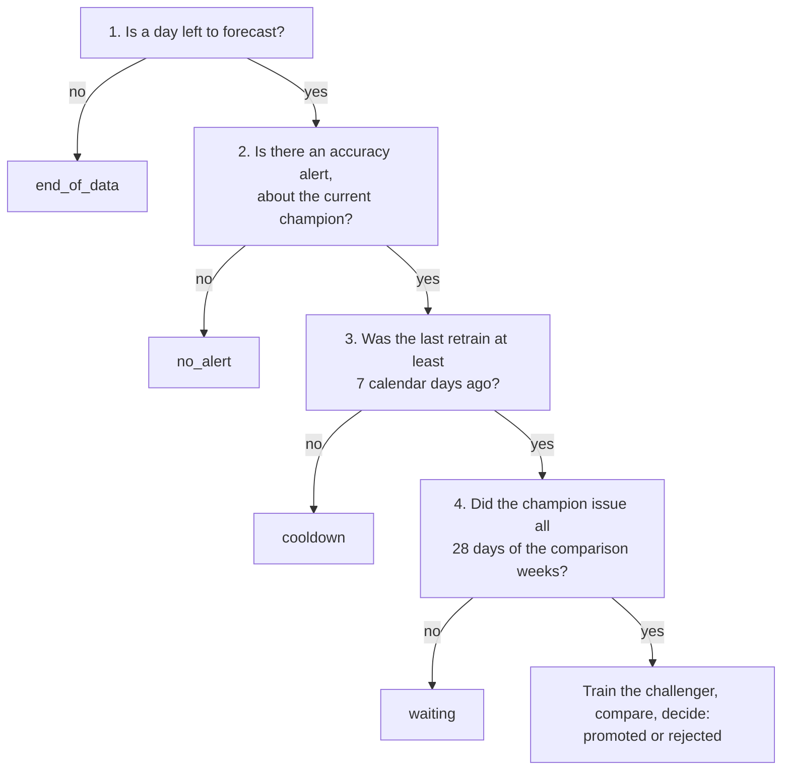

# Chapter 37 – Retraining, and a rule that was not changed

Version 2 stopped learning on 30 April, and in late May its accuracy alert fired (Chapter 36). Should a model trained on May replace it? This chapter shows when a new model is trained, what it may learn from, how it is compared with the champion, and what happened when the rule was nearly changed during the test.

## What you will learn

- Why a model is retrained, and why only on the accuracy alert.
- The four checks that decide whether a retrain starts.
- The cutoff: the last day a new model may learn from.
- How a frozen champion and a retrained recipe are compared fairly, and where the comparison still leans.
- Why a rule that looked too strict was not loosened, and what the replay with retraining gave.

## Why retrain, and when

A model learns the world up to its last training hour. Its inputs stay fresh, because the lags read the newest pickups, but what it learned gets older every day. **Retraining** means training the same recipe again on newer data: the same features, parameters and 20 zones, with a later end of training. Nothing is tuned.

Every retrain costs a training run and adds a version to judge, so the project retrains only for a reason: the accuracy alert. Chapter 36 decided that drift only warns. The code is in [`src/demand/flows/retrain_flow.py`](../../src/demand/flows/retrain_flow.py), and this chapter follows its long module docstring.

## Four checks, in order

At a step whose "now" is 00:00 on day X, the code runs four checks in a fixed order. The first that fails ends the evaluation, and its name becomes the outcome in `reports/retrain_report.json`.



*Figure 37.1 – The four checks before a retrain.*

**1. End of data.** A model trained after the last forecast would serve nothing.

**2. An alert about the champion.** Only `accuracy.alert` is read, and it must be about the version that is champion now. An alert about an older version is no reason to replace the current one.

**3. The cooldown.** A **cooldown** is a period after an action in which the action is not repeated. Without it, an alert that lasts five days would train five challengers, judged on nearly the same weeks. The config sets `monitoring.retrain_cooldown_days: 7`. There is no state file: every retrain writes the tag `retrain.now` onto the version it registers, promoted or not, and the code reads the newest of these tags from the registry. As with the clock of Chapter 34, a fact stored once cannot disagree with a copy.

**4. Waiting.** The comparison below needs the champion's own forecast for each of the 28 days before the cutoff. So a champion is never judged before it has served the four weeks it is judged on.

The fourth check explains a delay. The alert fired first as of 27 May, but the first champion forecast only from 2 May (Chapter 34):

| As of 00:00 on | Comparison weeks | Days without a forecast of the champion |
|---|---|---|
| 27 May | 29 April to 26 May | 3 (29 April, 30 April, 1 May) |
| 28 May | 30 April to 27 May | 2 |
| 29 May | 1 to 28 May | 1 |
| 30 May | 2 to 29 May | 0: the retrain runs |

*Figure 37.2 – Why the alerts of 27 to 29 May waited. From the reasons in the simulation log described below.*

## The cutoff

The **cutoff** is the last day a new model may learn from. For a retrain at 00:00 on day X it is X − 1, the last whole day that is over. The code copies the settings with `data.train_end_date` moved to the cutoff (`challenger_settings`) and trains with them. The rule is the one of Chapter 26: a model may not learn from pickups that did not exist when it makes its first forecast.

| Moment | What happens |
|---|---|
| Thu 29 May, 23:00 | The challenger's last training hour starts. It is complete at 00:00 on 30 May. |
| Fri 30 May, 00:00 | "Now". The step issues the forecast for 31 May with the champion, scores 29 May, runs monitoring, then trains the challenger. |
| Sat 31 May, 00:00 | The next step issues the forecast for 1 June, by the new model if it was promoted. |
| Sun 1 June, 23:00 | The last hour of that forecast. It reads pickups up to 30 May, 23:00 (48 hours). |

*Figure 37.3 – The timeline of the retrain of 30 May.*

Every training target had ended by "now", a day before the new model's first forecast. The forecast for 31 May comes from the champion, because it is due at "now" and is not held back while a model trains.

## The comparison

### Why a backtest of both would be a tie

The obvious test is to backtest both on the same folds. But they are the same recipe, and the same code on the same rows gives the same model (Chapter 25). They would tie, and the gate never promotes a tie (Chapter 29).

### The fair question

The real question is: *would a model that kept learning from the newest weeks have done better than the frozen champion did?* The code scores three forecasters on the four weeks before the cutoff, 2 to 29 May for the retrain of 30 May:

- **The champion**, by the forecasts it really issued, from `data/predictions/scored/`. Each was issued at 00:00 on the day before, by a model fitted on April.
- **The challenger's recipe**, by a backtest of the same four weeks as four folds of its settings: an expanding window, each fold model trained up to 48 hours before its first test hour (Chapter 23).
- **The weekly baseline**, on the same rows.

All three are scored on exactly the same 13,440 zone-hours: 28 days, 24 hours, 20 zones. The function `comparison_table` checks this instead of assuming it: the same keys on all three sides, the same pickups in the replay and in gold, the same `lag_168h` in the replay's inputs and in gold. Otherwise it raises `ComparisonError`, and nothing is trained. Then the rule of `promotion.py` applies unchanged: a pooled MAE at least 0.2 lower than both the champion's and the baseline's, and no fold higher than either.

### Fair, and where it leans

Both sides use only what existed at their issue moment. What differs is the age of the model. In these weeks the champion is 1 to 29 days old. A fold model is 2 to 9 days old, because the backtest refits every week. That difference is what a retrain offers, so it is what should be measured.

The comparison still leans towards the challenger in two ways, which the margin only partly offsets. First, a promoted model is frozen too and gets older, while the backtest refitted every week. Second, the retrain is triggered *because* the champion did badly in the last week, and that week is one of the four. Part of a bad week is bad luck, so the champion's live MAE there is probably higher than its next weeks will be.

## A rule that was not changed

The engineer simulated the replay with retraining on a copy of the MLflow store, in a temporary clone of the repository, because a challenger is trained only from a clean git commit. The real store and the real replay were not touched.

Before that run, the engineer had relaxed the rule against the champion: only the pooled margin of 0.2, without "no fold higher". The argument was about fold 1. For the retrain of 30 May, the fold-1 model learned from the rows up to 30 April, 00:00, and the champion from the rows up to 30 April, 23:00: the same recipe, 23 hours apart. Their difference in that week is close to noise, and "no fold higher" has no margin. There the challenger was higher in fold 1 by 0.17.

Under the relaxed rule, the retrain of 30 May was still rejected, because it was worse overall, and the retrain of 25 June was promoted. It served four days, 27 to 30 June, with an MAE of 29.385, against 27.357 for version 2 on the same days (the engineer's measurement; version 2's number can be recomputed from the scored files). Four days prove nothing in either direction.

The lead engineer reversed the change. The rule was fixed in Phase 2, before the replay. A rule loosened while the replay runs, in a way that flips its result, is the same mistake as tuning on the **test set**, the data that judges and must not take part in decisions (Chapter 27 measured what such tuning costs). Here the test set is the replay.

Two details keep the story honest. The change was coded before the simulation ran, so it was not chosen to pass a known result; but the data of May and June had already been seen in the replay and in monitoring. And fold 1 of 25 June was no near-tie: that fold's model had learned from the rows up to 26 May, 00:00, about 25 days more than the champion.

The argument is kept in the docstring under "A known weakness of the rule", with its numbers. Whether "no fold higher" should apply against live forecasts is for the owner to decide, on new evidence, before a new replay.

## The result under the restored rule

The engineer ran the simulation again with the restored rule, and the lead read the logs. There were two retrains, and the gate rejected both.

| Retrain at 00:00 on | Forecaster | Fold 1 | Fold 2 | Fold 3 | Fold 4 | Pooled |
|---|---|---|---|---|---|---|
| 30 May (2 to 29 May) | Challenger, version 3 | 25.72 | 24.23 | 26.79 | 38.21 | 28.73843 |
| | Champion's live forecasts | 25.55 | 27.98 | 28.26 | 32.47 | 28.567313 |
| | Weekly baseline | 26.48 | 28.68 | 28.68 | 46.62 | 32.61436 |
| 25 June (28 May to 24 June) | Challenger, version 4 | 26.11 | 24.42 | 23.89 | 27.70 | 25.528666 |
| | Champion's live forecasts | 25.73 | 28.78 | 22.64 | 31.29 | 27.108507 |
| | Weekly baseline | 36.95 | 28.17 | 26.41 | 31.56 | 30.772619 |

*Figure 37.4 – The two comparisons, 13,440 zone-hours each. From the engineer's simulation log; the champion's rows can be recomputed from `data/predictions/scored/`.*

On 30 May the challenger was worse than the champion overall, by 0.17, and higher in folds 1 and 4. On 25 June it was better overall by 1.58, far beyond the margin, but higher in folds 1 and 3. Both beat the baseline in every fold. On 31 May and 26 June the alert was still on, and the outcome was `cooldown`.

Version 2 served every day, and all 180 replay files of the simulation are byte-identical to the replay without retraining. The two steps with a retrain took 79 and 84 seconds on a quiet machine. The store copy ended with `champion` on version 2 and `challenger` on version 4.

Was the rejection of 25 June the weakness the engineer described, or the rule doing its job? This replay cannot tell, because it has already been used to look at the question.

## Rollback stays by hand

An automatic rollback would have to show that the new champion is worse than the old one *on the same days*. Only one model serves, so the old one forecast none of them, and live MAEs of different weeks measure the weeks, not the models.

An honest automatic rollback needs **shadow forecasts**: forecasts of the old champion, issued every day next to the served ones, stored and scored, and shown to nobody. They are not built. So a rollback stays a person's decision, with `set-champion` (Chapter 29). A new champion that falls behind still raises the alert, and after four weeks it faces a retrained challenger.

## What is not handled

- **A crash between two writes.** The training code registers the version, then the flow writes its `retrain.now` tag. A crash between them leaves a version that the cooldown does not see.
- **The nights the clocks change.** Around the night the clocks go back, the issue moment is 01:00 (Chapter 30). May and June have no such night, and the retrain was not tested on one.
- **Prediction drift after a retrain.** Its reference is the April backtest of the first training, whose MAE does not match the one recorded for a retrained version, so the check reports "not evaluated".

Chapter 38 adds an **orchestrator**, Prefect: a program that starts the daily step on a schedule. The step is already one function, `run_day`: forecast and score, monitor as of the same moment, retrain if needed. The simulation was that function in a loop, and the scheduled flow is the same loop with a clock in front of it.

## Try it yourself

Recompute the champion's side of Figure 37.4 for 30 May from the real replay files.

```powershell
.venv\Scripts\python.exe -c "import pandas as pd; t = pd.read_parquet('data/predictions/scored'); t['day'] = t.hour_start.dt.tz_convert('America/New_York').dt.tz_localize(None).dt.normalize(); w = t[t.day.between('2025-05-02', '2025-05-29')]; e = (w.forecast - w.actual).abs(); print(len(w), w.model_version.unique().tolist(), round(e.mean(), 6), e.groupby((w.day - pd.Timestamp('2025-05-02')).dt.days // 7 + 1).mean().round(6).to_dict())"
```

You should see `13440 ['2'] 28.567313 {1: 25.553997, 2: 27.979863, 3: 28.261526, 4: 32.473864}`. The challenger's side needs the simulation, which is not in the repository.

The command decides at the issue moment of the newest forecast, 00:00 on 29 June, and first runs monitoring as of that moment, which writes its own report. So point the reports at a scratch folder.

```powershell
$env:DEMAND_PATHS__REPORTS_DIR = "$env:TEMP\retrain"
.venv\Scripts\python.exe -m demand retrain
Remove-Item Env:DEMAND_PATHS__REPORTS_DIR
```

This command was not run for the book. From the code and the tests, after a `"monitoring evaluated"` line, the line `"retrain evaluated"` should have `"now": "2025-06-29T00:00:00-04:00"`, `"outcome": "end_of_data"`, the reason `No day is left to forecast after 2025-06-30, so a new model would serve nothing.`, `"champion": 2` and `"challenger": null`. The simulation gave the same reason at that moment. Nothing is trained.

Run the tests of the retrain.

```powershell
.venv\Scripts\python.exe -m pytest tests/unit/flows/test_retrain_flow.py -q
.venv\Scripts\python.exe -m pytest tests/unit/flows/test_retrain_flow.py -q -k "higher_fold or not_the_champion"
```

You should see `33 passed, 12 warnings`, then `3 passed, 30 deselected, 11 warnings`. The warnings come from libraries, as in Chapter 10. The three tests check that one higher fold rejects a challenger, against the champion and against the baseline, and that an alert about another version triggers nothing.

## Key takeaways

- Retraining trains the same recipe on newer data. Four checks come first: end of data, an alert about the champion, the cooldown (from the `retrain.now` tags), and waiting.
- The cutoff is the day before "now", so every training target ended before the new model's first forecast.
- The champion is scored by its real forecasts, the retrained recipe by a backtest of the same four weeks, on the same 13,440 zone-hours. The comparison leans towards the challenger.
- Loosening a rule during the replay, in a way that flips its result, is tuning on the test set. The rule was restored, and both retrains were rejected.
- Rollback stays by hand until shadow forecasts exist.

## Exercises

**1.** Suppose the alert were on as of 3 June, with the last retrain at 00:00 on 30 May. What is the outcome, and on which day could a retrain run first?

<details>
<summary>Answer</summary>

`cooldown`: 3 June is 4 calendar days after 30 May, and the config asks for 7. The first possible day is 6 June, if the alert is still on, and if the champion issued every day of 9 May to 5 June, which version 2 did.

</details>

**2.** A colleague says: "On 25 June the challenger was better by 1.58. Promote version 4 by hand." What do you answer?

<details>
<summary>Answer</summary>

The rule, fixed before the replay, rejected it, and the gain comes from a comparison that leans towards the challenger: weekly refits, and a window that holds the bad week. The four days of version 4 in the relaxed run prove nothing either. `set-champion` needs a reason, and it should be evidence the replay did not provide.

</details>

**3. Interview question.** "How does your system decide that a retrained model should replace the one in production?"

<details>
<summary>Points of a good answer</summary>

- Retrain only on an accuracy alert, with a cooldown, once the champion has served the comparison weeks.
- A cutoff so that no training target lies after the new model's first forecast.
- The champion's real forecasts against a backtest of the retrained recipe and a baseline, on the same rows, checked in code; and where that comparison leans.
- No rule changes while the hold-out is in use. Rollback by hand, until shadow forecasts exist.

</details>

---

[Previous: Chapter 36 – Alerts that mean something, and the numbers in Grafana](36-alerts-that-mean-something.md) | [Contents](README.md) | [Next: Chapter 38 – A clock that starts the day: scheduling with Prefect](38-a-clock-that-starts-the-day.md)
