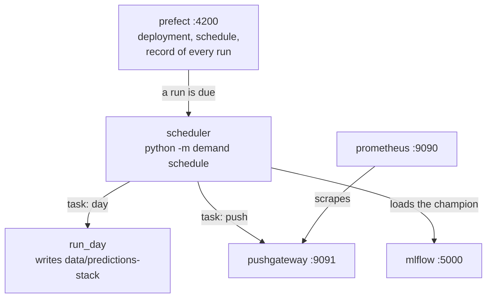

# Chapter 38 – A clock that starts the day: scheduling with Prefect

Since Chapter 34, every day of the replay started because a person typed a command. In production nobody types at one o'clock at night. Something must start the daily step once a day, never run it twice at the same time, and keep a record. This chapter shows the program that does this, what it adds to the earlier code, and two real problems found while it was set up. It closes Part VII.

## What you will learn

- What an orchestrator does, and why this project has both DVC and Prefect.
- Flows and tasks, and which step is retried and why.
- What a schedule means on data that ended in 2025, and how two runs are kept apart.
- What happens when a flow runs without a Prefect server.
- A server that failed with a newer version of its own database library, and an image pinned too early.

## What an orchestrator does

The daily step already exists: `run_day` of Chapter 37, which forecasts and scores, monitors, and retrains if due. An **orchestrator** is a program that runs such steps for you. It has four jobs.

1. It starts the step on a **schedule**: a rule that says when runs are due.
2. It runs one step at a time when two runs would harm each other.
3. It records every run: when it started, how it ended, and its log lines.
4. It repeats a failed step, but only where repeating is safe.

A timer of the operating system does only the first job. The orchestrator here is **Prefect**, version 3.8.8. The code is in [`src/demand/flows/orchestration.py`](../../src/demand/flows/orchestration.py), and this chapter follows its module docstring.

## Two tools that call the same functions

Chapter 21 gave the pipeline to DVC. Why a second tool? The two answer different questions.

| | DVC | Prefect |
|---|---|---|
| Starts a step when | an input file or config key changed | the clock says a run is due |
| Knows about | files and their checksums | runs, their states and their logs |
| Used here for | building `data/` and training | the daily step |

*Figure 38.1 – The two tools side by side.*

The daily step cannot be a DVC stage, because it reads its own earlier files (Chapter 34), and DVC starts nothing at 01:00 by itself. Prefect, in turn, does not know which files changed. The rule of [`docs/architecture.md`](../../docs/architecture.md) is that both call the same functions, so no logic exists twice.

## Flows and tasks

A **flow** is a Python function that Prefect runs and records as one run. A **task** is a function called inside a flow that Prefect records as a run of its own, with its own state, time and retries. Both are made with a decorator (Chapter 9).

```python
day_task = task(name="day", cache_policy=NO_CACHE)(run_day)
push_task = task(
    name="push to the pushgateway",
    retries=PUSH_RETRIES,
    retry_delay_seconds=PUSH_RETRY_DELAY_SECONDS,
    cache_policy=NO_CACHE,
)(push)


@flow(name=FLOW_NAME)
def daily_step(days: int = 1, push_to: str | None = None) -> list[DayDone]:
    return run_days(get_settings(), days, push_to, day=day_task, push_report=push_task)
```

The work is in `run_days`, which is plain Python. It loads the data snapshot once, calls the daily step `days` times, stops at the end of the data, and sends each day's monitoring numbers to the Pushgateway if an address is given. The flow passes it two tasks: `run_day` as `day`, and `push` of Chapter 36. The tests pass fake functions instead, so most of them need no Prefect.

So the flow is a thin wrapper. Without Prefect, `run_days` still works, and nothing a day does changes. Tasks exist only where they buy something: one record per simulated day, and a retry for the push.

### Which step is retried

The push has **2 retries**, 10 seconds apart. It is one HTTP PUT, which replaces all the numbers of its group (Chapter 36), so sending it twice leaves the same numbers. And its usual failure passes by itself: the Pushgateway is restarting.

The day has **no retry**. Most of its failures are not transient errors (Chapter 14): a missing file, a retrain refused by a rule, no version marked `champion`. Ten seconds later they fail again.

There is a second reason, which comes from the clock. The clock is the folder of forecasts, and a day writes its forecast first. Follow two failures.

1. No version is marked `champion`. Nothing is written, the clock stays, and the next run tries the same day.
2. A retrain is refused after the forecast for 31 May was written. The clock now stands at 31 May. The next run forecasts 1 June, and asks the retrain question again at that "now".

Nothing is lost or written twice. But in the second case a retry would not repeat the day: it would move the clock one more day.

### No cache

By default Prefect computes a key from the inputs of a task and reuses an earlier result with the same key. The day's inputs, the settings and the snapshot, are the same every day, but each call does another day. `cache_policy=NO_CACHE` turns this off, and a test checks both tasks.

### The reference, computed once per run

Prediction drift compares the forecasts with a **reference**: the backtest's forecasts, computed again by fitting four models (Chapter 35). `run_days` wraps that function in `OnceReference`, which computes it once and keeps it for the rest of the run. In the ten-day run described below, each day's log line carried the field `reference_computed`:

| "Now" (00:00 on) | Forecast for | `reference_computed` | Monitoring took |
|---|---|---|---|
| 1 May | 2 May | 0 | 0.1 s |
| 6 May | 7 May | 0 | 0.1 s |
| 7 May | 8 May | 1 | 16.1 s |
| 8 May | 9 May | 1 | 0.9 s |
| 10 May | 11 May | 1 | 1.0 s |

*Figure 38.2 – Five of the ten days, from the line `monitoring evaluated` of the run for this book. The reference is first needed when seven days are forecast. The engineer's run spent 14.5 seconds on it.*

Does a new champion make the kept reference wrong? No. It depends only on the training rows and the settings, which a run does not change. The check compares its MAE with the backtest MAE that the registry holds for the version that issued the forecasts, and that version is looked up again every day. If the rows or the settings did change, `OnceReference` computes it again; a test checks this.

## The schedule, honestly

`python -m demand schedule` takes exactly one of two schedules. An **interval** schedule makes a run due every N minutes: `--every-minutes 1`. A **cron** schedule is a line of five fields, minute, hour, day of month, month and day of week, named after the Unix tool cron: `--cron "0 1 * * *"` means 01:00 every day.

Each run moves the simulated clock by `--days` days, one by default, whatever the date on the wall. So:

- **One run a minute** is a demo. May and June pass in about an hour. It shows the mechanism, not the timing of production.
- **`"0 1 * * *"`** is what production would look like. On this data it would take 60 real days. It is written down to show the shape, not to be run.

After 30 June a run does the closing step, which changes nothing, so a schedule left running is harmless.

## Never two runs at once

Two runs on the same files would forecast the same day, and could train two challengers at once; the retraining code has no lock. In the demo this is real: Chapter 37 measured 79 and 84 seconds for the steps with a retrain, longer than a minute.

So `serve_daily_step` sets two limits. `limit=1` lets the process run one flow run at a time. `global_limit`, with `limit=1` and `ConcurrencyLimitStrategy.CANCEL_NEW`, is a **concurrency limit** on the server: at most one run in progress, and a run that becomes due meanwhile is cancelled, not queued.

Cancelling loses nothing. Suppose the retrain of 30 May takes 80 seconds. The run due a minute later is cancelled. The next one finds forecasts up to 31 May and forecasts 1 June, as if nothing had been skipped.

A **deployment** is a flow registered with the Prefect server, with its parameters and schedule. `daily_step.serve(...)` registers it under the project's name and keeps the process alive, asking the server for due runs and running them itself. The other way is a **work pool** with a **worker**, which starts each run on infrastructure chosen per run, such as a new container. One flow on one fixed machine needs only `serve()`.

## Without a server: ephemeral mode

With no `PREFECT_API_URL` set, `daily_step()` still works: Prefect starts a temporary server for the run, its **ephemeral mode**. The run for this book printed `Starting temporary server on http://127.0.0.1:8707`, and the server answered 17 seconds later. Its database goes under `PREFECT_HOME`, which is `~/.prefect` unless set.

The tests must not write into your `~/.prefect`. The fixture `prefect_home` in [`test_orchestration.py`](../../tests/unit/flows/test_orchestration.py) points `PREFECT_HOME` and the database to `tmp_path`, removes the server address, and stops the temporary server at the end. Prefect's own helper, `prefect_test_harness`, was tried first and failed at exit on Windows with a `PermissionError`.

## Two findings

### A server that could not schedule

The first Prefect server of the stack ran from the pipeline image, with the project's own lock. It started and answered, and never created a run. Every attempt of its scheduler failed with:

```text
sqlalchemy.exc.InvalidRequestError: Can't evaluate bulk DML statement
```

SQLAlchemy is the database library of Prefect's server. `requirements.lock` pins 2.1.4, which Prefect 3.8.8 accepts. The official image `prefecthq/prefect:3.8.8-python3.12` ships 2.0.45, and with it scheduling worked at once. So the stack runs the server from that image, pinned by tag and digest, as root, as published; the scheduler stays in the pipeline image as a client.

The lesson: a library accepts a range of versions of its dependencies, and its tests do not cover the whole range. A lock file pins what you tested together. Mix a lock with someone else's server, and you must test the server too.

### An image younger than the rule

The project's rule is that a pinned image or package is at least two weeks old, so that others find a broken release first. The 3.8.8 image was pushed on 6 October 2026, the day the release reached PyPI. It was 12 days old when pinned, and so was the pin of Prefect 3.8.8 in `requirements.lock`. This is a known exception.

## What was run

**On the host.** The engineer ran `daily_step(days=10)` on a scratch copy of the data and a copy of the MLflow store, champion version 2, in 39 seconds. It wrote 28 files: forecasts and inputs for 2 to 11 May, scores for 2 to 9 May, all byte-identical to the real replay. Repeated for this book, the 28 files were again identical; on a busier machine it took 73 seconds.

**In the stack.** The lead engineer started the services, then the scheduler:

```powershell
docker compose up -d --wait mlflow prefect pushgateway prometheus grafana
docker compose --profile schedule up -d scheduler
```



*Figure 38.3 – The scheduled daily step in the stack.*

Within about three minutes three flow runs had finished, one per minute, each with a task `day` and a task `push to the pushgateway`, and each logged `Finished in state Completed()`. For this book the commands were run again from an empty `data/predictions-stack`: the first run began 79 seconds after the container started, and each took about five seconds. Both times the folder then held forecasts for 2, 3 and 4 May, and Prometheus showed the target `demand-monitoring` up, `demand_monitoring_now_timestamp_seconds` at 1746244800 (00:00 on 3 May 2025 in New York) and `demand_monitoring_alert{check="accuracy"}` at 0.

The stack forecasts with its own champion, version 1, trained in the stack (Chapter 33). Compared with the host's version 2 on the 480 rows of 3 May, 477 are equal to the last bit and 3 differ by at most 2.8e-14. Chapter 33 found bit-identical forecasts, but for the 24 hours of one zone, through the API. The Linux and Windows builds of the libraries can differ in the last binary digit of a few rows.

One thing did not work as the Compose file says. `PREFECT_LOGGING_EXTRA_LOGGERS: demand` should send the project's log lines, such as `day done at ...`, to the Prefect UI. They reached neither the UI nor the container's output. Prefect sets up its own logging and leaves the logger `demand` at the level WARNING, so the INFO lines are dropped. This was found while writing this book and was reported.

**A retrain in the container** was not run. It would be refused: `check_clean_checkout` finds that the mounted checkout has uncommitted changes, and the gate of Chapter 29 cannot promote a model trained from changed files. That is correct.

## Part VII, closed

Phase 5 built four things on the served model: a replay of May and June (Chapter 34), monitoring in which only accuracy alerts (Chapters 35 and 36), retraining judged by the gate (Chapter 37), and a schedule that starts the daily step and records every run.

Phase 6 moves the stack to Kubernetes. A **CronJob** starts a container on a cron schedule. It can call `run_days` directly or keep Prefect. Its `concurrencyPolicy: Forbid` is the idea of `CANCEL_NEW`: a new run is skipped while the last one runs. And the clean-checkout check needs the commit baked into the image, because a cluster has no checkout to mount.

## Try it yourself

```powershell
.venv\Scripts\python.exe -m pytest tests/unit/flows/test_orchestration.py -q
```

You should see `19 passed, 11 warnings` after about half a minute, most of it for the temporary server. The warnings come from libraries, as in Chapter 10. Now ask for a schedule that makes no sense.

```powershell
.venv\Scripts\python.exe -m demand schedule --every-minutes 1 --cron "0 1 * * *"
$LASTEXITCODE
```

After some seconds and an informational line from MLflow, you should see `Error: Give exactly one schedule: every_minutes or cron.` and `1`. Nothing reached a server.

For the demo, set up the stack's champion as in Chapter 33, run the two `docker compose` commands above, and open `http://localhost:4200`. After three minutes:

```powershell
Get-ChildItem data\predictions-stack\forecasts -Name
docker compose --profile schedule down
docker compose ps -a
```

The first command lists one file per completed run, from `2025-05-02.parquet`. The last prints only its header line.

## Key takeaways

- An orchestrator starts steps on a schedule, one at a time, records every run and retries what is safe. DVC runs what changed, Prefect runs on the clock, and both call the same functions.
- The flow is a thin wrapper. Tasks exist where they buy something: one record per day, and a push retried because a PUT is safe to repeat.
- The day is not retried: its failures do not pass, and the clock carries on safely at the next run.
- One run a minute is a demo; production is a nightly cron. A run due during another is cancelled, and nothing is lost.
- The project's lock broke the Prefect server, the official image worked, and it was pinned before the two-week rule allowed.

## Exercises

**1.** A colleague sets `retries=3` on the task `day`, "to be safe". What happens on a day when the retrain is refused because the checkout has uncommitted changes?

<details>
<summary>Answer</summary>

The forecast is written before the retrain check, so the clock has moved. Each retry forecasts the next day and, while the alert stays on, is refused again: the cause is a fact of the checkout, not a passing problem. One run could forecast four days and still end as failed. Without retries, each run does one day and reports the refusal until someone commits.

</details>

**2.** Why is `CANCEL_NEW` safe here, when in many systems a skipped run means lost work?

<details>
<summary>Answer</summary>

A run does not carry "its" day. It reads the folder of forecasts and does the next missing day, so a cancelled run leaves no hole. Where each run is tied to a date, such as "the orders of 5 June", a skipped run must be run again for that date.

</details>

**3. Interview question.** "How do you schedule a model's daily batch job, and what can go wrong?"

<details>
<summary>Points of a good answer</summary>

- An orchestrator or a CronJob that calls a function which also runs without it.
- One run at a time, a policy for runs that come due meanwhile, and steps that are safe to repeat.
- Retries only for transient failures, such as a network call.
- A record of every run, and the numbers pushed to monitoring.
- Versions pinned and tested together, including the orchestrator's server.

</details>

---

[Previous: Chapter 37 – Retraining, and a rule that was not changed](37-retraining-and-a-rule-that-was-not-changed.md) | [Contents](README.md) | [Next: Appendix A – Stack map](appendix-a-stack-map.md)
